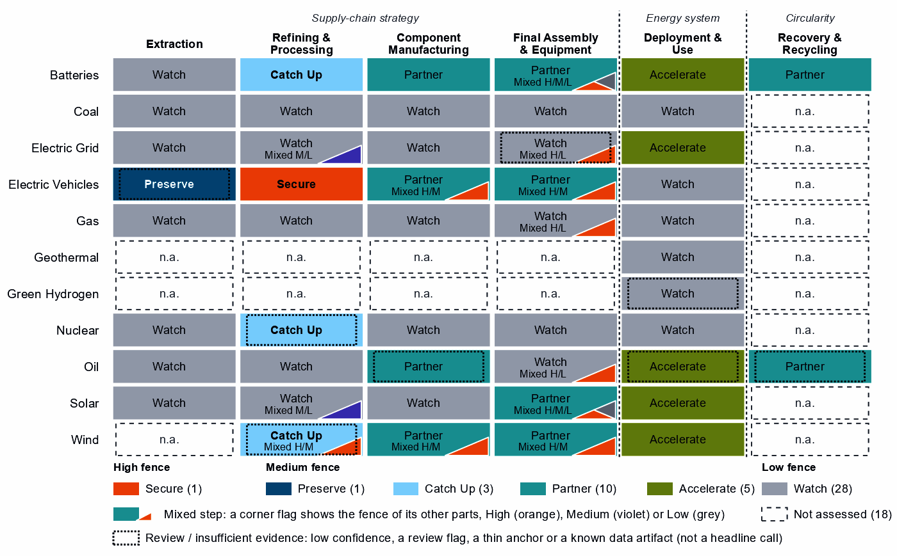
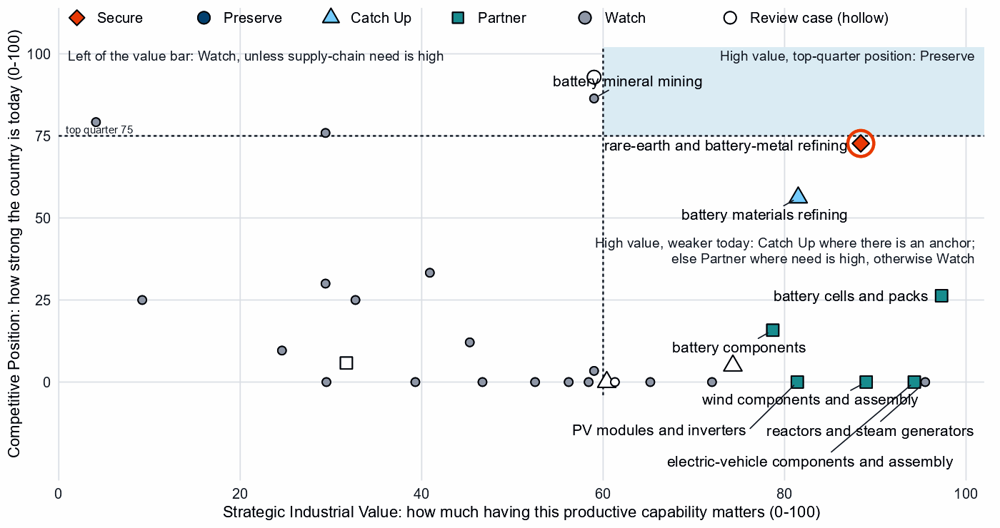
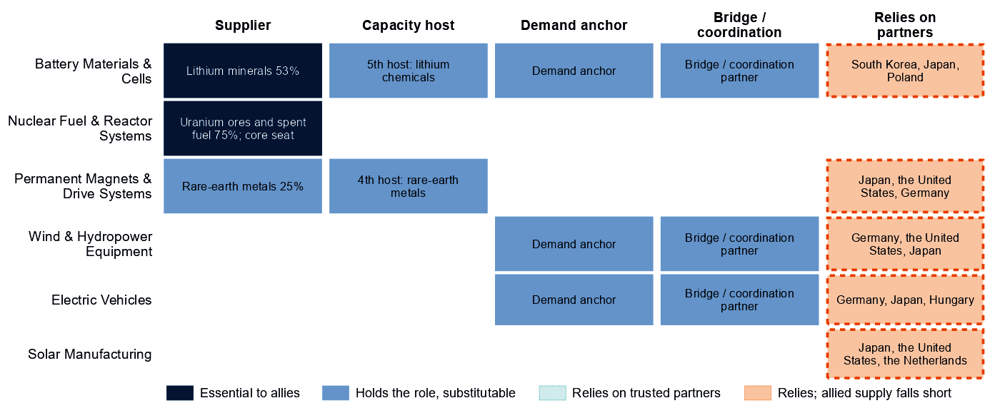
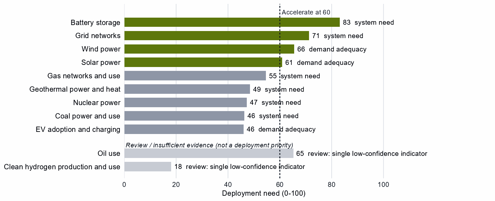

# Australia and the Allied Industrial Base

*What to secure, build, source from partners, and deploy*

*Generated from Allied Industrial Base Explorer data; evidence, sources and caveats in the appendix. Data as of 30 October 2026.*

## 1. Bottom line — Australia's strategic role

Australia's distinctive role in the Allied Industrial Base is as its trusted supplier of critical minerals: it holds the largest allied position in battery and EV minerals, and 52 economies have it as their best-placed trusted partner for battery minerals. That is an allied role first: nationally, those two mining steps read Watch and a low-confidence Preserve. Its domestic industrial effort should go one step down from the mine, into battery materials refining and the rare-earth chain, where it has operating capacity and committed investment to build on. For battery cells, EV drivetrains, wind turbines and solar inverters it should depend deliberately on trusted producers, which hold more capacity than Australia though not yet enough. Its development cooperation can help developing partners with credible pathways add that capacity. The larger domestic task is deployment: storage, grid, wind and solar all need to be built faster, and buying equipment competitively serves that build-out better than localizing it. The fence that matters is narrow but high: the rare-earth chain, and the control software that can command Australia's grid, batteries, inverters and turbines. [1]

- **Secure.** The rare-earth chain from separation to magnets, where China holds 94% of world refining supply and trusted suppliers only 4%; the control software of grid equipment, inverters, batteries and turbines; and the control systems of gas and oil networks. The answer is qualified trusted supply and control of command paths, not self-sufficiency. [2]
- **Build / preserve.** Catch Up in battery materials refining (lithium chemicals, cathode and anode), the best-anchored case for building. Build rare-earth separation and metal-making on the mining base. Keep mineral supply reliable for the allies that depend on it: an allied commitment, not a domestic fence.
- **Partner.** Battery cells, packs, components and recycling, EV drivetrains and vehicles, wind turbines and their parts, solar inverters, and solar-grade polysilicon. Source them from trusted producers, such as South Korea, Japan and Poland for battery components and Germany, the United States and Japan for wind parts. Where allied supply falls short, add trusted capacity through co-investment and, with developing partners, development finance and offtake. [1, 2, 3]
- **Deploy / stay open.** Accelerate battery storage, grid networks, wind and solar power. Buy commodity hardware competitively from trusted suppliers, with security conditions on equipment that carries built-in control. Leave open reactors, nuclear fuel and reactor parts, wafers and PV cells, and gas and oil plant equipment.

Figure 1 has a simple shape. The color sits in the first two columns, where Australia mines and refines, and in deployment, where it must build faster. The manufacturing columns are mostly Partner or Watch. The orange corner flags mark High-fence parts inside other steps: control software in battery, solar, wind, vehicle, grid, gas and oil equipment, and the rare-earth magnets and separation in EV drivetrains and wind. They are why imported hardware can still sit partly behind a high fence.

**Figure 1. Where Australia should secure, build, partner or stay open**

*Each cell is one supply-chain step of a technology, colored by its strategic choice. A corner flag marks a mixed step whose named parts sit behind a different fence: in battery cells and packs, the battery software is Secure, the cells Partner and the enclosures Watch. A dotted outline marks a review case, a call resting on low confidence, a review flag, a thin anchor or a known data artifact; this brief does not turn those calls into recommendations. Steps marked n.a. lack the data for a call. [1]*

## 2. Where Australia should secure, compete and stay open

### High fence — what cannot fail

Secure is a narrow call for Australia: one whole step and 13 layers inside other steps, which group into the four capabilities below. Secure does not mean making everything at home. It means being able to survive a prolonged cutoff or a hostile command, through qualified trusted supply, stocks, redundancy or control of the command path. Each capability pairs a measured chokepoint or remote command path with assets that Australia or its allies depend on. [1]

| Capability | Why it matters | Main vulnerability | Recommended response |
|---|---|---|---|
| The rare-earth chain: separation, metals and magnets | Feeds the magnets of EV motors and wind generators; Australia mines the ore and has operating refining capacity. | China holds 94% of world refining supply and trusted suppliers 4%; substitution is hard and rebuilding takes more than three years. Australia has no magnet-making position. | **Mixed.** Scale domestic separation and metal-making on existing capacity and committed investment; build the step to magnets with allied partners through co-investment and offtake; hold stocks until trusted supply qualifies. |
| Control software of grids, inverters and batteries | Firmware, energy-management and grid-control software can command, update or disable equipment from abroad. | About half the hardware comes from China: 56% of PV module and inverter imports and 49% of battery cells and packs. | **Mixed.** Domestic trusted-source and certification rules for firmware, communications and remote access; trusted vendors where control is built into the hardware, as in inverters and battery management. |
| Remote access to wind turbines and vehicles | Turbine controllers, park control and connected-vehicle software reach large energy assets and fleets from outside the country. | China supplies 53% of wind turbine imports and 36% of EV and charger imports. | **Mixed.** Restrictions on remote access and over-the-air updates by untrusted vendors; turbines from trusted makers such as Germany, South Korea and Italy, vehicles from makers such as Germany, the United States and South Korea. |
| Control systems of LNG terminals and oil and gas pipelines | Australia supplies 12% of world gas and is the best-placed trusted partner of 5 economies for it; terminal and pipeline control can be disrupted remotely. | Control-system risk on assets that Australia and its gas customers depend on. | **Mixed.** Domestic rules on access and updates; certified trusted vendors for control systems. |

Sources: 1, 2, 3, 4.

### Medium fence — where industrial capability matters

This is where Australia makes its real industrial choices. Two questions decide each step: is the capability worth having (Strategic Industrial Value), and how strong is Australia today (Competitive Position)?

**Preserve.** No Preserve call clears the evidence bar. EV mineral mining reads Preserve on a top-quarter Competitive Position, but the call is flagged for review by the engine, and battery mineral mining reads Watch. The table below treats them as a single capability: the national call stays open, while allies rely on Australia as their largest holder. What keeps it strategic is reliability and the processing that follows it, not a domestic fence. [1]

**Catch Up.** Battery materials refining is the clearest case for building. Its value is high and its position below the top quarter, and it rests on five capability anchors, from operating capacity to committed investment. China holds 94% of world supply and provides 50% of Australia's imports, so trusted capacity here is scarce for every ally. Lithium hydroxide and carbonate, cathode and anode materials are all Catch Up. Rare-earth and wind materials refining and uranium conversion and enrichment also read Catch Up, but they rest on a thin capability anchor (corroborated by context signals only) and a known data artifact; both are review cases, listed in the appendix. [1, 2]

**Partner.** The equipment Australia installs is worth having, but Australia holds almost none of world supply in it and has no capability anchor to build from, so duplicating it would be slow and costly. Dependence should be deliberate and spread across several trusted producers: Poland, Hungary and the United States for cells and packs, Germany, Japan and Hungary for EV drivetrains, and Germany, the United States and Japan for wind components. In battery cells and packs, EV drivetrain components, wind turbines, and PV modules and inverters, allied supply falls short, so a purchase-only strategy will not hold. Solar-grade polysilicon belongs here too: source it deliberately from trusted producers rather than build it. [1, 2, 3]

**Shared capabilities.** Some physical capabilities sit in several technology chains, and their calls differ because supply-chain need or evidence differs by technology. The table keeps the national reading apart from what allies rely on Australia for.

| Shared capability | Steps and their choices | National reading | AIB role |
|---|---|---|---|
| Lithium minerals | battery mineral mining (Watch) and EV mineral mining (Preserve, review: flagged for review by the engine) | Watch; the Preserve call is a review case | Supplier: 53% of world exports or production of lithium minerals (the AIB measure of the product, not a step's share); the largest allied holder of the step |
| Rare-earth metals | rare-earth and battery-metal refining (Secure) and rare-earth and wind materials refining (Catch Up, review: a thin capability anchor (corroborated by context signals only)) | Secure; the Catch Up call is a review case | Supplier: 25% of world exports or production of rare-earth metals (the AIB measure of the product, not a step's share) |

Sources: 1, 3.

**Figure 2. Which producing capabilities are worth holding, and where Australia is strong today**

*Producing steps with both measures (recovery has no position measure). Dashed lines mark the value bar (60) and the top quarter (75). The two mining steps sit just left of the bar because their value is capped where it rests on market size alone. Along the bottom sit high-value steps with no measurable position; those with high supply-chain need and no capability anchor are Partner. Hollow markers are review cases. Reactors, nuclear fuel and reactor parts, gas plant equipment and grid hardware are Watch because their need is low. [1]*

### Low fence — what not to prioritize

A credible strategy also says what not to localize. Watch is not a failure: it means affordable, diversified access matters more than domestic production. Five cases stand out.

- **Wafers and PV cells, and silicon metal.** Solar is an Accelerate technology, so Australia needs the modules, but making wafers, cells and silicon metal at home adds little strategic value (solar-grade polysilicon, above, is a Partner case); recorded industrial-policy measures run ahead of that case.
- **Grid metals refining and grid components.** The grid must grow faster, but copper and aluminium processing and grid components are Watch steps with low supply-chain need, best bought competitively. The one Catch Up layer, grain-oriented electrical steel, inherits the step's grid-metal export anchor rather than any position in electrical steel; only grid control layers, such as control software, smart meters and inverter firmware, sit behind the High fence.
- **Nuclear fuel and reactor parts.** These carry a high value, but nuclear power is not an Australian deployment priority and the supply-chain need is low; keep access open through diversified imports and procurement, not an industry.

## 3. Australia's allied bargain

**What Australia contributes.** In the Allied Industrial Base analysis Australia is a Resource & Processing Anchor, first among allies on share of world resource & processing supply. It holds 53% of world exports or production of lithium minerals and 25% of rare-earth metals. It is the largest allied holder in battery mineral mining and EV mineral mining, a single point of failure for allies, with Chile and Argentina the next holders. It holds a role in five of the ten strategic compacts and a core seat in Nuclear Fuel & Reactor Systems. [2, 3]

**What Australia needs.** Equipment: cells and packs, drivetrains, turbines and inverters, where allied supply falls short. If China's supply stopped, as in the Decoupling scenario, Australia would lose US$8.1 billion a year of imports across the Allied Industrial Base basket. New capacity at the best-placed allied hosts, led by Germany, would restore about US$4.7 billion of it a year. Under Managed Interdependence, the default scenario, no Sectoral Compact needs Australia as a member; under Decoupling it joins five of them as a demand anchor. [2, 3]

**The dependencies to make intentional.** Four bargains turn that exchange into a specialization partners can count on. The mechanisms are those the policy design sets for each choice.

| Capability / compact | Australia contributes | Australia needs | Natural partners | What makes the bargain work |
|---|---|---|---|---|
| Battery Materials & Cells | Lithium minerals (53%); refining capacity to build | Capital and demand for refining; cells and packs | The compact's processors and component makers, such as Japan, Indonesia and South Korea; Poland, Hungary and the United States for cells | For refining, joint ventures on terms that transfer capability and time-limited support tied to benchmarks; for cells, offtake and co-investment with the recommended partners |
| Permanent Magnets & Drive Systems | Rare-earth metals (25%); separation on the mining base | Magnets and trusted refined supply | The compact's magnet and motor makers, such as Germany, the United States, Japan and Mexico; Japan and the United States for refining | Co-investment and offtake for new trusted capacity, allied agreements, and stockpiles until it qualifies |
| Nuclear Fuel & Reactor Systems | Uranium, with a core seat | Conversion and enrichment from trusted processors | Canada, India, the United States and France | Co-investment and offtake with allied partners; domestic conversion stays an option to review |
| Clean-energy equipment: Wind & Hydropower Equipment, Solar Manufacturing and Electric Vehicles | A large, growing market for allied equipment | Turbines, inverters, EV drivetrains and vehicles | Germany, South Korea and Italy for turbines; Japan, the United States and the Netherlands for PV equipment; Germany, the United States and South Korea for vehicles | Partnership terms rather than tariffs: offtake and co-investment with the recommended partners, diversified contracts, and trusted-supplier conditions on connected equipment |

Sources: 1, 2, 3.

**Figure 3. Australia's role in the Allied Industrial Base**

*Each row is a strategic compact in which Australia holds a role or relies on partners. Dark cells are roles allies cannot easily replace; light cells are roles others could fill; dashed cells mark where Australia relies on trusted partners, orange where allied supply still falls short of what allies need. The uranium share rests on a thin, aggregated trade line.*

Figure 3 shows an economy that is essential at the mine and dependent at the factory. Australia's leverage is its mineral supply; its exposure is the equipment it installs. In every compact where it relies on partners, allied supply still falls short, so the bargain has to add capacity, not only redirect trade.

## 4. Development strategy — build trusted capacity by helping partners Catch Up

Development cooperation can be the development arm of that bargain. A partnership needs evidence on both sides. On the Australian side, a step needs more trusted capacity: it is Partner, or Secure with allied delivery, its need is high, allied supply falls short, or allies need new capacity there. On the partner's side, a developing economy's same step is a credible Catch Up, with a capability anchor corroborated by more than context signals, inside the allied trust screen. 49 pairs qualify as development partnerships, with 16 developing partners across 10 steps. [1, 3, 5]

Most fall in the equipment Australia sources from partners. The table takes the leading partner of the highest-ranked steps, each partner once. Malaysia, Indonesia, Turkiye and Mexico are upper-middle-income manufacturers, so finance, guarantees and offtake should lead, and grants should be kept for public goods such as project preparation. Viet Nam (lower middle income) needs that groundwork first: project preparation, investment promotion, industrial infrastructure and quality systems. [1, 3, 5]

| Capability / allied gap | Developing partner | Why this partner can Catch Up | What the donor should support | Security / AIB benefit | Development benefit |
|---|---|---|---|---|---|
| Wind turbines: high need, allied supply falls short and new allied capacity needed | Viet Nam (lower middle income) | A share of world supply and a share of world exports; corroborated by feasibility and industrial learning | Constraint: no operating or committed plant in the capacity data and a position that rests on trade or output shares, not on plant capacity. Input costs not covered by the data. Project preparation, investment promotion, industrial infrastructure, quality systems and certification; then, at scale, development finance, guarantees, offtake, equity and joint ventures | A trusted second source and allied capacity where allied supply falls short (allies need new capacity in 2 product groups of the step) | Factory capacity, skills and export sales of finished equipment |
| EV drivetrain components: high need, allied supply falls short and new allied capacity needed | Malaysia (upper middle income) | A share of world exports; corroborated by feasibility, input costs, specialization in the adjacent step and industrial learning | Plant capacity not covered by the data. Lead with development finance, guarantees, offtake, equity and joint ventures; public support for supplier development and technical and vocational skills | A trusted second source and allied capacity where allied supply falls short (allies need new capacity in 7 product groups of the step) | A certified supplier base and export sales of components |
| Battery cells and packs: high need, allied supply falls short and new allied capacity needed | Indonesia (upper middle income) | A share of world supply; corroborated by feasibility, input costs, specialization in the adjacent step and industrial learning | Constraint: no operating or committed plant in the capacity data and a position that rests on trade or output shares, not on plant capacity. Lead with development finance, guarantees, offtake, equity and joint ventures; public support for project preparation and investment promotion | A trusted second source and allied capacity where allied supply falls short (allies need new capacity in 2 product groups of the step) | Factory capacity, skills and export sales of finished equipment |
| PV modules and inverters: high need, allied supply falls short and new allied capacity needed | Turkiye (upper middle income) | A share of world supply and a share of world exports; corroborated by feasibility and industrial learning | Constraint: no operating or committed plant in the capacity data; input costs outside the cheapest quarter; and a position that rests on trade or output shares, not on plant capacity. Lead with development finance, guarantees, offtake, equity and joint ventures; public support for project preparation and investment promotion | A trusted second source and allied capacity where allied supply falls short (allies need new capacity in 3 product groups of the step) | Factory capacity, skills and export sales of finished equipment |
| EV and charger manufacturing: high need and new allied capacity needed | Mexico (upper middle income) | A share of world supply, a share of world exports, operating capacity and a strong position in the next step up the chain; corroborated by feasibility, specialization in the adjacent step and industrial learning | Constraint: input costs outside the cheapest quarter. Lead with development finance, guarantees, offtake, equity and joint ventures; public support for industrial infrastructure and supplier development | A trusted second source and new allied capacity where the AIB finds a gap (allies need new capacity in 4 product groups of the step) | Factory capacity, skills and export sales of finished equipment |

Sources: 1, 2, 3, 5, 6, 7.

A partnership is more likely to last when it rests on more than aid. The second table shows what ties Australia to each partner today and what would hold the supply relationship as the capability scales; aid is the 2020 to 2024 total, and the direct investment position is economy-wide. [5]

| Partnership | Relationship today | What makes it durable |
|---|---|---|
| Viet Nam: wind turbines | Under $0.1 million at this step, under stage-wide codes (the technology is not identified); a direct investment position of $770 million (economy-wide); and no factory projects by firms from Australia recorded in the technology | Long-term offtake, joint ventures and investment guarantees as the capability scales; the partner's role as Demand anchor in the Wind & Hydropower Equipment compact; Australia's own deployment demand for the technology (Accelerate); the partner's own deployment demand for the technology (Accelerate) |
| Malaysia: EV drivetrain components | $0.7 million of energy, industry and mining aid, none at this step; a direct investment position of $3,851 million (economy-wide); and no factory projects by firms from Australia recorded in the technology | Long-term offtake, joint ventures and investment guarantees as the capability scales; the partner's role as Demand anchor in the Permanent Magnets & Drive Systems compact |
| Indonesia: battery cells and packs | $16 million of energy, industry and mining aid, none at this step; a direct investment position of $4,241 million (economy-wide, reported by the partner); no factory projects by firms from Australia recorded in the technology; and no export-credit or lender finance recorded at the step | Long-term offtake, joint ventures and investment guarantees as the capability scales; the partner's role as Processing anchor in the Battery Materials & Cells compact; Australia's own deployment demand for the technology (Accelerate) |
| Turkiye: PV modules and inverters | No energy, industry or mining aid recorded for the pair; a direct investment position of $32 million (economy-wide, reported by the partner); no factory projects by firms from Australia recorded in the technology; and an AIB simulated investment pairing (a model result, not an existing tie) | Long-term offtake, joint ventures and investment guarantees as the capability scales; Australia's own deployment demand for the technology (Accelerate); the partner's own deployment demand for the technology (Accelerate) |
| Mexico: EV and charger manufacturing | No energy, industry or mining aid recorded for the pair; a direct investment position of $879 million (economy-wide); no factory projects by firms from Australia recorded in the technology; and an AIB simulated investment pairing (a model result, not an existing tie) | Long-term offtake, joint ventures and investment guarantees as the capability scales; the partner's role as Scale manufacturer in the Electric Vehicles compact |

Sources: 1, 3, 5, 7, 8, 9, 10.

Battery materials refining is a second strand. Australia is building its own refining and allies need new capacity, and 7 developing economies, led by the Philippines and Madagascar, have credible refining pathways that development cooperation can support. For Mozambique, Colombia and Tanzania, the position rests only on capacity data for mines and smelters, not on output or exports of refined battery materials, so they are review cases. For rare-earth and battery-metal refining, the Secure step of the rare-earth chain: No credible development-led supply solution identified. Malaysia and Thailand are the AIB's hosts for the step's new capacity, a commercial route. The other candidates' positions rest on battery-metal capacity data, not on rare earths, except Mexico's, which rests on a thin anchor. Another 29 pairs are commercial: the partner already Preserves the step or hosts its capacity, so trade, offtake and investment fit better than aid. [1, 3, 5]

Today's aid serves other aims and does not follow this map. Only Viet Nam and the Philippines receive Australian aid at the step of a partnership, in small amounts under stage-wide codes that do not identify the technology. Of the other partners, 8 receive it at other steps and 6 at no supply-chain step; the data cover energy, industry and mining aid only. The largest recipient of Australia's energy, industry and mining aid, Papua New Guinea, received $85 million over 2020 to 2024, none of it in the battery materials refining where it has a credible pathway. [5]

## 5. Energy-system priorities

The energy system needs some technologies faster regardless of where the equipment is made. Battery storage, grid networks, wind and solar power all clear the Accelerate bar of 60, storage most clearly, and each rests on all three measures of deployment need with high confidence. The national target of 143 GW of renewables by 2030 compares with 66 GW installed in 2025, and at the recent build rate the shortfall is about 50 GW. Between 2020 and 2025, solar capacity grew from 19.8 to 41.1 GW, wind from 10.2 to 16.4 GW and storage from 0.9 to 12.6 GW; the pace has to rise. [1, 11]

**Figure 4. What Australia needs to deploy faster**

*Deployment need by technology, with the largest of its three measures: demand adequacy, the gap to national targets, or system need. Review cases, which rest on a single indicator of low confidence, are shown apart in grey and are not deployment priorities.*

High deployment priority does not imply high manufacturing priority. The manufacturing steps behind solar, wind, storage and the grid are Partner or Watch, so protecting local assembly would raise the cost of the build-out Australia most needs. The configured build for Accelerate is infrastructure, permitting, interoperability and procurement efficiency, with trusted-supplier and security conditions on connected equipment. Oil use also reads Accelerate, but on a single indicator of low confidence, use rising from 1.88 to 2.24 EJ, so it is a review case, shown apart in Figure 4. We read it as a fuel-security warning: Australia's supply-chain need in crude oil is 84 out of a hundred, so the answer is supply diversified toward trusted producers while electrification cuts demand. EV adoption, gas networks and nuclear power sit below the bar: worth watching, not forcing. [1, 2, 12]

## 6. Is current policy pointed in the right direction?

Policy never decides a choice here; it is compared with it afterwards, using Australia's own recorded industrial-policy measures. The table keeps the most consequential mismatches of each kind and leaves out review cases.

| Capability | Strategic choice | Current policy | Gap |
|---|---|---|---|
| Battery cells and packs | Partner | Protection or localization in the top third | Domestic duplication where trusted specialization is the answer |
| EV drivetrain components | Partner | Protection or localization in the top third | Domestic duplication where trusted specialization is the answer |
| Blades, towers and nacelle parts | Partner | Protection or localization in the top third | Domestic duplication where trusted specialization is the answer |
| Grid networks | Accelerate | Deployment policy below the middle | Deployment needed faster than policy supports |
| Wind power | Accelerate | Deployment policy below the middle | Deployment needed faster than policy supports |
| Solar power | Accelerate | Deployment policy below the middle | Deployment needed faster than policy supports |
| Nuclear fuel and reactor parts | Watch | Heavy protection or localization | Localizing what is not a domestic priority |
| Gas-turbine and drilling components | Watch | Heavy protection or localization | Localizing what is not a domestic priority |
| Wafers and PV cells | Watch | Heavy protection or localization | Localizing what is not a domestic priority |

Sources: 1, 13, 14.

Government should change course in three places. First, recorded measures support local assembly in battery cells and packs, EV drivetrains, wind equipment and solar equipment, where the strategy is to partner: that effort should shift to partnering terms and to the refining anchors. Second, deployment policy lags for grid, wind and solar, three of the four technologies the energy system needs faster. Third, measures run ahead of the case in nuclear fuel and reactor parts, gas components and wafers and PV cells.

## 7. Strategic agenda — what should Australia do next?

### 1. Secure the rare-earth chain through a mixed domestic and allied build-out

Scale separation and metal-making at home, where the anchors are, and build the step to magnets with allied partners through co-investment and offtake, holding stocks until trusted supply qualifies. This is the one place where a chokepoint meets an Australian capability. No developing partner qualifies for a development partnership in this step: the allied route runs through trusted refiners such as Japan and the United States, and through Malaysia and Thailand, which already host new capacity, on commercial terms. [1, 2, 3, 5]

### 2. Catch up in battery materials refining with time-limited support tied to benchmarks

Lithium chemicals, cathode and anode rest on the strongest anchors in the brief. Tie production support, first-of-a-kind finance, workforce development and demand creation to benchmarks, and keep the gate open to joint ventures on terms that transfer capability. Allies need new capacity here too: project preparation, industrial infrastructure and workforce development, then offtake at scale, with refiners such as the Philippines and Madagascar add trusted supply alongside Australia's own. [1, 3, 5]

### 3. Keep mineral supply reliable as an allied commitment

The allied division of labor makes Australian battery and EV minerals a single point of failure. Reliability through price cycles, and the processing that follows, matter more than a domestic fence.

### 4. Make the equipment bargain explicit

Buy turbines, cells and inverters from several trusted producers, and co-invest where allied supply falls short. Recorded measures that localize these steps should give way to partnership terms.

### 5. Build trusted equipment capacity with developing partners through development finance and offtake

Start with Viet Nam in wind turbines, Malaysia in EV drivetrain components and Indonesia in battery cells and packs. Use project preparation, standards and skills where the constraint is a public good, and development finance, guarantees and offtake where it is bankability. The objective is both an additional trusted supplier and a durable manufacturing capability in the partner economy. [1, 3, 5]

### 6. Accelerate storage, grid, wind and solar while keeping sourcing open

Deploy faster through infrastructure, permitting and procurement; buy commodity hardware competitively from trusted suppliers, and attach trusted-supplier and security conditions to public deployment support and to equipment with built-in control. Wafers, PV cells and reactor parts are not localization priorities: affordable, diversified access is.

## Sources

1. Country strategy choices by technology and supply-chain step (supply-chain need, Strategic Industrial Value, Competitive Position, deployment need, policy alignment), computed by the Explorer's authors (dashboard data of 31 October 2026); CC BY 4.0.
2. United Nations, UN Comtrade Database, HS6 bilateral trade (all reporters); reconciled by the authors (2022-2024 data); attribution; https://comtradeplus.un.org/.
3. Allied Industrial Base model: roles, compacts, trade restored and new capacity across the allied coalition, computed by the Explorer's authors (run of 30 October 2026); CC BY 4.0.
4. Yards & Fences node attributes: standardization, learning, industrial commons and control layers, curated by the authors from public sources (2026-10-30); CC BY 4.0.
5. OECD Creditor Reporting System: official development assistance by donor, recipient and purpose code, gross disbursements at constant prices, energy, industry and mining purpose codes only, mapped to supply-chain steps by the authors (Components and Assembly share purpose codes; no code funds recycling) (2020-2024 data); attribution; https://data-explorer.oecd.org/.
6. Clean Investment Monitor: clean-technology manufacturing investment and capacity (aggregated), world capital expenditure 2021-22 to 2024-25; attribution; https://www.cleaninvestmentmonitor.org/.
7. Development tool families by supply-chain stage and constraint, and the development-partnership tests, set by the authors (config/development_partnerships.yml) (2026-11-03); CC BY 4.0.
8. International Monetary Fund, Direct Investment Positions: outward positions (reported, else derived from the counterpart's reports) (2020-2024 data); attribution; https://data.imf.org/.
9. fDi Markets clean-manufacturing projects (CM-FDI): factory projects by home and destination economy (Components and Assembly not separated); subscription (aggregates only).
10. Oil Change International, Public Finance for Energy: export-credit and development-lender energy finance (not aid) (2013-2025 data); attribution; https://energyfinance.org/.
11. Ember, electricity generation and capacity data (2020-2025) and 2030 Renewable Target Tracker; CC BY 4.0; https://ember-energy.org/.
12. Energy Institute, Statistical Review of World Energy 2026: oil consumption (data to 2025); attribution; https://www.energyinst.org/statistical-review.
13. Global Trade Alert, New Industrial Policy Observatory: industrial-policy interventions, strength scored by the authors, October 2026 extract (as of 5 October 2026); subscription (titles, dates and links only); https://www.globaltradealert.org/.
14. International Energy Agency, Policies and Measures Database (export of 2026-10-26); attribution; https://www.iea.org/policies.
15. International Energy Agency, World Energy Outlook 2025 (Stated Policies Scenario) and Global Critical Minerals Outlook: demand 2024-2035 (2025); CC BY-NC-SA 4.0 (free dataset); https://www.iea.org/.

## Appendix — evidence and method

**How this brief is built.** Every number comes from the Country page data of the Allied Industrial Base Explorer (the data release of 30 October 2026) and from the Allied Industrial Base analysis. Each technology is split into six supply-chain stages, and each step gets a strategic choice by fixed rules applied in order: [1]

- Secure where an acute vulnerability is measured;
- at deployment, Accelerate where deployment need reaches 60; [1]
- Watch where the step is a large, commoditized yard;
- Preserve where Competitive Position is in the top quarter (75) and either Strategic Industrial Value (bar 60) or supply-chain need (bar 67) is high; [1]
- Catch Up where the value is high, the position is not, and a capability anchor is corroborated by other evidence;
- Partner where supply-chain need is high but there is neither a top-quarter position nor, for a high-value step, a credible pathway;
- Watch otherwise.

Named layers inside a step, such as control software or magnets, take their own choice, and a step whose parts sit behind different fences is mixed. A value that rests on market size alone is capped just under the bar. Observed policy never decides a choice. The high fence (Secure) protects what cannot be allowed to fail; the medium fence covers capabilities worth building, keeping or sourcing deliberately and deployment to accelerate; the low fence (Watch) leaves a step open to competitive purchase.

**Review cases.** Some calls rest on low confidence, an engine review flag, a thin capability anchor, a known data artifact or, at deployment, a single indicator of low confidence. They stay on the map but never enter the Bottom line, the Agenda, the policy table or a headline mark. 8 steps are review cases. [1]

| Step | Choice | Why it is a review case |
|---|---|---|
| Transformers, switchgear and cables | Watch | Low confidence |
| EV mineral mining | Preserve | Flagged for review by the engine |
| Clean hydrogen production and use | Watch | A single indicator of low confidence |
| Uranium conversion and enrichment | Catch Up | A known data artifact |
| Drilling and pump components | Partner | Low confidence |
| Oil use | Accelerate | A single indicator of low confidence |
| Waste-oil recovery | Partner | Low confidence |
| Rare-earth and wind materials refining | Catch Up | A thin capability anchor (corroborated by context signals only) |

Sources: 1.

**Evidence and caveats.** The rare-earth chokepoint rests on measured supply concentration, and the battery-materials Catch Up has high confidence. The uranium share of 75% comes from an aggregated, thinly covered trade line, against 8% of world mining supply, and Australia's core seat in nuclear fuel rests on the same line. The uranium conversion Catch Up rests on a supply share of about 1% that more likely reflects trade in uranium compounds than conversion capacity. The Secure refining step and battery materials refining show the same China share of world supply, which suggests overlapping trade codes. 18 steps lack the data for a call, including all of geothermal and green hydrogen manufacturing and most recycling. Recorded policy ranks electrolyser systems, stacks and hydrogen use among Australia's highest priorities, but deployment need reads low on a single indicator, so this brief does not settle that disagreement. Competitive Position ranks Australia among economies that already supply a step, so a zero means no measurable position. Partner lists name where allied capacity sits, which can include trading hubs, not who owns it. [1, 2, 3]

**Development partnerships.** A pair joins an Australian step with a strategic reason for more allied capacity and a developing economy (not high income) whose same step is a Catch Up. The partner needs an anchor corroborated beyond context signals, sufficient evidence and confidence, and a place inside the AIB trust screen; on a step whose data describe different products, the anchor must measure the product the need is about. A partner that already hosts the step's new capacity in the AIB, or Preserves it, is a commercial case. Aid comes from the OECD Creditor Reporting System by purpose code. Components and Assembly share codes, no code funds recycling, and many codes name a stage rather than a technology, so aid at a step is not aid for that technology. Aid is called technology-coded only where codes naming the technology hold at least half of it. A constraint on a partner is named only where the data observe its input; otherwise the table says the data do not cover it. In the relationship table an observed zero is stated as nothing recorded, data that do not cover a pair are left out, and the direct investment position is economy-wide, not tied to the step. Export-credit finance is reported apart and never counted as aid, and direct investment uses the IMF positions (the partner's reports where Australia reports none). Development Potential, an older partner score, is a supporting indicator only. The full list of pairs, with every field, is in the development-partnership export.

| Step | Donor reason | Development partners | Commercial route | Review cases | Aid at the step |
|---|---|---|---|---|---|
| Wind turbines | Partner, high need, allied supply falls short and new allied capacity needed | Viet Nam, Turkiye, Malaysia, Indonesia, Morocco and Thailand | India and Mexico | Brazil | Viet Nam |
| EV drivetrain components | Partner, high need, allied supply falls short and new allied capacity needed | Malaysia, Thailand, Turkiye, Morocco, Serbia, Ukraine and Honduras | Indonesia, the Philippines, Mexico and India | Viet Nam | the Philippines and Viet Nam |
| Battery cells and packs | Partner, high need, allied supply falls short and new allied capacity needed | Malaysia, Indonesia, Mexico, India and Turkiye | Viet Nam | – | Viet Nam |
| PV modules and inverters | Partner, high need, allied supply falls short and new allied capacity needed | Turkiye and Morocco | Viet Nam, India, Thailand, Malaysia, Mexico and Indonesia | – | Viet Nam |
| EV and charger manufacturing | Partner, high need and new allied capacity needed | Mexico, Viet Nam, Thailand, Malaysia, Morocco and Indonesia | Turkiye and India | – | Viet Nam |
| Battery components | Partner, high need and new allied capacity needed | Viet Nam, Indonesia, Turkiye, Mexico, India, Morocco and Malaysia | – | – | Viet Nam |
| Blades, towers and nacelle parts | Partner, high need and new allied capacity needed | Thailand, Serbia, Turkiye, Brazil and Malaysia | Mexico, Viet Nam, the Philippines and India | – | Viet Nam and the Philippines |
| Battery materials refining | High need and new allied capacity needed | the Philippines, Madagascar, India, South Africa, Papua New Guinea, Thailand and Turkiye | Indonesia, Argentina, the Democratic Republic of Congo and Malaysia | Mozambique, Colombia and Tanzania | the Philippines |
| Rare-earth and wind materials refining | High need and new allied capacity needed | India | – | Viet Nam and South Africa | Viet Nam |
| Transformers, switchgear and cables | New allied capacity needed | the Philippines, Malaysia and India | Turkiye, Mexico, Thailand and Viet Nam | Morocco | the Philippines and Viet Nam |
| Rare-earth and battery-metal refining | Secure with allied delivery, few trusted alternatives, high need and new allied capacity needed | – | Malaysia and Thailand | Argentina, Indonesia, Mozambique, the Democratic Republic of Congo, the Philippines, Mexico, Tanzania and Madagascar | the Philippines |
| Battery recycling | Partner and high need | – | – | India and Malaysia | – |
| Polysilicon refining | High need | – | – | India | – |

Sources: 1, 3, 5.

**Every step.**

| Step | Stage | Choice | Fence | Need | Value | Position | Evidence | Policy |
|---|---|---|---|---|---|---|---|---|
| Battery mineral mining | Extraction | Watch | Low | 12 | 59 | 86 | strong | mixed signals |
| Battery materials refining | Refining | Catch Up | Medium | 83 | 82 | 56 | strong | broadly aligned |
| Battery components | Components | Partner | Medium | 72 | 79 | 16 | moderate | wrong tool for the problem |
| Battery cells and packs | Assembly | Partner | Mixed High/Medium/Low | 85 | 97 | 26 | moderate | wrong tool for the problem |
| Battery storage | Deployment | Accelerate | Medium | 83 | – | – | strong | broadly aligned |
| Battery recycling | Recovery | Partner | Medium | 95 | 82 | – | – | broadly aligned |
| Coal mining | Extraction | Watch | Low | 17 | 4 | 79 | strong | mixed signals |
| Coke and coal processing | Refining | Watch | Low | 72 | 9 | 25 | strong | broadly aligned |
| Coal-plant components | Components | Watch | Low | 63 | 39 | 0 | strong | not enough policy evidence |
| Coal-plant equipment | Assembly | Watch | Low | 50 | 39 | 0 | strong | mixed signals |
| Coal power and use | Deployment | Watch | Low | 46 | – | – | strong | broadly aligned |
| Coal recovery | Recovery | Not assessed | – | – | 1 | – | – | not enough policy evidence |
| Copper and bauxite mining | Extraction | Watch | Low | 86 | 41 | 33 | strong | mixed signals |
| Grid metals refining | Refining | Watch | Mixed Medium/Low | 60 | 53 | 0 | strong | broadly aligned |
| Grid components | Components | Watch | Low | 50 | 47 | 0 | strong | broadly aligned |
| Transformers, switchgear and cables | Assembly | Watch | Mixed High/Low | 65 | 61 | 0 | strong | not enough policy evidence |
| Grid networks | Deployment | Accelerate | Medium | 71 | – | – | – | deployment policy lags |
| Grid-equipment recycling | Recovery | Not assessed | – | – | 14 | – | – | not enough policy evidence |
| EV mineral mining | Extraction | Preserve | Medium | 72 | 59 | 93 | strong | broadly aligned |
| Rare-earth and battery-metal refining | Refining | Secure | High | 87 | 88 | 73 | strong | broadly aligned |
| EV drivetrain components | Components | Partner | Mixed High/Medium | 76 | 94 | 0 | moderate | wrong tool for the problem |
| EV and charger manufacturing | Assembly | Partner | Mixed High/Medium | 71 | 94 | 0 | moderate | broadly aligned |
| EV adoption and charging | Deployment | Watch | Low | 46 | – | – | strong | broadly aligned |
| EV recycling | Recovery | Not assessed | – | – | 37 | – | – | not enough policy evidence |
| Gas production | Extraction | Watch | Low | 28 | 29 | 76 | strong | mixed signals |
| Gas liquids processing | Refining | Watch | Low | 73 | 29 | 30 | strong | mixed signals |
| Gas-turbine and drilling components | Components | Watch | Low | 58 | 65 | 0 | strong | too much intervention |
| Gas turbines and LNG plant | Assembly | Watch | Mixed High/Low | 57 | 65 | 0 | strong | mixed signals |
| Gas networks and use | Deployment | Watch | Low | 55 | – | – | strong | broadly aligned |
| Gas recovery | Recovery | Not assessed | – | – | 18 | – | – | not enough policy evidence |
| Geothermal resource development | Extraction | Not assessed | – | – | 20 | – | – | not enough policy evidence |
| Geothermal refining | Refining | Not assessed | – | – | 20 | – | – | not enough policy evidence |
| Geothermal plant components | Components | Not assessed | – | – | 69 | – | – | not enough policy evidence |
| Geothermal power-plant equipment | Assembly | Not assessed | – | – | 69 | – | – | not enough policy evidence |
| Geothermal power and heat | Deployment | Watch | Low | 49 | – | – | strong | broadly aligned |
| Geothermal recovery | Recovery | Not assessed | – | – | 20 | – | – | not enough policy evidence |
| Electrolyser mineral mining | Extraction | Not assessed | – | – | 35 | 40 | strong | not enough policy evidence |
| PGM and catalyst refining | Refining | Not assessed | – | – | 63 | 91 | strong | not enough policy evidence |
| Electrolyser stacks | Components | Not assessed | – | – | 99 | – | – | not enough policy evidence |
| Electrolyser systems | Assembly | Not assessed | – | – | 90 | – | – | not enough policy evidence |
| Clean hydrogen production and use | Deployment | Watch | Low | 18 | – | – | – | broadly aligned |
| Stack and catalyst recycling | Recovery | Not assessed | – | – | 49 | – | – | not enough policy evidence |
| Uranium mining | Extraction | Watch | Low | 61 | 33 | 25 | strong | mixed signals |
| Uranium conversion and enrichment | Refining | Catch Up | Medium | 61 | 74 | 5 | strong | needs more attention |
| Nuclear fuel and reactor parts | Components | Watch | Low | 56 | 72 | 0 | strong | too much intervention |
| Reactors and steam generators | Assembly | Watch | Low | 54 | 96 | 0 | strong | broadly aligned |
| Nuclear power | Deployment | Watch | Low | 47 | – | – | strong | broadly aligned |
| Spent-fuel reprocessing | Recovery | Not assessed | – | – | 74 | – | – | not enough policy evidence |
| Oil production | Extraction | Watch | Low | 84 | 25 | 10 | strong | mixed signals |
| Oil refining | Refining | Watch | Low | 55 | 45 | 12 | strong | broadly aligned |
| Drilling and pump components | Components | Partner | Medium | 69 | 32 | 6 | strong | broadly aligned |
| Drilling rigs, tankers and oil equipment | Assembly | Watch | Mixed High/Low | 56 | 58 | 0 | strong | too much intervention |
| Oil use | Deployment | Accelerate | Medium | 65 | – | – | strong | deployment policy lags |
| Waste-oil recovery | Recovery | Partner | Medium | 93 | 13 | – | – | broadly aligned |
| PV mineral mining | Extraction | Watch | Low | 88 | 30 | 0 | strong | broadly aligned |
| Polysilicon refining | Refining | Watch | Mixed Medium/Low | 81 | 56 | 0 | strong | too much intervention |
| Wafers and PV cells | Components | Watch | Low | 56 | 59 | 3 | moderate | too much intervention |
| PV modules and inverters | Assembly | Partner | Mixed High/Medium/Low | 81 | 81 | 0 | moderate | wrong tool for the problem |
| Solar power | Deployment | Accelerate | Medium | 61 | – | – | strong | deployment policy lags |
| PV module recycling | Recovery | Not assessed | – | – | 44 | – | – | not enough policy evidence |
| Wind mineral mining | Extraction | Not assessed | – | – | 46 | 79 | strong | not enough policy evidence |
| Rare-earth and wind materials refining | Refining | Catch Up | Mixed High/Medium | 85 | 60 | 0 | strong | broadly aligned |
| Blades, towers and nacelle parts | Components | Partner | Mixed High/Medium | 92 | 89 | 0 | moderate | wrong tool for the problem |
| Wind turbines | Assembly | Partner | Mixed High/Medium | 83 | 89 | 0 | moderate | wrong tool for the problem |
| Wind power | Deployment | Accelerate | Medium | 66 | – | – | strong | deployment policy lags |
| Wind-turbine recycling | Recovery | Not assessed | – | – | 36 | – | – | not enough policy evidence |

Sources: 1, 2, 4, 6, 11, 13, 14, 15.

**Named layers.**

| Layer | Step | Choice | Fence |
|---|---|---|---|
| Anode materials (natural and synthetic graphite) | battery materials refining | Catch Up | Medium |
| Cathode active materials and precursors | battery materials refining | Catch Up | Medium |
| Battery-grade lithium hydroxide and carbonate | battery materials refining | Catch Up | Medium |
| Battery cells (LFP and NMC) | battery cells and packs | Partner | Medium |
| Communications gateway and cloud fleet management | battery cells and packs | Secure | High |
| Battery-management firmware, energy-management software and remote updates | battery cells and packs | Secure | High |
| Enclosures, racking, thermal management and balance of system | battery cells and packs | Watch | Low |
| Grain-oriented electrical steel | grid metals refining | Catch Up | Medium |
| Power conversion hardware (inverters and converters) | transformers, switchgear and cables | Watch | Low |
| Smart meters and advanced metering head-end systems | transformers, switchgear and cables | Secure | High |
| Cables and conductors | transformers, switchgear and cables | Watch | Low |
| Utility-scale inverter firmware and remote-access functions | transformers, switchgear and cables | Secure | High |
| Grid-control software (SCADA, EMS, DERMS) | transformers, switchgear and cables | Secure | High |
| Large power transformers | transformers, switchgear and cables | Watch | Low |
| HVDC converter-station control and protection | transformers, switchgear and cables | Watch | Low |
| Electric drive units and motors | EV drivetrain components | Partner | Medium |
| Sintered NdFeB permanent magnets (traction motors) | EV drivetrain components | Secure | High |
| Connected-vehicle telematics, over-the-air software and connectivity systems | EV and charger manufacturing | Secure | High |
| Charging-network management software (charge-point back ends) | EV adoption and charging | Watch | Low |
| Pipeline SCADA, compressor-station and LNG-terminal control systems | gas turbines and LNG plant | Secure | High |
| Iridium and platinum for PEM electrolyser catalysts | electrolyser mineral mining | Not assessed | – |
| HALEU enrichment | uranium conversion and enrichment | Catch Up | Medium |
| LEU enrichment services | uranium conversion and enrichment | Catch Up | Medium |
| Fuel assemblies (design-specific fabrication) | nuclear fuel and reactor parts | Watch | Low |
| Reactor control and safety instrumentation | reactors and steam generators | Watch | Low |
| Oil pipeline and terminal control systems | drilling rigs, tankers and oil equipment | Secure | High |
| Solar-grade polysilicon | polysilicon refining | Partner | Medium |
| Solar cells and wafers | wafers and PV cells | Watch | Low |
| Next-generation PV (perovskite and tandem cells) | wafers and PV cells | Watch | Low |
| Distributed PV inverter firmware, communication dongles and vendor cloud | PV modules and inverters | Secure | High |
| Conventional crystalline-silicon modules | PV modules and inverters | Watch | Low |
| Passive racking and mounting | PV modules and inverters | Watch | Low |
| Rare-earth separation and metal-making | rare-earth and wind materials refining | Secure | High |
| Sintered NdFeB permanent magnets | blades, towers and nacelle parts | Secure | High |
| Turbine controllers, OEM remote access and park SCADA | wind turbines | Secure | High |

Sources: 1, 4.

**Partner recommendations.**

| Step | Choice | Trusted partners | Allied supply | Evidence |
|---|---|---|---|---|
| Battery components | Partner | South Korea, Japan and Poland | Allied supply covers the need | strong |
| Battery cells and packs | Partner | Poland, Hungary and the United States | Allied supply falls short | strong |
| Battery recycling | Partner | the United States, Hungary and Poland | Allied supply covers the need | moderate |
| Rare-earth and battery-metal refining | Secure | Japan and the United States | Allied supply covers the need | moderate |
| EV drivetrain components | Partner | Germany, Japan and Hungary | Allied supply falls short | strong |
| EV and charger manufacturing | Partner | Germany, the United States and South Korea | Allied supply covers the need | moderate |
| Drilling and pump components | Partner | the Netherlands, Canada and the United Kingdom | Allied supply covers the need | weak |
| Waste-oil recovery | Partner | No credible allied solution yet | – | none |
| PV modules and inverters | Partner | Japan, the United States and the Netherlands | Allied supply falls short | strong |
| Blades, towers and nacelle parts | Partner | Germany, the United States and Japan | Allied supply covers the need | strong |
| Wind turbines | Partner | Germany, South Korea and Italy | Allied supply falls short | strong |

Sources: 1, 2, 3.

**Compact roles.**

| Strategic compact | Lead role | Functions | Lead step | Core countries |
|---|---|---|---|---|
| Permanent Magnets & Drive Systems | Processing anchor | Processing anchor and capacity-building host | Metals & alloys | Thailand, Viet Nam, Germany, the United States, Japan and Mexico |
| Battery Materials & Cells | Resource supplier | Resource supplier, demand anchor, capacity-building host, bridge / coordination partner and diversification partner | Minerals & recycled feed | the United States, the Democratic Republic of Congo, Japan, Indonesia, South Korea and Germany |
| Wind & Hydropower Equipment | Bridge / coordination partner | Demand anchor, bridge / coordination partner and diversification partner | – | Spain, Poland, India, Germany, the United States and the United Kingdom |
| Nuclear Fuel & Reactor Systems | Resource supplier | Resource supplier | Uranium ore & spent fuel | Australia, Canada, India, the United States, France and the United Kingdom |
| Electric Vehicles | Bridge / coordination partner | Demand anchor, bridge / coordination partner and diversification partner | – | Germany, the United States, France, Japan, South Korea and the United Kingdom |

Sources: 3.

**Coverage and freshness.**

| Item | Value |
|---|---|
| Data release | 30 October 2026 |
| Steps with a choice | 48 |
| Steps not assessed | 18 |
| Named layers with a choice | 34 |
| Steps with strong position evidence | 39 |
| Steps with moderate or weak position evidence | 8 |
| Steps with no position evidence | 19 |

Sources: 1.

*AI-generated from the data and checked against it by an independent verifier.*

*Allied Industrial Base Explorer, Country strategy brief: Australia*
