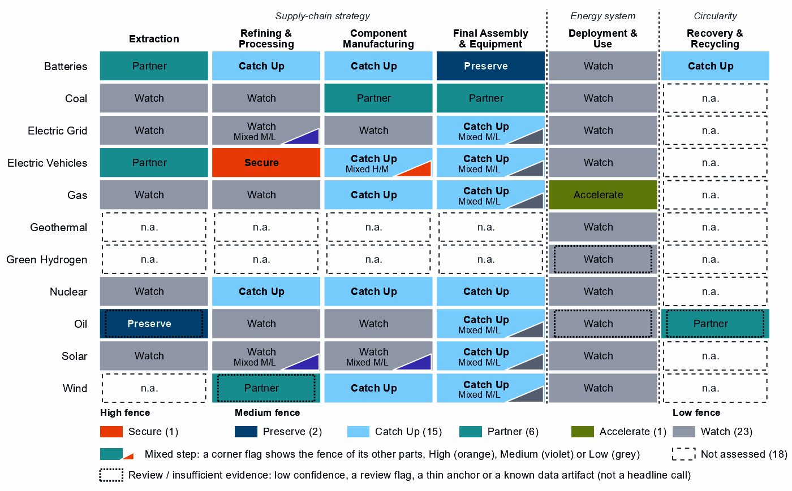
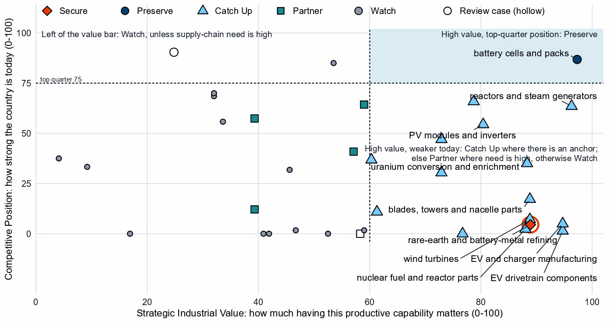
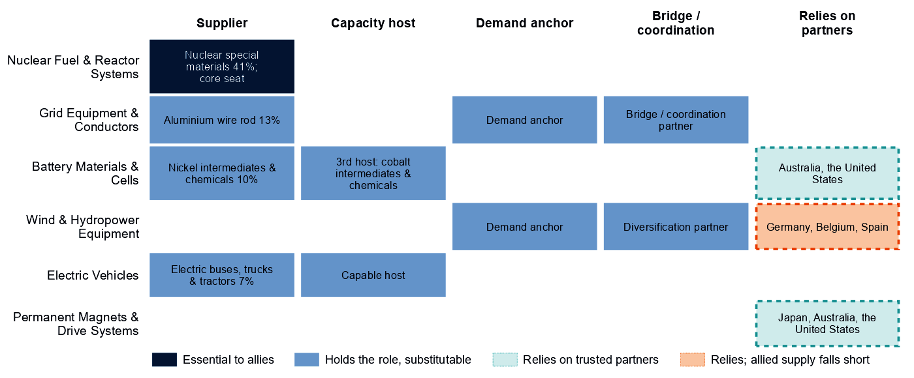
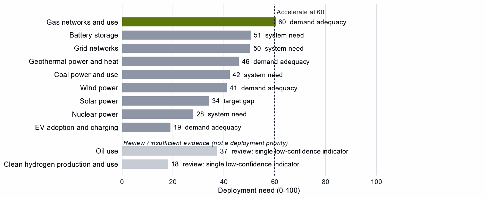

# Canada and the Allied Industrial Base

*What to secure, build, source from partners, and deploy*

*Generated from Allied Industrial Base Explorer data; evidence, sources and caveats in the appendix. Data as of 30 October 2026.*

## 1. Bottom line — Canada's strategic role

Canada's distinctive role in the Allied Industrial Base is as a resource and processing anchor: it ranks first among allies on resource & processing positions, and 19 economies count it as their best-placed trusted partner somewhere in the chain. That role is allied before it is national: at home, uranium mining reads Watch, and battery and EV mineral mining, where Canada holds only 1% of world supply, read Partner. Its industrial effort should go into batteries, where it makes cells and packs, has committed investment in components and holds a supplier role in nickel chemicals. The fence that matters is narrow: the rare-earth chain, to be secured with allied partners. Only gas networks need faster deployment, and recorded protection should shift away from steps the strategy leaves open. [1, 2, 3]

- **Secure.** The rare-earth chain from refining to traction magnets, where China holds 94% of world supply and trusted suppliers only 4% (shares that battery materials refining repeats). The answer is qualified trusted supply built with allies, stocks until it qualifies and phased limits on adversary sources, not self-sufficiency. [3]
- **Build / preserve.** Preserve battery cells and packs. Catch Up in battery components, on committed investment, and in battery materials refining, on its export share of refined battery materials; build EV manufacturing on committed investment and extend gas-turbine equipment. Keep uranium, nickel chemicals and aluminium wire rod reliable for allies, and above all nuclear special materials: an allied commitment, not a domestic fence. [2]
- **Partner.** Battery and EV minerals from trusted producers such as Australia and the United States, where the allied model finds supply covers the need; coal-plant equipment from allied makers; solar-grade polysilicon. With developing partners, add trusted battery capacity through development finance and offtake. [1, 2, 3]
- **Deploy / stay open.** Accelerate gas networks, buying equipment competitively from trusted suppliers, and build storage, grid, wind and solar on a market footing. Leave open wafers and PV cells, grid metals refining and grid components, and gas liquids processing.

In Figure 1, Partner sits in battery and EV minerals and coal-plant hardware, and Catch Up fills most manufacturing columns, including the nuclear chain after mining. Deployment is Watch except gas. The orange corner flag marks the traction magnets, the only High-fence part inside another step; grey flags mark Watch layers, such as control software, inside Catch Up steps.

**Figure 1. Where Canada should secure, build, partner or stay open**

*Each cell is a supply-chain step of a technology, colored by its strategic choice. A corner flag marks a mixed step whose named parts sit behind a different fence: in EV drivetrain components, the traction magnets are Secure and the step Catch Up. A dotted outline marks a review case, a call resting on low confidence, a review flag, a thin anchor or a known data artifact; this brief does not turn those calls into recommendations. Steps marked n.a. lack the data for a call. [2]*

## 2. Where Canada should secure, compete and stay open

### High fence — what cannot fail

Secure is a narrow call for Canada: one whole step and one layer inside another step, which form one capability. [2]

| Capability | Why it matters | Main vulnerability | Recommended response |
|---|---|---|---|
| The rare-earth chain: separation, metals and magnets | Feeds the traction magnets of EV motors. The refining step also covers battery metals; Canada holds 1% of its world supply and <1% of world exports. | China holds 94% of world supply and trusted suppliers 4%; it provides 37% of Canada's imports, and rebuilding takes more than three years. | **Mixed.** New trusted separation, metal and magnet capacity with allies such as Japan, Australia and the United States, through co-investment and offtake, and at home where a foothold can be built. Stocks until it qualifies; adversary-source limits in critical uses, phased in. |

Sources: 1, 2, 3, 4.

The magnets of blades, towers and nacelle parts read Catch Up there but Secure in EV drivetrains; this brief treats both as the same chain. No control software sits behind the fence: grid, inverter, turbine and vehicle control layers read Watch. The hardware shares are modest (for example, 22% of PV module and inverter imports), and the data do not measure who supplies the software. [2, 3]

### Medium fence — where industrial capability matters

Here Canada makes its real industrial choices: is a capability worth having (Strategic Industrial Value), and how strong is Canada today (Competitive Position)? Most of its 15 Catch Up steps rest on small shares of world supply in mixed trade codes, so this brief builds on few. [2]

**Preserve.** Battery cells and packs is the only Preserve call that clears the evidence bar: a top-quarter position (87) on operating capacity, with high value and need. With 1% of world supply, keeping the position means expanding it. Oil production also reads Preserve but is flagged for review by the engine, a review case, although 14 economies have Canada as their best-placed trusted partner for it. [2, 3]

**Catch Up.** Battery components rests on three anchors, including committed investment, with a position of 66 and high need (71); China provides 76% of Canada's imports. Battery materials refining has high confidence but a single anchor, 6% of world exports, and a position of 0: a trade position to build from, not proven refining capacity. The AIB's share of nickel intermediates and chemicals (10%) corroborates the nickel side, not lithium, cathode or anode materials. [1, 2, 3]

EV and charger manufacturing adds committed investment to small trade shares, from a low position (5). Gas turbines and LNG plant (47) and gas-turbine and drilling components (30) extend existing positions with high confidence. In transformers, switchgear and cables, whose value just clears the bar, the case sits in large power transformers, power conversion and HVDC control. EV drivetrain components starts from almost no position (1), so it is a build with allied partners. [2, 3]

Other Catch Up calls are weaker than they look, and this brief does not build on them:

- **Uranium conversion and enrichment:** a supply share (3%) that more likely reflects uranium compounds, concentrate included, than conversion capacity; the enrichment layers inherit it. [2, 3]
- **Reactors, nuclear fuel and reactor parts:** baskets that mix reactor and fuel lines with generic boiler and steam-turbine parts.
- **Wind turbines and their parts:** positions of 7 and 17 in trade codes dominated by cables, transformers and switchgear, with towers that include transmission masts. [2, 3]
- **PV modules and inverters:** moderate confidence, Watch modules, and trade codes that include chip-making machines. [2]
- **Battery recycling:** an export share (19%) of battery waste, scrap and residues. [3]
- **Drilling rigs, tankers and oil equipment:** a value at the bar (60) and moderate confidence. [2, 4, 5, 6]

**Partner.** Battery and EV mineral mining have very high need (96), but their value is capped below the bar because it rests on market size alone. Source them deliberately from trusted producers such as Australia and the United States; allied supply covers the need. Coal-plant hardware reads Partner on high need and low value: diversified contracts with allied makers such as Japan, Germany and Italy should suffice, on weak partner evidence. Solar-grade polysilicon is a Partner layer, and rare-earth and wind materials refining reads Partner on low confidence, a review case. [1, 2, 3]

**Figure 2. Which producing capabilities are worth holding, and where Canada is strong today**

*Producing steps with both measures (recovery has no position measure). Dashed lines mark the value bar (60) and the top quarter (75). Cells and packs sit alone in the top right; most Catch Up steps sit low on position. Uranium mining has a top-quarter position but sits left of the value bar, where its value rests on market size alone. Hollow markers are review cases, among them oil production at the top left. [2]*

**Shared capabilities.** Some physical capabilities sit in several technology chains, and their calls differ by technology; the table keeps the national reading apart from what allies rely on Canada for. In its first row, the AIB counts mined uranium concentrate as conversion, so the allied role is uranium supply.

| Shared capability | Steps and their choices | National reading | AIB role |
|---|---|---|---|
| Uranium conversion & enrichment | uranium mining (Watch) and uranium conversion and enrichment (Catch Up) | The choices differ within the same technology with each step's own measures (uranium mining: need 61, value 54, position 85; uranium conversion and enrichment: need 61, value 88, position 35) | Supplier: 16% of world exports or production of uranium conversion & enrichment (the AIB measure of the product, not a step's share); the largest allied holder of the step |
| Insulators & bushings | grid components (Watch); wafers and PV cells (Watch); and blades, towers and nacelle parts (Catch Up) | The choices differ across technologies with each step's own measures (grid components: need 33, value 47, position 2; wafers and PV cells: need 50, value 59, position 2; blades, towers and nacelle parts: need 45, value 89, position 17) | Allies need new capacity here (BUILD); no supplier role |
| Li-ion cells & packs | battery cells and packs (Preserve) and EV drivetrain components (Catch Up) | The choices differ across technologies with each step's own measures (battery cells and packs: need 68, value 97, position 87; EV drivetrain components: need 58, value 95, position 1) | Allies need new capacity here (BUILD); no supplier role |
| Power electronics components | grid components (Watch); EV drivetrain components (Catch Up); wafers and PV cells (Watch); and blades, towers and nacelle parts (Catch Up) | The choices differ across technologies with each step's own measures (grid components: need 33, value 47, position 2; EV drivetrain components: need 58, value 95, position 1; wafers and PV cells: need 50, value 59, position 2; blades, towers and nacelle parts: need 45, value 89, position 17) | Allies need new capacity here (BUILD); no supplier role |

Sources: 1, 2.

### Low fence — what not to prioritize

Watch is not a failure: affordable, diversified access matters more than domestic production. Of the 23 Watch steps, 10 are deployments below the Accelerate bar. [2]

- **Uranium mining.** A top-quarter position (85) and 23% of world supply, but need and value sit below their bars: no domestic fence, and reliable supply to allies as an allied commitment. [2, 3]
- **Gas liquids processing and oil refining.** Large, commoditized yards, where Canada holds 5% and 2% of world supply. [2, 3]
- **Grid metals refining and grid components.** A commoditized yard and a low-need step (33), yet both rank high in Canada's protection measures. Electrical steel reads Catch Up only by inheriting the step's export anchor; aluminium wire rod is a supplier role to keep reliable. [2, 3]
- **Wafers and PV cells.** Low need (50) and almost no position (2); the cell layers read Catch Up only on that thin anchor. [2, 3]

## 3. Canada's allied bargain

**What Canada contributes.** In the Allied Industrial Base analysis Canada is a Resource & Processing Anchor, first among allies on resource & processing positions. It supplies 10% of world exports or production of nickel intermediates and chemicals and 13% of aluminium wire rod. It holds a core seat in Nuclear Fuel & Reactor Systems, with 41% of world exports or production of nuclear special materials: heavy water and enriched isotopes. The AIB also names it the largest allied holder of uranium conversion and enrichment (16%, with the United Kingdom and France next), but that rests on concentrate exports, not conversion. [1, 3]

**What Canada needs.** Trusted refined rare earths and magnets, battery minerals and battery components. If China's supply stopped, as in the Decoupling scenario, Canada would lose US$4.2 billion a year of imports across the Allied Industrial Base basket. New capacity at the best-placed allied hosts, led by Germany, would restore about US$1.6 billion of it a year. Under Managed Interdependence, the default scenario, Canada sits in the minimum coalition of two Sectoral Compacts; under Decoupling, three, each as a demand anchor. [1, 3]

**The dependencies to make intentional.** These bargains turn that exchange into a specialization partners can count on.

| Capability / compact | Canada contributes | Canada needs | Natural partners | What makes the bargain work |
|---|---|---|---|---|
| Battery Materials & Cells | Nickel intermediates and chemicals (10%, its lead product); a home cell and pack base to expand | Battery minerals; battery components, now mostly from China | Australia and the United States for minerals; the compact's makers, such as South Korea | Offtake and co-investment with mineral partners; for refining and components, joint ventures that transfer capability and time-limited support tied to benchmarks |
| Nuclear Fuel & Reactor Systems | Nuclear special materials (41%) and uranium (23% of world mining supply), with a core seat | Trusted conversion and enrichment | The next allied holders, the United Kingdom and France | Co-investment and offtake with allied processors; the data do not establish a domestic enrichment case |
| Permanent Magnets & Drive Systems | Little measured today | Trusted refined rare earths and magnets | Refiners such as Japan, Australia and the United States | Co-investment and offtake for new trusted capacity, allied agreements, and stockpiles until it qualifies |
| Electric Vehicles and Grid Equipment & Conductors | Electric buses, trucks and tractors (7%); aluminium wire rod (13%) | Drivetrain components and magnets; large power transformers | Makers with core seats in both compacts, Japan and Germany | Co-investment and offtake with allied makers, and joint ventures that transfer capability |

Sources: 1, 2, 3.

**Figure 3. Canada's role in the Allied Industrial Base**

*Each row is a strategic compact in which Canada holds a role or relies on partners. Dark cells are roles allies cannot easily replace; light cells are roles others could fill; dashed cells mark where Canada relies on trusted partners, orange where allied supply still falls short of what allies need.*

Figure 3 shows a materials supplier that relies on partners for battery minerals and magnets; its only essential role is in nuclear materials. In wind, the orange cell rests on the wind-materials refining step, a review case, so this brief builds no bargain on it.

## 4. Development strategy — build trusted capacity by helping partners Catch Up

Development cooperation can be the development arm of that bargain, and a partnership needs evidence on both sides. On the Canadian side, a step needs more trusted capacity. On the partner's side, a developing economy's same step is a credible Catch Up with a corroborated anchor, inside the allied trust screen. 53 pairs qualify, with 16 developing partners across 12 steps. [1, 2, 7]

Most, 37 pairs, rest on the allied gap alone, a reason that is the same for every donor in scope. Canada's own supply chain supports 16 pairs with 7 partners across four steps, and the table leads with them: coal-plant components; coal-plant equipment; battery components; and battery cells and packs. The coal pairs rest on high need in steps Canada sources from allied makers, while its coal power fell from 8.8 to 3.4 GW between 2020 and 2025. Development finance for coal-plant capacity abroad would serve a technology Canada is leaving, so the coal row below is not a recommendation; the battery pairs carry the strategy. [1, 2, 7, 8]

Malaysia and Indonesia are upper-middle-income economies, so finance, guarantees and offtake should lead. Cells and packs are a Preserve step, whose policy design sets no partner-country finance, so the Malaysia case rests on high need and supplements the home build. Madagascar (low income, with a Competitive Position of 0) and Mexico rest on the allied gap alone. [1, 2, 3, 7]

| Capability / allied gap | Developing partner | Why this partner can Catch Up | What the donor should support | Security / AIB benefit | Development benefit |
|---|---|---|---|---|---|
| Coal-plant components: high need | Viet Nam (lower middle income) | A share of world supply and a share of world exports; corroborated by feasibility, specialization in the adjacent step and industrial learning | Plant capacity not covered by the data and input costs not covered by the data. Supplier development, technical and vocational skills, quality systems and certification, common testing facilities; then, at scale, development finance, guarantees, offtake, equity and joint ventures | A trusted second source | A certified supplier base and export sales of components |
| Battery cells and packs: high need and new allied capacity needed | Malaysia (upper middle income) | A share of world supply and a share of world exports; corroborated by feasibility, input costs, specialization in the adjacent step and industrial learning | Constraint: no operating or committed plant in the capacity data and a position that rests on trade or output shares, not on plant capacity. Lead with development finance, guarantees, offtake, equity and joint ventures; public support for project preparation and investment promotion | Diversified supply for a high-need step and new allied capacity where the AIB finds a gap (allies need new capacity in 2 product groups of the step) | Factory capacity, skills and export sales of finished equipment |
| Battery components: high need and new allied capacity needed | Indonesia (upper middle income) | A share of world exports; corroborated by feasibility, input costs, specialization in the adjacent step and industrial learning | Constraint: operating or committed plant below the capacity bar and a position that rests on trade or output shares, not on plant capacity. Lead with development finance, guarantees, offtake, equity and joint ventures; public support for project preparation and investment promotion | Diversified supply for a high-need step and new allied capacity where the AIB finds a gap (allies need new capacity in 1 product group of the step) | A certified supplier base and export sales of components |
| Battery materials refining: new allied capacity needed | Madagascar (low income) | A share of world exports and operating capacity; corroborated by specialization in the adjacent step | Constraint: related industrial know-how outside the top quarter and input costs outside the cheapest quarter. Workforce development, technology transfer and joint ventures, industrial infrastructure, feasibility studies and project preparation; then, at scale, offtake, market access, investment guarantees | New allied capacity where the AIB finds a gap (allies need new capacity in 6 product groups of the step) | Processing capacity at home, with the skills, standards and value capture of a refinery |
| EV and charger manufacturing: new allied capacity needed | Mexico (upper middle income) | A share of world supply, a share of world exports, operating capacity and a strong position in the next step up the chain; corroborated by feasibility, specialization in the adjacent step and industrial learning | Constraint: input costs outside the cheapest quarter. Lead with development finance, guarantees, offtake, equity and joint ventures; public support for industrial infrastructure and supplier development | New allied capacity where the AIB finds a gap (allies need new capacity in 4 product groups of the step) | Factory capacity, skills and export sales of finished equipment |

Sources: 1, 2, 3, 6, 7, 9.

A partnership is more likely to last when it rests on more than aid. The second table shows what ties Canada to each partner today; aid is the 2020 to 2024 total at the step, and the direct investment position is the economy-wide total, not tied to the step. The deepest tie is with Mexico, where Canadian firms already have a factory project in the technology. [1, 2, 7]

| Partnership | Relationship today | What makes it durable |
|---|---|---|
| Viet Nam: coal-plant components | $0.5 million at this step, under stage-wide codes (the technology is not identified) and a direct investment position of $3,811 million (economy-wide) | Long-term offtake, joint ventures and investment guarantees as the capability scales; the partner's own deployment demand for the technology (Accelerate) |
| Malaysia: battery cells and packs | No energy, industry or mining aid recorded for the pair; a direct investment position of $1,112 million (economy-wide); no factory projects by firms from Canada recorded in the technology; and no export-credit or lender finance recorded at the step | Long-term offtake, joint ventures and investment guarantees as the capability scales; the partner's role as Specialized technology supplier in the Battery Materials & Cells compact |
| Indonesia: battery components | $95 million of energy, industry and mining aid, none at this step; a direct investment position of $4,196 million (economy-wide); no factory projects by firms from Canada recorded in the technology; and no export-credit or lender finance recorded at the step | Long-term offtake, joint ventures and investment guarantees as the capability scales; the partner's role as Processing anchor in the Battery Materials & Cells compact |
| Madagascar: battery materials refining | No energy, industry or mining aid recorded for the pair; a direct investment position of $50 million (economy-wide); and no export-credit or lender finance recorded at the step | Long-term offtake, joint ventures and investment guarantees as the capability scales; the partner's role as Resource supplier in the Battery Materials & Cells compact |
| Mexico: EV and charger manufacturing | $5.1 million of energy, industry and mining aid, none at this step; a direct investment position of $24,489 million (economy-wide); 1 factory project by firms from Canada in the technology; and an AIB simulated investment pairing (a model result, not an existing tie) | Long-term offtake, joint ventures and investment guarantees as the capability scales; the partner's role as Scale manufacturer in the Electric Vehicles compact |

Sources: 1, 2, 7, 9, 10, 11, 12.

Battery components is among the broadest strands: 7 developing economies, led by Viet Nam and Indonesia, have credible pathways. For battery mineral mining; EV mineral mining; and rare-earth and battery-metal refining: No credible development-led supply solution identified. In rare-earth refining, the AIB places new capacity in Malaysia and Thailand, a commercial case. Another 30 pairs are commercial, where trade, offtake and investment fit better than aid. [1, 2, 7]

Today's energy, industry and mining aid serves other aims and does not follow this map. Only Viet Nam and Ukraine receive Canadian aid at the step of a partnership, under stage-wide codes that do not identify the technology. Of the other partners, 8 receive it at other steps only and 6 at no supply-chain step. The largest recipient, South Africa, received $183 million over 2020 to 2024, none of it in battery materials refining, where it has a credible pathway. [7]

## 5. Energy-system priorities

Only gas networks and use reach the Accelerate bar of 60, with a need of 60 on two measures, moderate confidence and demand adequacy in the lead. Battery storage (51) and grid networks (50) come next, on all three measures with high confidence, driven by system need. Wind reads high on demand adequacy (76) but low on system need (18). The renewables target of 126 GW by 2030 compares with 111 GW installed in 2025, a projected shortfall of about 8 GW by then at the recent build rate. [2, 5, 8]

**Figure 4. What Canada needs to deploy faster**

*Deployment need by technology, with the largest of its measures: demand adequacy, the gap to national targets, or system need. Review cases, which rest on a single indicator of low confidence, are shown apart in grey and are not deployment priorities.*

High deployment priority does not imply high manufacturing priority. The gas-turbine and LNG-plant Catch Ups are a separate capability call; the gas build-out itself should buy from whichever trusted supplier is ready. Storage, grid, wind and solar are worth watching, not forcing; a small renewables shortfall argues for a market footing, not local content. Clean hydrogen and oil use rest on a single indicator of low confidence, so both are review cases.

## 6. Is current policy pointed in the right direction?

Policy never decides a choice here; it is compared with it afterwards, using Canada's own recorded industrial-policy measures. Protection and priority are ranks within the country, not levels. The table keeps the most consequential mismatches of each kind and leaves out review cases.

| Capability | Strategic choice | Current policy | Gap |
|---|---|---|---|
| EV drivetrain components | Catch Up | Needs more attention | Capability case without enough policy attention |
| Blades, towers and nacelle parts | Catch Up | Needs more attention | Capability case without enough policy attention |
| Wind turbines | Catch Up | Needs more attention | Capability case without enough policy attention |
| Wafers and PV cells | Watch | Heavy protection or localization | Localizing what is not a domestic priority |
| Grid metals refining | Watch | Heavy protection or localization | Localizing what is not a domestic priority |
| Grid networks | Watch | Heavy local-content protection on the equipment of a Watch deployment | Localizing what is not a domestic priority |

Sources: 2, 13, 14.

First, protection ranks high where the strategy is to stay open: wafers and PV cells (73), grid metals refining (76) and the equipment of Watch deployments such as grid networks (78). It should give way to competitive sourcing, with at most a stated capability floor in grid metals. Second, EV drivetrain components and the wind steps read Catch Up with less recorded policy attention than their case warrants, but the wind anchors are thin, so the wind rows are no call to act. Attention belongs first with battery components, whose policy priority is only 30. In EV drivetrains, where protection already ranks high (81), it should come as time-limited support tied to benchmarks. [2, 13, 14]

## 7. Strategic agenda — what should Canada do next?

### 1. Secure the rare-earth chain with allied partners

Build trusted separation, metal and magnet capacity with allies such as Japan, Australia and the United States through co-investment and offtake, and at home where a foothold can be built. Hold stocks sized to bridge the years until that supply qualifies, screen inbound investment in trusted capacity, and phase in limits on adversary sources in critical uses as it qualifies. No developing partner qualifies in this step; the AIB places new capacity in Malaysia and Thailand, a commercial case. [1, 2, 3, 7]

### 2. Keep cell and pack making competitive and catch up in battery components

Expand cell and pack production with finance for expansion, workforce and supplier development, tied to benchmarks, with the gate open to allied and conditional investment. In battery components, where China provides 76% of imports, use time-limited production incentives and demand creation tied to benchmarks, at home and with allied partners. [3]

### 3. Build battery materials refining on the nickel chemicals base

Canada's anchor is its export share of refined battery materials, corroborated in nickel chemicals by a supplier role in the AIB. Tie production incentives, first-of-a-kind finance and workforce development to benchmarks, with sunsets, and keep the gate open to licensing and joint ventures that transfer capability in lithium, cathode and anode materials.

### 4. Make mineral dependence deliberate and supplier roles reliable

Buy battery and EV minerals through offtake and co-investment with producers such as Australia and the United States, spread across several suppliers. Treat reliable supply of uranium, nickel chemicals and aluminium wire rod, and above all nuclear special materials, as an allied commitment, not a domestic fence. Source conversion and enrichment through co-investment and offtake with allied partners, such as the United Kingdom and France. [1, 2, 3]

### 5. Build trusted battery and EV capacity with developing partners

Start with Indonesia in battery components, where Canadian need is high, leading with development finance, guarantees and offtake; Malaysia in battery cells and packs only supplements the home build. Add Mexico in EV and charger manufacturing, where recorded ties are deepest, and prepare Madagascar in battery materials refining over a longer horizon. Leave coal-plant hardware to diversified contracts with allied makers. The objective is both an additional trusted supplier and a durable capability in the partner economy. [1, 2, 7]

### 6. Accelerate gas networks, keep sourcing open and narrow protection

Deploy gas networks faster through infrastructure, permitting and competitive procurement, with trusted-supplier conditions on public deployment support. Build storage, grid, wind and solar without local-content rules, and narrow protection on wafers and PV cells, grid metals refining and grid components, which are Watch steps.

## Sources

1. Allied Industrial Base model: roles, compacts, trade restored and new capacity across the allied coalition, computed by the Explorer's authors (run of 30 October 2026); CC BY 4.0.
2. Country strategy choices by technology and supply-chain step (supply-chain need, Strategic Industrial Value, Competitive Position, deployment need, policy alignment), computed by the Explorer's authors (dashboard data of 31 October 2026); CC BY 4.0.
3. United Nations, UN Comtrade Database, HS6 bilateral trade (all reporters); reconciled by the authors (2022-2024 data); attribution; https://comtradeplus.un.org/.
4. Yards & Fences node attributes: standardization, learning, industrial commons and control layers, curated by the authors from public sources (2026-10-30); CC BY 4.0.
5. International Energy Agency, World Energy Outlook 2025 (Stated Policies Scenario) and Global Critical Minerals Outlook: demand 2024-2035 (2025); CC BY-NC-SA 4.0 (free dataset); https://www.iea.org/.
6. Clean Investment Monitor: clean-technology manufacturing investment and capacity (aggregated), world capital expenditure 2021-22 to 2024-25; attribution; https://www.cleaninvestmentmonitor.org/.
7. OECD Creditor Reporting System: official development assistance by donor, recipient and purpose code, gross disbursements at constant prices, energy, industry and mining purpose codes only, mapped to supply-chain steps by the authors (Components and Assembly share purpose codes; no code funds recycling) (2020-2024 data); attribution; https://data-explorer.oecd.org/.
8. Ember, electricity generation and capacity data (2020-2025) and 2030 Renewable Target Tracker; CC BY 4.0; https://ember-energy.org/.
9. Development tool families by supply-chain stage and constraint, and the development-partnership tests, set by the authors (config/development_partnerships.yml) (2026-11-03); CC BY 4.0.
10. International Monetary Fund, Direct Investment Positions: outward positions (reported, else derived from the counterpart's reports) (2020-2024 data); attribution; https://data.imf.org/.
11. fDi Markets clean-manufacturing projects (CM-FDI): factory projects by home and destination economy (Components and Assembly not separated); subscription (aggregates only).
12. Oil Change International, Public Finance for Energy: export-credit and development-lender energy finance (not aid) (2013-2025 data); attribution; https://energyfinance.org/.
13. Global Trade Alert, New Industrial Policy Observatory: industrial-policy interventions, strength scored by the authors, October 2026 extract (as of 5 October 2026); subscription (titles, dates and links only); https://www.globaltradealert.org/.
14. International Energy Agency, Policies and Measures Database (export of 2026-10-26); attribution; https://www.iea.org/policies.

## Appendix — evidence and method

**How this brief is built.** Every number comes from the Country page data of the Allied Industrial Base Explorer (the data release of 30 October 2026) and from the Allied Industrial Base analysis. Each supply-chain step gets a strategic choice by fixed rules applied in order. A step is Secure where an acute vulnerability is measured, and a deployment step Accelerate where deployment need reaches 60. A large, commoditized yard is Watch. Preserve needs a top-quarter Competitive Position (75) and high Strategic Industrial Value (bar 60) or supply-chain need (bar 67). Catch Up needs high value, a lower position and a capability anchor corroborated by other evidence. Partner is high need with neither a top-quarter position nor, for a high-value step, a credible pathway; the rest is Watch. [2]

Named layers, such as control software or magnets, take their own choice; a step whose parts sit behind different fences is mixed.

**Review cases.** Calls on insufficient evidence stay on the map but never enter the Bottom line, the Agenda, the policy table or a headline mark. The brief treats five steps as review cases. [2]

| Step | Choice | Why it is a review case |
|---|---|---|
| Clean hydrogen production and use | Watch | A single indicator of low confidence |
| Oil production | Preserve | Flagged for review by the engine |
| Oil use | Watch | A single indicator of low confidence |
| Waste-oil recovery | Partner | Low confidence |
| Rare-earth and wind materials refining | Partner | Low confidence |

Sources: 2.

**Evidence and caveats.** The Secure refining step and battery materials refining show the same 94% share of world supply, which suggests shared battery-metal supply data. The status "allied supply covers the need" for rare-earth and battery-metal refining describes the allied model, not ample trusted supply (4% of world supply). In battery and EV mineral mining the trusted share reads 0%, which conflicts with allied supply that covers the need; this brief relies on the partner list. 18 steps lack the data for a call, including most of geothermal, green hydrogen manufacturing and most recycling. Competitive Position ranks Canada among economies that already supply a step, so a zero means no measurable position. Partner lists name where allied capacity sits, which can include trading hubs, not who owns it. [2, 3]

**Development partnerships.** A developing partner (not high income) needs an anchor corroborated beyond context signals, sufficient evidence and confidence, and a place inside the AIB trust screen. On a step whose data describe different products, the anchor must measure the product the need is about. A partner that already hosts the step's new capacity in the AIB, or Preserves it, is a commercial case. Many codes name a stage rather than a technology, so aid at a step is not aid for that technology; export-credit finance is never counted as aid. In rare-earth refining, the other candidates rest on battery-metal capacity data, and Mexico on a thin anchor. [1, 2, 7]

| Step | Donor reason | Development partners | Commercial route | Review cases | Aid at the step |
|---|---|---|---|---|---|
| Coal-plant components | Partner and high need | Viet Nam, India and Indonesia | – | Turkiye | Viet Nam |
| Coal-plant equipment | Partner and high need | Viet Nam | India | Turkiye | Viet Nam |
| Battery components | High need and new allied capacity needed | Viet Nam, Indonesia, Mexico, Turkiye, India, Morocco and Malaysia | – | – | Viet Nam |
| Battery cells and packs | High need and new allied capacity needed | Malaysia, Indonesia, Mexico, India and Turkiye | Viet Nam | – | Viet Nam |
| Battery materials refining | New allied capacity needed | Madagascar, the Philippines, India, South Africa, Papua New Guinea, Thailand and Turkiye | Indonesia, Argentina, the Democratic Republic of Congo and Malaysia | Mozambique, Colombia and Tanzania | – |
| EV and charger manufacturing | New allied capacity needed | Mexico, Viet Nam, Thailand, Malaysia, Morocco and Indonesia | Turkiye and India | – | Viet Nam |
| Wind turbines | New allied capacity needed | Viet Nam, Turkiye, Malaysia, Indonesia, Morocco and Thailand | India and Mexico | Brazil | Viet Nam |
| EV drivetrain components | New allied capacity needed | Malaysia, Thailand, Ukraine, Honduras, Morocco, Turkiye and Serbia | Indonesia, the Philippines, Mexico and India | Viet Nam | Ukraine and Viet Nam |
| Blades, towers and nacelle parts | New allied capacity needed | Thailand, Serbia, Turkiye, Brazil and Malaysia | Mexico, Viet Nam, the Philippines and India | – | Viet Nam |
| Transformers, switchgear and cables | New allied capacity needed | Malaysia, India and the Philippines | Mexico, Turkiye, Thailand and Viet Nam | Morocco | Viet Nam |
| Rare-earth and wind materials refining | Allied supply falls short and new allied capacity needed | India | – | Viet Nam and South Africa | Viet Nam |
| PV modules and inverters | New allied capacity needed | Morocco and Turkiye | Viet Nam, India, Thailand, Malaysia, Mexico and Indonesia | – | Viet Nam |
| Rare-earth and battery-metal refining | Secure with allied delivery, few trusted alternatives, high need and new allied capacity needed | – | Malaysia and Thailand | Argentina, Indonesia, the Democratic Republic of Congo, Mozambique, Madagascar, the Philippines, Tanzania and Mexico | – |
| Nuclear fuel and reactor parts | High need | – | – | India, Thailand and Viet Nam | Viet Nam |
| Reactors and steam generators | High need | – | – | Turkiye, India, Malaysia and Viet Nam | Viet Nam |
| Battery recycling | High need | – | – | India and Malaysia | – |
| Polysilicon refining | High need | – | – | India | – |

Sources: 1, 2, 7.

**Every step.**

| Step | Stage | Choice | Fence | Need | Value | Position | Evidence | Policy |
|---|---|---|---|---|---|---|---|---|
| Battery mineral mining | Extraction | Partner | Medium | 96 | 57 | 41 | strong | broadly aligned |
| Battery materials refining | Refining | Catch Up | Medium | 47 | 77 | 0 | strong | broadly aligned |
| Battery components | Components | Catch Up | Medium | 71 | 79 | 66 | moderate | needs more attention |
| Battery cells and packs | Assembly | Preserve | Medium | 68 | 97 | 87 | moderate | broadly aligned |
| Battery storage | Deployment | Watch | Low | 51 | – | – | moderate | broadly aligned |
| Battery recycling | Recovery | Catch Up | Medium | 86 | 82 | – | – | needs more attention |
| Coal mining | Extraction | Watch | Low | 54 | 4 | 38 | strong | too much intervention |
| Coke and coal processing | Refining | Watch | Low | 95 | 9 | 33 | strong | mixed signals |
| Coal-plant components | Components | Partner | Medium | 81 | 39 | 12 | strong | broadly aligned |
| Coal-plant equipment | Assembly | Partner | Medium | 68 | 39 | 57 | strong | broadly aligned |
| Coal power and use | Deployment | Watch | Low | 42 | – | – | moderate | broadly aligned |
| Coal recovery | Recovery | Not assessed | – | – | 1 | – | – | not enough policy evidence |
| Copper and bauxite mining | Extraction | Watch | Low | 80 | 41 | 0 | strong | broadly aligned |
| Grid metals refining | Refining | Watch | Mixed Medium/Low | 53 | 53 | 0 | strong | too much intervention |
| Grid components | Components | Watch | Low | 33 | 47 | 2 | strong | too much intervention |
| Transformers, switchgear and cables | Assembly | Catch Up | Mixed Medium/Low | 48 | 61 | 11 | strong | broadly aligned |
| Grid networks | Deployment | Watch | Low | 50 | – | – | – | too much intervention |
| Grid-equipment recycling | Recovery | Not assessed | – | – | 14 | – | – | not enough policy evidence |
| EV mineral mining | Extraction | Partner | Medium | 96 | 59 | 64 | strong | broadly aligned |
| Rare-earth and battery-metal refining | Refining | Secure | High | 94 | 89 | 5 | strong | broadly aligned |
| EV drivetrain components | Components | Catch Up | Mixed High/Medium | 58 | 95 | 1 | moderate | needs more attention |
| EV and charger manufacturing | Assembly | Catch Up | Mixed Medium/Low | 62 | 95 | 5 | moderate | broadly aligned |
| EV adoption and charging | Deployment | Watch | Low | 19 | – | – | strong | too much intervention |
| EV recycling | Recovery | Not assessed | – | – | 42 | – | – | not enough policy evidence |
| Gas production | Extraction | Watch | Low | 77 | 32 | 69 | strong | broadly aligned |
| Gas liquids processing | Refining | Watch | Low | 72 | 32 | 70 | strong | broadly aligned |
| Gas-turbine and drilling components | Components | Catch Up | Medium | 56 | 73 | 30 | strong | broadly aligned |
| Gas turbines and LNG plant | Assembly | Catch Up | Mixed Medium/Low | 56 | 73 | 47 | strong | broadly aligned |
| Gas networks and use | Deployment | Accelerate | Medium | 60 | – | – | strong | broadly aligned |
| Gas recovery | Recovery | Not assessed | – | – | 25 | – | – | not enough policy evidence |
| Geothermal resource development | Extraction | Not assessed | – | – | 20 | – | – | not enough policy evidence |
| Geothermal refining | Refining | Not assessed | – | – | 20 | – | – | not enough policy evidence |
| Geothermal plant components | Components | Not assessed | – | – | 69 | – | – | not enough policy evidence |
| Geothermal power-plant equipment | Assembly | Not assessed | – | – | 69 | – | – | not enough policy evidence |
| Geothermal power and heat | Deployment | Watch | Low | 46 | – | – | strong | broadly aligned |
| Geothermal recovery | Recovery | Not assessed | – | – | 20 | – | – | not enough policy evidence |
| Electrolyser mineral mining | Extraction | Not assessed | – | – | 35 | 70 | strong | not enough policy evidence |
| PGM and catalyst refining | Refining | Not assessed | – | – | 63 | 99 | strong | not enough policy evidence |
| Electrolyser stacks | Components | Not assessed | – | – | 99 | – | – | not enough policy evidence |
| Electrolyser systems | Assembly | Not assessed | – | – | 90 | – | – | not enough policy evidence |
| Clean hydrogen production and use | Deployment | Watch | Low | 18 | – | – | – | broadly aligned |
| Stack and catalyst recycling | Recovery | Not assessed | – | – | 49 | – | – | not enough policy evidence |
| Uranium mining | Extraction | Watch | Low | 61 | 54 | 85 | strong | mixed signals |
| Uranium conversion and enrichment | Refining | Catch Up | Medium | 61 | 88 | 35 | strong | needs more attention |
| Nuclear fuel and reactor parts | Components | Catch Up | Medium | 74 | 88 | 2 | strong | mixed signals |
| Reactors and steam generators | Assembly | Catch Up | Medium | 67 | 96 | 64 | strong | broadly aligned |
| Nuclear power | Deployment | Watch | Low | 28 | – | – | strong | broadly aligned |
| Spent-fuel reprocessing | Recovery | Not assessed | – | – | 88 | – | – | not enough policy evidence |
| Oil production | Extraction | Preserve | Medium | 84 | 25 | 90 | strong | broadly aligned |
| Oil refining | Refining | Watch | Low | 56 | 46 | 32 | strong | broadly aligned |
| Drilling and pump components | Components | Watch | Low | 52 | 34 | 56 | strong | broadly aligned |
| Drilling rigs, tankers and oil equipment | Assembly | Catch Up | Mixed Medium/Low | 62 | 60 | 37 | strong | needs more attention |
| Oil use | Deployment | Watch | Low | 37 | – | – | strong | too much intervention |
| Waste-oil recovery | Recovery | Partner | Medium | 99 | 16 | – | – | broadly aligned |
| PV mineral mining | Extraction | Watch | Low | 82 | 17 | 0 | strong | broadly aligned |
| Polysilicon refining | Refining | Watch | Mixed Medium/Low | 67 | 42 | 0 | strong | too much intervention |
| Wafers and PV cells | Components | Watch | Mixed Medium/Low | 50 | 59 | 2 | moderate | too much intervention |
| PV modules and inverters | Assembly | Catch Up | Mixed Medium/Low | 36 | 80 | 54 | moderate | broadly aligned |
| Solar power | Deployment | Watch | Low | 34 | – | – | strong | too much intervention |
| PV module recycling | Recovery | Not assessed | – | – | 44 | – | – | not enough policy evidence |
| Wind mineral mining | Extraction | Not assessed | – | – | 45 | 50 | strong | not enough policy evidence |
| Rare-earth and wind materials refining | Refining | Partner | Medium | 69 | 58 | 0 | strong | broadly aligned |
| Blades, towers and nacelle parts | Components | Catch Up | Medium | 45 | 89 | 17 | moderate | needs more attention |
| Wind turbines | Assembly | Catch Up | Mixed Medium/Low | 50 | 89 | 7 | moderate | needs more attention |
| Wind power | Deployment | Watch | Low | 41 | – | – | strong | too much intervention |
| Wind-turbine recycling | Recovery | Not assessed | – | – | 32 | – | – | not enough policy evidence |

Sources: 2, 3, 4, 5, 6, 8, 13, 14.

**Named layers.**

| Layer | Step | Choice | Fence |
|---|---|---|---|
| Anode materials (natural and synthetic graphite) | battery materials refining | Catch Up | Medium |
| Cathode active materials and precursors | battery materials refining | Catch Up | Medium |
| Battery-grade lithium hydroxide and carbonate | battery materials refining | Catch Up | Medium |
| Battery cells (LFP and NMC) | battery cells and packs | Preserve | Medium |
| Communications gateway and cloud fleet management | battery cells and packs | Preserve | Medium |
| Battery-management firmware, energy-management software and remote updates | battery cells and packs | Preserve | Medium |
| Enclosures, racking, thermal management and balance of system | battery cells and packs | Preserve | Medium |
| Grain-oriented electrical steel | grid metals refining | Catch Up | Medium |
| Power conversion hardware (inverters and converters) | transformers, switchgear and cables | Catch Up | Medium |
| Smart meters and advanced metering head-end systems | transformers, switchgear and cables | Watch | Low |
| Cables and conductors | transformers, switchgear and cables | Watch | Low |
| Utility-scale inverter firmware and remote-access functions | transformers, switchgear and cables | Watch | Low |
| Grid-control software (SCADA, EMS, DERMS) | transformers, switchgear and cables | Watch | Low |
| Large power transformers | transformers, switchgear and cables | Catch Up | Medium |
| HVDC converter-station control and protection | transformers, switchgear and cables | Catch Up | Medium |
| Electric drive units and motors | EV drivetrain components | Catch Up | Medium |
| Sintered NdFeB permanent magnets (traction motors) | EV drivetrain components | Secure | High |
| Connected-vehicle telematics, over-the-air software and connectivity systems | EV and charger manufacturing | Watch | Low |
| Charging-network management software (charge-point back ends) | EV adoption and charging | Watch | Low |
| Pipeline SCADA, compressor-station and LNG-terminal control systems | gas turbines and LNG plant | Watch | Low |
| Iridium and platinum for PEM electrolyser catalysts | electrolyser mineral mining | Not assessed | – |
| HALEU enrichment | uranium conversion and enrichment | Catch Up | Medium |
| LEU enrichment services | uranium conversion and enrichment | Catch Up | Medium |
| Fuel assemblies (design-specific fabrication) | nuclear fuel and reactor parts | Catch Up | Medium |
| Reactor control and safety instrumentation | reactors and steam generators | Catch Up | Medium |
| Oil pipeline and terminal control systems | drilling rigs, tankers and oil equipment | Watch | Low |
| Solar-grade polysilicon | polysilicon refining | Partner | Medium |
| Solar cells and wafers | wafers and PV cells | Catch Up | Medium |
| Next-generation PV (perovskite and tandem cells) | wafers and PV cells | Catch Up | Medium |
| Distributed PV inverter firmware, communication dongles and vendor cloud | PV modules and inverters | Watch | Low |
| Conventional crystalline-silicon modules | PV modules and inverters | Watch | Low |
| Passive racking and mounting | PV modules and inverters | Watch | Low |
| Rare-earth separation and metal-making | rare-earth and wind materials refining | Catch Up | Medium |
| Sintered NdFeB permanent magnets | blades, towers and nacelle parts | Catch Up | Medium |
| Turbine controllers, OEM remote access and park SCADA | wind turbines | Watch | Low |

Sources: 2, 4.

**Partner recommendations.**

| Step | Choice | Trusted partners | Allied supply | Evidence |
|---|---|---|---|---|
| Battery mineral mining | Partner | Australia and the United States | Allied supply covers the need | moderate |
| Coal-plant components | Partner | Japan, Germany and Italy | Allied supply covers the need | weak |
| Coal-plant equipment | Partner | France, Germany and Italy | Allied supply covers the need | weak |
| EV mineral mining | Partner | Australia and the United States | Allied supply covers the need | moderate |
| Rare-earth and battery-metal refining | Secure | Japan, Australia and the United States | Allied supply covers the need | moderate |
| Waste-oil recovery | Partner | No credible allied solution yet | – | none |
| Rare-earth and wind materials refining | Partner | Germany, Belgium and Spain | Allied supply falls short | strong |

Sources: 1, 2, 3.

**Compact roles.**

| Strategic compact | Lead role | Functions | Lead step | Core countries |
|---|---|---|---|---|
| Battery Materials & Cells | Processing anchor | Processing anchor and capacity-building host | Refined chemicals | the United States, the Democratic Republic of Congo, Japan, Indonesia, South Korea and Germany |
| Wind & Hydropower Equipment | Diversification partner | Demand anchor and diversification partner | – | Spain, Poland, India, Germany, the United States and the United Kingdom |
| Nuclear Fuel & Reactor Systems | Processing anchor | Resource supplier and processing anchor | Fuel & nuclear materials | Australia, Canada, India, the United States, France and the United Kingdom |
| Grid Equipment & Conductors | Specialized technology supplier | Specialized technology supplier, scale manufacturer, demand anchor, bridge / coordination partner and diversification partner | Wire rod & transformer steel | Chile, Peru, the Democratic Republic of Congo, Japan, Germany and the United States |
| Electric Vehicles | Scale manufacturer | Scale manufacturer and capacity-building host | Electric vehicles | Germany, the United States, France, Japan, South Korea and the United Kingdom |

Sources: 1.

**Coverage and freshness.**

| Item | Value |
|---|---|
| Data release | 30 October 2026 |
| Steps with a choice | 48 |
| Steps not assessed | 18 |
| Named layers with a choice | 34 |
| Steps with strong position evidence | 37 |
| Steps with moderate or weak position evidence | 10 |
| Steps with no position evidence | 19 |

Sources: 2.

*AI-generated from the data and checked against it by an independent verifier.*

*Allied Industrial Base Explorer, Country strategy brief: Canada*
