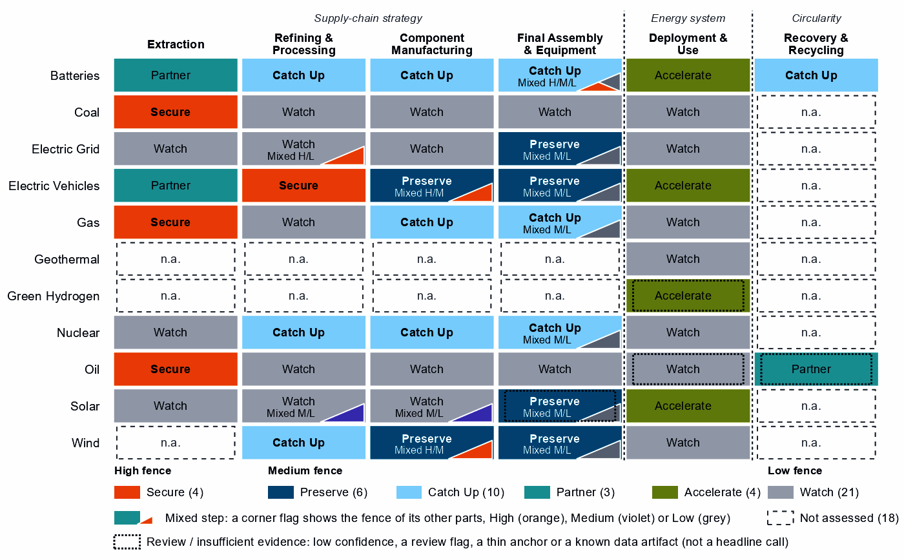
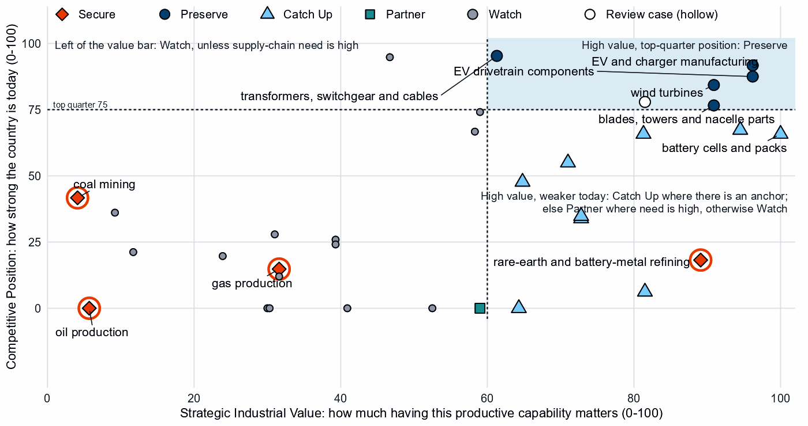
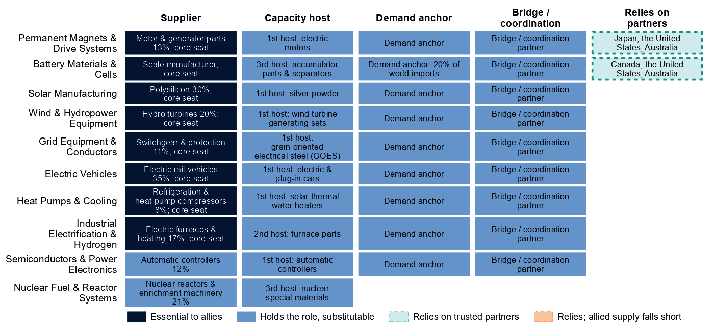
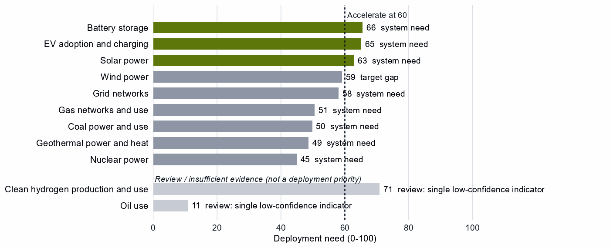

# Germany and the Allied Industrial Base

*What to secure, build, source from partners, and deploy*

*Generated from Allied Industrial Base Explorer data; evidence, sources and caveats in the appendix. Data as of 26 November 2026.*

## 1. Bottom line — Germany's strategic role

Germany's distinctive role in the Allied Industrial Base is as its integrated equipment maker. It holds a role in all ten strategic compacts and a core seat in eight, and 86 economies count it as their best-placed trusted partner somewhere in the chain. Allies rely on it as their largest holder of vehicle supply and, on mixed trade codes, of drivetrain, grid-equipment and wind-part supply. Its exposure lies in imported fuel, minerals it does not mine, refined rare earths and battery cells, where China supplies 64% of cell and pack imports. Its industrial effort should keep EV making, drivetrains and grid equipment at the frontier, and catch up in battery cells, where its own need is high, and in battery components. For minerals it should depend deliberately on trusted producers, and development cooperation can add drivetrain and battery capacity with developing partners. At home, storage, EVs and solar need to be deployed faster. The high fence belongs around fuel supply, the rare-earth chain, battery control software and transformer steel. [1, 2, 3]

- **Secure.** The supply of gas, oil and coal, which takes one to three years to rebuild. The rare-earth chain from separation to magnets, where China holds 94% of world supply of rare-earth and battery-metal refining and trusted suppliers only 4%. The control software of imported battery systems, and grain-oriented electrical steel. The answer is trusted contracts, stocks and control of command paths, not self-sufficiency. [2, 3, 4]
- **Build / preserve.** Keep EV and charger manufacturing, EV drivetrain components and transformers and switchgear at the frontier, with support tied to benchmarks. Catch Up in battery cells and packs and battery components. Battery materials refining serves allies more than German need. Preserve blades, towers and nacelle parts, where the AIB makes Germany a single point of failure for allies, so reliability for allies is the case; reactor supply is an allied commitment more than a national build. Both rest on trade codes that mix in cables and boiler parts.
- **Partner.** Battery and EV minerals from trusted producers such as Canada, the United States and Australia, where allied supply covers the need. With developing partners, add trusted battery capacity through development finance, guarantees and offtake; drivetrain rests on German need alone and its Preserve design sets no partner finance. [1, 2, 3]
- **Deploy / stay open.** Accelerate battery storage, EV adoption and solar power, buying commodity hardware competitively from trusted suppliers, with security conditions on connected equipment. Leave open wafers and PV cells, grid components and coal-plant equipment.

In Figure 1, the first column holds the fuels and minerals Germany imports, and the components and assembly columns its industrial core. Orange corner flags mark High-fence parts inside other steps: battery software, rare-earth magnets and electrical steel. Violet flags mark Catch Up layers inside Watch steps, such as solar-grade polysilicon.

**Figure 1. Where Germany should secure, build, partner or stay open**

*Each cell is a supply-chain step of a technology, colored by its strategic choice. A corner flag marks a mixed step whose named parts sit behind a different fence: in battery cells and packs, the battery software is Secure, the cells Catch Up and the enclosures Watch. A dotted outline marks a review case, a call resting on low confidence, a review flag, a thin anchor or a known data artifact. Steps marked n.a. lack the data for a call. [2]*

## 2. Where Germany should secure, compete and stay open

### High fence — what cannot fail

Secure covers four whole steps and five layers inside other steps, grouped into six capabilities; the table takes them all, with gas and coal together. Secure means surviving a prolonged cutoff or a hostile command, not making everything at home. [2]

| Capability | Why it matters | Main vulnerability | Recommended response |
|---|---|---|---|
| The rare-earth chain: separation, metals and magnets | Feeds the magnets of the EV motors and wind generators Germany makes; its refining position is 18 out of a hundred. | China holds 94% of world supply and trusted suppliers 4%; it provides 36% of Germany's imports. Rebuilding takes more than three years. | **Mixed.** Offtake, public finance and co-investment with refiners such as Japan, the United States and Australia; stockpiles until trusted supply qualifies; adversary-source limits, phased in. |
| Oil supply | Need is 92 out of a hundred, and supply takes one to three years to rebuild. | 38% of imports come from potentially coercive suppliers, and allied supply falls short. | **Diversified.** Stocks sized to the rebuild time; capacity reservations with several trusted producers, such as Canada, Norway and the United States; demand-side substitution. |
| Control software of battery systems | Battery firmware, gateways and cloud fleet management can command or disable storage from abroad. | China supplies 64% of cell and pack imports, a hardware share: the data do not measure who supplies the software, which is built partly into the hardware. | **Trusted control.** Certification of firmware, communications and remote access; limits on untrusted over-the-air updates; a deadline to replace untrusted control. |
| Gas and coal supply | Need is 84 for gas and 80 for coal, out of a hundred; both are imported, and substitution is hard. | Norway supplies 68% of gas imports and Australia 38% of coal; allied supply covers the need, but rebuilding takes one to three years. | **Allied.** Long-term and capacity-reservation contracts with producers such as the United States, Norway and Australia; stocks sized to the rebuild time; stress tests. |
| Grain-oriented electrical steel | The core steel of power transformers, inside grid metals refining, a step otherwise left open. | Essential, import-dependent and slow to rebuild, on the need of the whole step (76), not of the steel alone. | **Resilience.** Stocks and spares sized to the rebuild time; capacity reservations with trusted producers; fast-track approval of trusted capacity. |

Sources: 1, 2, 3, 4.

Grid, turbine and vehicle control software reads Watch: need is low in those steps, measured on hardware trade rather than software supply, for example 10 in grid equipment, where Germany's positions are in the top quarter. Battery systems are the exception. [2, 3]

### Medium fence — where industrial capability matters

This is where Germany makes its real industrial choices: is a capability worth having (Strategic Industrial Value), and how strong is Germany today (Competitive Position)?

**Preserve.** EV and charger manufacturing rests on a clear position: 16% of world supply, with operating capacity and high confidence. The other Preserve calls each need a qualifier: [2, 3]

- **EV drivetrain components:** a top-quarter position (88), in trade codes that also hold battery packs and separators. Need is high (83), so keeping the position means expanding it. [2, 3]
- **Transformers, switchgear and cables:** a real position (95), but a value just over the bar (61). The Preserve sits in large power transformers, power conversion hardware and HVDC control. [2, 3, 4, 5, 6]
- **Wind turbines, and blades, towers and nacelle parts:** real turbine capacity, but trade codes that are mostly cables, transformers and switchgear, so the turbine share of world supply (10%) duplicates grid equipment's (10%). The parts read Preserve on a position of 77 and moderate confidence. [2, 3]

PV modules and inverters reads Preserve on low confidence, just over the bar (78): a review case. [2, 3]

**Catch Up.** Battery cells and packs combine a need of 92 with a position of 66, anchored on shares of world supply and exports rather than plant capacity. Battery components sit at the same position on four anchors, including committed investment. Battery materials refining starts lower (6) on four anchors, including operating capacity. German need there is low (35), but China holds 94% of world supply (the rare-earth refining share too, so codes may overlap), and the AIB finds new allied capacity needed. Gas turbines and LNG plant (35) and gas-turbine and drilling components (34) start well below the top quarter on high value, and the plant's share (7%) repeats that of oil equipment, which suggests shared codes. [2, 3]

Other Catch Up calls are weaker than they look, and this brief does not build on them:

- **Uranium conversion and enrichment:** a share of world supply of 12% points to a real fuel-cycle position. But recorded policy ranks the step 4 out of a hundred within Germany, and the reactor fleet has closed: the case depends on settings this analysis does not score. [2, 3, 7, 8]
- **Reactors and steam generators:** a position of 67 in trade codes that mix reactor parts with generic boiler and steam-turbine parts, while nuclear capacity at home went from 8.1 to 0.0 GW. The national case is thin; keep supply reliable for allies. [2, 3, 9]
- **Nuclear fuel and reactor parts:** a value just over the bar, on the same mixed reactor and boiler codes.
- **Rare-earth and wind materials refining:** a position of 0, anchored on exports that are mostly cable, not rare earths; the rare-earth separation layer inherits that anchor. [2, 3]
- **Battery recycling:** a single export-share anchor on battery waste, scrap and residues.

**Partner.** With 0% of world supply in battery and EV minerals and no credible pathway, Germany should spread a deliberate dependence across trusted producers such as Canada, the United States and Australia. Waste-oil recovery reads Partner on low confidence: a review case. [1, 2, 3]

**Figure 2. Which producing capabilities are worth holding, and where Germany is strong today**

*Producing steps with both measures (recovery has no position measure). Dashed lines mark the value bar (60) and the top quarter (75). The Preserve steps sit in the upper right. A strong position in grid components reads Watch on low need and value. Hollow markers are review cases. [2]*

**Shared capabilities.** Some capabilities sit in several chains with different calls. The table keeps the national reading apart from what allies rely on Germany for; in cells and packs the battery compact counts Germany as a demand anchor, with 20% of world imports, not as a lead supplier. [1, 3]

| Shared capability | Steps and their choices | National reading | AIB role |
|---|---|---|---|
| AC generators | drilling rigs, tankers and oil equipment (Watch) and blades, towers and nacelle parts (Preserve) | The choices differ across technologies with each step's own measures (drilling rigs, tankers and oil equipment: need 12, value 31, position 28; blades, towers and nacelle parts: need 34, value 91, position 77) | Allies need new capacity here (BUILD); no supplier role |
| Accumulator parts & separators | battery components (Catch Up) and EV drivetrain components (Preserve) | The choices differ across technologies with each step's own measures (battery components: need 66, value 81, position 66; EV drivetrain components: need 83, value 96, position 88) | Allies need new capacity here (BUILD); no supplier role |
| Insulators & bushings | grid components (Watch); wafers and PV cells (Watch); and blades, towers and nacelle parts (Preserve) | The choices differ across technologies with each step's own measures (grid components: need 31, value 47, position 95; wafers and PV cells: need 18, value 59, position 74; blades, towers and nacelle parts: need 34, value 91, position 77) | Allies need new capacity here (BUILD); no supplier role |
| Li-ion cells & packs | battery cells and packs (Catch Up) and EV drivetrain components (Preserve) | The choices differ across technologies with each step's own measures (battery cells and packs: need 92, value 100, position 66; EV drivetrain components: need 83, value 96, position 88) | Allies need new capacity here (BUILD); no supplier role |

Sources: 1, 2.

### Low fence — what not to prioritize

Watch is not a failure: for Germany it often marks positions that compete without help.

- **Wafers and PV cells.** Need is low (18), yet protection ranks 99 out of a hundred among Germany's own steps, on codes that include inverters and chip-making machines. The cell and wafer layers read Catch Up only on the step's anchors. [2, 3, 7, 8]
- **Polysilicon refining beyond its solar-grade layer.** Most of the step's trade is solar cabling; the solar-grade layer is an allied supplier role, not a national fence.
- **Grid components.** A top-quarter position (95) on low need (31), yet protection ranks 94 within the country: its makers compete without a fence. [2, 3, 7, 8]
- **Coal-plant equipment and components.** Positions of 24 and 26 on low value and need, while coal capacity went from 46.4 to 32.0 GW: no case for public support. [2, 3, 9]

## 3. Germany's allied bargain

**What Germany contributes.** In the Allied Industrial Base analysis, whose allies are the 64 economies of the trusted network, Germany is a Coordination / Bridge Hub with demand & market and scale manufacturing roles. It supplies 22% of world exports or production of electric and plug-in cars, 18% of electric two-wheelers & works trucks and 11% of electric motors. It is the largest allied holder in 7 steps, and a single point of failure for allies in EV drivetrain components, in blades, towers and nacelle parts and in reactors and steam generators. The reactor and wind-part shares rest on the same mixed codes as the national calls. Figure 3, which measures the compact's lead product rather than the step, rates the nuclear supplier role as one others could fill. In polysilicon refining the next allied holders after Germany are the United Arab Emirates and the United States. [1, 2, 3]

**What Germany needs.** Minerals, refined rare earths, fuel and battery cells. If China's supply stopped, as in the Decoupling scenario, Germany would lose US$44.2 billion a year of imports across the Allied Industrial Base basket. New capacity at the best-placed hosts, led by Thailand, would restore only about US$8.0 billion of it a year: capacity abroad serving German demand, not German investment. [1, 3]

**The dependencies to make intentional.** These bargains make that exchange deliberate.

| Capability / compact | Germany contributes | Germany needs | Natural partners | What makes the bargain work |
|---|---|---|---|---|
| Battery Materials & Cells | A core seat as a large market: 20% of world imports of lithium-ion cells and packs, against 5% of world supply in the national step | Battery minerals; trusted cells while its own build catches up | Canada, the United States and Australia for minerals; the compact's cell maker, South Korea | Offtake and co-investment for minerals; for cells, time-limited support tied to benchmarks and joint ventures that transfer capability |
| Permanent Magnets & Drive Systems | Motor and generator parts (13% of world exports or production, the compact's lead product, not magnets) and electric motors, with a core seat | Trusted refined rare earths and magnets | Japan, the United States and Australia for refining; the compact's makers, Japan, the United States and Mexico | Offtake, public finance and allied agreements; co-investment; stockpiles until trusted supply qualifies |
| Electric Vehicles | Electric rail vehicles (35% of world exports or production, the compact's lead product) and electric and plug-in cars (22%), with a core seat | Trusted drivetrain inputs: China supplies 42% of drivetrain component imports | The compact's makers, the United States, Japan, France and Spain | Allied and conditional investment and supplier development; trade remedies only against unfair competition |
| Clean-energy equipment: Grid Equipment & Conductors and Wind & Hydropower Equipment | Switchgear and protection (11%) and hydro turbines (20%, the wind compact's lead product, not wind turbines), with core seats | Grain-oriented electrical steel; copper and bauxite | For copper, the grid compact's mineral seats, Chile, Peru and the Democratic Republic of Congo, and its maker, India | Stocks and capacity reservations for electrical steel; diversified trusted metal imports; reliable equipment supply for allies |

Sources: 1, 2, 3.

**Figure 3. Germany's role in the Allied Industrial Base**

*Each row is a strategic compact in which Germany holds a role or relies on partners. Dark cells are roles allies cannot easily replace; light cells are roles others could fill; dashed cells mark where Germany relies on trusted partners, orange where allied supply still falls short of what allies need.*

Figure 3 shows an economy essential as a supplier across most compacts and reliant on partners only in magnets and batteries, where allied supply covers the need. Its capital role is real but not drawn: in the vehicle and wind compacts it is also an investment anchor. In solar the AIB makes Germany the processing anchor, with 30% of world exports or production of polysilicon, while the national step reads Watch. [1, 3]

## 4. Development strategy — build trusted capacity by helping partners Catch Up

Development cooperation can be the development arm of that bargain: a German step that needs more trusted capacity, paired with a developing partner whose same step is a corroborated Catch Up inside the AIB trust screen. 47 pairs qualify, with 16 developing partners across 11 steps. [1, 2, 10]

Germany's own supply chain supports 12 of them, with 10 partners across two steps, and the table leads with them: EV drivetrain components and battery cells and packs. Another 35 pairs, including the table's last rows, rest on the allied gap alone, which is the same for every donor in scope. In drivetrain components Germany's own call is Preserve, delivered at home, a design that sets no partner-country finance; that case rests on high German need. [1, 2, 10]

Indonesia and Mexico are upper-middle-income economies, where finance, guarantees and offtake should lead. Mexico's plant is below the capacity bar, and its position (45) rests on trade shares. Madagascar (low income, position 0) is a long-horizon case. Viet Nam (lower middle income) needs supplier development and quality systems first, and Morocco, with a position of 21 and no plant in the capacity data, project preparation. [1, 2, 3, 10]

| Capability / allied gap | Developing partner | Why this partner can Catch Up | What the donor should support | Security / AIB benefit | Development benefit |
|---|---|---|---|---|---|
| EV drivetrain components: high need and new allied capacity needed | Indonesia (upper middle income) | A share of world supply, a share of world exports and a strong position in the next step up the chain; corroborated by feasibility, input costs, specialization in the adjacent step and industrial learning | Plant capacity not covered by the data. Lead with development finance, guarantees, offtake, equity and joint ventures; public support for supplier development and technical and vocational skills | Diversified supply for a high-need step and new allied capacity where the AIB finds a gap (allies need new capacity in 7 product groups of the step) | A certified supplier base and export sales of components |
| Battery cells and packs: high need and new allied capacity needed | Mexico (upper middle income) | A share of world supply and a share of world exports; corroborated by feasibility, specialization in the adjacent step and industrial learning | Constraint: operating or committed plant below the capacity bar; input costs outside the cheapest quarter; and a position that rests on trade or output shares, not on plant capacity. Lead with development finance, guarantees, offtake, equity and joint ventures; public support for project preparation and investment promotion | Diversified supply for a high-need step and new allied capacity where the AIB finds a gap (allies need new capacity in 2 product groups of the step) | Factory capacity, skills and export sales of finished equipment |
| Battery materials refining: new allied capacity needed | Madagascar (low income) | A share of world exports and operating capacity; corroborated by specialization in the adjacent step | Constraint: related industrial know-how outside the top quarter and input costs outside the cheapest quarter. Workforce development, technology transfer and joint ventures, industrial infrastructure, feasibility studies and project preparation; then, at scale, offtake, market access, investment guarantees | New allied capacity where the AIB finds a gap (allies need new capacity in 6 product groups of the step) | Processing capacity at home, with the skills, standards and value capture of a refinery |
| EV and charger manufacturing: new allied capacity needed | Viet Nam (lower middle income) | A share of world supply, a share of world exports and operating capacity; corroborated by feasibility, specialization in the adjacent step and industrial learning | Input costs not covered by the data. Supplier development, technical and vocational skills, quality systems and certification, common testing facilities; then, at scale, development finance, guarantees, offtake, equity and joint ventures | New allied capacity where the AIB finds a gap (allies need new capacity in 6 product groups of the step) | Factory capacity, skills and export sales of finished equipment |
| Wind turbines: new allied capacity needed | Morocco (lower middle income) | A share of world supply and a share of world exports; corroborated by specialization in the adjacent step | Constraint: no operating or committed plant in the capacity data; related industrial know-how outside the top quarter; and a position that rests on trade or output shares, not on plant capacity. Input costs not covered by the data. Project preparation, investment promotion, industrial infrastructure, technical and vocational skills; then, at scale, development finance, guarantees, offtake, equity and joint ventures | New allied capacity where the AIB finds a gap (allies need new capacity in 6 product groups of the step) | Factory capacity, skills and export sales of finished equipment |

Sources: 1, 2, 3, 6, 10, 11.

The second table shows what ties Germany to each partner today and what would hold the relationship as the capability scales; aid is the 2020 to 2024 total at the step, and small (Madagascar's is at other steps). The wider ties are economy-wide investment positions, not tied to the step, and, in Mexico and Morocco, factory projects by German firms in the technology. [1, 2, 10]

| Partnership | Relationship today | What makes it durable |
|---|---|---|
| Indonesia: EV drivetrain components | $0.9 million at this step, under stage-wide codes (the technology is not identified); a direct investment position of $3,294 million (economy-wide); and no factory projects by firms from Germany recorded in the technology | Long-term offtake, joint ventures and investment guarantees as the capability scales; Germany's own deployment demand for the technology (Accelerate) |
| Mexico: battery cells and packs | $1.1 million at this step, under stage-wide codes (the technology is not identified); a direct investment position of $20,201 million (economy-wide); 1 factory project by firms from Germany in the technology; and no export-credit or lender finance recorded at the step | Long-term offtake, joint ventures and investment guarantees as the capability scales; the partner's role as Capacity-building host in the Battery Materials & Cells compact; Germany's own deployment demand for the technology (Accelerate) |
| Madagascar: battery materials refining | $19 million of energy, industry and mining aid, none at this step; a direct investment position of $7.2 million (economy-wide); and no export-credit or lender finance recorded at the step | Long-term offtake, joint ventures and investment guarantees as the capability scales; the partner's role as Resource supplier in the Battery Materials & Cells compact; Germany's own deployment demand for the technology (Accelerate) |
| Viet Nam: EV and charger manufacturing | $3.5 million at this step, under stage-wide codes (the technology is not identified); a direct investment position of $1,457 million (economy-wide); and no factory projects by firms from Germany recorded in the technology | Long-term offtake, joint ventures and investment guarantees as the capability scales; Germany's own deployment demand for the technology (Accelerate) |
| Morocco: wind turbines | Under $0.1 million at this step, under stage-wide codes (the technology is not identified); a direct investment position of $1,233 million (economy-wide); and 1 factory project by firms from Germany in the technology | Long-term offtake, joint ventures and investment guarantees as the capability scales; the partner's own deployment demand for the technology (Accelerate) |

Sources: 1, 2, 10, 11, 12, 13, 14.

For battery mineral mining; coal mining; EV mineral mining; rare-earth and battery-metal refining; gas production; and oil production: No credible development-led supply solution identified. In rare-earth refining, Malaysia and Thailand host new capacity commercially, and the other candidates' positions rest on battery-metal capacity data, not on rare earths. Another 33 pairs are commercial, where trade, offtake and investment fit better than aid. [1, 2, 10]

Today's aid does not follow this map. 11 partners receive German aid at the step of a partnership, but only under stage-wide codes that do not identify the technology. The largest recipient of Germany's energy, industry and mining aid, India, received $2,110 million over 2020 to 2024 across all steps; at its partnership steps the aid is under stage-wide codes only. [10]

## 5. Energy-system priorities

Wherever the equipment is made, battery storage, EV adoption and solar power clear the Accelerate bar of 60, each driven by system need. The renewables target of 360 GW by 2030 compares with 200 GW installed in 2025, a shortfall of about 65 GW at the recent build rate. Between 2020 and 2025, solar grew from 53.7 to 106.3 GW, wind from 62.2 to 77.8 GW and storage from 2.4 to 17.5 GW. [2, 9]

**Figure 4. What Germany needs to deploy faster**

*Deployment need by technology, with the largest of its measures: demand adequacy, the gap to national targets, or system need. Review cases, which rest on a single indicator of low confidence, are shown apart in grey and are not deployment priorities.*

Wind power and grid networks sit just below the bar (59 and 58), so a small change in the data would make them Accelerate. High deployment priority does not imply high manufacturing priority. Germany is catching up in batteries, but storage should not wait: equipment should come from whichever trusted supplier is ready, with the fence on battery control software. Clean hydrogen reads Accelerate on a single indicator of low confidence, so it is a review case. [2, 5, 9]

## 6. Is current policy pointed in the right direction?

Policy never decides a choice here; it is compared with it afterwards, using Germany's own recorded industrial-policy measures. Priority and protection are ranks within the country, not levels. The table leaves out review cases.

| Capability | Strategic choice | Current policy | Gap |
|---|---|---|---|
| Rare-earth and battery-metal refining | Secure | Needs more attention | Vulnerability without enough policy attention |
| Gas production | Secure | Needs more attention | Vulnerability without enough policy attention |
| Oil production | Secure | Needs more attention | Vulnerability without enough policy attention |
| EV drivetrain components | Preserve | Needs more attention | Capability case without enough policy attention |
| EV and charger manufacturing | Preserve | Needs more attention | Capability case without enough policy attention |
| Battery recycling | Catch Up | Needs more attention | Capability case without enough policy attention |
| Wafers and PV cells | Watch | Heavy protection or localization | Localizing what is not a domestic priority |
| Grid components | Watch | Heavy protection or localization | Localizing what is not a domestic priority |

Sources: 2, 7, 8.

First, rare-earth refining is Secure but ranks 4 out of a hundred on recorded priority, and gas and oil also rank low. That is little recorded industrial-policy attention; it says nothing about actual stocks, so stocks and contracts should be tested against the rebuild time. Second, the Preserve calls in drivetrains and EV making get less recorded attention than they need. Finally, protection is highest on wafers and PV cells and on grid components, both Watch steps, and on solar generally (96 at deployment); that effort should shift toward deployment. The battery-recycling row rests on an export anchor of scrap: a data flag, not a call for new support. [2, 7, 8]

## 7. Strategic agenda — what should Germany do next?

### 1. Hold fuel security through stocks and trusted contracts

Gas, oil and coal supply takes one to three years to rebuild: size strategic stocks to that time. Reserve capacity with trusted producers such as the United States, Norway and Australia for gas, and with Canada, Norway and the United States for oil, where allied supply falls short. Partner evidence is weak, so test the contract terms and stress-test the loss of the largest supplier. Treat grain-oriented electrical steel the same way, with stocks and capacity reservations. [1, 2, 3, 4]

### 2. Secure the rare-earth chain with allied partners

Qualify trusted refining and magnet supply through offtake, public finance and allied agreements with refiners such as Japan, the United States and Australia and magnet makers such as Japan, the United States and Mexico. Bridge the years until it qualifies with stockpiles, and phase in limits on adversary sources in critical uses only as it does. [1, 2, 3]

### 3. Catch up across the battery chain, and fence its control software

Tie production incentives, first-of-a-kind finance and workforce and supplier development to benchmarks, with sunsets, in cells, components and materials refining. Build at home where the base is established and with allied partners for the rest. Require certified, trusted battery firmware, and replace untrusted control in the installed base on a deadline.

### 4. Keep vehicles, drivetrains and grid equipment at the frontier

Back next-generation R&D, workforce and supplier development and finance for expansion, tied to benchmarks under which support per unit falls. Keep the gate open to allied investment and import competition, with trade remedies only where unfair competition threatens the base. Allies rely on this supply, so reliability is part of the case; in blades, towers and nacelle parts, where Germany is a single point of failure for allies, reliability is the case. [2]

### 5. Build trusted drivetrain and battery capacity with developing partners

Start with Mexico in battery cells and packs, where German need is high and a German factory project already sits, leading with development finance, guarantees and offtake. Test Indonesia in EV drivetrain components before committing, since it rests on German need alone: its Preserve design sets no partner finance. The objective is both an additional trusted supplier and a durable capability in the partner economy. [1, 2, 10]

### 6. Accelerate storage, EVs and solar while keeping sourcing open

Deploy faster through infrastructure, permitting and procurement, buying commodity hardware competitively with security conditions on connected equipment. Shift effort from protecting wafers, cells and grid components to deployment.

## Sources

1. Allied Industrial Base model: roles, compacts, trade restored and new capacity across the trusted network (core members, partners and economies treated as allied), computed by the Explorer's authors (run of 26 November 2026); CC BY 4.0.
2. Country strategy choices by technology and supply-chain step (supply-chain need, Strategic Industrial Value, Competitive Position, deployment need, policy alignment), computed by the Explorer's authors (dashboard data of 26 November 2026); CC BY 4.0.
3. United Nations, UN Comtrade Database, HS6 bilateral trade (all reporters); reconciled by the authors (2022-2024 data); attribution; https://comtradeplus.un.org/.
4. Yards & Fences node attributes: standardization, learning, industrial commons and control layers, curated by the authors from public sources (2026-10-30); CC BY 4.0.
5. International Energy Agency, World Energy Outlook 2025 (Stated Policies Scenario) and Global Critical Minerals Outlook: demand 2024-2035 (2025); CC BY-NC-SA 4.0 (free dataset); https://www.iea.org/.
6. Clean Investment Monitor: clean-technology manufacturing investment and capacity (aggregated), world capital expenditure 2021-22 to 2024-25; attribution; https://www.cleaninvestmentmonitor.org/.
7. Global Trade Alert, New Industrial Policy Observatory: industrial-policy interventions, strength scored by the authors, October 2026 extract (as of 5 October 2026); subscription (titles, dates and links only); https://www.globaltradealert.org/.
8. International Energy Agency, Policies and Measures Database (export of 2026-10-26); attribution; https://www.iea.org/policies.
9. Ember, electricity generation and capacity data (2020-2025) and 2030 Renewable Target Tracker; CC BY 4.0; https://ember-energy.org/.
10. OECD Creditor Reporting System: official development assistance by donor, recipient and purpose code, gross disbursements at constant prices, energy, industry and mining purpose codes only, mapped to supply-chain steps by the authors (Components and Assembly share purpose codes; no code funds recycling) (2020-2024 data); attribution; https://data-explorer.oecd.org/.
11. Development tool families by supply-chain stage and constraint, and the development-partnership tests, set by the authors (config/development_partnerships.yml) (2026-11-03); CC BY 4.0.
12. International Monetary Fund, Direct Investment Positions: outward positions (reported, else derived from the counterpart's reports) (2020-2024 data); attribution; https://data.imf.org/.
13. fDi Markets clean-manufacturing projects (CM-FDI): factory projects by home and destination economy (Components and Assembly not separated); subscription (aggregates only).
14. Oil Change International, Public Finance for Energy: export-credit and development-lender energy finance (not aid) (2013-2025 data); attribution; https://energyfinance.org/.

## Appendix — evidence and method

**How this brief is built.** Every number comes from the Country page data of the Allied Industrial Base Explorer (the data release of 26 November 2026) and from the Allied Industrial Base analysis. Allies are the 64 economies of the trusted network: 31 core members, 28 partners and 5 economies treated as allied; Germany is a core member of the trusted network. Each technology is split into supply-chain stages from extraction to recycling, and each step gets a strategic choice by fixed rules applied in order: [1, 2]

- Secure where an acute vulnerability is measured;
- at deployment, Accelerate where deployment need reaches 60; [2]
- Watch where the step is a large, commoditized yard;
- Preserve where Competitive Position is in the top quarter (75) and either Strategic Industrial Value (bar 60) or supply-chain need (bar 67) is high; [2]
- Catch Up where the value is high, the position is not, and a capability anchor is corroborated by other evidence;
- Partner where supply-chain need is high but there is neither a top-quarter position nor, for a high-value step, a credible pathway;
- Watch otherwise.

Named layers inside a step, such as control software or magnets, take their own choice, and a step whose parts sit behind different fences is mixed. A value that rests on market size alone is capped just under the bar. Observed policy never decides a choice. The high fence (Secure) protects what cannot be allowed to fail; the medium fence covers capabilities worth building, keeping or sourcing deliberately and deployment to accelerate; the low fence (Watch) leaves a step open to competitive purchase.

**Review cases.** Some calls rest on low confidence, an engine review flag, a thin capability anchor, a known data artifact or, at deployment, a single indicator of low confidence. They stay on the map but never enter the Bottom line, the Agenda, the policy table or a headline mark. 4 steps are review cases. [2]

| Step | Choice | Why it is a review case |
|---|---|---|
| Clean hydrogen production and use | Accelerate | A single indicator of low confidence |
| Oil use | Watch | A single indicator of low confidence |
| Waste-oil recovery | Partner | Low confidence |
| PV modules and inverters | Preserve | Low confidence |

Sources: 2.

**Evidence and caveats.** The rare-earth chokepoint rests on measured supply concentration, and the battery-materials Catch Up has high confidence. The Secure refining step and battery materials refining show the same China share of world supply, 94%, which suggests overlapping trade codes. Several top-quarter positions rest on mixed trade codes, in the national calls and in the AIB division of labor: wind turbines, reactors and nuclear parts, rare-earth and wind materials, polysilicon, wafers and drivetrains, as noted in the main text. The AIB finds allied supply covers the need in rare-earth refining, but trusted suppliers hold only 4% of world supply. The AIB ranks Germany a first host for new electrolyser capacity, and recorded policy ranks electrolyser stacks (89) and systems (96) near the top of its own measures, but hydrogen manufacturing cannot be assessed. 18 steps lack the data for a call, including geothermal supply, green hydrogen manufacturing and most recycling. Competitive Position ranks Germany among economies that already supply a step, so a zero means no measurable position. Partner lists name where allied capacity sits, which can include trading hubs, not who owns it. [2, 3, 7, 8]

**Development partnerships.** A pair joins a German step with a strategic reason for more allied capacity, Germany's own need or the allied gap alone, and a developing economy whose same step is a credible Catch Up inside the AIB trust screen. On a step whose data describe different products, the partner's anchor must measure the product the need is about. A partner that already hosts the step's new capacity in the AIB, or Preserves it, is a commercial case. Aid comes from the OECD Creditor Reporting System and covers energy, industry and mining purpose codes only; Components and Assembly share codes, no code funds recycling, and many codes name a stage rather than a technology. A constraint on a partner is named only where the data observe its input. Export-credit finance is reported apart and never counted as aid, and the direct investment position is economy-wide. The full list of pairs is in the development-partnership export.

| Step | Donor reason | Development partners | Commercial route | Review cases | Aid at the step |
|---|---|---|---|---|---|
| EV drivetrain components | High need and new allied capacity needed | Indonesia, Thailand, Turkiye, Morocco, Serbia, Ukraine and Honduras | India, the Philippines, Malaysia and Mexico | Viet Nam | Indonesia, Thailand, Turkiye, Morocco, Serbia, Ukraine, India, Mexico and Viet Nam |
| Battery cells and packs | High need and new allied capacity needed | Mexico, Indonesia, Malaysia, India and Turkiye | Viet Nam | – | Mexico, Indonesia, India, Turkiye and Viet Nam |
| Battery materials refining | New allied capacity needed | Madagascar, the Philippines, India, Thailand, South Africa, Turkiye and Papua New Guinea | Indonesia, Argentina, the Democratic Republic of Congo and Malaysia | Mozambique, Colombia and Tanzania | India, Thailand, South Africa, Turkiye, Indonesia, Argentina, Mozambique and Colombia |
| EV and charger manufacturing | New allied capacity needed | Viet Nam, Morocco, Malaysia and Indonesia | Mexico, Turkiye, India and Thailand | – | Viet Nam, Morocco, Indonesia, Mexico, Turkiye, India and Thailand |
| Wind turbines | New allied capacity needed | Viet Nam, Morocco, Thailand, Indonesia and Malaysia | India, Turkiye and Mexico | Brazil | Viet Nam, Morocco, Thailand, Indonesia, India, Turkiye, Mexico and Brazil |
| Battery components | New allied capacity needed | Mexico, Viet Nam, Indonesia, Turkiye, India, Morocco and Malaysia | – | – | Mexico, Viet Nam, Indonesia, Turkiye, India and Morocco |
| Blades, towers and nacelle parts | New allied capacity needed | Serbia, Thailand and Brazil | Mexico, Viet Nam, the Philippines, India, Turkiye and Malaysia | – | Serbia, Thailand, Brazil, Mexico, Viet Nam, India and Turkiye |
| Rare-earth and wind materials refining | New allied capacity needed | Viet Nam and India | – | South Africa | Viet Nam, India and South Africa |
| Drilling rigs, tankers and oil equipment | New allied capacity needed | Mexico, Turkiye, Indonesia and Malaysia | – | India and Viet Nam | Mexico, Turkiye, Indonesia, India and Viet Nam |
| PV modules and inverters | New allied capacity needed | Morocco | India, Viet Nam, Thailand, Turkiye, Malaysia and Mexico | Indonesia | Morocco, India, Viet Nam, Thailand, Turkiye, Mexico and Indonesia |
| Transformers, switchgear and cables | New allied capacity needed | Morocco and Malaysia | Thailand, Turkiye and Mexico | the Philippines, India and Viet Nam | Morocco, Thailand, Turkiye, Mexico, India and Viet Nam |
| Rare-earth and battery-metal refining | Secure with allied delivery, few trusted alternatives, high need and new allied capacity needed | – | Malaysia and Thailand | Indonesia, Mozambique, the Democratic Republic of Congo, Mexico, the Philippines, Madagascar and Tanzania | Thailand, Indonesia, Mozambique and Mexico |
| Battery recycling | High need | – | – | India and Malaysia | – |
| Grid components | New allied capacity needed | – | – | India | India |

Sources: 1, 2, 10.

**Every step.**

| Step | Stage | Choice | Fence | Need | Value | Position | Evidence | Policy |
|---|---|---|---|---|---|---|---|---|
| Battery mineral mining | Extraction | Partner | Medium | 87 | 59 | 0 | strong | broadly aligned |
| Battery materials refining | Refining | Catch Up | Medium | 35 | 82 | 6 | strong | broadly aligned |
| Battery components | Components | Catch Up | Medium | 66 | 81 | 66 | moderate | broadly aligned |
| Battery cells and packs | Assembly | Catch Up | Mixed High/Medium/Low | 92 | 100 | 66 | moderate | broadly aligned |
| Battery storage | Deployment | Accelerate | Medium | 66 | – | – | strong | broadly aligned |
| Battery recycling | Recovery | Catch Up | Medium | 91 | 82 | – | – | needs more attention |
| Coal mining | Extraction | Secure | High | 80 | 4 | 42 | strong | mixed signals |
| Coke and coal processing | Refining | Watch | Low | 96 | 9 | 36 | strong | broadly aligned |
| Coal-plant components | Components | Watch | Low | 48 | 39 | 26 | moderate | mixed signals |
| Coal-plant equipment | Assembly | Watch | Low | 44 | 39 | 24 | moderate | mixed signals |
| Coal power and use | Deployment | Watch | Low | 50 | – | – | moderate | broadly aligned |
| Coal recovery | Recovery | Not assessed | – | – | 1 | – | – | not enough policy evidence |
| Copper and bauxite mining | Extraction | Watch | Low | 92 | 41 | 0 | strong | broadly aligned |
| Grid metals refining | Refining | Watch | Mixed High/Low | 76 | 53 | 0 | strong | broadly aligned |
| Grid components | Components | Watch | Low | 31 | 47 | 95 | moderate | too much intervention |
| Transformers, switchgear and cables | Assembly | Preserve | Mixed Medium/Low | 10 | 61 | 95 | moderate | broadly aligned |
| Grid networks | Deployment | Watch | Low | 58 | – | – | – | broadly aligned |
| Grid-equipment recycling | Recovery | Not assessed | – | – | 14 | – | – | not enough policy evidence |
| EV mineral mining | Extraction | Partner | Medium | 87 | 59 | 0 | strong | broadly aligned |
| Rare-earth and battery-metal refining | Refining | Secure | High | 96 | 89 | 18 | strong | needs more attention |
| EV drivetrain components | Components | Preserve | Mixed High/Medium | 83 | 96 | 88 | moderate | needs more attention |
| EV and charger manufacturing | Assembly | Preserve | Mixed Medium/Low | 1 | 96 | 92 | moderate | needs more attention |
| EV adoption and charging | Deployment | Accelerate | Medium | 65 | – | – | strong | broadly aligned |
| EV recycling | Recovery | Not assessed | – | – | 43 | – | – | not enough policy evidence |
| Gas production | Extraction | Secure | High | 84 | 32 | 15 | strong | needs more attention |
| Gas liquids processing | Refining | Watch | Low | 43 | 32 | 12 | strong | broadly aligned |
| Gas-turbine and drilling components | Components | Catch Up | Medium | 28 | 73 | 34 | moderate | mixed signals |
| Gas turbines and LNG plant | Assembly | Catch Up | Mixed Medium/Low | 15 | 73 | 35 | moderate | broadly aligned |
| Gas networks and use | Deployment | Watch | Low | 51 | – | – | strong | broadly aligned |
| Gas recovery | Recovery | Not assessed | – | – | 25 | – | – | not enough policy evidence |
| Geothermal resource development | Extraction | Not assessed | – | – | 20 | – | – | not enough policy evidence |
| Geothermal refining | Refining | Not assessed | – | – | 20 | – | – | not enough policy evidence |
| Geothermal plant components | Components | Not assessed | – | – | 69 | 96 | none | not enough policy evidence |
| Geothermal power-plant equipment | Assembly | Not assessed | – | – | 69 | 96 | none | not enough policy evidence |
| Geothermal power and heat | Deployment | Watch | Low | 49 | – | – | strong | broadly aligned |
| Geothermal recovery | Recovery | Not assessed | – | – | 20 | – | – | not enough policy evidence |
| Electrolyser mineral mining | Extraction | Not assessed | – | – | 35 | 0 | strong | not enough policy evidence |
| PGM and catalyst refining | Refining | Not assessed | – | – | 63 | 91 | strong | not enough policy evidence |
| Electrolyser stacks | Components | Not assessed | – | – | 99 | 98 | none | not enough policy evidence |
| Electrolyser systems | Assembly | Not assessed | – | – | 90 | 98 | none | not enough policy evidence |
| Clean hydrogen production and use | Deployment | Accelerate | Medium | 71 | – | – | – | broadly aligned |
| Stack and catalyst recycling | Recovery | Not assessed | – | – | 49 | – | – | not enough policy evidence |
| Uranium mining | Extraction | Watch | Low | 96 | 30 | 0 | strong | broadly aligned |
| Uranium conversion and enrichment | Refining | Catch Up | Medium | 61 | 71 | 55 | strong | needs more attention |
| Nuclear fuel and reactor parts | Components | Catch Up | Medium | 48 | 65 | 48 | moderate | mixed signals |
| Reactors and steam generators | Assembly | Catch Up | Mixed Medium/Low | 5 | 95 | 67 | moderate | mixed signals |
| Nuclear power | Deployment | Watch | Low | 45 | – | – | strong | broadly aligned |
| Spent-fuel reprocessing | Recovery | Not assessed | – | – | 71 | – | – | not enough policy evidence |
| Oil production | Extraction | Secure | High | 92 | 6 | 0 | strong | needs more attention |
| Oil refining | Refining | Watch | Low | 31 | 24 | 20 | strong | broadly aligned |
| Drilling and pump components | Components | Watch | Low | 39 | 12 | 21 | moderate | mixed signals |
| Drilling rigs, tankers and oil equipment | Assembly | Watch | Low | 12 | 31 | 28 | moderate | broadly aligned |
| Oil use | Deployment | Watch | Low | 11 | – | – | strong | broadly aligned |
| Waste-oil recovery | Recovery | Partner | Medium | 85 | 2 | – | – | broadly aligned |
| PV mineral mining | Extraction | Watch | Low | 97 | 30 | 0 | strong | broadly aligned |
| Polysilicon refining | Refining | Watch | Mixed Medium/Low | 44 | 58 | 67 | strong | mixed signals |
| Wafers and PV cells | Components | Watch | Mixed Medium/Low | 18 | 59 | 74 | moderate | too much intervention |
| PV modules and inverters | Assembly | Preserve | Mixed Medium/Low | 13 | 82 | 78 | moderate | needs more attention |
| Solar power | Deployment | Accelerate | Medium | 63 | – | – | strong | broadly aligned |
| PV module recycling | Recovery | Not assessed | – | – | 45 | – | – | not enough policy evidence |
| Wind mineral mining | Extraction | Not assessed | – | – | 51 | 8 | strong | not enough policy evidence |
| Rare-earth and wind materials refining | Refining | Catch Up | Medium | 57 | 64 | 0 | strong | needs more attention |
| Blades, towers and nacelle parts | Components | Preserve | Mixed High/Medium | 34 | 91 | 77 | moderate | broadly aligned |
| Wind turbines | Assembly | Preserve | Mixed Medium/Low | 10 | 91 | 84 | moderate | mixed signals |
| Wind power | Deployment | Watch | Low | 59 | – | – | strong | broadly aligned |
| Wind-turbine recycling | Recovery | Not assessed | – | – | 40 | – | – | not enough policy evidence |

Sources: 2, 3, 4, 5, 6, 7, 8, 9.

**Named layers.**

| Layer | Step | Choice | Fence |
|---|---|---|---|
| Anode materials (natural and synthetic graphite) | battery materials refining | Catch Up | Medium |
| Cathode active materials and precursors | battery materials refining | Catch Up | Medium |
| Battery-grade lithium hydroxide and carbonate | battery materials refining | Catch Up | Medium |
| Battery cells (LFP and NMC) | battery cells and packs | Catch Up | Medium |
| Communications gateway and cloud fleet management | battery cells and packs | Secure | High |
| Battery-management firmware, energy-management software and remote updates | battery cells and packs | Secure | High |
| Enclosures, racking, thermal management and balance of system | battery cells and packs | Watch | Low |
| Grain-oriented electrical steel | grid metals refining | Secure | High |
| Power conversion hardware (inverters and converters) | transformers, switchgear and cables | Preserve | Medium |
| Smart meters and advanced metering head-end systems | transformers, switchgear and cables | Watch | Low |
| Cables and conductors | transformers, switchgear and cables | Watch | Low |
| Utility-scale inverter firmware and remote-access functions | transformers, switchgear and cables | Watch | Low |
| Grid-control software (SCADA, EMS, DERMS) | transformers, switchgear and cables | Watch | Low |
| Large power transformers | transformers, switchgear and cables | Preserve | Medium |
| HVDC converter-station control and protection | transformers, switchgear and cables | Preserve | Medium |
| Electric drive units and motors | EV drivetrain components | Preserve | Medium |
| Sintered NdFeB permanent magnets (traction motors) | EV drivetrain components | Secure | High |
| Connected-vehicle telematics, over-the-air software and connectivity systems | EV and charger manufacturing | Watch | Low |
| Charging-network management software (charge-point back ends) | EV adoption and charging | Accelerate | Medium |
| Pipeline SCADA, compressor-station and LNG-terminal control systems | gas turbines and LNG plant | Watch | Low |
| Iridium and platinum for PEM electrolyser catalysts | electrolyser mineral mining | Not assessed | – |
| HALEU enrichment | uranium conversion and enrichment | Catch Up | Medium |
| LEU enrichment services | uranium conversion and enrichment | Catch Up | Medium |
| Fuel assemblies (design-specific fabrication) | nuclear fuel and reactor parts | Catch Up | Medium |
| Reactor control and safety instrumentation | reactors and steam generators | Watch | Low |
| Oil pipeline and terminal control systems | drilling rigs, tankers and oil equipment | Watch | Low |
| Solar-grade polysilicon | polysilicon refining | Catch Up | Medium |
| Solar cells and wafers | wafers and PV cells | Catch Up | Medium |
| Next-generation PV (perovskite and tandem cells) | wafers and PV cells | Catch Up | Medium |
| Distributed PV inverter firmware, communication dongles and vendor cloud | PV modules and inverters | Watch | Low |
| Conventional crystalline-silicon modules | PV modules and inverters | Preserve | Medium |
| Passive racking and mounting | PV modules and inverters | Watch | Low |
| Rare-earth separation and metal-making | rare-earth and wind materials refining | Catch Up | Medium |
| Sintered NdFeB permanent magnets | blades, towers and nacelle parts | Secure | High |
| Turbine controllers, OEM remote access and park SCADA | wind turbines | Watch | Low |

Sources: 2, 4.

**Partner recommendations.**

| Step | Choice | Trusted partners | Allied supply | Evidence |
|---|---|---|---|---|
| Battery mineral mining | Partner | Canada, the United States and Australia | Allied supply covers the need | moderate |
| Coal mining | Secure | Canada, the United States and Australia | Allied supply covers the need | weak |
| EV mineral mining | Partner | Canada, the United States and Australia | Allied supply covers the need | moderate |
| Rare-earth and battery-metal refining | Secure | Japan, the United States and Australia | Allied supply covers the need | moderate |
| Gas production | Secure | the United States, Norway and Australia | Allied supply covers the need | weak |
| Oil production | Secure | Canada, Norway and the United States | Allied supply falls short | weak |
| Waste-oil recovery | Partner | No credible allied solution yet | – | none |

Sources: 1, 2, 3.

**Compact roles.**

| Strategic compact | Lead role | Functions | Lead step | Core countries |
|---|---|---|---|---|
| Permanent Magnets & Drive Systems | Specialized technology supplier | Specialized technology supplier, scale manufacturer, demand anchor, capacity-building host, bridge / coordination partner and diversification partner | Motor & generator parts | Thailand, Viet Nam, Germany, Japan, the United States and Mexico |
| Battery Materials & Cells | Demand anchor | Scale manufacturer, demand anchor, bridge / coordination partner and diversification partner | Cells & packs | the United States, the Democratic Republic of Congo, Japan, Indonesia, South Korea and Germany |
| Semiconductors & Power Electronics | Scale manufacturer | Specialized technology supplier, scale manufacturer, demand anchor, capacity-building host, bridge / coordination partner and diversification partner | Converters & controllers | South Korea, Taiwan, Singapore, Malaysia, the United States and Viet Nam |
| Solar Manufacturing | Processing anchor | Processing anchor, scale manufacturer, demand anchor, capacity-building host, bridge / coordination partner and diversification partner | Polysilicon | Germany, the United States, Japan, South Korea, India and Taiwan |
| Wind & Hydropower Equipment | Scale manufacturer | Specialized technology supplier, scale manufacturer, demand anchor, investment anchor, capacity-building host, bridge / coordination partner and diversification partner | Turbines | Spain, India, Germany, Denmark, the United States and the United Kingdom |
| Nuclear Fuel & Reactor Systems | Scale manufacturer | Scale manufacturer | Reactors & enrichment machinery | Australia, India, the United States, Sweden, France and the United Kingdom |
| Grid Equipment & Conductors | Scale manufacturer | Specialized technology supplier, scale manufacturer, demand anchor, capacity-building host, bridge / coordination partner and diversification partner | Network equipment | Chile, Peru, the Democratic Republic of Congo, Germany, India and the United States |
| Electric Vehicles | Scale manufacturer | Scale manufacturer, demand anchor, investment anchor, capacity-building host, bridge / coordination partner and diversification partner | Electric vehicles | Germany, the United States, Japan, France, Spain and the United Kingdom |
| Heat Pumps & Cooling | Scale manufacturer | Scale manufacturer, demand anchor, capacity-building host, bridge / coordination partner and diversification partner | Compressors | the United States, Thailand, Germany, Mexico, Japan and Italy |
| Industrial Electrification & Hydrogen | Scale manufacturer | Processing anchor, specialized technology supplier, scale manufacturer, demand anchor, bridge / coordination partner and diversification partner | Electric furnaces & heating | the United States, India, South Africa, Germany, Indonesia and Saudi Arabia |

Sources: 1.

**Coverage and freshness.**

| Item | Value |
|---|---|
| Data release | 26 November 2026 |
| Steps with a choice | 48 |
| Steps not assessed | 18 |
| Named layers with a choice | 34 |
| Steps with strong position evidence | 28 |
| Steps with moderate or weak position evidence | 19 |
| Steps with no position evidence | 19 |

Sources: 2.

*AI-generated from the data and checked against it by an independent verifier.*

*Allied Industrial Base Explorer, Country strategy brief: Germany*
