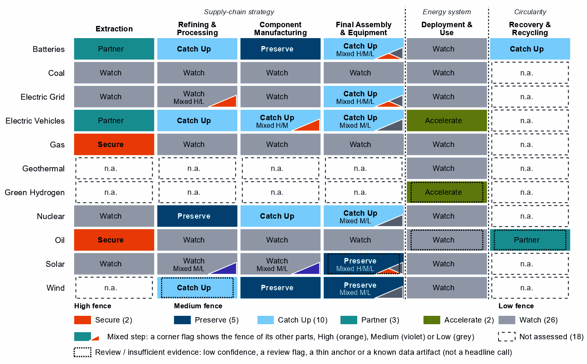
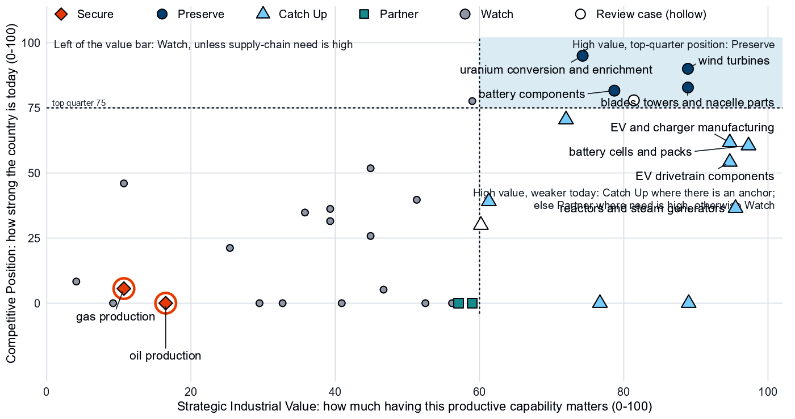
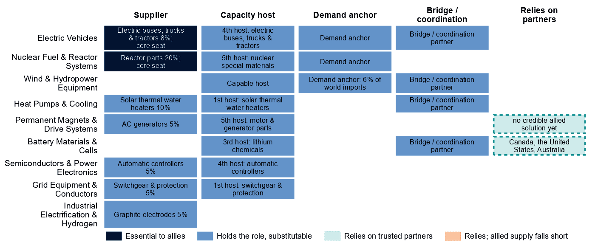
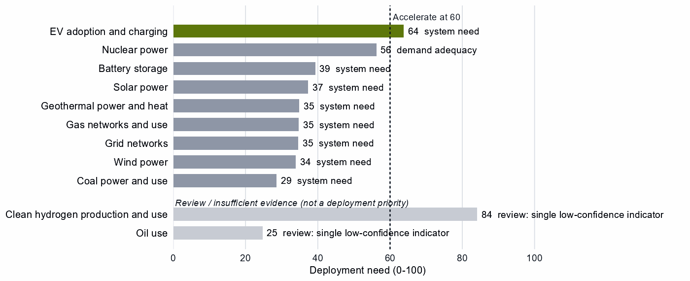

# France and the Allied Industrial Base

*What to secure, build, source from partners, and deploy*

*Generated from Allied Industrial Base Explorer data; evidence, sources and caveats in the appendix. Data as of 30 October 2026.*

## 1. Bottom line — France's strategic role

France's distinctive role in the Allied Industrial Base is as its nuclear specialist and a broad, mid-sized equipment maker. Allies rely on it for reactor parts, 20% of world exports or production, and it holds core seats in Nuclear Fuel & Reactor Systems and Electric Vehicles. Elsewhere its roles are substitutable, and the AIB assigns it no primary strategic role at its current thresholds. Its exposure is imported fuel and the control of imported equipment: oil and gas, grid and battery software, rare-earth magnets and transformer steel sit behind the High fence. Its industrial effort should keep enrichment, wind parts and battery components competitive and catch up in EVs, drivetrains and battery cells, where allies also need new capacity. Most of its manufacturing positions are a few percent of world supply, so catching up should go with allied makers. The nuclear manufacturing calls need care, because their trade baskets mix reactor parts with boiler and steam-turbine parts. At home only EV adoption needs a faster build-out, and France's own need gives its development cooperation a narrow base, battery cells. [1, 2]

- **Secure.** Oil and gas supply, which takes one to three years to rebuild; potentially coercive suppliers provide 51% of oil imports. The control software of battery, grid and inverter equipment. Rare-earth magnets for EV motors, where China leads world rare-earth refining, and grain-oriented electrical steel for transformers. The answer is trusted contracts, stocks, qualified suppliers and control of command paths, not self-sufficiency. [2, 3]
- **Build / preserve.** Preserve uranium enrichment, on 38% of world exports of enriched uranium, wind parts, and battery components. Catch Up in EVs, EV drivetrain components and battery cells and packs, with allied makers where the base is thin. Judge the nuclear parts and reactor Catch Up calls on reactor-specific measures. [2]
- **Partner.** Battery and EV minerals from trusted producers such as Canada, the United States and Australia; allied supply covers the need. With developing partners, add trusted battery-cell capacity through development finance and offtake. [1, 2, 4]
- **Deploy / stay open.** Accelerate EV adoption and charging, buying equipment competitively from trusted suppliers, with security conditions on connected equipment. Leave open wafers and PV cells, polysilicon, plant equipment for gas, oil and coal, and uranium ore, bought from a diversified base of trusted producers.

Figure 1 shows a manufacturing economy. Preserve and Catch Up fill the component and assembly columns of batteries, EVs, nuclear and wind, and enrichment is the only Preserve among the refining steps. Secure sits only in oil and gas, Partner in the minerals France does not mine, and deployment is mostly Watch. Orange corner flags mark High-fence parts inside other steps: control software, EV magnets and transformer steel. Violet flags mark Catch Up layers inside Watch steps, such as solar cells and polysilicon, which inherit their steps' anchors.

**Figure 1. Where France should secure, build, partner or stay open**

*Each cell is a supply-chain step of a technology, colored by its strategic choice. A corner flag marks a mixed step whose named parts sit behind a different fence: in battery cells and packs, the battery software is Secure, the cells Catch Up and the enclosures Watch. A dotted outline marks a review case, a call resting on low confidence, a review flag, a thin anchor or a known data artifact; this brief does not turn those calls into recommendations. Steps marked n.a. lack the data for a call. [4]*

## 2. Where France should secure, compete and stay open

### High fence — what cannot fail

Secure covers two whole steps and eight layers inside other steps, grouped into five capabilities, all in the table with oil and gas together. Secure means surviving a prolonged cutoff or a hostile command through trusted supply, stocks, redundancy or control of the command path, not making everything at home. [4]

| Capability | Why it matters | Main vulnerability | Recommended response |
|---|---|---|---|
| Oil and gas supply | Need is 98 for oil and 91 for gas out of a hundred, and rebuilding supply takes one to three years. | Potentially coercive suppliers provide 51% of oil and 25% of gas imports; allied supply falls short for oil. | **Diversified and allied.** Stocks sized to the rebuild time; capacity reservations with trusted producers such as Canada, Norway and the United States. |
| Control software of grids, inverters and batteries | Firmware and grid-control software can command equipment from abroad. | China supplies 51% of battery and 25% of PV and inverter imports: hardware shares, not software. | **Mixed.** Trusted-source and certification rules for firmware and remote access; a replacement program for the installed base. |
| Grain-oriented electrical steel | The core steel of power transformers. | The call rests on its step, grid metals refining: need 73, trusted suppliers 5% of world supply, a figure unrelated steps repeat; potentially coercive suppliers provide only 6% of its imports. | **Trusted supply.** Capacity reservations with trusted steelmakers; spares pools for transformers. |
| Rare-earth magnets for EV motors | They drive the traction motors of France's EVs. | China holds 94% of rare-earth and battery-metal refining, a step-wide share that battery materials repeats; trusted suppliers 4%; rebuilding takes more than three years. | **Qualified supply.** Offtake and allied agreements; stockpiles; adversary-source limits, phased in as trusted supply qualifies. |

Sources: 1, 2, 3, 4.

Turbine, vehicle, reactor and oil and gas network controls read Watch for France. Inside blades, towers and nacelle parts, the same magnets read Preserve on that step's position, not on magnet output. [4]

### Medium fence — where industrial capability matters

This is where France makes its real industrial choices: is a capability worth having (Strategic Industrial Value), and how strong is France today (Competitive Position)? Most French positions rest on world supply shares of a few percent, ranking high only among the economies that already make them.

**Preserve.** Uranium conversion and enrichment reads Preserve on a position of 95. Its measured anchor is exports of enriched uranium, 38% of the world's. Its supply share of 25% counts uranium compounds, yellowcake included, and converted uranium trades under the mining step's codes, so the data see enrichment, not conversion. With Russia holding 22% of that compound-based supply, trusted enrichment matters to allies. Wind turbines (90) and blades, towers and nacelle parts (83) rest on operating capacity, but on 2% of world supply each, and the turbine step's trade codes are mostly cables, transformers and switchgear. Battery components (82) rest on three anchors with moderate confidence. PV modules and inverters read Preserve only on low confidence, a review case. [2, 4]

**Catch Up.** EV and charger manufacturing (62) and EV drivetrain components (54) combine high value with high confidence; vehicles rest on three anchors, operating capacity among them. Battery cells and packs add high need (79) but rest on a single anchor, 1% of world supply, while China provides 51% of imports. Nuclear fuel and reactor parts (71) and reactors and steam generators (37) also read Catch Up, but their trade baskets mix reactor parts with generic boiler and steam-turbine parts. The AIB's own measure, 20% of world exports or production of reactor parts, is the firmer sign of a nuclear supplier. [1, 2, 4]

Other Catch Up calls are weaker than they look, and this brief does not build on them:

- **Battery materials and rare-earth refining:** both at a position of 0, each on a single export share (2% and 1%). Both show China with 94% of world supply, an identical share that suggests overlapping trade codes. [2, 4]
- **Battery recycling:** a single export share (3%) in trade codes for battery waste, scrap and residues. [2]
- **Rare-earth and wind materials refining:** low confidence, a review case. [4]

**Partner.** France holds 0% of world supply in battery and EV minerals and no pathway to scale it, so it should depend deliberately on trusted producers such as Canada, the United States and Australia; allied supply covers the need. Its largest supplier today, Gabon, is outside that list. Waste-oil recovery reads Partner on low confidence, a review case. [1, 2, 4]

**Shared capabilities.** Some capabilities sit in several technology chains with different calls; the table keeps the national reading apart from what allies rely on France for.

| Shared capability | Steps and their choices | National reading | AIB role |
|---|---|---|---|
| Uranium conversion & enrichment | uranium mining (Watch) and uranium conversion and enrichment (Preserve) | The choices differ within the same technology with each step's own measures (uranium mining: need 98, value 33, position 0; uranium conversion and enrichment: need 61, value 74, position 95) | Supplier: 10% of world exports or production of uranium conversion & enrichment (the AIB measure of the product, not a step's share) |
| Accumulator parts & separators | battery components (Preserve) and EV drivetrain components (Catch Up) | The choices differ across technologies with each step's own measures (battery components: need 65, value 79, position 82; EV drivetrain components: need 38, value 95, position 54) | Allies need new capacity here (BUILD); no supplier role |
| Electricity meters | transformers, switchgear and cables (Catch Up); PV modules and inverters (Preserve, review: low confidence); and wind turbines (Preserve) | The choices differ across technologies with each step's own measures (transformers, switchgear and cables: need 22, value 61, position 39; PV modules and inverters: need 30, value 81, position 78; wind turbines: need 22, value 89, position 90) | Allies need new capacity here (BUILD); no supplier role |
| Ferrite & other magnets | EV drivetrain components (Catch Up) and blades, towers and nacelle parts (Preserve) | The choices differ across technologies with each step's own measures (EV drivetrain components: need 38, value 95, position 54; blades, towers and nacelle parts: need 34, value 89, position 83) | Allies need new capacity here (BUILD); no supplier role |

Sources: 1, 4.

**Figure 2. Which producing capabilities are worth holding, and where France is strong today**

*Producing steps with both measures (recovery has no position measure). Dashed lines mark the value bar (60) and the top quarter (75). Enrichment and the wind steps sit in the upper right; battery materials and rare-earth refining sit on the bottom axis, with no measurable position. Wafers and PV cells hold a top-quarter position (78) but read Watch on low need and a value just under the bar. Hollow markers are review cases. [2, 4]*

### Low fence — what not to prioritize

A credible strategy also says what not to localize. Watch is not a failure: it means affordable, diversified access matters more than domestic production.

- **Wafers and PV cells, and polysilicon refining.** Need for wafers and cells is low (19), their trade codes include chip-industry codes, and their cell layers read Catch Up only on inherited anchors. France has no measurable position in polysilicon refining (0), and its solar-grade layer's Catch Up rests on the step's export share alone. [2, 4]
- **Gas, oil and coal plant equipment.** Need is low, value below the bar and positions below the top quarter. Yet 19 economies count France as their best-placed trusted partner for coal-plant equipment, where it holds 9% of world supply: a supplier role to keep reliable through competition, not a fence. [2, 4]
- **Uranium mining.** Need is very high (98), and Kazakhstan, the largest potentially coercive supplier, provides 31% of imports. Yet the step reads Watch, a large, commoditized yard where France has no mines: buy from a diversified base of trusted producers. [2, 4]

## 3. France's allied bargain

**What France contributes.** The Allied Industrial Base analysis assigns France no primary strategic role at its current thresholds. It holds a role in nine of the ten strategic compacts, most of them substitutable. Its supply is essential where it holds core seats, in Nuclear Fuel & Reactor Systems and Electric Vehicles: 20% of world exports or production of reactor parts and 8% of electric buses, trucks and tractors. It also supplies 10% of uranium conversion and enrichment products, natural uranium compounds included. 20 economies count France as their best-placed trusted partner somewhere in the chain, 19 of them for coal-plant equipment. [1, 2, 4]

**What France needs.** Fuel, minerals, magnets and battery cells. If China's supply stopped, as in the Decoupling scenario, France would lose US$8.3 billion a year of imports across the Allied Industrial Base basket. New capacity at allied hosts, led by Germany, would restore only about US$2.6 billion of it a year. Under Managed Interdependence, the default scenario, France sits in the minimum coalition of two Sectoral Compacts (the finer units beneath the strategic compacts); under Decoupling, in five. [1, 2]

**The dependencies to make intentional.** These bargains turn that exchange into a specialization partners can count on.

| Capability / compact | France contributes | France needs | Natural partners | What makes the bargain work |
|---|---|---|---|---|
| Nuclear Fuel & Reactor Systems | Reactor parts, the lead product (20% of world exports or production) and enrichment (38% of world exports); a core seat | Uranium and fuel materials; uranium imports led by Kazakhstan | Australia, Canada and India, the compact's resource and fuel seats | Diversified uranium imports; public finance and allied investment for enrichment, tied to benchmarks |
| Electric Vehicles | Electric buses, trucks and tractors, the lead product (8% of world exports or production); a core seat | Battery cells: China supplies 51% of imports | Germany, the United States, Japan and South Korea; for cells, South Korea | Co-investment, offtake and joint ventures with allied cell makers; time-limited support tied to benchmarks |
| Battery Materials & Cells | Bridge and diversification roles; hosting (3rd host: lithium chemicals) | Battery and EV minerals; refined materials | Canada, the United States and Australia for minerals; Japan, Indonesia and South Korea for processing | Offtake and co-investment with the recommended partners; development finance for partner capacity |
| Permanent Magnets & Drive Systems | AC generators, the lead product (5% of world exports or production), not magnets | Qualified magnets: the AIB finds no credible allied solution yet | Germany, the United States, Japan and Mexico, the compact's makers | Offtake and allied agreements; stockpiles until supply qualifies |

Sources: 1, 2, 4.

**Figure 3. France's role in the Allied Industrial Base**

*Each row is a strategic compact in which France holds a role or relies on partners. Dark cells are roles allies cannot easily replace; light cells are roles others could fill; dashed cells mark where France relies on trusted partners, orange where allied supply still falls short of what allies need.*

Figure 3 shows a supplier with many substitutable roles and essential ones in nuclear and vehicles. France relies on partners in battery minerals, where allied supply covers the need, and in magnets, where no credible allied solution exists yet. In magnets the bargain has to add capacity, not only redirect trade.

## 4. Development strategy — build trusted capacity by helping partners Catch Up

Development cooperation can be the development arm of that bargain. A partnership pairs a step where France or its allies need more trusted capacity with a developing partner whose same step is a credible Catch Up with a corroborated anchor, inside the allied trust screen. 49 pairs qualify, with 16 developing partners across 10 steps. [1, 4, 5]

France's own need is a thin base for them. Only 5 pairs, with 5 partners, rest on it, all in battery cells and packs. The other 44 rest on the allied gap alone, a reason that is the same for every donor in scope: they show where allies fall short, not what France needs. [1, 4, 5]

| Capability / allied gap | Developing partner | Why this partner can Catch Up | What the donor should support | Security / AIB benefit | Development benefit |
|---|---|---|---|---|---|
| Battery cells and packs: high need and new allied capacity needed | Malaysia (upper middle income) | A share of world supply and a share of world exports; corroborated by feasibility, input costs, specialization in the adjacent step and industrial learning | Constraint: no operating or committed plant in the capacity data and a position that rests on trade or output shares, not on plant capacity. Lead with development finance, guarantees, offtake, equity and joint ventures; public support for project preparation and investment promotion | Diversified supply for a high-need step and new allied capacity where the AIB finds a gap (allies need new capacity in 2 product groups of the step) | Factory capacity, skills and export sales of finished equipment |
| Battery materials refining: new allied capacity needed | Madagascar (low income) | A share of world exports and operating capacity; corroborated by specialization in the adjacent step | Constraint: related industrial know-how outside the top quarter and input costs outside the cheapest quarter. Workforce development, technology transfer and joint ventures, industrial infrastructure, feasibility studies and project preparation; then, at scale, offtake, market access, investment guarantees | New allied capacity where the AIB finds a gap (allies need new capacity in 6 product groups of the step) | Processing capacity at home, with the skills, standards and value capture of a refinery |
| EV and charger manufacturing: new allied capacity needed | Mexico (upper middle income) | A share of world supply, a share of world exports, operating capacity and a strong position in the next step up the chain; corroborated by feasibility, specialization in the adjacent step and industrial learning | Constraint: input costs outside the cheapest quarter. Lead with development finance, guarantees, offtake, equity and joint ventures; public support for industrial infrastructure and supplier development | New allied capacity where the AIB finds a gap (allies need new capacity in 4 product groups of the step) | Factory capacity, skills and export sales of finished equipment |
| EV drivetrain components: new allied capacity needed | Thailand (upper middle income) | A share of world supply and a share of world exports; corroborated by feasibility, input costs, specialization in the adjacent step and industrial learning | Plant capacity not covered by the data. Lead with development finance, guarantees, offtake, equity and joint ventures; public support for supplier development and technical and vocational skills | New allied capacity where the AIB finds a gap (allies need new capacity in 7 product groups of the step) | A certified supplier base and export sales of components |
| Wind turbines: new allied capacity needed | Viet Nam (lower middle income) | A share of world supply and a share of world exports; corroborated by feasibility and industrial learning | Constraint: no operating or committed plant in the capacity data and a position that rests on trade or output shares, not on plant capacity. Input costs not covered by the data. Project preparation, investment promotion, industrial infrastructure, quality systems and certification; then, at scale, development finance, guarantees, offtake, equity and joint ventures | New allied capacity where the AIB finds a gap (allies need new capacity in 2 product groups of the step) | Factory capacity, skills and export sales of finished equipment |

Sources: 1, 2, 4, 5, 6, 7.

The table leads with the own-need row, Malaysia, an upper middle income economy with a position of 66 but no operating or committed plant in the capacity data. The other rows rest on the allied gap. Finance, guarantees and offtake should lead for Mexico and Thailand. Madagascar (low income, Competitive Position 0) and Viet Nam (lower middle income; its anchor is a trade share on the step's cable-heavy codes, with no plant in the capacity data) need project preparation, infrastructure and skills first. [1, 2, 4, 5]

A partnership lasts longer when it rests on more than aid. The second table shows today's ties: aid is the 2020 to 2024 total at the step, and the direct investment position is economy-wide. Aid at these steps is small or absent, and where the factory-project data cover a pair, they record no French project in the technology. [5]

| Partnership | Relationship today | What makes it durable |
|---|---|---|
| Malaysia: battery cells and packs | No energy, industry or mining aid recorded for the pair; a direct investment position of $1,217 million (economy-wide); no factory projects by firms from France recorded in the technology; and no export-credit or lender finance recorded at the step | Long-term offtake, joint ventures and investment guarantees as the capability scales; the partner's role as Specialized technology supplier in the Battery Materials & Cells compact |
| Madagascar: battery materials refining | $2.0 million of energy, industry and mining aid, none at this step; a direct investment position of $227 million (economy-wide); and no export-credit or lender finance recorded at the step | Long-term offtake, joint ventures and investment guarantees as the capability scales; the partner's role as Resource supplier in the Battery Materials & Cells compact |
| Mexico: EV and charger manufacturing | $104 million of energy, industry and mining aid, none at this step; a direct investment position of $5,073 million (economy-wide); no factory projects by firms from France recorded in the technology; and an AIB simulated investment pairing (a model result, not an existing tie) | Long-term offtake, joint ventures and investment guarantees as the capability scales; the partner's role as Scale manufacturer in the Electric Vehicles compact; France's own deployment demand for the technology (Accelerate) |
| Thailand: EV drivetrain components | $0.6 million at this step, under stage-wide codes (the technology is not identified); a direct investment position of $2,453 million (economy-wide); and no factory projects by firms from France recorded in the technology | Long-term offtake, joint ventures and investment guarantees as the capability scales; the partner's role as Resource supplier in the Permanent Magnets & Drive Systems compact; France's own deployment demand for the technology (Accelerate) |
| Viet Nam: wind turbines | $154 million of energy, industry and mining aid, none at this step; a direct investment position of $1,040 million (economy-wide); and no factory projects by firms from France recorded in the technology | Long-term offtake, joint ventures and investment guarantees as the capability scales; the partner's role as Demand anchor in the Wind & Hydropower Equipment compact; the partner's own deployment demand for the technology (Accelerate) |

Sources: 1, 4, 5, 7, 8, 9, 10.

In battery cells and packs, 5 developing economies have credible pathways, led by Malaysia and Indonesia, and Viet Nam already hosts new capacity commercially. For battery mineral mining, EV mineral mining, gas production and oil production: no developing partner passes the tests. Nor does any developing partner qualify in rare-earth and battery-metal refining, where French need is high. Malaysia and Thailand host its new capacity commercially; the other candidates rest on battery-metal capacity data or a thin anchor. Another 29 pairs are commercial, where trade, offtake and investment fit better than aid. [1, 4, 5]

Today's aid does not follow this map; the data cover energy, industry and mining aid only. 7 partners receive French aid at a partnership's step, only under stage-wide codes that do not identify the technology; 8 receive it at other steps, and 2 at none; a partner with several steps can sit in two groups. The largest recipient, South Africa ($434 million over 2020 to 2024), has a credible pathway in battery materials refining, where its aid is coded only by stage. Other large recipients, such as Egypt, Nigeria, Kenya, Cote d'Ivoire, Guinea and Tanzania, have no qualifying partnership here; that aid serves aims this brief does not judge. [1, 4, 5]

## 5. Energy-system priorities

Wherever the equipment is made, only EV adoption and charging clears the Accelerate bar of 60 on settled evidence: a need of 64 on two measures with moderate confidence. Clean hydrogen reads higher, but on a single indicator of low confidence, so it is a review case. Nuclear power sits just below the bar (56), though demand adequacy alone (62) clears it and capacity was flat (61.4 to 61.4 GW); it deserves the next review. Renewables are close to target: 91 GW by 2030 against 84 GW in 2025, a shortfall of about 3 GW at the recent build rate. Storage, solar, wind and grid networks are worth watching, not forcing. [4, 11, 12]

**Figure 4. What France needs to deploy faster**

*Deployment need by technology, with the largest of its measures: demand adequacy, the gap to national targets, or system need. Review cases, which rest on a single indicator of low confidence, are shown apart in grey and are not deployment priorities.*

EV adoption should not wait for the domestic Catch Up. Oil use is a review case on a single indicator of low confidence, so it sets no priority.

## 6. Is current policy pointed in the right direction?

Recorded policy never decides a choice; it is compared with it afterwards, within France's own measures.

| Capability | Strategic choice | Current policy | Gap |
|---|---|---|---|
| Oil production | Secure | Needs more attention | Vulnerability without enough policy attention |
| Gas production | Secure | Needs more attention | Vulnerability without enough policy attention |
| Rare-earth and battery-metal refining | Catch Up | Needs more attention | Capability case without enough policy attention |
| Battery storage | Watch | Heavy local-content protection on the equipment of a Watch deployment | Localizing what is not a domestic priority |
| Wind power | Watch | Heavy local-content protection on the equipment of a Watch deployment | Localizing what is not a domestic priority |

Sources: 4, 13, 14.

First, oil and gas are Secure but rank low in France's own measures (25 and 36): little recorded policy attention; stocks are not measured here, so test stocks and contracts against the rebuild time. Second, rare-earth refining needs attention, but on a small export base, so qualified magnet supply comes first. Finally, local-content protection on wind and storage equipment ranks near the top (99 and 94), though both deployments read Watch. The equipment steps are Preserve and Catch Up: Catch Up allows time-limited local-content rules tied to benchmarks, while Preserve calls only for targeted remedies and conditional procurement. [4, 13, 14]

## 7. Strategic agenda — what should France do next?

### 1. Secure fuel supply and the grid's command layer

Size oil and gas stocks to the rebuild time. Reserve capacity with trusted producers such as Canada, Norway and the United States for oil and Norway, Australia and the United States for gas; partner evidence is weak, so test the terms. Apply trusted-source and certification rules to battery, inverter, metering and grid-control software, and reserve transformer steel with trusted steelmakers. [1, 2, 4]

### 2. Keep enrichment competitive as an allied supply, and diversify uranium

Keep enrichment, the nuclear position the data measure most directly, at the frontier with public finance and allied investment tied to benchmarks, so allies can move away from Russia's supply. Buy uranium from diversified trusted producers. [2]

### 3. Catch up in EVs, drivetrains and battery cells, with support tied to benchmarks

Tie production incentives, workforce development and demand creation to benchmarks, with sunsets. Build at home where the base is established and with allied makers such as Germany, the United States, Japan and South Korea for the rest. Source magnets through offtake and allied agreements that add capacity, since the AIB finds no credible allied solution yet; hold stocks until trusted supply qualifies. [1, 4]

### 4. Build trusted battery-cell capacity with developing partners

Start with Malaysia, the own-need partner, checking first why the capacity data show no plant; lead with development finance, guarantees and offtake. Pursue allied-gap pairs, such as Mexico in EV and charger manufacturing, jointly with allies. [1, 4, 5]

### 5. Accelerate EV adoption while keeping sourcing open

Deploy faster through charging infrastructure, permitting and procurement, buying from trusted suppliers with security conditions on connected equipment. Keep local-content protection on storage equipment time-limited and tied to Catch Up benchmarks, with sunsets, and hold wind equipment to targeted remedies and conditional procurement.

## Sources

1. Allied Industrial Base model: roles, compacts, trade restored and new capacity across the allied coalition, computed by the Explorer's authors (run of 30 October 2026); CC BY 4.0.
2. United Nations, UN Comtrade Database, HS6 bilateral trade (all reporters); reconciled by the authors (2022-2024 data); attribution; https://comtradeplus.un.org/.
3. Yards & Fences node attributes: standardization, learning, industrial commons and control layers, curated by the authors from public sources (2026-10-30); CC BY 4.0.
4. Country strategy choices by technology and supply-chain step (supply-chain need, Strategic Industrial Value, Competitive Position, deployment need, policy alignment), computed by the Explorer's authors (dashboard data of 31 October 2026); CC BY 4.0.
5. OECD Creditor Reporting System: official development assistance by donor, recipient and purpose code, gross disbursements at constant prices, energy, industry and mining purpose codes only, mapped to supply-chain steps by the authors (Components and Assembly share purpose codes; no code funds recycling) (2020-2024 data); attribution; https://data-explorer.oecd.org/.
6. Clean Investment Monitor: clean-technology manufacturing investment and capacity (aggregated), world capital expenditure 2021-22 to 2024-25; attribution; https://www.cleaninvestmentmonitor.org/.
7. Development tool families by supply-chain stage and constraint, and the development-partnership tests, set by the authors (config/development_partnerships.yml) (2026-11-03); CC BY 4.0.
8. International Monetary Fund, Direct Investment Positions: outward positions (reported, else derived from the counterpart's reports) (2020-2024 data); attribution; https://data.imf.org/.
9. fDi Markets clean-manufacturing projects (CM-FDI): factory projects by home and destination economy (Components and Assembly not separated); subscription (aggregates only).
10. Oil Change International, Public Finance for Energy: export-credit and development-lender energy finance (not aid) (2013-2025 data); attribution; https://energyfinance.org/.
11. Ember, electricity generation and capacity data (2020-2025) and 2030 Renewable Target Tracker; CC BY 4.0; https://ember-energy.org/.
12. International Energy Agency, World Energy Outlook 2025 (Stated Policies Scenario) and Global Critical Minerals Outlook: demand 2024-2035 (2025); CC BY-NC-SA 4.0 (free dataset); https://www.iea.org/.
13. Global Trade Alert, New Industrial Policy Observatory: industrial-policy interventions, strength scored by the authors, October 2026 extract (as of 5 October 2026); subscription (titles, dates and links only); https://www.globaltradealert.org/.
14. International Energy Agency, Policies and Measures Database (export of 2026-10-26); attribution; https://www.iea.org/policies.

## Appendix — evidence and method

**How this brief is built.** Every number comes from the Country page data of the Allied Industrial Base Explorer (the data release of 30 October 2026) and from the Allied Industrial Base analysis. Each technology is split into supply-chain stages from extraction to recycling, and each step gets a strategic choice by fixed rules applied in order: [4]

- Secure where an acute vulnerability is measured;
- at deployment, Accelerate where deployment need reaches 60; [4]
- Watch where the step is a large, commoditized yard;
- Preserve where Competitive Position is in the top quarter (75) and either Strategic Industrial Value (bar 60) or supply-chain need (bar 67) is high; [4]
- Catch Up where the value is high, the position is not, and a capability anchor is corroborated by other evidence;
- Partner where supply-chain need is high but there is neither a top-quarter position nor, for a high-value step, a credible pathway;
- Watch otherwise.

Named layers inside a step, such as control software or magnets, take their own choice, and a step whose parts sit behind different fences is mixed. A value that rests on market size alone is capped just under the bar. Observed policy never decides a choice. The high fence (Secure) protects what cannot be allowed to fail; the medium fence covers capabilities worth building, keeping or sourcing deliberately and deployment to accelerate; the low fence (Watch) leaves a step open to competitive purchase.

**Review cases.** Some calls rest on low confidence, an engine review flag, a thin capability anchor, a known data artifact or, at deployment, a single indicator of low confidence. They stay on the map but never enter the Bottom line, the Agenda, the policy table or a headline mark. 5 steps are review cases. [4]

| Step | Choice | Why it is a review case |
|---|---|---|
| Clean hydrogen production and use | Accelerate | A single indicator of low confidence |
| Oil use | Watch | A single indicator of low confidence |
| Waste-oil recovery | Partner | Low confidence |
| PV modules and inverters | Preserve | Low confidence |
| Rare-earth and wind materials refining | Catch Up | Low confidence |

Sources: 4.

**Evidence and caveats.** The oil and gas calls rest on measured import dependence and supplier concentration, and the EV and battery-cell Catch Up calls have high confidence. The enrichment Preserve rests on exports of enriched uranium; its supply share of 25% is a share in uranium compounds, yellowcake included, and the AIB's measure of 10% also covers natural uranium compounds. Natural uranium hexafluoride, the output of conversion, trades with yellowcake under the mining step's codes, so conversion has no measure of its own. The baskets of nuclear fuel and reactor parts and of reactors mix reactor parts with generic boiler and steam-turbine parts, the kind of equipment that also fills the coal-plant steps. The wind turbines step's trade codes are mostly cables, transformers and switchgear; battery recycling's are battery waste, scrap and residues; rare-earth and wind materials refining's are mostly copper wire rod by value. The solar wafer and module baskets include chip-industry codes, and the Catch Up layers inside the Watch solar steps inherit their steps' anchors. Rare-earth and battery-metal refining and battery materials refining show the identical China share of world supply, which suggests overlapping trade codes. Grain-oriented electrical steel reads Secure on the measures of its step, which cover grid metals as a whole; sintered magnets read Secure in EV drivetrains and Preserve in wind components, each on its step's measures. Uranium mining reads Watch as a large yard despite a need of 98. 18 steps lack the data for a call, including geothermal supply, green hydrogen manufacturing and most recycling. Recorded policy ranks electrolyser systems (96) and stacks (83) near the top of France's own measures, but those steps cannot be assessed and hydrogen deployment need rests on a single indicator, so this brief does not settle that disagreement. Import shares follow the trading partner, so a hub such as Belgium for gas can stand for the producers behind it. Competitive Position ranks France among economies that already supply a step, so a zero means no measurable position. Partner lists name where allied capacity sits, which can include trading hubs, not who owns it. [1, 2, 4, 13, 14]

**Development partnerships.** A pair joins a French step with a strategic reason for more allied capacity and a developing economy (not high income) whose same step is a Catch Up. The reason is France's own need, or the allied gap alone, where allies need new capacity, which is the same for every donor in scope. The partner needs an anchor corroborated beyond context signals, sufficient evidence and confidence, and a place inside the AIB trust screen; on a step whose data describe different products, the anchor must measure the product the need is about. A partner that already hosts the step's new capacity in the AIB, or Preserves it, is a commercial case. Aid comes from the OECD Creditor Reporting System by purpose code and covers energy, industry and mining aid only. Components and Assembly share codes, no code funds recycling, and many codes name a stage rather than a technology, so aid at a step is not aid for that technology. Aid is called technology-coded only where codes naming the technology hold at least half of it, and a partner with several steps can sit in several aid groups. A constraint on a partner is named only where the data observe its input; otherwise the table says the data do not cover it. In the relationship table an observed zero is stated as nothing recorded, data that do not cover a pair are left out, and the direct investment position is economy-wide, not tied to the step. Export-credit finance is reported apart and never counted as aid, and direct investment uses the IMF positions (the partner's reports where France reports none). The full list of pairs, with every field, is in the development-partnership export.

| Step | Donor reason | Development partners | Commercial route | Review cases | Aid at the step |
|---|---|---|---|---|---|
| Battery cells and packs | High need and new allied capacity needed | Malaysia, Indonesia, Mexico, India and Turkiye | Viet Nam | – | India |
| Battery materials refining | New allied capacity needed | Madagascar, the Philippines, India, South Africa, Thailand, Papua New Guinea and Turkiye | Argentina, Indonesia, the Democratic Republic of Congo and Malaysia | Mozambique, Colombia and Tanzania | India, South Africa, Thailand, Papua New Guinea and Argentina |
| EV and charger manufacturing | New allied capacity needed | Mexico, Viet Nam, Thailand, Malaysia, Morocco and Indonesia | Turkiye and India | – | Viet Nam, Thailand and India |
| EV drivetrain components | New allied capacity needed | Thailand, Morocco, Malaysia, Serbia, Turkiye, Honduras and Ukraine | Indonesia, the Philippines, Mexico and India | Viet Nam | Thailand, Serbia, India and Viet Nam |
| Blades, towers and nacelle parts | New allied capacity needed | Thailand, Serbia, Turkiye, Brazil and Malaysia | Mexico, Viet Nam, the Philippines and India | – | Thailand, Serbia, Brazil and India |
| Wind turbines | New allied capacity needed | Viet Nam, Turkiye, Thailand, Indonesia, Morocco and Malaysia | India and Mexico | Brazil | Thailand, India and Brazil |
| Battery components | New allied capacity needed | Viet Nam, Indonesia, Turkiye, Mexico, India, Morocco and Malaysia | – | – | India |
| Transformers, switchgear and cables | New allied capacity needed | India, Malaysia and the Philippines | Mexico, Thailand, Turkiye and Viet Nam | Morocco | India and Thailand |
| Rare-earth and wind materials refining | New allied capacity needed | India | – | Viet Nam and South Africa | India and South Africa |
| PV modules and inverters | New allied capacity needed | Morocco and Turkiye | India, Viet Nam, Thailand, Mexico, Malaysia and Indonesia | – | India and Thailand |
| Rare-earth and battery-metal refining | High need and new allied capacity needed | – | Malaysia and Thailand | Argentina, Indonesia, the Democratic Republic of Congo, Mozambique, the Philippines, Mexico, Madagascar and Tanzania | Thailand and Argentina |
| Nuclear fuel and reactor parts | High need | – | – | India, Thailand and Viet Nam | India and Thailand |
| Battery recycling | High need | – | – | India and Malaysia | – |

Sources: 1, 4, 5.

**Every step.**

| Step | Stage | Choice | Fence | Need | Value | Position | Evidence | Policy |
|---|---|---|---|---|---|---|---|---|
| Battery mineral mining | Extraction | Partner | Medium | 90 | 57 | 0 | strong | broadly aligned |
| Battery materials refining | Refining | Catch Up | Medium | 52 | 77 | 0 | strong | broadly aligned |
| Battery components | Components | Preserve | Medium | 65 | 79 | 82 | moderate | broadly aligned |
| Battery cells and packs | Assembly | Catch Up | Mixed High/Medium/Low | 79 | 97 | 61 | moderate | broadly aligned |
| Battery storage | Deployment | Watch | Low | 39 | – | – | moderate | too much intervention |
| Battery recycling | Recovery | Catch Up | Medium | 87 | 82 | – | – | mixed signals |
| Coal mining | Extraction | Watch | Low | 91 | 4 | 8 | strong | broadly aligned |
| Coke and coal processing | Refining | Watch | Low | 87 | 9 | 0 | strong | broadly aligned |
| Coal-plant components | Components | Watch | Low | 56 | 39 | 36 | strong | broadly aligned |
| Coal-plant equipment | Assembly | Watch | Low | 38 | 39 | 32 | strong | mixed signals |
| Coal power and use | Deployment | Watch | Low | 29 | – | – | moderate | broadly aligned |
| Coal recovery | Recovery | Not assessed | – | – | 1 | – | – | not enough policy evidence |
| Copper and bauxite mining | Extraction | Watch | Low | 89 | 41 | 0 | strong | broadly aligned |
| Grid metals refining | Refining | Watch | Mixed High/Low | 73 | 53 | 0 | strong | broadly aligned |
| Grid components | Components | Watch | Low | 30 | 47 | 5 | strong | broadly aligned |
| Transformers, switchgear and cables | Assembly | Catch Up | Mixed High/Medium/Low | 22 | 61 | 39 | strong | mixed signals |
| Grid networks | Deployment | Watch | Low | 35 | – | – | – | broadly aligned |
| Grid-equipment recycling | Recovery | Not assessed | – | – | 14 | – | – | not enough policy evidence |
| EV mineral mining | Extraction | Partner | Medium | 90 | 59 | 0 | strong | broadly aligned |
| Rare-earth and battery-metal refining | Refining | Catch Up | Medium | 87 | 89 | 0 | strong | needs more attention |
| EV drivetrain components | Components | Catch Up | Mixed High/Medium | 38 | 95 | 54 | moderate | mixed signals |
| EV and charger manufacturing | Assembly | Catch Up | Mixed Medium/Low | 21 | 95 | 62 | moderate | broadly aligned |
| EV adoption and charging | Deployment | Accelerate | Medium | 64 | – | – | strong | broadly aligned |
| EV recycling | Recovery | Not assessed | – | – | 42 | – | – | not enough policy evidence |
| Gas production | Extraction | Secure | High | 91 | 11 | 6 | strong | needs more attention |
| Gas liquids processing | Refining | Watch | Low | 58 | 11 | 46 | strong | broadly aligned |
| Gas-turbine and drilling components | Components | Watch | Low | 41 | 45 | 52 | strong | broadly aligned |
| Gas turbines and LNG plant | Assembly | Watch | Low | 21 | 45 | 26 | strong | broadly aligned |
| Gas networks and use | Deployment | Watch | Low | 35 | – | – | strong | broadly aligned |
| Gas recovery | Recovery | Not assessed | – | – | 7 | – | – | not enough policy evidence |
| Geothermal resource development | Extraction | Not assessed | – | – | 20 | – | – | not enough policy evidence |
| Geothermal refining | Refining | Not assessed | – | – | 20 | – | – | not enough policy evidence |
| Geothermal plant components | Components | Not assessed | – | – | 69 | – | – | not enough policy evidence |
| Geothermal power-plant equipment | Assembly | Not assessed | – | – | 69 | – | – | not enough policy evidence |
| Geothermal power and heat | Deployment | Watch | Low | 35 | – | – | strong | broadly aligned |
| Geothermal recovery | Recovery | Not assessed | – | – | 20 | – | – | not enough policy evidence |
| Electrolyser mineral mining | Extraction | Not assessed | – | – | 35 | 0 | strong | not enough policy evidence |
| PGM and catalyst refining | Refining | Not assessed | – | – | 63 | 91 | strong | not enough policy evidence |
| Electrolyser stacks | Components | Not assessed | – | – | 99 | – | – | not enough policy evidence |
| Electrolyser systems | Assembly | Not assessed | – | – | 90 | – | – | not enough policy evidence |
| Clean hydrogen production and use | Deployment | Accelerate | Medium | 84 | – | – | – | broadly aligned |
| Stack and catalyst recycling | Recovery | Not assessed | – | – | 49 | – | – | not enough policy evidence |
| Uranium mining | Extraction | Watch | Low | 98 | 33 | 0 | strong | broadly aligned |
| Uranium conversion and enrichment | Refining | Preserve | Medium | 61 | 74 | 95 | strong | mixed signals |
| Nuclear fuel and reactor parts | Components | Catch Up | Medium | 80 | 72 | 71 | strong | broadly aligned |
| Reactors and steam generators | Assembly | Catch Up | Mixed Medium/Low | 43 | 96 | 37 | strong | broadly aligned |
| Nuclear power | Deployment | Watch | Low | 56 | – | – | strong | broadly aligned |
| Spent-fuel reprocessing | Recovery | Not assessed | – | – | 74 | – | – | not enough policy evidence |
| Oil production | Extraction | Secure | High | 98 | 17 | 0 | strong | needs more attention |
| Oil refining | Refining | Watch | Low | 28 | 36 | 35 | strong | broadly aligned |
| Drilling and pump components | Components | Watch | Low | 41 | 25 | 21 | strong | broadly aligned |
| Drilling rigs, tankers and oil equipment | Assembly | Watch | Low | 12 | 51 | 40 | strong | broadly aligned |
| Oil use | Deployment | Watch | Low | 25 | – | – | strong | broadly aligned |
| Waste-oil recovery | Recovery | Partner | Medium | 91 | 8 | – | – | broadly aligned |
| PV mineral mining | Extraction | Watch | Low | 93 | 30 | 0 | strong | broadly aligned |
| Polysilicon refining | Refining | Watch | Mixed Medium/Low | 53 | 56 | 0 | strong | broadly aligned |
| Wafers and PV cells | Components | Watch | Mixed Medium/Low | 19 | 59 | 78 | moderate | broadly aligned |
| PV modules and inverters | Assembly | Preserve | Mixed High/Medium/Low | 30 | 81 | 78 | moderate | broadly aligned |
| Solar power | Deployment | Watch | Low | 37 | – | – | strong | broadly aligned |
| PV module recycling | Recovery | Not assessed | – | – | 45 | – | – | not enough policy evidence |
| Wind mineral mining | Extraction | Not assessed | – | – | 46 | 8 | strong | not enough policy evidence |
| Rare-earth and wind materials refining | Refining | Catch Up | Medium | 64 | 60 | 30 | strong | needs more attention |
| Blades, towers and nacelle parts | Components | Preserve | Medium | 34 | 89 | 83 | moderate | broadly aligned |
| Wind turbines | Assembly | Preserve | Mixed Medium/Low | 22 | 89 | 90 | moderate | broadly aligned |
| Wind power | Deployment | Watch | Low | 34 | – | – | strong | too much intervention |
| Wind-turbine recycling | Recovery | Not assessed | – | – | 34 | – | – | not enough policy evidence |

Sources: 2, 3, 4, 6, 11, 12, 13, 14.

**Named layers.**

| Layer | Step | Choice | Fence |
|---|---|---|---|
| Anode materials (natural and synthetic graphite) | battery materials refining | Catch Up | Medium |
| Cathode active materials and precursors | battery materials refining | Catch Up | Medium |
| Battery-grade lithium hydroxide and carbonate | battery materials refining | Catch Up | Medium |
| Battery cells (LFP and NMC) | battery cells and packs | Catch Up | Medium |
| Communications gateway and cloud fleet management | battery cells and packs | Secure | High |
| Battery-management firmware, energy-management software and remote updates | battery cells and packs | Secure | High |
| Enclosures, racking, thermal management and balance of system | battery cells and packs | Watch | Low |
| Grain-oriented electrical steel | grid metals refining | Secure | High |
| Power conversion hardware (inverters and converters) | transformers, switchgear and cables | Catch Up | Medium |
| Smart meters and advanced metering head-end systems | transformers, switchgear and cables | Secure | High |
| Cables and conductors | transformers, switchgear and cables | Watch | Low |
| Utility-scale inverter firmware and remote-access functions | transformers, switchgear and cables | Secure | High |
| Grid-control software (SCADA, EMS, DERMS) | transformers, switchgear and cables | Secure | High |
| Large power transformers | transformers, switchgear and cables | Catch Up | Medium |
| HVDC converter-station control and protection | transformers, switchgear and cables | Catch Up | Medium |
| Electric drive units and motors | EV drivetrain components | Catch Up | Medium |
| Sintered NdFeB permanent magnets (traction motors) | EV drivetrain components | Secure | High |
| Connected-vehicle telematics, over-the-air software and connectivity systems | EV and charger manufacturing | Watch | Low |
| Charging-network management software (charge-point back ends) | EV adoption and charging | Accelerate | Medium |
| Pipeline SCADA, compressor-station and LNG-terminal control systems | gas turbines and LNG plant | Watch | Low |
| Iridium and platinum for PEM electrolyser catalysts | electrolyser mineral mining | Not assessed | – |
| HALEU enrichment | uranium conversion and enrichment | Preserve | Medium |
| LEU enrichment services | uranium conversion and enrichment | Preserve | Medium |
| Fuel assemblies (design-specific fabrication) | nuclear fuel and reactor parts | Catch Up | Medium |
| Reactor control and safety instrumentation | reactors and steam generators | Watch | Low |
| Oil pipeline and terminal control systems | drilling rigs, tankers and oil equipment | Watch | Low |
| Solar-grade polysilicon | polysilicon refining | Catch Up | Medium |
| Solar cells and wafers | wafers and PV cells | Catch Up | Medium |
| Next-generation PV (perovskite and tandem cells) | wafers and PV cells | Catch Up | Medium |
| Distributed PV inverter firmware, communication dongles and vendor cloud | PV modules and inverters | Secure | High |
| Conventional crystalline-silicon modules | PV modules and inverters | Preserve | Medium |
| Passive racking and mounting | PV modules and inverters | Watch | Low |
| Rare-earth separation and metal-making | rare-earth and wind materials refining | Catch Up | Medium |
| Sintered NdFeB permanent magnets | blades, towers and nacelle parts | Preserve | Medium |
| Turbine controllers, OEM remote access and park SCADA | wind turbines | Watch | Low |

Sources: 3, 4.

**Partner recommendations.**

| Step | Choice | Trusted partners | Allied supply | Evidence |
|---|---|---|---|---|
| Battery mineral mining | Partner | Canada, the United States and Australia | Allied supply covers the need | moderate |
| EV mineral mining | Partner | the United States, Canada and Australia | Allied supply covers the need | moderate |
| Gas production | Secure | Norway, Australia and the United States | Allied supply covers the need | weak |
| Oil production | Secure | Canada, Norway and the United States | Allied supply falls short | weak |
| Waste-oil recovery | Partner | No credible allied solution yet | – | none |

Sources: 1, 2, 4.

**Compact roles.**

| Strategic compact | Lead role | Functions | Lead step | Core countries |
|---|---|---|---|---|
| Permanent Magnets & Drive Systems | Scale manufacturer | Scale manufacturer and capacity-building host | Motors & generators | Thailand, Viet Nam, Germany, the United States, Japan and Mexico |
| Battery Materials & Cells | Bridge / coordination partner | Bridge / coordination partner and diversification partner | – | the United States, the Democratic Republic of Congo, Japan, Indonesia, South Korea and Germany |
| Semiconductors & Power Electronics | Scale manufacturer | Scale manufacturer and capacity-building host | Converters & controllers | Brazil, Taiwan, Singapore, South Korea, the United States and Viet Nam |
| Wind & Hydropower Equipment | Demand anchor | Demand anchor, capacity-building host, bridge / coordination partner and diversification partner | Blade materials | Spain, Poland, India, Germany, the United States and the United Kingdom |
| Nuclear Fuel & Reactor Systems | Specialized technology supplier | Processing anchor, specialized technology supplier, scale manufacturer and demand anchor | Reactor components | Australia, Canada, India, the United States, France and the United Kingdom |
| Grid Equipment & Conductors | Scale manufacturer | Scale manufacturer and capacity-building host | Network equipment | Chile, Peru, the Democratic Republic of Congo, Japan, Germany and the United States |
| Electric Vehicles | Scale manufacturer | Scale manufacturer, demand anchor, capacity-building host, bridge / coordination partner and diversification partner | Electric vehicles | Germany, the United States, France, Japan, South Korea and the United Kingdom |
| Heat Pumps & Cooling | Scale manufacturer | Scale manufacturer, capacity-building host, bridge / coordination partner and diversification partner | Heating & cooling units | the United States, the Netherlands, Thailand, Mexico, Germany and Italy |
| Industrial Electrification & Hydrogen | Scale manufacturer | Scale manufacturer | Green iron & furnace inputs | India, Oman, South Africa, the United States, Saudi Arabia and Morocco |

Sources: 1.

**Coverage and freshness.**

| Item | Value |
|---|---|
| Data release | 30 October 2026 |
| Steps with a choice | 48 |
| Steps not assessed | 18 |
| Named layers with a choice | 34 |
| Steps with strong position evidence | 37 |
| Steps with moderate or weak position evidence | 10 |
| Steps with no position evidence | 19 |

Sources: 4.

*AI-generated from the data and checked against it by an independent verifier.*

*Allied Industrial Base Explorer, Country strategy brief: France*
