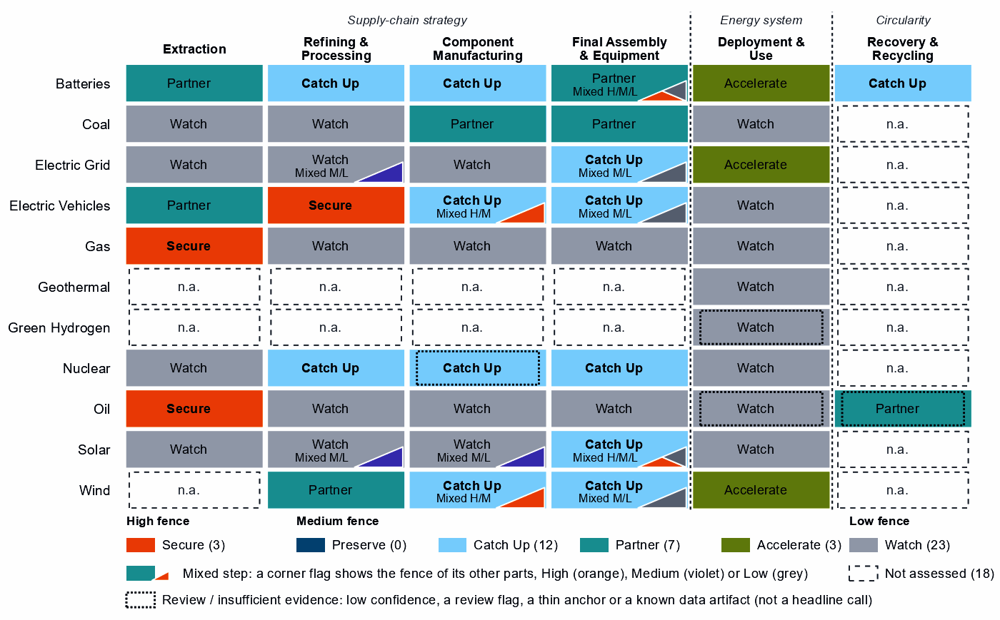
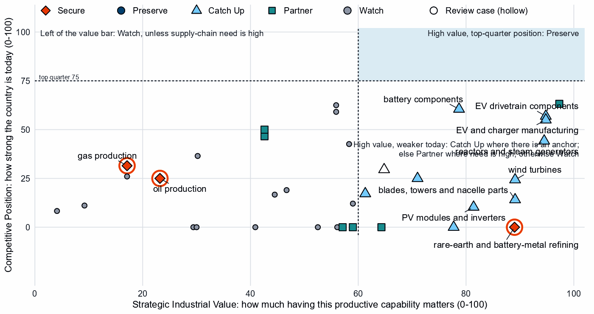
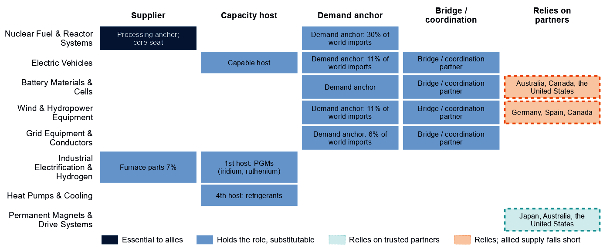
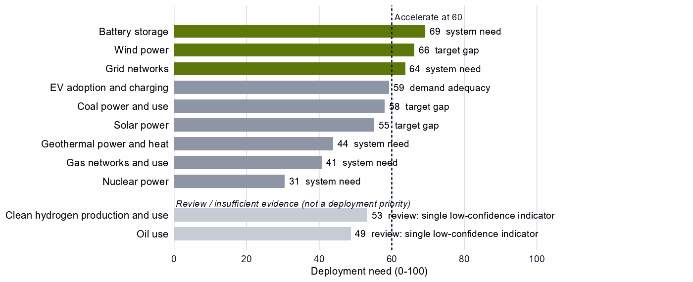

# The United Kingdom and the Allied Industrial Base

*What to secure, build, source from partners, and deploy*

*Generated from Allied Industrial Base Explorer data; evidence, sources and caveats in the appendix. Data as of 30 October 2026.*

## 1. Bottom line — the United Kingdom's strategic role

The United Kingdom's role in the Allied Industrial Base is as a demand and market anchor: allies count on it more as a buyer of turbines, vehicles and reactor parts than as a supplier. Its core seats in three strategic compacts are led by demand roles, and its main supply contribution is uranium conversion and enrichment. Nationally, no producing step reaches the top quarter of producers, so nothing reads Preserve. The industrial task is to catch up in the vehicle chain, where the anchors are, and to source battery cells and rare-earth materials from trusted partners, with development cooperation adding cell capacity now and preparing rare-earth capacity later. Storage, wind and grid networks need to be built faster. The high fence belongs around gas and oil supply, the rare-earth chain, and the control software of batteries and rooftop inverters. [1]

- **Secure.** Gas and oil supply, which is essential and imported and takes one to three years to rebuild; Norway alone provides 75% of gas imports. The rare-earth chain, where China holds 94% of world refining supply. The control software of battery systems and distributed PV inverters. The answer is stocks, trusted supply and control of command paths, not self-sufficiency. [2, 3]
- **Build / preserve.** No step qualifies for Preserve. Catch Up in EV and charger manufacturing, EV drivetrain components and battery components. Meet the high need for reactors mainly with allied makers, and keep conversion and enrichment reliable for allies.
- **Partner.** Battery cells and packs from producers such as Poland, the United States and Hungary, and rare-earth and wind materials from Germany, Spain and Canada, where allied supply falls short; minerals from Australia, Canada and the United States. With developing partners, add cell capacity now and prepare rare-earth capacity later. [1, 3, 4]
- **Deploy / stay open.** Accelerate storage, wind power and grid networks, buying from trusted suppliers with security conditions on connected equipment. Leave open grid components, oil refining, wafers and PV cells, gas-turbine equipment and the commodity mining steps.

In Figure 1, Secure sits in fuel extraction and rare-earth refining, Catch Up spreads across the manufacturing columns, and Partner covers minerals and battery cells. The orange corner flags mark Secure software and magnet layers inside other steps.

**Figure 1. Where the United Kingdom should secure, build, partner or stay open**

*Each cell is a supply-chain step of a technology, colored by its strategic choice. A corner flag marks a mixed step whose named parts sit behind a different fence: in battery cells and packs, the battery software is Secure, the cells Partner and the enclosures Watch. A dotted outline marks a review case, a call resting on low confidence, a review flag, a thin anchor or a known data artifact; this brief does not turn those calls into recommendations. Steps marked n.a. lack the data for a call. [4]*

## 2. Where the United Kingdom should secure, compete and stay open

### High fence — what cannot fail

Secure covers three whole steps and five layers inside other steps, grouped into four capabilities. Gas and oil are Secure for system resilience, not coercion: they are essential, hard to substitute and slow to rebuild, though most imports come from suppliers not flagged as potentially coercive. [4]

| Capability | Why it matters | Main vulnerability | Recommended response |
|---|---|---|---|
| Gas supply | Supply-chain need is 92 out of a hundred; gas takes one to three years to rebuild. | Norway supplies 75% of imports; potentially coercive suppliers only 2%. The risk is concentration and rebuild time. | **Allied.** Long-term and capacity-reservation contracts with trusted suppliers, such as Australia, the United States and Belgium (a list that can include trading hubs); stockholding obligations sized to the rebuild time; stress tests. |
| The rare-earth chain: separation, metals and magnets | Feeds the magnets of EV motors and wind generators; the United Kingdom holds 0% of world refining supply. | China holds 94% of world refining supply and trusted suppliers 4%. Rebuilding takes more than three years. | **Mixed.** New trusted capacity with allies such as Japan, Australia and the United States, through co-investment and offtake; at home only where announced projects can qualify; stockpiles until it qualifies. |
| Oil supply | Supply-chain need is 87; oil takes one to three years to rebuild. | Norway supplies 38% of imports; trusted suppliers hold 29% of world supply, and allied supply falls short. | **Diversified.** Stocks sized to the rebuild time; capacity reservations with several trusted producers, such as Canada, the United States and Norway; demand-side substitution. |
| Control software of battery systems and PV inverters | Battery-management, energy-management and inverter firmware can command or disable storage and rooftop solar from abroad. | China supplies 61% of battery cell and pack imports and 23% of PV module and inverter imports: hardware shares, not software. | **Trusted control.** Trusted-source and certification rules for firmware, communications and remote access; limits on over-the-air updates by untrusted vendors; replacement of untrusted control in the installed base. |

Sources: 1, 2, 3, 4.

Grid, turbine, vehicle, and oil and gas control software mostly reads Watch. The Secure software layers sit in the hardware bought most from potentially coercive suppliers: 66% of battery cell and pack imports and 27% of PV equipment, against 24% for transformers and switchgear. These shares measure hardware, not software vendors, so basic security standards should still apply and the calls should be re-tested as suppliers change. [3]

### Medium fence — where industrial capability matters

**Preserve.** There is no Preserve step, because no producing step reaches the top quarter of producers. The highest positions, 63 in gas-turbine and drilling components and 63 in battery cells and packs (a Partner step with no capability anchor), sit below the bar of 75. The United Kingdom competes in many steps but leads in none, so its gains must be built or partnered, not defended. [3, 4]

**Catch Up.** The vehicle chain is where the anchors are. EV and charger manufacturing rests on three anchors, including operating capacity, with 4% of world exports, a position of 55 and high confidence. EV drivetrain components (57, which overlaps the cells node) and battery components (61, with committed investment) sit beside it. Delivery is mixed: build at home where the base is established and with allied partners for the rest. [3, 4]

In nuclear, uranium conversion and enrichment rests on a share of world supply of 12%, close to the AIB's measure of the product. Its exports of the step's trade line are <1% of world exports, so verify the capacity before support scales. In reactors and steam generators, need (79) and value are high, but the basket mixes reactor parts with generic boiler and steam-turbine parts, so the build should run mainly through allied makers. The call on nuclear fuel and reactor parts is a review case, on low confidence. [3, 4]

Other Catch Up calls are weaker than they look, and this brief does not build on them:

- **Wind turbines:** shares of 2% in a step whose trade codes are mostly cables, transformers and switchgear; need is low (20). [3, 4]
- **Blades, towers and nacelle parts, and PV modules and inverters:** low positions (14 and 10) and low need; the PV codes include chip-industry lines. [3, 4]
- **Transformers, switchgear and cables:** value just over the bar (61), low need (22) and a position of 17. [2, 3, 4, 5, 6]
- **Battery materials refining:** a single export-share anchor of about 1% and no measurable position. Its China share of world supply, 94%, matches the Secure refining step's, which suggests overlapping trade codes. [3]
- **Battery recycling:** an export share of 11% in a step whose trade codes are battery waste, scrap and residues. [3]

**Partner.** A major gap is in battery cells and packs: need is 84, China provides 61% of imports and allied supply falls short. With <1% of world supply and no capability anchor, dependence should be deliberate and spread across producers such as Poland, the United States and Hungary. In rare-earth and wind materials refining allied supply also falls short; its rare-earth separation layer reads Partner too. Coal-plant equipment and components read Partner on high need alone; allied supply covers it, and coal capacity fell from 6.3 to 0.0 GW. [1, 3, 4, 7]

**Shared capabilities.** The table keeps the national reading of capabilities that sit in several chains apart from what allies rely on the United Kingdom for.

| Shared capability | Steps and their choices | National reading | AIB role |
|---|---|---|---|
| Uranium conversion & enrichment | uranium mining (Watch) and uranium conversion and enrichment (Catch Up) | The choices differ within the same technology with each step's own measures (uranium mining: need 97, value 30, position 0; uranium conversion and enrichment: need 61, value 71, position 25) | Supplier: 11% of world exports or production of uranium conversion & enrichment (the AIB measure of the product, not a step's share) |
| Insulators & bushings | grid components (Watch); wafers and PV cells (Watch); and blades, towers and nacelle parts (Catch Up) | The choices differ across technologies with each step's own measures (grid components: need 25, value 47, position 19; wafers and PV cells: need 26, value 59, position 12; blades, towers and nacelle parts: need 28, value 89, position 14) | Allies need new capacity here (BUILD); no supplier role |
| Li-ion cells & packs | battery cells and packs (Partner) and EV drivetrain components (Catch Up) | The choices differ across technologies with each step's own measures (battery cells and packs: need 84, value 97, position 63; EV drivetrain components: need 56, value 95, position 57) | Allies need new capacity here (BUILD); no supplier role |
| Power electronics components | grid components (Watch); EV drivetrain components (Catch Up); wafers and PV cells (Watch); and blades, towers and nacelle parts (Catch Up) | The choices differ across technologies with each step's own measures (grid components: need 25, value 47, position 19; EV drivetrain components: need 56, value 95, position 57; wafers and PV cells: need 26, value 59, position 12; blades, towers and nacelle parts: need 28, value 89, position 14) | Allies need new capacity here (BUILD); no supplier role |

Sources: 1, 4.

**Figure 2. Which producing capabilities are worth holding, and where the United Kingdom is strong today**

*Producing steps with both measures (recovery has no position measure). Dashed lines mark the value bar (60) and the top quarter (75). No step reaches the upper right. The vehicle and battery steps cluster in the upper middle, short of the top-quarter line, and gas-turbine and LNG equipment sits at the same height just left of the value bar. Hollow markers are review cases. [4]*

### Low fence — what not to prioritize

Watch is not a failure: it means affordable, diversified access matters more than domestic production.

- **Grid components and oil refining.** Need is low (25 and 27), yet both rank near the top of the country's own recorded protection (94 and 99). Buy them competitively. [3, 4, 8, 9]
- **Wafers and PV cells.** Need is low (26) and value rests on market size alone. The cell and next-generation PV layers read Catch Up, but they inherit the step's anchors, whose trade codes include chip wafers. [3, 4]
- **Gas turbines, LNG plant and their components.** Positions of 59 and 63, among the country's highest, rest on low need and value just under the bar: these makers compete without a fence. [3, 4]
- **Uranium, copper and bauxite, and PV mineral mining.** Need is high (97, 90 and 94), but these are large, commoditized yards: diversified trusted imports, with at most a limited, stated capability floor. [3, 4]

Grid metals refining and polysilicon refining are not Low-fence cases: their grain-oriented electrical steel and solar-grade polysilicon layers read Partner.

## 3. The United Kingdom's allied bargain

**What the United Kingdom contributes.** In the Allied Industrial Base analysis the United Kingdom is a Demand & Market Anchor. It holds a role in seven of the ten strategic compacts and core seats in Wind & Hydropower Equipment, Nuclear Fuel & Reactor Systems and Electric Vehicles, each led as a demand anchor. Its supply roles are narrow, apart from host seats: 11% of world exports or production of uranium conversion and enrichment, and, in Industrial Electrification & Hydrogen, a scale manufacturer seat with 7% of world exports or production of furnace parts. [1, 3]

**What the United Kingdom needs.** Battery cells, rare-earth and wind materials, and the turbines, vehicles and reactor parts its demand seats describe. If China's supply stopped, as in the Decoupling scenario, the United Kingdom would lose US$10.0 billion a year of imports across the Allied Industrial Base basket. New capacity at the best-placed allied hosts, led by Germany, would restore about US$5.5 billion of it a year. Under Managed Interdependence, the default scenario, it sits in the minimum coalition of three Sectoral Compacts, and of five under Decoupling. [1, 3]

**The dependencies to make intentional.** The United Kingdom's bargaining strength is its market. These bargains turn that demand into trusted capacity at home and with allies.

| Capability / compact | The United Kingdom contributes | The United Kingdom needs | Natural partners | What makes the bargain work |
|---|---|---|---|---|
| Electric Vehicles and Battery Materials & Cells | A large vehicle market and a vehicle base (4% of world exports of EVs and chargers) | Battery cells and packs, where allied supply falls short | The EV compact's makers, Germany, the United States, France, Japan and South Korea; for cells, the battery compact's maker, South Korea | For vehicles and drivetrains, joint ventures that transfer capability; for cells, offtake and co-investment |
| Permanent Magnets & Drive Systems | Demand for magnets in vehicles and wind | Trusted refined rare earths and magnets | Refiners such as Japan, Australia and the United States | Co-investment and offtake for new trusted capacity; stockpiles until it qualifies |
| Nuclear Fuel & Reactor Systems | Uranium conversion and enrichment (11%), with a core seat | Reactors and reactor parts | The compact's makers, the United States and France | Co-investment and offtake with allied makers; reliable conversion and enrichment for allies |
| Wind & Hydropower Equipment and Grid Equipment & Conductors | A large market for turbines and grid equipment | Wind materials, where allied supply falls short; turbines and transformers | Germany, Spain and Canada for materials; the makers India and Germany (wind) and Japan and Germany (grid) | Offtake and co-investment; trusted-supplier conditions on connected equipment |

Sources: 1, 3, 4.

**Figure 3. The United Kingdom's role in the Allied Industrial Base**

*Each row is a strategic compact in which the United Kingdom holds a role or relies on partners. Dark cells are roles allies cannot easily replace; light cells are roles others could fill; dashed cells mark where the United Kingdom relies on trusted partners, orange where allied supply still falls short of what allies need. In the nuclear row, the share printed in the supplier cell is the AIB's share of world imports of reactor parts, a measure of demand, not of supply.*

Figure 3 shows an economy that anchors demand across the clean-energy compacts and supplies in few of them. Where it relies on partners for battery materials and cells and for wind, allied supply falls short, so the bargain has to add capacity, not only redirect trade.

## 4. Development strategy — build trusted capacity by helping partners Catch Up

Development cooperation can be the development arm of that bargain. A partnership pairs a British step that needs more trusted capacity with a partner whose same step is a credible Catch Up inside the allied trust screen. 53 pairs qualify, with 16 developing partners across 12 steps. [1, 4, 10]

The United Kingdom's own supply chain supports 10 pairs with 6 partners across four steps, and the table leads with them: battery cells and packs; rare-earth and wind materials refining; coal-plant components; and coal-plant equipment. Another 43 rest on the allied gap alone, a reason that is the same for every donor in scope. Malaysia, an upper middle income economy with a position of 66 in cells and packs, suits finance, guarantees and offtake. India's case rests on a single export-share anchor and a position of 0, so groundwork comes first. The coal pairs rest on need that allied supply already covers, so Viet Nam is a weak own-need case. The pairs with Madagascar and Mexico rest on the allied gap alone. [1, 3, 4, 10]

| Capability / allied gap | Developing partner | Why this partner can Catch Up | What the donor should support | Security / AIB benefit | Development benefit |
|---|---|---|---|---|---|
| Battery cells and packs: high need, allied supply falls short and new allied capacity needed | Malaysia (upper middle income) | A share of world supply and a share of world exports; corroborated by feasibility, input costs, specialization in the adjacent step and industrial learning | Constraint: no operating or committed plant in the capacity data and a position that rests on trade or output shares, not on plant capacity. Lead with development finance, guarantees, offtake, equity and joint ventures; public support for project preparation and investment promotion | A trusted second source and allied capacity where allied supply falls short (allies need new capacity in 2 product groups of the step) | Factory capacity, skills and export sales of finished equipment |
| Rare-earth and wind materials refining: high need, allied supply falls short and new allied capacity needed | India (lower middle income) | A share of world exports; corroborated by feasibility, specialization in the adjacent step and industrial learning | Plant capacity not covered by the data and input costs not covered by the data. Feasibility studies and project preparation, industrial infrastructure, environmental and permitting capability, workforce development; then, at scale, offtake, market access, investment guarantees | A trusted second source and allied capacity where allied supply falls short (allies need new capacity in 2 product groups of the step) | Processing capacity at home, with the skills, standards and value capture of a refinery |
| Coal-plant components: high need | Viet Nam (lower middle income) | A share of world supply and a share of world exports; corroborated by feasibility, specialization in the adjacent step and industrial learning | Plant capacity not covered by the data and input costs not covered by the data. Supplier development, technical and vocational skills, quality systems and certification, common testing facilities; then, at scale, development finance, guarantees, offtake, equity and joint ventures | A trusted second source | A certified supplier base and export sales of components |
| Battery materials refining: new allied capacity needed | Madagascar (low income) | A share of world exports and operating capacity; corroborated by specialization in the adjacent step | Constraint: related industrial know-how outside the top quarter and input costs outside the cheapest quarter. Workforce development, technology transfer and joint ventures, industrial infrastructure, feasibility studies and project preparation; then, at scale, offtake, market access, investment guarantees | New allied capacity where the AIB finds a gap (allies need new capacity in 6 product groups of the step) | Processing capacity at home, with the skills, standards and value capture of a refinery |
| EV and charger manufacturing: new allied capacity needed | Mexico (upper middle income) | A share of world supply, a share of world exports, operating capacity and a strong position in the next step up the chain; corroborated by feasibility, specialization in the adjacent step and industrial learning | Constraint: input costs outside the cheapest quarter. Lead with development finance, guarantees, offtake, equity and joint ventures; public support for industrial infrastructure and supplier development | New allied capacity where the AIB finds a gap (allies need new capacity in 4 product groups of the step) | Factory capacity, skills and export sales of finished equipment |

Sources: 1, 3, 4, 6, 10, 11.

A partnership is more likely to last when it rests on more than aid. The second table shows what ties the United Kingdom to each partner today and what would hold the relationship as the capability scales. Aid is the 2020 to 2024 total; the direct investment position is economy-wide, not tied to the step. [10]

| Partnership | Relationship today | What makes it durable |
|---|---|---|
| Malaysia: battery cells and packs | $0.2 million at this step, under stage-wide codes (the technology is not identified); a direct investment position of $4,294 million (economy-wide); no factory projects by firms from the United Kingdom recorded in the technology; and no export-credit or lender finance recorded at the step | Long-term offtake, joint ventures and investment guarantees as the capability scales; the partner's role as Specialized technology supplier in the Battery Materials & Cells compact; the United Kingdom's own deployment demand for the technology (Accelerate) |
| India: rare-earth and wind materials refining | Under $0.1 million at this step, under stage-wide codes (the technology is not identified) and a direct investment position of $23,834 million (economy-wide) | Long-term offtake and investment guarantees as the capability scales; the partner's role as Specialized technology supplier in the Wind & Hydropower Equipment compact; the United Kingdom's own deployment demand for the technology (Accelerate); the partner's own deployment demand for the technology (Accelerate) |
| Viet Nam: coal-plant components | Under $0.1 million at this step, under stage-wide codes (the technology is not identified) and a direct investment position of $325 million (economy-wide) | Long-term offtake, joint ventures and investment guarantees as the capability scales; the partner's own deployment demand for the technology (Accelerate) |
| Madagascar: battery materials refining | $0.6 million of energy, industry and mining aid, none at this step and no export-credit or lender finance recorded at the step | Long-term offtake, joint ventures and investment guarantees as the capability scales; the partner's role as Resource supplier in the Battery Materials & Cells compact; the United Kingdom's own deployment demand for the technology (Accelerate) |
| Mexico: EV and charger manufacturing | $7.4 million of energy, industry and mining aid, none at this step; a direct investment position of $16,633 million (economy-wide); no factory projects by firms from the United Kingdom recorded in the technology; and an AIB simulated investment pairing (a model result, not an existing tie) | Long-term offtake, joint ventures and investment guarantees as the capability scales; the partner's role as Scale manufacturer in the Electric Vehicles compact |

Sources: 1, 4, 10, 11, 12, 13, 14.

Battery materials refining is among the broadest strands, level with battery components and EV drivetrain components, with 7 developing economies each; all rest on the allied gap alone. For battery mineral mining; EV mineral mining; rare-earth and battery-metal refining; gas production; and oil production: No credible development-led supply solution identified. In rare-earth refining, Malaysia and Thailand host new capacity in the AIB, a commercial route; the other candidates rest on battery-metal capacity data or a thin anchor. Another 30 pairs are commercial, where trade, offtake and investment fit better than aid. [1, 4, 10]

Today's aid follows this map only loosely, and none of it at a partnership step is technology-coded. Of the partners, 7 receive British aid at the step, only under stage-wide codes; 6 receive it at other steps and 3 at no supply-chain step. The largest recipient of energy, industry and mining aid, Ukraine ($132 million over 2020 to 2024), has a Catch Up case in EV drivetrain components on a single supply-share anchor, but none of that aid sits at the step. [1, 4, 10]

## 5. Energy-system priorities

Wherever the equipment is made, battery storage, wind power and grid networks clear the Accelerate bar of 60. Each rests on all three measures of deployment need with high confidence, though not on demand. System need drives storage and the grid (93 and 93), and the gap to national targets drives wind (91). The renewables target of 153 GW by 2030 compares with 64 GW installed in 2025, a shortfall of about 69 GW at the recent build rate. Between 2020 and 2025, wind grew from 24.5 to 33.4 GW and storage from 1.5 to 9.0 GW. [4, 5, 7]

**Figure 4. What the United Kingdom needs to deploy faster**

*Deployment need by technology, with the largest of its measures: demand adequacy, the gap to national targets, or system need. Review cases, which rest on a single indicator of low confidence, are shown apart in grey and are not deployment priorities.*

High deployment priority does not imply high manufacturing priority: storage depends on partner cells and the turbine Catch Up on cable and switchgear trade, so equipment should come from whichever trusted supplier is ready. Solar power (55), EV adoption (59) and coal power (58) sit just below the bar. The coal reading rests on target-gap and system measures while coal capacity fell to zero, so it is no case for coal. Clean hydrogen and oil use are review cases, each on a single indicator of low confidence. [4, 5, 7]

## 6. Is current policy pointed in the right direction?

Policy never decides a choice here; it is compared with it afterwards, using the United Kingdom's own recorded measures. Protection and priority are ranks within the country, not levels.

| Capability | Strategic choice | Current policy | Gap |
|---|---|---|---|
| Oil production | Secure | Needs more attention | Vulnerability without enough policy attention |
| Gas production | Secure | Needs more attention | Vulnerability without enough policy attention |
| EV mineral mining | Partner | Protection or localization in the top third | Domestic duplication where trusted specialization is the answer |
| Battery materials refining | Catch Up | Needs more attention | Capability case without enough policy attention |
| Wind power | Accelerate | Deployment policy below the middle | Deployment needed faster than policy supports |
| Grid networks | Accelerate | Deployment policy below the middle | Deployment needed faster than policy supports |
| Wafers and PV cells | Watch | Heavy protection or localization | Localizing what is not a domestic priority |
| Solar power | Watch | Heavy local-content protection on the equipment of a Watch deployment | Localizing what is not a domestic priority |
| Grid metals refining | Watch | Heavy protection or localization | Localizing what is not a domestic priority |

Sources: 4, 8, 9.

Government should change course in several places. First, gas and oil supply are Secure but rank low among the country's recorded measures (19 and 14). That shows little industrial-policy attention, not missing stocks, so test stocks and contracts against the rebuild time. Second, deployment policy lags for wind and grid networks. Next, protection runs ahead of the case in Watch steps such as oil refining, grid components and wafers and PV cells, and in EV mineral mining, a Partner step that needs partnership terms instead. In grid metals refining (96), the data cannot tell whether the measures target electrical steel, a Partner layer, or the wider basket. Finally, battery materials refining reads as needing more attention, but on a thin anchor: test the announced projects before adding support. [4, 8, 9]

## 7. Strategic agenda — what should the United Kingdom do next?

### 1. Hold fuel security through stocks and trusted contracts

Gas and oil are Secure for resilience: they are essential and imported, and supply takes one to three years to rebuild. Size stocks to that time, sign long-term and capacity-reservation contracts with trusted suppliers such as Australia, the United States and Belgium for gas and Canada, the United States and Norway for oil, and stress-test the loss of the largest supplier. Partner evidence is weak, so test the terms. [1, 2, 3, 4]

### 2. Secure the rare-earth chain with allied partners

Add trusted separation, metal and magnet capacity with allies such as Japan, Australia and the United States through co-investment and offtake, and at home only where announced projects can qualify. Hold stocks until trusted supply qualifies, and phase in limits on adversary sources in critical uses as it does. No developing partner qualifies in this step; Malaysia and Thailand host new capacity on commercial terms. [1, 3, 4, 10]

### 3. Catch up in the vehicle chain and partner for battery cells

Tie time-limited production incentives, first-of-a-kind finance, and workforce and supplier development to benchmarks in EV and charger manufacturing, drivetrain components and battery components, with the gate open to joint ventures that transfer capability. Source cells from producers such as Poland, the United States and Hungary through offtake and co-investment, including with the battery compact's maker, South Korea. [1, 3, 4]

### 4. Meet reactor needs with allied makers and keep enrichment reliable

Reactors combine high need with a doubtful measured base, so meet that need through co-investment and offtake with the nuclear compact's makers, the United States and France, rather than a domestic build alone. Keep conversion and enrichment reliable for allies, and verify the capacity behind them before support scales. [1]

### 5. Build trusted cell and rare-earth capacity with developing partners

Start with Malaysia in battery cells and packs, through development finance, guarantees and offtake. Prepare India in rare-earth and wind materials refining over a longer horizon, with project preparation, infrastructure and skills. Leave the coal pairs aside, since allied supply already covers that need. The objective is both an additional trusted supplier and a durable capability in the partner economy. [1, 4, 10]

### 6. Accelerate storage, wind and grid while keeping sourcing open

Deploy faster through infrastructure, permitting and procurement, buying from trusted suppliers such as the wind compact's makers, India and Germany. Require certified, trusted firmware and remote access for battery systems and distributed PV inverters, and replace untrusted control in the installed base on a deadline. Shift protection from Watch steps, such as grid components and oil refining, to deployment. [1]

## Sources

1. Allied Industrial Base model: roles, compacts, trade restored and new capacity across the allied coalition, computed by the Explorer's authors (run of 30 October 2026); CC BY 4.0.
2. Yards & Fences node attributes: standardization, learning, industrial commons and control layers, curated by the authors from public sources (2026-10-30); CC BY 4.0.
3. United Nations, UN Comtrade Database, HS6 bilateral trade (all reporters); reconciled by the authors (2022-2024 data); attribution; https://comtradeplus.un.org/.
4. Country strategy choices by technology and supply-chain step (supply-chain need, Strategic Industrial Value, Competitive Position, deployment need, policy alignment), computed by the Explorer's authors (dashboard data of 31 October 2026); CC BY 4.0.
5. International Energy Agency, World Energy Outlook 2025 (Stated Policies Scenario) and Global Critical Minerals Outlook: demand 2024-2035 (2025); CC BY-NC-SA 4.0 (free dataset); https://www.iea.org/.
6. Clean Investment Monitor: clean-technology manufacturing investment and capacity (aggregated), world capital expenditure 2021-22 to 2024-25; attribution; https://www.cleaninvestmentmonitor.org/.
7. Ember, electricity generation and capacity data (2020-2025) and 2030 Renewable Target Tracker; CC BY 4.0; https://ember-energy.org/.
8. Global Trade Alert, New Industrial Policy Observatory: industrial-policy interventions, strength scored by the authors, October 2026 extract (as of 5 October 2026); subscription (titles, dates and links only); https://www.globaltradealert.org/.
9. International Energy Agency, Policies and Measures Database (export of 2026-10-26); attribution; https://www.iea.org/policies.
10. OECD Creditor Reporting System: official development assistance by donor, recipient and purpose code, gross disbursements at constant prices, energy, industry and mining purpose codes only, mapped to supply-chain steps by the authors (Components and Assembly share purpose codes; no code funds recycling) (2020-2024 data); attribution; https://data-explorer.oecd.org/.
11. Development tool families by supply-chain stage and constraint, and the development-partnership tests, set by the authors (config/development_partnerships.yml) (2026-11-03); CC BY 4.0.
12. International Monetary Fund, Direct Investment Positions: outward positions (reported, else derived from the counterpart's reports) (2020-2024 data); attribution; https://data.imf.org/.
13. fDi Markets clean-manufacturing projects (CM-FDI): factory projects by home and destination economy (Components and Assembly not separated); subscription (aggregates only).
14. Oil Change International, Public Finance for Energy: export-credit and development-lender energy finance (not aid) (2013-2025 data); attribution; https://energyfinance.org/.

## Appendix — evidence and method

**How this brief is built.** Every number comes from the Country page data of the Allied Industrial Base Explorer (the data release of 30 October 2026) and from the Allied Industrial Base analysis. Each technology is split into supply-chain stages from extraction to recycling, and each step gets a strategic choice by fixed rules applied in order: [4]

- Secure where an acute vulnerability is measured;
- at deployment, Accelerate where deployment need reaches 60; [4]
- Watch where the step is a large, commoditized yard;
- Preserve where Competitive Position is in the top quarter (75) and either Strategic Industrial Value (bar 60) or supply-chain need (bar 67) is high; [4]
- Catch Up where the value is high, the position is not, and a capability anchor is corroborated by other evidence;
- Partner where supply-chain need is high but there is neither a top-quarter position nor, for a high-value step, a credible pathway;
- Watch otherwise.

Named layers inside a step, such as control software or magnets, take their own choice, and a step whose parts sit behind different fences is mixed. A value that rests on market size alone is capped just under the bar. Observed policy never decides a choice.

**Review cases.** Some calls rest on low confidence, an engine review flag, a thin capability anchor, a known data artifact or, at deployment, a single indicator of low confidence. They stay on the map but never enter the Bottom line, the Agenda, the policy table or a headline mark. 4 steps are review cases. [4]

| Step | Choice | Why it is a review case |
|---|---|---|
| Clean hydrogen production and use | Watch | A single indicator of low confidence |
| Nuclear fuel and reactor parts | Catch Up | Low confidence |
| Oil use | Watch | A single indicator of low confidence |
| Waste-oil recovery | Partner | Low confidence |

Sources: 4.

**Evidence and caveats.** The AIB status "allied supply covers the need" for rare-earth and battery-metal refining describes the allied analysis, not ample trusted supply: trusted suppliers hold 4% of world supply. In the AIB, the lead shares of the United Kingdom's demand-anchor seats measure world imports, not supply. 18 steps lack the data for a call, including most of geothermal, green hydrogen manufacturing and most recycling. Recorded policy ranks electrolyser stacks (96) and systems (98) near the top of the country's own measures, a disagreement this brief does not settle. Competitive Position ranks the United Kingdom among economies that already supply a step, so a zero means no measurable position. Partner lists name where allied capacity sits, which can include trading hubs, not who owns it. [3, 4, 8, 9]

**Development partnerships.** A pair joins a British step that needs more allied capacity, for the United Kingdom's own need or for the allied gap alone, with a developing economy whose same step is a credible Catch Up inside the AIB trust screen. Where a step's data describe different products, the partner's anchor must measure the product the need is about. A partner that already hosts the step's new capacity, or Preserves it, is a commercial case. Aid is energy, industry and mining aid in the OECD Creditor Reporting System, by purpose code; many codes name a stage, not a technology. Export-credit finance is reported apart, never as aid.

| Step | Donor reason | Development partners | Commercial route | Review cases | Aid at the step |
|---|---|---|---|---|---|
| Battery cells and packs | Partner, high need, allied supply falls short and new allied capacity needed | Malaysia, Indonesia, Mexico, India and Turkiye | Viet Nam | – | Malaysia, Indonesia, India, Turkiye and Viet Nam |
| Rare-earth and wind materials refining | Partner, high need, allied supply falls short and new allied capacity needed | India | – | Viet Nam and South Africa | India, Viet Nam and South Africa |
| Coal-plant components | Partner and high need | Viet Nam, India and Indonesia | – | Turkiye | Viet Nam, India, Indonesia and Turkiye |
| Coal-plant equipment | Partner and high need | Viet Nam | India | Turkiye | Viet Nam, India and Turkiye |
| Battery materials refining | New allied capacity needed | Madagascar, the Philippines, India, South Africa, Thailand, Turkiye and Papua New Guinea | Indonesia, Argentina, the Democratic Republic of Congo and Malaysia | Mozambique, Tanzania and Colombia | India, South Africa, Thailand, Turkiye, Indonesia, Malaysia and Tanzania |
| EV and charger manufacturing | New allied capacity needed | Mexico, Viet Nam, Thailand, Malaysia, Morocco and Indonesia | Turkiye and India | – | Viet Nam, Thailand, Malaysia, Indonesia, Turkiye and India |
| Wind turbines | New allied capacity needed | Turkiye, Viet Nam, Malaysia, Indonesia, Thailand and Morocco | India and Mexico | Brazil | Turkiye, Viet Nam, Malaysia, Indonesia, Thailand and India |
| Battery components | New allied capacity needed | Viet Nam, Indonesia, Turkiye, Mexico, India, Malaysia and Morocco | – | – | Viet Nam, Indonesia, Turkiye, India and Malaysia |
| EV drivetrain components | New allied capacity needed | Malaysia, Thailand, Turkiye, Serbia, Ukraine, Honduras and Morocco | Indonesia, the Philippines, Mexico and India | Viet Nam | Malaysia, Thailand, Turkiye, Indonesia, India and Viet Nam |
| Blades, towers and nacelle parts | New allied capacity needed | Thailand, Serbia, Turkiye, Malaysia and Brazil | Mexico, Viet Nam, the Philippines and India | – | Thailand, Turkiye, Malaysia, Viet Nam and India |
| Transformers, switchgear and cables | New allied capacity needed | Malaysia, India and the Philippines | Turkiye, Mexico, Thailand and Viet Nam | Morocco | Malaysia, India, Turkiye, Thailand and Viet Nam |
| PV modules and inverters | New allied capacity needed | Turkiye and Morocco | India, Viet Nam, Thailand, Malaysia, Indonesia and Mexico | – | Turkiye, India, Viet Nam, Thailand, Malaysia and Indonesia |
| Rare-earth and battery-metal refining | Secure with allied delivery, few trusted alternatives, high need and new allied capacity needed | – | Malaysia and Thailand | Argentina, Indonesia, the Democratic Republic of Congo, Mozambique, Tanzania, the Philippines, Mexico and Madagascar | Malaysia, Thailand, Indonesia and Tanzania |
| Reactors and steam generators | High need | – | – | Turkiye, India, Malaysia and Viet Nam | Turkiye, India, Malaysia and Viet Nam |
| Battery recycling | High need | – | – | India and Malaysia | – |
| Polysilicon refining | High need | – | – | India | India |

Sources: 1, 4, 10.

**Every step.**

| Step | Stage | Choice | Fence | Need | Value | Position | Evidence | Policy |
|---|---|---|---|---|---|---|---|---|
| Battery mineral mining | Extraction | Partner | Medium | 85 | 57 | 0 | strong | broadly aligned |
| Battery materials refining | Refining | Catch Up | Medium | 62 | 78 | 0 | strong | needs more attention |
| Battery components | Components | Catch Up | Medium | 67 | 79 | 61 | moderate | mixed signals |
| Battery cells and packs | Assembly | Partner | Mixed High/Medium/Low | 84 | 97 | 63 | moderate | broadly aligned |
| Battery storage | Deployment | Accelerate | Medium | 69 | – | – | strong | broadly aligned |
| Battery recycling | Recovery | Catch Up | Medium | 93 | 82 | – | – | mixed signals |
| Coal mining | Extraction | Watch | Low | 65 | 4 | 8 | strong | broadly aligned |
| Coke and coal processing | Refining | Watch | Low | 88 | 9 | 11 | strong | broadly aligned |
| Coal-plant components | Components | Partner | Medium | 68 | 43 | 47 | strong | broadly aligned |
| Coal-plant equipment | Assembly | Partner | Medium | 77 | 43 | 50 | strong | broadly aligned |
| Coal power and use | Deployment | Watch | Low | 58 | – | – | moderate | broadly aligned |
| Coal recovery | Recovery | Not assessed | – | – | 1 | – | – | not enough policy evidence |
| Copper and bauxite mining | Extraction | Watch | Low | 90 | 41 | 0 | strong | broadly aligned |
| Grid metals refining | Refining | Watch | Mixed Medium/Low | 79 | 53 | 0 | strong | too much intervention |
| Grid components | Components | Watch | Low | 25 | 47 | 19 | strong | too much intervention |
| Transformers, switchgear and cables | Assembly | Catch Up | Mixed Medium/Low | 22 | 61 | 17 | strong | broadly aligned |
| Grid networks | Deployment | Accelerate | Medium | 64 | – | – | – | deployment policy lags |
| Grid-equipment recycling | Recovery | Not assessed | – | – | 14 | – | – | not enough policy evidence |
| EV mineral mining | Extraction | Partner | Medium | 85 | 59 | 0 | strong | wrong tool for the problem |
| Rare-earth and battery-metal refining | Refining | Secure | High | 88 | 89 | 0 | strong | broadly aligned |
| EV drivetrain components | Components | Catch Up | Mixed High/Medium | 56 | 95 | 57 | moderate | broadly aligned |
| EV and charger manufacturing | Assembly | Catch Up | Mixed Medium/Low | 47 | 95 | 55 | moderate | broadly aligned |
| EV adoption and charging | Deployment | Watch | Low | 59 | – | – | strong | broadly aligned |
| EV recycling | Recovery | Not assessed | – | – | 42 | – | – | not enough policy evidence |
| Gas production | Extraction | Secure | High | 92 | 17 | 32 | strong | needs more attention |
| Gas liquids processing | Refining | Watch | Low | 57 | 17 | 26 | strong | broadly aligned |
| Gas-turbine and drilling components | Components | Watch | Low | 36 | 56 | 63 | strong | broadly aligned |
| Gas turbines and LNG plant | Assembly | Watch | Low | 17 | 56 | 59 | strong | not enough policy evidence |
| Gas networks and use | Deployment | Watch | Low | 41 | – | – | strong | too much intervention |
| Gas recovery | Recovery | Not assessed | – | – | 10 | – | – | not enough policy evidence |
| Geothermal resource development | Extraction | Not assessed | – | – | 20 | – | – | not enough policy evidence |
| Geothermal refining | Refining | Not assessed | – | – | 20 | – | – | not enough policy evidence |
| Geothermal plant components | Components | Not assessed | – | – | 69 | – | – | not enough policy evidence |
| Geothermal power-plant equipment | Assembly | Not assessed | – | – | 69 | – | – | not enough policy evidence |
| Geothermal power and heat | Deployment | Watch | Low | 44 | – | – | strong | broadly aligned |
| Geothermal recovery | Recovery | Not assessed | – | – | 20 | – | – | not enough policy evidence |
| Electrolyser mineral mining | Extraction | Not assessed | – | – | 35 | 0 | strong | not enough policy evidence |
| PGM and catalyst refining | Refining | Not assessed | – | – | 63 | 43 | strong | not enough policy evidence |
| Electrolyser stacks | Components | Not assessed | – | – | 99 | – | – | not enough policy evidence |
| Electrolyser systems | Assembly | Not assessed | – | – | 90 | – | – | not enough policy evidence |
| Clean hydrogen production and use | Deployment | Watch | Low | 53 | – | – | – | broadly aligned |
| Stack and catalyst recycling | Recovery | Not assessed | – | – | 49 | – | – | not enough policy evidence |
| Uranium mining | Extraction | Watch | Low | 97 | 30 | 0 | strong | not enough policy evidence |
| Uranium conversion and enrichment | Refining | Catch Up | Medium | 61 | 71 | 25 | strong | mixed signals |
| Nuclear fuel and reactor parts | Components | Catch Up | Medium | 62 | 65 | 30 | strong | broadly aligned |
| Reactors and steam generators | Assembly | Catch Up | Medium | 79 | 95 | 44 | strong | broadly aligned |
| Nuclear power | Deployment | Watch | Low | 31 | – | – | strong | broadly aligned |
| Spent-fuel reprocessing | Recovery | Not assessed | – | – | 71 | – | – | not enough policy evidence |
| Oil production | Extraction | Secure | High | 87 | 23 | 25 | strong | needs more attention |
| Oil refining | Refining | Watch | Low | 27 | 45 | 17 | strong | too much intervention |
| Drilling and pump components | Components | Watch | Low | 50 | 30 | 37 | strong | broadly aligned |
| Drilling rigs, tankers and oil equipment | Assembly | Watch | Low | 12 | 58 | 43 | strong | not enough policy evidence |
| Oil use | Deployment | Watch | Low | 49 | – | – | strong | too much intervention |
| Waste-oil recovery | Recovery | Partner | Medium | 98 | 12 | – | – | broadly aligned |
| PV mineral mining | Extraction | Watch | Low | 94 | 29 | 0 | strong | broadly aligned |
| Polysilicon refining | Refining | Watch | Mixed Medium/Low | 81 | 56 | 0 | strong | broadly aligned |
| Wafers and PV cells | Components | Watch | Mixed Medium/Low | 26 | 59 | 12 | moderate | too much intervention |
| PV modules and inverters | Assembly | Catch Up | Mixed High/Medium/Low | 22 | 81 | 10 | moderate | broadly aligned |
| Solar power | Deployment | Watch | Low | 55 | – | – | strong | too much intervention |
| PV module recycling | Recovery | Not assessed | – | – | 44 | – | – | not enough policy evidence |
| Wind mineral mining | Extraction | Not assessed | – | – | 51 | 0 | strong | not enough policy evidence |
| Rare-earth and wind materials refining | Refining | Partner | Medium | 82 | 64 | 0 | strong | broadly aligned |
| Blades, towers and nacelle parts | Components | Catch Up | Mixed High/Medium | 28 | 89 | 14 | moderate | broadly aligned |
| Wind turbines | Assembly | Catch Up | Mixed Medium/Low | 20 | 89 | 24 | moderate | mixed signals |
| Wind power | Deployment | Accelerate | Medium | 66 | – | – | strong | deployment policy lags |
| Wind-turbine recycling | Recovery | Not assessed | – | – | 36 | – | – | not enough policy evidence |

Sources: 2, 3, 4, 5, 6, 7, 8, 9.

**Named layers.**

| Layer | Step | Choice | Fence |
|---|---|---|---|
| Anode materials (natural and synthetic graphite) | battery materials refining | Catch Up | Medium |
| Cathode active materials and precursors | battery materials refining | Catch Up | Medium |
| Battery-grade lithium hydroxide and carbonate | battery materials refining | Catch Up | Medium |
| Battery cells (LFP and NMC) | battery cells and packs | Partner | Medium |
| Communications gateway and cloud fleet management | battery cells and packs | Secure | High |
| Battery-management firmware, energy-management software and remote updates | battery cells and packs | Secure | High |
| Enclosures, racking, thermal management and balance of system | battery cells and packs | Watch | Low |
| Grain-oriented electrical steel | grid metals refining | Partner | Medium |
| Power conversion hardware (inverters and converters) | transformers, switchgear and cables | Catch Up | Medium |
| Smart meters and advanced metering head-end systems | transformers, switchgear and cables | Watch | Low |
| Cables and conductors | transformers, switchgear and cables | Watch | Low |
| Utility-scale inverter firmware and remote-access functions | transformers, switchgear and cables | Watch | Low |
| Grid-control software (SCADA, EMS, DERMS) | transformers, switchgear and cables | Watch | Low |
| Large power transformers | transformers, switchgear and cables | Catch Up | Medium |
| HVDC converter-station control and protection | transformers, switchgear and cables | Catch Up | Medium |
| Electric drive units and motors | EV drivetrain components | Catch Up | Medium |
| Sintered NdFeB permanent magnets (traction motors) | EV drivetrain components | Secure | High |
| Connected-vehicle telematics, over-the-air software and connectivity systems | EV and charger manufacturing | Watch | Low |
| Charging-network management software (charge-point back ends) | EV adoption and charging | Watch | Low |
| Pipeline SCADA, compressor-station and LNG-terminal control systems | gas turbines and LNG plant | Watch | Low |
| Iridium and platinum for PEM electrolyser catalysts | electrolyser mineral mining | Not assessed | – |
| HALEU enrichment | uranium conversion and enrichment | Catch Up | Medium |
| LEU enrichment services | uranium conversion and enrichment | Catch Up | Medium |
| Fuel assemblies (design-specific fabrication) | nuclear fuel and reactor parts | Catch Up | Medium |
| Reactor control and safety instrumentation | reactors and steam generators | Partner | Medium |
| Oil pipeline and terminal control systems | drilling rigs, tankers and oil equipment | Watch | Low |
| Solar-grade polysilicon | polysilicon refining | Partner | Medium |
| Solar cells and wafers | wafers and PV cells | Catch Up | Medium |
| Next-generation PV (perovskite and tandem cells) | wafers and PV cells | Catch Up | Medium |
| Distributed PV inverter firmware, communication dongles and vendor cloud | PV modules and inverters | Secure | High |
| Conventional crystalline-silicon modules | PV modules and inverters | Watch | Low |
| Passive racking and mounting | PV modules and inverters | Watch | Low |
| Rare-earth separation and metal-making | rare-earth and wind materials refining | Partner | Medium |
| Sintered NdFeB permanent magnets | blades, towers and nacelle parts | Secure | High |
| Turbine controllers, OEM remote access and park SCADA | wind turbines | Watch | Low |

Sources: 2, 4.

**Partner recommendations.**

| Step | Choice | Trusted partners | Allied supply | Evidence |
|---|---|---|---|---|
| Battery mineral mining | Partner | Australia, Canada and the United States | Allied supply covers the need | moderate |
| Battery cells and packs | Partner | Poland, the United States and Hungary | Allied supply falls short | strong |
| Coal-plant components | Partner | Japan, Italy and South Korea | Allied supply covers the need | weak |
| Coal-plant equipment | Partner | Germany, Italy and the United States | Allied supply covers the need | weak |
| EV mineral mining | Partner | Australia, Canada and the United States | Allied supply covers the need | moderate |
| Rare-earth and battery-metal refining | Secure | Japan, Australia and the United States | Allied supply covers the need | moderate |
| Gas production | Secure | Australia, the United States and Belgium | Allied supply covers the need | weak |
| Oil production | Secure | Canada, the United States and Norway | Allied supply falls short | weak |
| Waste-oil recovery | Partner | No credible allied solution yet | – | none |
| Rare-earth and wind materials refining | Partner | Germany, Spain and Canada | Allied supply falls short | strong |

Sources: 1, 3, 4.

**Compact roles.**

| Strategic compact | Lead role | Functions | Lead step | Core countries |
|---|---|---|---|---|
| Battery Materials & Cells | Bridge / coordination partner | Demand anchor, bridge / coordination partner and diversification partner | – | the United States, the Democratic Republic of Congo, Japan, Indonesia, South Korea and Germany |
| Wind & Hydropower Equipment | Demand anchor | Demand anchor, bridge / coordination partner and diversification partner | Turbines | Spain, Poland, India, Germany, the United States and the United Kingdom |
| Nuclear Fuel & Reactor Systems | Demand anchor | Processing anchor and demand anchor | Reactor components | Australia, Canada, India, the United States, France and the United Kingdom |
| Grid Equipment & Conductors | Demand anchor | Demand anchor, bridge / coordination partner and diversification partner | Network equipment | Chile, Peru, the Democratic Republic of Congo, Japan, Germany and the United States |
| Electric Vehicles | Demand anchor | Demand anchor, capacity-building host, bridge / coordination partner and diversification partner | Electric vehicles | Germany, the United States, France, Japan, South Korea and the United Kingdom |
| Heat Pumps & Cooling | Capacity-building host | Capacity-building host | – | the United States, the Netherlands, Thailand, Mexico, Germany and Italy |
| Industrial Electrification & Hydrogen | Scale manufacturer | Scale manufacturer and capacity-building host | Green iron & furnace inputs | India, Oman, South Africa, the United States, Saudi Arabia and Morocco |

Sources: 1.

**Coverage and freshness.**

| Item | Value |
|---|---|
| Data release | 30 October 2026 |
| Steps with a choice | 48 |
| Steps not assessed | 18 |
| Named layers with a choice | 34 |
| Steps with strong position evidence | 38 |
| Steps with moderate or weak position evidence | 9 |
| Steps with no position evidence | 19 |

Sources: 4.

*AI-generated from the data and checked against it by an independent verifier.*

*Allied Industrial Base Explorer, Country strategy brief: the United Kingdom*
