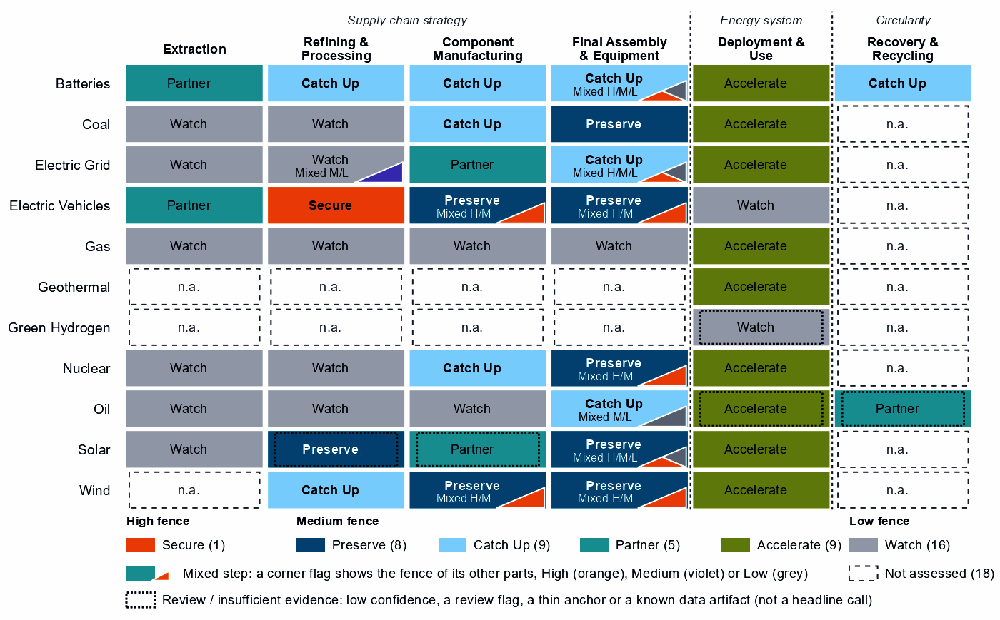
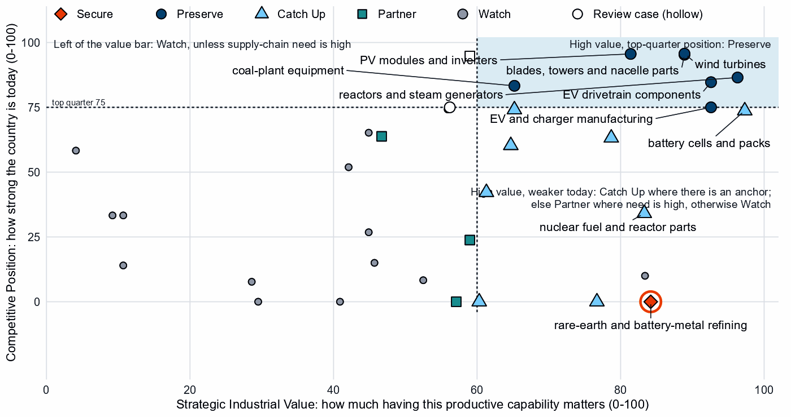
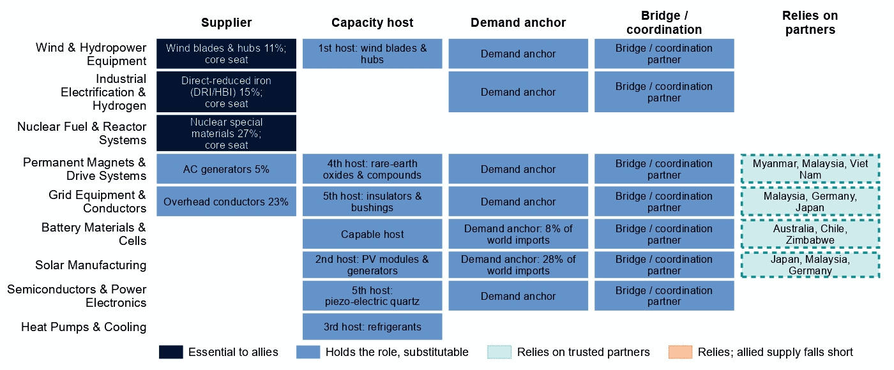
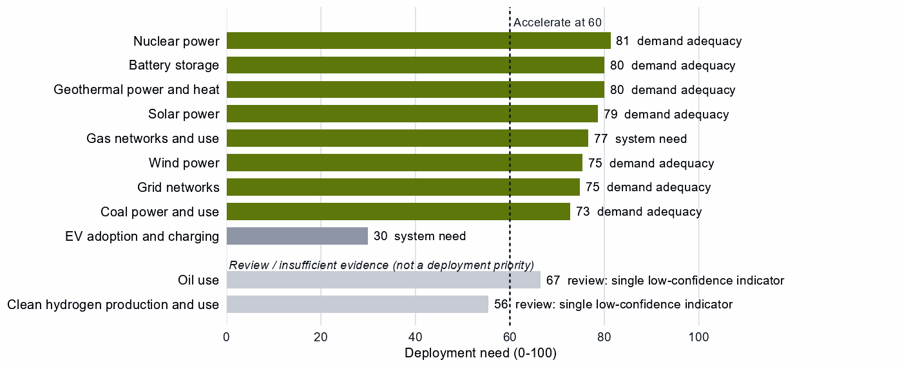

# India and the Allied Industrial Base

*What to secure, build, source from partners, and deploy*

*Generated from Allied Industrial Base Explorer data; evidence, sources and caveats in the appendix. Data as of 30 October 2026.*

## 1. Bottom line — India's strategic role

India is a coalition partner of the Allied Industrial Base, not a core member, yet it already holds a part in almost all of it. It holds a role in nine of the ten strategic compacts and a core seat in Solar Manufacturing, Wind & Hydropower Equipment, Nuclear Fuel & Reactor Systems and Industrial Electrification & Hydrogen. Its distinctive contribution is clean-energy equipment, where it ranks in the top quarter of suppliers although its share of world supply is small (2% in wind turbines, 2% in PV modules and inverters). Allies rely on it for 11% of world exports or production of wind blades and hubs, and it holds top-quarter positions in wind turbines, PV modules and EV drivetrains that it should preserve. Its main industrial build is batteries, where cells, packs and components rest on committed investment and China supplies 90% of cell and pack imports. Development partners with their own need for trusted battery supply can help that build reach scale. The fence that matters is high but narrow: the rare-earth chain, and the control software of the grid, inverters and batteries India installs. The larger task is deployment: storage, solar, wind, grid and nuclear power all need to be built faster. [1, 2, 3]

- **Secure.** The rare-earth chain, where China holds 94% of world refining supply and trusted suppliers only 5%; the control software of grid equipment, inverters and batteries; reactor control; and remote access to turbines and vehicles. The answer is qualified trusted supply and control of command paths, not self-sufficiency. [3]
- **Build / preserve.** Preserve wind turbines and their parts, where allies already rely on India's blades and hubs, and PV modules, EV drivetrains and vehicles, where the AIB shows little or no supplier role. Catch Up in battery cells, packs and components, the cases with high need and value, anchored on committed investment rather than on today's output, and in rare-earth separation as part of the Secure chain.
- **Partner.** Battery and EV minerals, from trusted producers such as Australia, Chile and Zimbabwe, and grid components, from producers such as Malaysia, Germany and Japan. Allied supply already covers India's need in both, so the task is terms and diversification. [1, 2, 3]
- **Deploy / stay open.** Accelerate battery storage, solar and wind power, grid networks and nuclear power; coal power and gas networks also clear the bar. Buy commodity hardware competitively, with security conditions on equipment that carries built-in control. Leave open uranium conversion and enrichment, gas turbines and LNG plant, grid metals refining, and coal, copper and bauxite mining.

In Figure 1 the color sits in the manufacturing columns and in deployment, which is almost all Accelerate. India holds Preserve positions in wind, solar, EV and coal-plant equipment, and Catch Up runs down the battery row. The first columns are mostly Watch or Partner: India buys its minerals and most refined inputs. The orange corner flags mark control software in battery, grid, solar, wind, vehicle and reactor equipment, and the magnets in EV drivetrains and wind parts.

**Figure 1. Where India should secure, build, partner or stay open**

*Each cell is a supply-chain step of a technology, colored by its strategic choice. A corner flag marks a mixed step whose named parts sit behind a different fence: in battery cells and packs, the battery software is Secure, the cells Catch Up and the enclosures Watch. A dotted outline marks a review case, a call resting on low confidence, a review flag, a thin anchor or a known data artifact. Steps marked n.a. lack the data for a call. [2]*

## 2. Where India should secure, compete and stay open

### High fence — what cannot fail

Secure is a narrow call for India: one whole step and 11 layers inside other steps, which group into the four capabilities below. Secure means being able to survive a prolonged cutoff or a hostile command, through qualified trusted supply, stocks, redundancy or control of the command path. [2]

| Capability | Why it matters | Main vulnerability | Recommended response |
|---|---|---|---|
| Control software of grids, inverters and batteries | Battery-management firmware, inverter firmware, smart meters and grid-control software can command, update or disable equipment from abroad, across the storage, solar and grid build-out India must accelerate. | China supplies 90% of battery cell and pack imports, 65% of PV module and inverter imports and 46% of transformer, switchgear and cable imports. | **Mixed.** Trusted-source and certification rules for firmware, communications and remote access. Vendor disclosure and testing where the separability of inverter firmware is not established. Certified trusted control software at deployment scale, for which the data do not show whether India's own equipment makers can supply it. |
| The rare-earth chain: separation, metals and magnets | Feeds the magnets of EV motors and wind generators, both steps India preserves; India has a small export position in rare-earth compounds to build on. | China holds 94% of world supply in rare-earth and battery-metal refining and provides 54% of India's imports of that step; substitution is hard and rebuilding takes more than three years. | **Mixed.** Test and, if it holds, build separation and metal-making at home on the small export foothold. Build the step to magnets with allied partners through co-investment and offtake. Hold stocks sized to the time it takes to restore supply until trusted supply qualifies. |
| Reactor control and safety systems | Nuclear power leads India's deployment need, and its fleet grew from 6.8 to 8.8 GW between 2020 and 2025; reactor control and safety instrumentation is a command path into it. | Control-system risk on a fleet that has to grow. The trade data mix reactors with generic boilers, so they say little about who supplies the control systems. | **Domestic.** Trusted-source and certification rules for control and safety instrumentation, restrictions on remote access by untrusted vendors, and detection, patching and incident-response capacity. |
| Remote access to wind turbines and vehicles | Turbine controllers, park control and connected-vehicle software reach large energy assets and fleets from outside the country. India imports little of this hardware relative to the size of its economy. | China supplies 42% of wind turbine imports and 47% of EV and charger imports. | **Mixed.** Restrictions on remote access and over-the-air updates by untrusted vendors; trusted-source rules for the control layer and the hardware built around it; support for redesigns that separate the control layer, so the fence can shrink. |

Sources: 3, 4, 5.

### Medium fence — where industrial capability matters

Each step turns on whether the capability is worth having (Strategic Industrial Value) and how strong India is today (Competitive Position).

**Preserve.** Wind turbines and blades, towers and nacelle parts hold top-quarter positions, and allies treat India as an essential supplier of blades and hubs. PV modules and inverters also sit in the top quarter, with operating capacity and committed investment behind them. EV drivetrain components are strong; EV and charger manufacturing sits on the top-quarter line and holds no role in the Electric Vehicles compact, so it serves the home market more than allies. Coal-plant equipment also reads Preserve. Reactors and steam generators read Preserve too, but their trade basket mixes reactor lines with generic boiler parts, so the call is not evidence of a reactor industry. Polysilicon refining reads Preserve but is flagged for review by the engine, a review case listed in the appendix. [1, 2]

**Catch Up.** Battery cells and packs is the clearest case for building: high value and a position just below the top quarter among current suppliers (India supplies <1% of world supply). Its committed investment is corroborated by feasibility, industrial learning and announced projects, with high confidence. Battery components rest on the same kind of anchor, with less recorded policy behind them. Both are mixed in delivery: build at home where the base is established and with allied partners for the rest. Transformers, switchgear and cables also read Catch Up, though their value sits just above the bar, and rare-earth and wind materials refining is the Catch Up part of the Secure rare-earth chain. Several other Catch Up calls should not carry the strategy. Battery materials refining rests on 1% of world exports with no plant in the capacity data. Nuclear fuel and reactor parts rests on the same mixed boiler basket as reactors, and battery recycling on no measured position. [2, 3]

**Partner.** India's Partner steps sit at the start of the chain. It holds no measurable position in battery mineral mining and only a weak one in EV mineral mining (24 out of a hundred). It depends heavily on imports, so supply should be spread across trusted producers such as Australia, Chile and Zimbabwe. Grid components are worth sourcing from Malaysia, Germany and Japan rather than duplicating. Wafers and PV cells also read Partner, but the call is flagged for review by the engine. India holds a top-quarter position there and both named layers read Catch Up, a disagreement this brief does not settle. [1, 2, 3]

**Shared capabilities.** Some physical capabilities sit in several technology chains, and their calls differ by technology. The table keeps the national reading apart from what allies rely on India for. Overhead conductors show the gap: the cables layer of India's grid equipment reads Watch, while India holds 23% of world exports or production, a role the AIB rates as one others could fill. That is an allied role to keep reliable, not a domestic fence. [1, 3]

| Shared capability | Steps and their choices | National reading | AIB role |
|---|---|---|---|
| Overhead conductors | transformers, switchgear and cables (Catch Up); PV modules and inverters (Preserve); and wind turbines (Preserve) | The choices differ across technologies with each step's own measures (transformers, switchgear and cables: need 39, value 61, position 42; PV modules and inverters: need 58, value 81, position 96; wind turbines: need 28, value 89, position 96) | Supplier: 23% of world exports or production of overhead conductors (the AIB measure of the product, not a step's share) |
| Accumulator parts & separators | battery components (Catch Up) and EV drivetrain components (Preserve) | The choices differ across technologies with each step's own measures (battery components: need 91, value 79, position 63; EV drivetrain components: need 67, value 93, position 85) | Allies need new capacity here (BUILD); no supplier role |
| Insulators & bushings | grid components (Partner); wafers and PV cells (Partner, review: flagged for review by the engine); and blades, towers and nacelle parts (Preserve) | The choices differ across technologies with each step's own measures (grid components: need 72, value 47, position 64; wafers and PV cells: need 90, value 59, position 95; blades, towers and nacelle parts: need 69, value 89, position 95) | Allies need new capacity here (BUILD); no supplier role |
| Li-ion cells & packs | battery cells and packs (Catch Up) and EV drivetrain components (Preserve) | The choices differ across technologies with each step's own measures (battery cells and packs: need 95, value 97, position 74; EV drivetrain components: need 67, value 93, position 85) | Allies need new capacity here (BUILD); no supplier role |

Sources: 1, 2.

**Figure 2. Which producing capabilities are worth holding, and where India is strong today**

*Producing steps with both measures (recovery has no position measure). Dashed lines mark the value bar (60) and the top quarter (75). India's wind, solar, EV and power-plant equipment sits in the upper right; battery cells and packs and coal-plant components sit just below the top-quarter line. Hollow markers are review cases. [2]*

### Low fence — what not to prioritize

Watch is not a failure: it means affordable, diversified access matters more than domestic production.

- **Uranium conversion and enrichment.** Nuclear power must grow, but these steps have low supply-chain need and no capability anchor, and trusted suppliers hold 74% of world supply. Keep access diversified. [3]
- **Gas turbines, LNG plant and their components.** Gas networks read Accelerate, but the equipment behind them has low supply-chain need and is best bought competitively.
- **Grid metals refining.** Copper and aluminium processing is a commodity step with a capability floor.
- **Coal, copper and bauxite mining.** These are commodity steps: coal is best diversified toward trusted producers, and copper and bauxite need at most a specified capability floor.

## 3. India's allied bargain

**What India contributes.** In the Allied Industrial Base analysis it is a coordination / bridge hub: a demand anchor and bridge in most compacts, with supplier seats that allies cannot easily replace in wind, nuclear and industrial electrification. It holds 11% of world exports or production of wind blades and hubs, 23% of overhead conductors and 15% of direct-reduced iron. Its nuclear seat rests on 27% of nuclear special materials, a trade line with no physical data. Under Managed Interdependence, the default scenario, India sits in the minimum coalition of nine Sectoral Compacts, the AIB's finer workstreams within the strategic compacts. Under Decoupling it sits in ten, as a demand anchor in nine. [1, 3]

**What India needs.** Minerals, refined inputs and battery capability. If China's supply stopped, as in the Decoupling scenario, India would lose US$24.7 billion a year of imports across the Allied Industrial Base basket. New capacity at the best-placed allied hosts, led by Japan, would restore about US$2.3 billion of it a year. That counts new capacity only, not trade redirected to existing allied suppliers, so it is not a measure of how much of the loss allies could cover. The allies with the most supply restored to and from India by new and expanded trade are South Korea, Singapore and Australia. The count runs in both directions, so it includes buyers of India's output as well as suppliers. [1, 3]

**The dependencies to make intentional.** These bargains turn that exchange into a specialization partners can count on.

| Capability / compact | India contributes | India needs | Natural partners | What makes the bargain work |
|---|---|---|---|---|
| Wind & Hydropower Equipment | Wind blades and hubs (11%), with a core seat; turbines it preserves at home | Trusted magnets for generators; allied demand for its equipment | The compact's other core countries, Spain, Poland, Germany, the United States and the United Kingdom | Allied or conditional inbound investment and public finance to expand blade capacity (in the AIB, 1st host: wind blades & hubs) |
| Battery Materials & Cells | A large market and a capable host for new capacity | Battery minerals; cell and component capability, since China supplies 90% of cell and pack imports | Australia, Chile and Zimbabwe for minerals; the compact's processors and makers, Japan, Indonesia and South Korea | For minerals, offtake and co-investment with the recommended partners and diversified contracts; for cells and components, joint ventures on terms that transfer capability, and allied co-investment for the capacity not built at home |
| Permanent Magnets & Drive Systems | AC generators (5% of world exports or production); a host for new rare-earth capacity (in the AIB, 4th host: rare-earth oxides & compounds) | Trusted refined rare earths and magnets | The compact's magnet and motor makers, Germany, the United States, Japan and Mexico. Refining where allied supply sits, such as Myanmar, Malaysia and Viet Nam (a list of where allied capacity is, not of reliable partners; each needs checking before India relies on it) | Allied co-investment and offtake for new trusted capacity, qualified supply from trusted producers, and stockpiles until it qualifies |
| Grid Equipment & Conductors | Overhead conductors (23%); transformers and switchgear to build | Grid components | Malaysia, Germany and Japan; the compact's makers, Japan and Germany | Offtake and co-investment with the recommended partners and mutual recognition of standards; for transformers, joint ventures on terms that transfer capability |

Sources: 1, 2, 3.

**Figure 3. India's role in the Allied Industrial Base**

*Each row is a strategic compact in which India holds a role or relies on partners. Dark cells are roles allies cannot easily replace; light cells are roles others could fill; dashed cells mark where India relies on trusted partners. The solar row's reliance comes from wafers and PV cells, a review case.*

Wherever India relies on partners, allied supply covers its need, so its bargains are about terms and diversification more than missing capacity. Its seat in Industrial Electrification & Hydrogen rests on direct-reduced iron, a product the national choices do not assess. In Solar Manufacturing it is a demand anchor and a host for new module capacity, with no supplier role in the AIB. [1]

## 4. Development partnerships — what support could help India Catch Up?

India is not high income, so this section asks what support could help it Catch Up and what developed partners would gain. A Catch Up step qualifies when its anchor is corroborated beyond context signals, its evidence and confidence suffice, and it measures the product partners need. Developed economies must also have their own need for more trusted supply there. That shows a shared interest, not capacity to give: some named partners do not report development aid to the OECD. Of India's nine Catch Up steps, seven pass. [1, 2, 6]

The battery steps lead. Battery cells and packs and battery components rest on committed investment, and many developed economies share the need, among them Spain, the United Kingdom, Australia and Chile for cells and Oman, Finland, Australia and Chile for components. Battery materials refining passes on a share of world exports alone (1%), and no plant appears in the capacity data, so feasibility studies and project preparation come first. It is a candidate for study, not a build commitment. Rare-earth and wind materials refining passes on India's exports of rare-earth compounds, a supply that Denmark, Finland, the United Kingdom and Japan need. [1, 2, 3, 6]

The other passes are narrower. Only Oman shares the need in transformers, switchgear and cables, and only Oman in drilling rigs, tankers and oil equipment; in transformers, switchgear and cables, other allies share only the AIB's allied capacity gap, a weaker reason. Coal-plant components and oil equipment sit outside the AIB's strategic compacts, and their own supply-chain need (57 and 6 out of a hundred, against a high-need bar of 67) is not high. In the table, 'high-need step' describes the partners' need, not India's, and these are commercial openings, not security priorities. Nuclear fuel and reactor parts does not pass, because its basket mixes reactor and fuel parts with generic boiler parts, and neither does battery recycling, for lack of evidence. [1, 2, 3, 6]

| Catch Up capability | What constrains scale | Potential development partners | Useful support | What the partners gain | What it builds at home |
|---|---|---|---|---|---|
| Battery materials refining | No operating or committed plant in the capacity data; a position that rests on trade or output shares, not on plant capacity; and input costs not covered by the data | Denmark, Hungary, the Czech Republic and Israel | Feasibility studies and project preparation, industrial infrastructure, technical standards, testing facilities; then, at scale, offtake, market access, investment guarantees | A trusted second source and diversified supply for a high-need step | Processing capacity at home, with the skills, standards and value capture of a refinery |
| Battery components | Committed projects not yet operating and input costs not covered by the data | Oman, Finland, Australia and Chile | Project preparation, supplier development, technical and vocational skills, quality systems and certification; then, at scale, development finance, guarantees, offtake, equity and joint ventures | A trusted second source and diversified supply for a high-need step | A certified supplier base and export sales of components |
| Battery cells and packs | Committed projects not yet operating and input costs not covered by the data | Spain, the United Kingdom, Australia and Chile | Project preparation, supplier development, technical and vocational skills, quality systems and certification; then, at scale, development finance, guarantees, offtake, equity and joint ventures | A trusted second source and diversified supply for a high-need step | Factory capacity, skills and export sales of finished equipment |
| Coal-plant components | Plant capacity not covered by the data and input costs not covered by the data | Oman, the United Kingdom, Canada and Greece | Supplier development, technical and vocational skills, quality systems and certification, common testing facilities; then, at scale, development finance, guarantees, offtake, equity and joint ventures | A trusted second source and diversified supply for a high-need step | A certified supplier base and export sales of components |
| Transformers, switchgear and cables | Plant capacity not covered by the data and input costs not covered by the data | Oman | Supplier development, technical and vocational skills, quality systems and certification, common testing facilities; then, at scale, development finance, guarantees, offtake, equity and joint ventures | Trusted supply of a High-fence input and an alternative to concentrated, untrusted supply | Factory capacity, skills and export sales of finished equipment |
| Drilling rigs, tankers and oil equipment | Plant capacity not covered by the data and input costs not covered by the data | Oman | Supplier development, technical and vocational skills, quality systems and certification, common testing facilities; then, at scale, development finance, guarantees, offtake, equity and joint ventures | A trusted second source and diversified supply for a high-need step | Factory capacity, skills and export sales of finished equipment |
| Rare-earth and wind materials refining | Plant capacity not covered by the data and input costs not covered by the data | Denmark, Finland, the United Kingdom and Japan | Feasibility studies and project preparation, industrial infrastructure, environmental and permitting capability, workforce development; then, at scale, offtake, market access, investment guarantees | A trusted second source and diversified supply for a high-need step | Processing capacity at home, with the skills, standards and value capture of a refinery |

Sources: 1, 2, 6, 7.

India's Preserve steps in wind, solar and EV equipment are a commercial case, not aid: partners with their own need should trade with India, take offtake and invest on commercial terms.

## 5. Energy-system priorities

India needs almost every energy technology faster, regardless of where the equipment is made. Nuclear power, battery storage, solar and wind power and grid networks all clear the Accelerate bar of 60, each resting on every measure of deployment need with high confidence and led by demand adequacy. The national target of 560 GW of renewables by 2030 compares with 250 GW installed in 2025; at the recent build rate the shortfall is about 165 GW. Between 2020 and 2025, solar capacity grew from 39.7 to 135.5 GW and wind from 38.6 to 54.5 GW. The target and the shortfall cover renewables together, so the data do not say which technology must speed up most. [2, 5]

**Figure 4. What India needs to deploy faster**

*Deployment need by technology, with the largest of its measures: demand adequacy, the gap to national targets, or system need. Review cases, which rest on a single indicator of low confidence, are shown apart in grey and are not deployment priorities.*

Coal power and gas networks also clear the bar, coal mainly on demand adequacy and gas on system need. Accelerate says the system needs more of what they provide; this analysis does not weigh them against clean sources. Recorded policy already ranks coal power among India's top deployment priorities. Geothermal power and heat reads Accelerate on fewer measures, with no geothermal supply step assessed, so it is a case to examine, not a priority.

High deployment priority does not imply high manufacturing priority: the configured build is infrastructure, permitting and procurement. Oil use also reads Accelerate, but on a single indicator of low confidence, use rising from 9.14 to 10.89 EJ; it is a review case, shown apart. As a supply-side question only: India's supply-chain need in crude oil is 76 out of a hundred, and the configured answer for that Watch step is supply diversified toward trusted producers. EV adoption and clean hydrogen sit below the bar: worth watching, not forcing. [2, 3, 8]

## 6. Is current policy pointed in the right direction?

Policy never decides a choice here; it is compared with it afterwards, using India's own recorded industrial-policy measures. The table keeps the most consequential mismatches of each kind and leaves out review cases.

| Capability | Strategic choice | Current policy | Gap |
|---|---|---|---|
| Rare-earth and battery-metal refining | Secure | Needs more attention | Vulnerability without enough policy attention |
| Reactors and steam generators | Preserve | Needs more attention | Capability case without enough policy attention |
| Nuclear fuel and reactor parts | Catch Up | Needs more attention | Capability case without enough policy attention |
| Battery components | Catch Up | Needs more attention | Capability case without enough policy attention |
| Geothermal power and heat | Accelerate | Deployment policy below the middle | Deployment needed faster than policy supports |
| Gas networks and use | Accelerate | Deployment policy below the middle | Deployment needed faster than policy supports |
| Copper and bauxite mining | Watch | Heavy protection or localization | Localizing what is not a domestic priority |
| Coal mining | Watch | Heavy protection or localization | Localizing what is not a domestic priority |

Sources: 2, 9, 10.

The largest gap is rare-earth refining: it is India's only Secure step, yet recorded measures barely reach it or the separation step beside it. Battery components rank well below cells in India's recorded support, though both are Catch Up cases on the same anchor. Coal, copper and bauxite mining rank among India's most protected steps, where the configured answer is diversified supply from trusted producers for coal and at most a specified capability floor for copper and bauxite. Deployment policy lags for gas networks. The nuclear gaps in the table rest on trade baskets that cannot tell reactor and fuel parts from boilers, so this brief does not treat them as priorities. Recorded measures also localize wafers and PV cells, which read Partner, but that call is a review case and is not settled here.

## 7. Strategic agenda — what should India do next?

### 1. Secure the rare-earth chain through a mixed domestic and allied build-out

Build separation and metal-making at home, starting from a small export foothold (about 2% of world exports, with no measurable share of world supply) and testing it with feasibility work before committing capacity. Build the step to magnets with allied makers such as Germany, the United States, Japan and Mexico through co-investment and offtake. Hold stocks sized to the time it takes to restore supply until trusted supply qualifies. Recorded policy barely reaches this step today, so it is the first gap to close. [1, 3]

### 2. Catch up in battery cells and components with time-limited support tied to benchmarks

Tie production incentives, first-of-a-kind finance, workforce and supplier development and demand creation to benchmarks, and let support sunset if the gap does not narrow. Keep the gate open to joint ventures on terms that transfer capability. Bring support for components up to the level of cells.

### 3. Keep the wind, solar and EV equipment base competitive as India's allied contribution

Wind turbines, blades, PV modules and EV drivetrains are positions to hold, not to rebuild. Back them with R&D, workforce and supplier development and finance for expansion tied to benchmarks, and welcome allied investment in new blade capacity (in the AIB, 1st host: wind blades & hubs). [1, 2]

### 4. Put a high, narrow fence around control software

Set trusted-source and certification rules for battery management, inverter firmware, smart meters, grid control, turbine controllers, connected vehicles and reactor control. Restrict remote access and over-the-air updates by untrusted vendors, and replace untrusted control software in the installed base. Whether India's own equipment makers can supply the certified alternative is not measured here and should be tested first.

### 5. Use development partnerships to bring battery cells and components to scale

Start with partners that share the need, such as Spain, the United Kingdom, Australia and Chile for battery cells and packs and Oman, Finland, Australia and Chile for battery components. Use project preparation, supplier development, skills and certification first, then development finance, guarantees, offtake and joint ventures as plants come on line. The objective is a trusted second source for partners and a durable industry at home. [1, 2, 6]

### 6. Accelerate storage, solar, wind, grid and nuclear power while keeping sourcing open

Deploy faster through infrastructure, permitting, interoperability and procurement; buy commodity hardware competitively from trusted suppliers, with trusted-supplier and security conditions on public deployment support and connected equipment. Gas turbines, conversion and enrichment, and coal and copper mining are not localization priorities: affordable, diversified access is.

## Sources

1. Allied Industrial Base model: roles, compacts, trade restored and new capacity across the allied coalition, computed by the Explorer's authors (run of 30 October 2026); CC BY 4.0.
2. Country strategy choices by technology and supply-chain step (supply-chain need, Strategic Industrial Value, Competitive Position, deployment need, policy alignment), computed by the Explorer's authors (dashboard data of 31 October 2026); CC BY 4.0.
3. United Nations, UN Comtrade Database, HS6 bilateral trade (all reporters); reconciled by the authors (2022-2024 data); attribution; https://comtradeplus.un.org/.
4. Yards & Fences node attributes: standardization, learning, industrial commons and control layers, curated by the authors from public sources (2026-10-30); CC BY 4.0.
5. Ember, electricity generation and capacity data (2020-2025) and 2030 Renewable Target Tracker; CC BY 4.0; https://ember-energy.org/.
6. OECD Creditor Reporting System: official development assistance by donor, recipient and purpose code, gross disbursements at constant prices, energy, industry and mining purpose codes only, mapped to supply-chain steps by the authors (Components and Assembly share purpose codes; no code funds recycling) (2020-2024 data); attribution; https://data-explorer.oecd.org/.
7. Development tool families by supply-chain stage and constraint, and the development-partnership tests, set by the authors (config/development_partnerships.yml) (2026-11-03); CC BY 4.0.
8. Energy Institute, Statistical Review of World Energy 2026: oil consumption (data to 2025); attribution; https://www.energyinst.org/statistical-review.
9. Global Trade Alert, New Industrial Policy Observatory: industrial-policy interventions, strength scored by the authors, October 2026 extract (as of 5 October 2026); subscription (titles, dates and links only); https://www.globaltradealert.org/.
10. International Energy Agency, Policies and Measures Database (export of 2026-10-26); attribution; https://www.iea.org/policies.
11. International Energy Agency, World Energy Outlook 2025 (Stated Policies Scenario) and Global Critical Minerals Outlook: demand 2024-2035 (2025); CC BY-NC-SA 4.0 (free dataset); https://www.iea.org/.
12. Clean Investment Monitor: clean-technology manufacturing investment and capacity (aggregated), world capital expenditure 2021-22 to 2024-25; attribution; https://www.cleaninvestmentmonitor.org/.

## Appendix — evidence and method

**How this brief is built.** Every number comes from the Country page data of the Allied Industrial Base Explorer (the data release of 30 October 2026) and from the Allied Industrial Base analysis. Each technology is split into supply-chain stages, from mining to recovery, and each step gets a strategic choice by fixed rules applied in order: [2]

- Secure where an acute vulnerability is measured;
- at deployment, Accelerate where deployment need reaches 60; [2]
- Watch where the step is a large, commoditized yard;
- Preserve where Competitive Position is in the top quarter (75) and either Strategic Industrial Value (bar 60) or supply-chain need (bar 67) is high; [2]
- Catch Up where the value is high, the position is not, and a capability anchor is corroborated by other evidence;
- Partner where supply-chain need is high but there is neither a top-quarter position nor, for a high-value step, a credible pathway;
- Watch otherwise.

Named layers inside a step, such as control software or magnets, take their own choice, and a step whose parts sit behind different fences is mixed. A value that rests on market size alone is capped just under the bar. Observed policy never decides a choice. The high fence (Secure) protects what cannot be allowed to fail; the medium fence covers capabilities worth building, keeping or sourcing deliberately and deployment to accelerate; the low fence (Watch) leaves a step open to competitive purchase.

**Review cases.** Some calls rest on low confidence, an engine review flag, a thin capability anchor, a known data artifact or, at deployment, a single indicator of low confidence. They stay on the map but never enter the Bottom line, the Agenda, the policy table or a headline mark. 5 steps are review cases. [2]

| Step | Choice | Why it is a review case |
|---|---|---|
| Clean hydrogen production and use | Watch | A single indicator of low confidence |
| Oil use | Accelerate | A single indicator of low confidence |
| Waste-oil recovery | Partner | Low confidence |
| Polysilicon refining | Preserve | Flagged for review by the engine |
| Wafers and PV cells | Partner | Flagged for review by the engine |

Sources: 2.

**Evidence and caveats.** India is a coalition partner, not a core member; the brief applies the same method as for core members. Both nuclear manufacturing steps rest on trade baskets that mix reactor and fuel lines with generic boiler and steam-turbine parts, which the shares cannot tell apart. Reactors and nuclear fuel parts are therefore not treated as established or emerging industries. The AIB nuclear seat rests on a trade line in nuclear special materials with no physical data. The AIB flags its wind-blade line as usable with caution: its trade headings are broad, and production is more concentrated than trade. India's rare-earth position rests on its exports of rare-earth compounds, about 2% of world exports, with no measurable share of world supply. Allied supply covers India's rare-earth need although trusted suppliers hold only 5% of world supply, and India's imports are modest, though the data do not show that as the reason. 18 steps lack the data for a call, including every geothermal supply step and green hydrogen manufacturing and most recycling. Recorded policy ranks clean hydrogen among India's priorities, but its deployment need reads low on a single indicator, so this brief does not settle that disagreement. Competitive Position ranks India among economies that already supply a step, so a zero means no measurable position. Policy alignment and protection are ranks within India, not levels. Partner lists name where allied capacity sits, which can include trading hubs, not who owns it. [2, 3]

**Development partnerships.** India is a development recipient in this analysis (not high income). A Catch Up step qualifies when its capability anchor is corroborated beyond context signals, its evidence and confidence are sufficient, and the economy sits inside the AIB trust screen. On a step whose data describe different products, the anchor must also measure the product the need is about. The developed partners named are high-income economies whose own same step has a strategic reason for more trusted capacity: Partner, Secure with allied delivery, high need, allied supply short, or new allied capacity needed. A constraint is named only where the data observe its input; otherwise the table says the data do not cover it. India's Preserve steps are a commercial route (trade, offtake and investment), and steps whose position cannot be verified are review cases. This brief does not compare current aid to India with these steps.

**Every step.**

| Step | Stage | Choice | Fence | Need | Value | Position | Evidence | Policy |
|---|---|---|---|---|---|---|---|---|
| Battery mineral mining | Extraction | Partner | Medium | 90 | 57 | 0 | strong | broadly aligned |
| Battery materials refining | Refining | Catch Up | Medium | 80 | 77 | 0 | strong | broadly aligned |
| Battery components | Components | Catch Up | Medium | 91 | 79 | 63 | moderate | needs more attention |
| Battery cells and packs | Assembly | Catch Up | Mixed High/Medium/Low | 95 | 97 | 74 | moderate | mixed signals |
| Battery storage | Deployment | Accelerate | Medium | 80 | – | – | strong | broadly aligned |
| Battery recycling | Recovery | Catch Up | Medium | 94 | 82 | – | – | mixed signals |
| Coal mining | Extraction | Watch | Low | 78 | 4 | 58 | strong | too much intervention |
| Coke and coal processing | Refining | Watch | Low | 86 | 9 | 33 | strong | not enough policy evidence |
| Coal-plant components | Components | Catch Up | Medium | 57 | 65 | 74 | strong | needs more attention |
| Coal-plant equipment | Assembly | Preserve | Medium | 55 | 65 | 83 | strong | needs more attention |
| Coal power and use | Deployment | Accelerate | Medium | 73 | – | – | strong | broadly aligned |
| Coal recovery | Recovery | Not assessed | – | – | 1 | – | – | not enough policy evidence |
| Copper and bauxite mining | Extraction | Watch | Low | 82 | 41 | 0 | strong | too much intervention |
| Grid metals refining | Refining | Watch | Mixed Medium/Low | 80 | 53 | 8 | strong | broadly aligned |
| Grid components | Components | Partner | Medium | 72 | 47 | 64 | strong | broadly aligned |
| Transformers, switchgear and cables | Assembly | Catch Up | Mixed High/Medium/Low | 39 | 61 | 42 | strong | broadly aligned |
| Grid networks | Deployment | Accelerate | Medium | 75 | – | – | – | broadly aligned |
| Grid-equipment recycling | Recovery | Not assessed | – | – | 14 | – | – | not enough policy evidence |
| EV mineral mining | Extraction | Partner | Medium | 90 | 59 | 24 | strong | broadly aligned |
| Rare-earth and battery-metal refining | Refining | Secure | High | 85 | 84 | 0 | strong | needs more attention |
| EV drivetrain components | Components | Preserve | Mixed High/Medium | 67 | 93 | 85 | moderate | broadly aligned |
| EV and charger manufacturing | Assembly | Preserve | Mixed High/Medium | 42 | 93 | 75 | moderate | broadly aligned |
| EV adoption and charging | Deployment | Watch | Low | 30 | – | – | strong | broadly aligned |
| EV recycling | Recovery | Not assessed | – | – | 37 | – | – | not enough policy evidence |
| Gas production | Extraction | Watch | Low | 64 | 11 | 33 | strong | broadly aligned |
| Gas liquids processing | Refining | Watch | Low | 59 | 11 | 14 | strong | broadly aligned |
| Gas-turbine and drilling components | Components | Watch | Low | 33 | 45 | 27 | strong | broadly aligned |
| Gas turbines and LNG plant | Assembly | Watch | Low | 11 | 45 | 65 | strong | broadly aligned |
| Gas networks and use | Deployment | Accelerate | Medium | 77 | – | – | strong | deployment policy lags |
| Gas recovery | Recovery | Not assessed | – | – | 7 | – | – | not enough policy evidence |
| Geothermal resource development | Extraction | Not assessed | – | – | 20 | – | – | not enough policy evidence |
| Geothermal refining | Refining | Not assessed | – | – | 20 | – | – | not enough policy evidence |
| Geothermal plant components | Components | Not assessed | – | – | 69 | – | – | not enough policy evidence |
| Geothermal power-plant equipment | Assembly | Not assessed | – | – | 69 | – | – | not enough policy evidence |
| Geothermal power and heat | Deployment | Accelerate | Medium | 80 | – | – | strong | deployment policy lags |
| Geothermal recovery | Recovery | Not assessed | – | – | 20 | – | – | not enough policy evidence |
| Electrolyser mineral mining | Extraction | Not assessed | – | – | 35 | 0 | strong | not enough policy evidence |
| PGM and catalyst refining | Refining | Not assessed | – | – | 63 | 95 | strong | not enough policy evidence |
| Electrolyser stacks | Components | Not assessed | – | – | 99 | – | – | not enough policy evidence |
| Electrolyser systems | Assembly | Not assessed | – | – | 90 | – | – | not enough policy evidence |
| Clean hydrogen production and use | Deployment | Watch | Low | 56 | – | – | – | broadly aligned |
| Stack and catalyst recycling | Recovery | Not assessed | – | – | 49 | – | – | not enough policy evidence |
| Uranium mining | Extraction | Watch | Low | 93 | 46 | 15 | strong | not enough policy evidence |
| Uranium conversion and enrichment | Refining | Watch | Low | 39 | 83 | 10 | strong | broadly aligned |
| Nuclear fuel and reactor parts | Components | Catch Up | Medium | 54 | 83 | 34 | strong | needs more attention |
| Reactors and steam generators | Assembly | Preserve | Mixed High/Medium | 64 | 96 | 87 | strong | needs more attention |
| Nuclear power | Deployment | Accelerate | Medium | 81 | – | – | strong | broadly aligned |
| Spent-fuel reprocessing | Recovery | Not assessed | – | – | 83 | – | – | not enough policy evidence |
| Oil production | Extraction | Watch | Low | 76 | 29 | 8 | strong | broadly aligned |
| Oil refining | Refining | Watch | Low | 8 | 56 | 74 | strong | broadly aligned |
| Drilling and pump components | Components | Watch | Low | 46 | 42 | 52 | strong | broadly aligned |
| Drilling rigs, tankers and oil equipment | Assembly | Catch Up | Mixed Medium/Low | 6 | 65 | 60 | strong | broadly aligned |
| Oil use | Deployment | Accelerate | Medium | 67 | – | – | strong | deployment policy lags |
| Waste-oil recovery | Recovery | Partner | Medium | 91 | 17 | – | – | wrong tool for the problem |
| PV mineral mining | Extraction | Watch | Low | 78 | 30 | 0 | strong | broadly aligned |
| Polysilicon refining | Refining | Preserve | Medium | 86 | 56 | 75 | strong | mixed signals |
| Wafers and PV cells | Components | Partner | Medium | 90 | 59 | 95 | moderate | wrong tool for the problem |
| PV modules and inverters | Assembly | Preserve | Mixed High/Medium/Low | 58 | 81 | 96 | moderate | broadly aligned |
| Solar power | Deployment | Accelerate | Medium | 79 | – | – | strong | broadly aligned |
| PV module recycling | Recovery | Not assessed | – | – | 44 | – | – | not enough policy evidence |
| Wind mineral mining | Extraction | Not assessed | – | – | 46 | 63 | strong | not enough policy evidence |
| Rare-earth and wind materials refining | Refining | Catch Up | Medium | 73 | 60 | 0 | strong | needs more attention |
| Blades, towers and nacelle parts | Components | Preserve | Mixed High/Medium | 69 | 89 | 95 | moderate | broadly aligned |
| Wind turbines | Assembly | Preserve | Mixed High/Medium | 28 | 89 | 96 | moderate | broadly aligned |
| Wind power | Deployment | Accelerate | Medium | 75 | – | – | strong | broadly aligned |
| Wind-turbine recycling | Recovery | Not assessed | – | – | 34 | – | – | not enough policy evidence |

Sources: 2, 3, 4, 5, 9, 10, 11, 12.

**Named layers.**

| Layer | Step | Choice | Fence |
|---|---|---|---|
| Anode materials (natural and synthetic graphite) | battery materials refining | Catch Up | Medium |
| Cathode active materials and precursors | battery materials refining | Catch Up | Medium |
| Battery-grade lithium hydroxide and carbonate | battery materials refining | Catch Up | Medium |
| Battery cells (LFP and NMC) | battery cells and packs | Catch Up | Medium |
| Communications gateway and cloud fleet management | battery cells and packs | Secure | High |
| Battery-management firmware, energy-management software and remote updates | battery cells and packs | Secure | High |
| Enclosures, racking, thermal management and balance of system | battery cells and packs | Watch | Low |
| Grain-oriented electrical steel | grid metals refining | Catch Up | Medium |
| Power conversion hardware (inverters and converters) | transformers, switchgear and cables | Catch Up | Medium |
| Smart meters and advanced metering head-end systems | transformers, switchgear and cables | Secure | High |
| Cables and conductors | transformers, switchgear and cables | Watch | Low |
| Utility-scale inverter firmware and remote-access functions | transformers, switchgear and cables | Secure | High |
| Grid-control software (SCADA, EMS, DERMS) | transformers, switchgear and cables | Secure | High |
| Large power transformers | transformers, switchgear and cables | Catch Up | Medium |
| HVDC converter-station control and protection | transformers, switchgear and cables | Catch Up | Medium |
| Electric drive units and motors | EV drivetrain components | Preserve | Medium |
| Sintered NdFeB permanent magnets (traction motors) | EV drivetrain components | Secure | High |
| Connected-vehicle telematics, over-the-air software and connectivity systems | EV and charger manufacturing | Secure | High |
| Charging-network management software (charge-point back ends) | EV adoption and charging | Watch | Low |
| Pipeline SCADA, compressor-station and LNG-terminal control systems | gas turbines and LNG plant | Watch | Low |
| Iridium and platinum for PEM electrolyser catalysts | electrolyser mineral mining | Not assessed | – |
| HALEU enrichment | uranium conversion and enrichment | Watch | Low |
| LEU enrichment services | uranium conversion and enrichment | Watch | Low |
| Fuel assemblies (design-specific fabrication) | nuclear fuel and reactor parts | Catch Up | Medium |
| Reactor control and safety instrumentation | reactors and steam generators | Secure | High |
| Oil pipeline and terminal control systems | drilling rigs, tankers and oil equipment | Watch | Low |
| Solar-grade polysilicon | polysilicon refining | Preserve | Medium |
| Solar cells and wafers | wafers and PV cells | Catch Up | Medium |
| Next-generation PV (perovskite and tandem cells) | wafers and PV cells | Catch Up | Medium |
| Distributed PV inverter firmware, communication dongles and vendor cloud | PV modules and inverters | Secure | High |
| Conventional crystalline-silicon modules | PV modules and inverters | Preserve | Medium |
| Passive racking and mounting | PV modules and inverters | Watch | Low |
| Rare-earth separation and metal-making | rare-earth and wind materials refining | Catch Up | Medium |
| Sintered NdFeB permanent magnets | blades, towers and nacelle parts | Secure | High |
| Turbine controllers, OEM remote access and park SCADA | wind turbines | Secure | High |

Sources: 2, 4.

**Partner recommendations.**

| Step | Choice | Trusted partners | Allied supply | Evidence |
|---|---|---|---|---|
| Battery mineral mining | Partner | Australia, Chile and Zimbabwe | Allied supply covers the need | moderate |
| Grid components | Partner | Malaysia, Germany and Japan | Allied supply covers the need | strong |
| EV mineral mining | Partner | Australia, Chile and Zimbabwe | Allied supply covers the need | moderate |
| Rare-earth and battery-metal refining | Secure | Myanmar, Malaysia and Viet Nam | Allied supply covers the need | moderate |
| Waste-oil recovery | Partner | No credible allied solution yet | – | none |
| Wafers and PV cells | Partner | Japan, Malaysia and Germany | Allied supply covers the need | strong |

Sources: 1, 2, 3.

**Compact roles.**

| Strategic compact | Lead role | Functions | Lead step | Core countries |
|---|---|---|---|---|
| Permanent Magnets & Drive Systems | Scale manufacturer | Scale manufacturer, demand anchor, bridge / coordination partner and diversification partner | Motors & generators | Thailand, Viet Nam, Germany, the United States, Japan and Mexico |
| Battery Materials & Cells | Demand anchor | Demand anchor, capacity-building host, bridge / coordination partner and diversification partner | Minerals & recycled feed | the United States, the Democratic Republic of Congo, Japan, Indonesia, South Korea and Germany |
| Semiconductors & Power Electronics | Capacity-building host | Demand anchor, capacity-building host, bridge / coordination partner and diversification partner | – | Brazil, Taiwan, Singapore, South Korea, the United States and Viet Nam |
| Solar Manufacturing | Demand anchor | Demand anchor, bridge / coordination partner and diversification partner | Cells & cover glass | Germany, Japan, South Korea, Viet Nam, the United States and India |
| Wind & Hydropower Equipment | Specialized technology supplier | Specialized technology supplier, scale manufacturer, demand anchor, capacity-building host and bridge / coordination partner | Blades, towers & turbine parts | Spain, Poland, India, Germany, the United States and the United Kingdom |
| Nuclear Fuel & Reactor Systems | Processing anchor | Processing anchor | Fuel & nuclear materials | Australia, Canada, India, the United States, France and the United Kingdom |
| Grid Equipment & Conductors | Scale manufacturer | Scale manufacturer, demand anchor, capacity-building host, bridge / coordination partner and diversification partner | Network equipment | Chile, Peru, the Democratic Republic of Congo, Japan, Germany and the United States |
| Heat Pumps & Cooling | Capacity-building host | Capacity-building host | – | the United States, the Netherlands, Thailand, Mexico, Germany and Italy |
| Industrial Electrification & Hydrogen | Processing anchor | Processing anchor, specialized technology supplier, demand anchor, bridge / coordination partner and diversification partner | Green iron & furnace inputs | India, Oman, South Africa, the United States, Saudi Arabia and Morocco |

Sources: 1.

**Coverage and freshness.**

| Item | Value |
|---|---|
| Data release | 30 October 2026 |
| Steps with a choice | 48 |
| Steps not assessed | 18 |
| Named layers with a choice | 34 |
| Steps with strong position evidence | 39 |
| Steps with moderate or weak position evidence | 8 |
| Steps with no position evidence | 19 |

Sources: 2.

*AI-generated from the data and checked against it by an independent verifier.*

*Allied Industrial Base Explorer, Country strategy brief: India*
