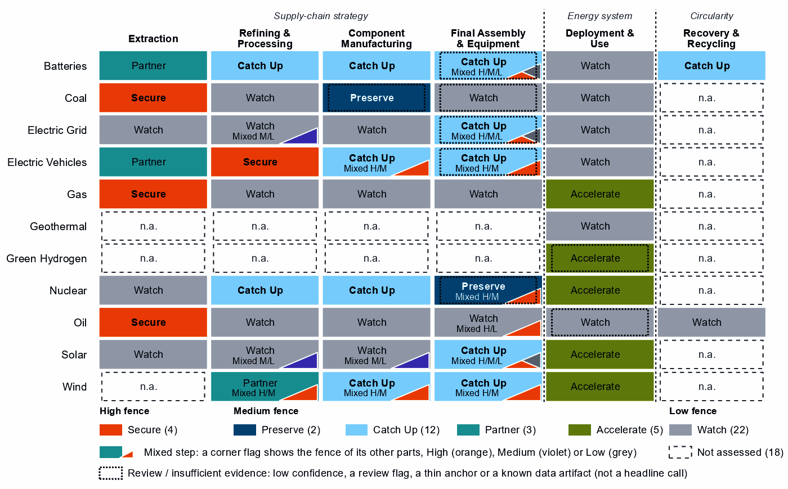
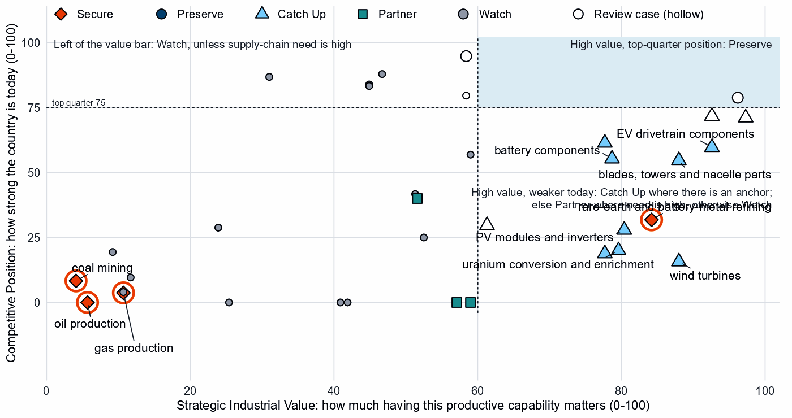
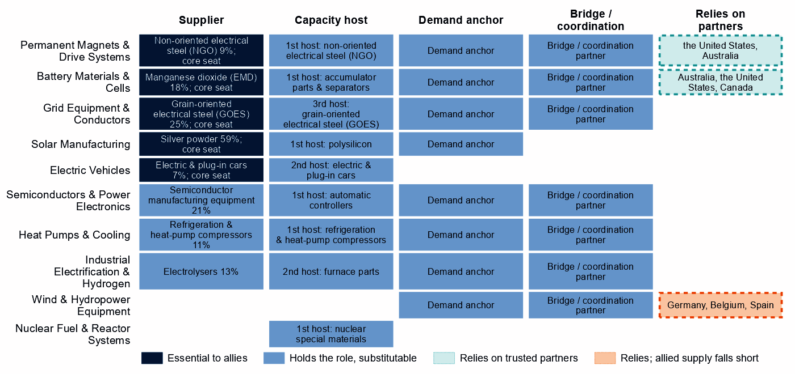
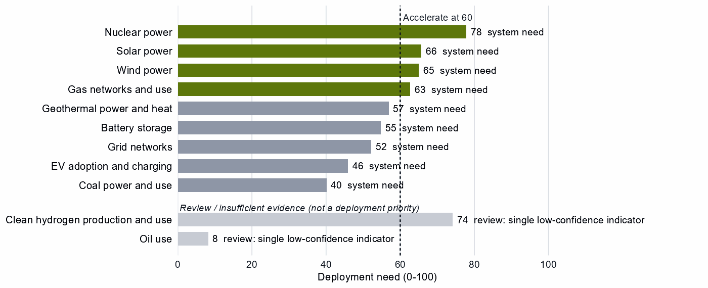

# Japan and the Allied Industrial Base

*What to secure, build, source from partners, and deploy*

*Generated from Allied Industrial Base Explorer data; evidence, sources and caveats in the appendix. Data as of 30 October 2026.*

## 1. Bottom line — Japan's strategic role

Japan's distinctive role in the Allied Industrial Base is as its specialist supplier and manufacturer: it holds a role in all ten strategic compacts, and 61 economies count it as their best-placed trusted partner somewhere in the chain. Its exposure sits at the start of the chain: imported fuel, minerals it does not mine, and refined rare earths. Its industrial effort should go into battery materials refining and battery components, where its anchors are among the strongest and allies need new capacity, and into extending its positions in EV drivetrains, wind components and nuclear fuel. For minerals and wind materials it should depend deliberately on trusted producers, and its development cooperation can help developing partners add the battery and wind capacity allies lack. At home, deployment is as pressing: nuclear, solar and wind power need to be built faster. The high fence belongs around the rare-earth chain, fuel supply, and the control software that can command Japan's grid, batteries, inverters, turbines and vehicles. [1, 2]

- **Secure.** The rare-earth chain from separation to magnets, where China holds 94% of world supply of rare-earth and battery-metal refining, which covers battery metals as well as rare earths, and trusted suppliers only 4%. The supply of oil, gas and coal, which takes one to three years to rebuild. The control software of grid, battery, inverter, turbine and vehicle equipment. The answer is trusted supply, stocks and control of command paths, not self-sufficiency. [2, 3, 4]
- **Build / preserve.** Catch Up in battery materials refining and battery components, among the best-anchored cases and with high need, where allies also need new capacity, and extend existing positions in EV drivetrain components, wind components, and nuclear fuel and reactor parts. No Preserve call clears the evidence bar. Keep specialist supply, from chip equipment to transformer steel, reliable for allies: an allied commitment, not a domestic fence.
- **Partner.** Battery and EV minerals from trusted producers such as Australia, the United States and Canada, and wind materials, where allied supply falls short. With developing partners, add trusted battery and wind capacity through development finance and offtake. [1, 2, 3]
- **Deploy / stay open.** Accelerate nuclear, solar and wind power and gas networks, buying commodity hardware competitively from trusted suppliers, with security conditions on connected equipment. Leave open wafers and PV cells, polysilicon refining and gas-plant equipment.

In Figure 1, Secure and Partner in the first column mark the fuels and minerals Japan must import. The middle columns hold most of its Catch Up cases, and deployment its Accelerate cases. The orange corner flags mark High-fence parts inside other steps, from control software and reactor controls to rare-earth magnets and separation. Violet flags mark Catch Up layers inside Watch steps, such as solar-grade polysilicon and grain-oriented electrical steel; they inherit their steps' anchors.

**Figure 1. Where Japan should secure, build, partner or stay open**

*Each cell is a supply-chain step of a technology, colored by its strategic choice. A corner flag marks a mixed step whose named parts sit behind a different fence: in PV modules and inverters, the inverter firmware is Secure, the step Catch Up and conventional modules Watch. A dotted outline marks a review case, a call resting on low confidence, a review flag, a thin anchor or a known data artifact. Steps marked n.a. lack the data for a call. [2]*

## 2. Where Japan should secure, compete and stay open

### High fence — what cannot fail

Secure covers four whole steps and 13 layers inside other steps, grouped into eight capabilities. The table takes the capabilities where an acute route meets the assets Japan depends on most, with gas and coal together. [2]

| Capability | Why it matters | Main vulnerability | Recommended response |
|---|---|---|---|
| The rare-earth chain: separation, metals and magnets | Feeds the magnets of EV motors and wind generators. Japan has 9% of world exports of the refining step, and 20 economies have it as their best-placed trusted refiner. | China holds 94% of world refining supply and trusted suppliers 4%; it provides 47% of Japan's imports. Rebuilding takes more than three years. | **Mixed.** Trusted separation, metal and magnet capacity at home and with allies such as the United States and Australia, through co-investment and offtake; stocks until it qualifies; limits on adversary sources in critical uses, phased in. |
| Oil supply | Supply-chain need is 98 out of a hundred, and supply takes one to three years to rebuild. | The United Arab Emirates supplies 44% of imports; trusted suppliers hold 29% of world supply, and allied supply falls short. | **Diversified.** Stocks sized to the rebuild time; capacity reservations with several trusted producers, such as the United States, Canada and Norway; demand-side substitution. |
| Gas and coal supply | Gas use is an Accelerate deployment, and coal still fuels power; both are imported. | Australia supplies 39% of gas and 66% of coal imports; allied supply covers the need, but rebuilding takes one to three years. | **Allied.** Long-term and capacity-reservation contracts with trusted producers, such as Norway, the United States and Belgium for gas; stockholding obligations; stress tests. |
| Control software of grids, inverters and batteries | Firmware and grid-control software can command, update or disable equipment from abroad. | China supplies 77% of battery cell and pack imports, 48% of PV module and inverter imports and 51% of transformer and switchgear imports. These are hardware shares for the steps that carry the control layers; the data do not measure who supplies the software. | **Mixed.** Trusted-source and certification rules for firmware, communications and remote access; trusted vendors where control is built into the hardware. |
| Remote access to wind turbines and vehicles | Turbine controllers and connected-vehicle software reach energy assets and fleets from abroad. | China supplies 56% of imports under the wind turbines step's trade codes, which also cover cables, substations and transformers, and 47% of EV and charger imports. These are hardware shares for the steps that carry the control layers; the data do not measure who supplies the software. | **Mixed.** Limits on remote access and over-the-air updates by untrusted vendors; certified trusted control software and a replacement programme. |

Sources: 1, 2, 3, 4.

Reactor control and safety instrumentation and oil terminal control systems sit behind the same fence and take the same trusted-source rules.

### Medium fence — where industrial capability matters

This is where Japan makes its real industrial choices, by asking whether a capability is worth having (Strategic Industrial Value) and how strong Japan is today (Competitive Position). For Japan, Catch Up in components and assembly often means closing a gap to the frontier from a substantial base; in battery materials refining and wind turbines it means building from a low position.

**Preserve.** No Preserve call clears the evidence bar. Reactors and steam generators reads Preserve on low confidence, with a position (79) just above the top-quarter bar (75). Battery cells and packs and EV and charger manufacturing sit just below the bar and read Catch Up, also on low confidence, and coal-plant components is flagged for review by the engine. [2, 3]

**Catch Up.** Battery materials refining is the clearest case for building: high value, a low position (19), three capability anchors and high confidence. China holds 94% of world supply and trusted suppliers 4%, so trusted capacity is scarce for every ally. Battery components is also well anchored: Japan holds 13% of world exports and has operating capacity behind them, and 8 economies have it as their best-placed trusted partner. Yet 84% of its own imports come from China. EV drivetrain components (60), blades, towers and nacelle parts (55) and nuclear fuel and reactor parts (61) extend positions Japan already holds, with high confidence. [2, 3]

Other Catch Up calls are weaker than they look, and this brief does not build on them:

- **Wind turbines:** a position of 16 on a world supply share of 2%, in a step whose trade codes also cover cables, substations and transformers. [2, 3]
- **PV modules and inverters:** moderate confidence, conventional modules read Watch, and the trade codes include machines for making wafers and chips. [2]
- **Uranium conversion and enrichment:** an inherited anchor (a strong position in the next step up the chain) and a world supply share of <1%, so trusted allied enrichment comes first. [2, 3]
- **Battery recycling:** a single export-share anchor in a step whose trade codes are battery waste, scrap and residues, with no position measure.

**Partner.** Japan holds 0% of world supply in battery and EV minerals and the data show no credible pathway to scale it. So dependence should be deliberate and spread across trusted producers such as Australia, the United States and Canada; allied supply covers the need. In rare-earth and wind materials refining, allied supply sits in Germany, Belgium and Spain and falls short, so co-investment and offtake must add capacity. Its rare-earth separation layer belongs to the High fence. [1, 2, 3]

**Figure 2. Which producing capabilities are worth holding, and where Japan is strong today**

*Producing steps with both measures (recovery has no position measure). Dashed lines mark the value bar (60) and the top quarter (75). Strong positions in grid components and gas and oil equipment read Watch on low need and value. Hollow markers are review cases; reactors, cells and packs, and EVs sit near the top-quarter line. [2]*

**Shared capabilities.** Some physical capabilities sit in several technology chains, and their calls differ by technology. The table keeps the national reading apart from what allies rely on Japan for.

| Shared capability | Steps and their choices | National reading | AIB role |
|---|---|---|---|
| Semiconductor manufacturing equipment | wafers and PV cells (Watch) and PV modules and inverters (Catch Up) | The choices differ within the same technology with each step's own measures (wafers and PV cells: need 32, value 59, position 57; PV modules and inverters: need 55, value 80, position 28) | Supplier: 21% of world exports or production of semiconductor manufacturing equipment (the AIB measure of the product, not a step's share); the largest allied holder of the step |
| Insulators & bushings | grid components (Watch); wafers and PV cells (Watch); and blades, towers and nacelle parts (Catch Up) | The choices differ across technologies with each step's own measures (grid components: need 35, value 47, position 88; wafers and PV cells: need 32, value 59, position 57; blades, towers and nacelle parts: need 60, value 88, position 55) | Allies need new capacity here (BUILD); no supplier role |
| Power electronics components | grid components (Watch); EV drivetrain components (Catch Up); wafers and PV cells (Watch); and blades, towers and nacelle parts (Catch Up) | The choices differ across technologies with each step's own measures (grid components: need 35, value 47, position 88; EV drivetrain components: need 62, value 93, position 60; wafers and PV cells: need 32, value 59, position 57; blades, towers and nacelle parts: need 60, value 88, position 55) | Allies need new capacity here (BUILD); no supplier role |
| Rare-earth metals | rare-earth and battery-metal refining (Secure) and rare-earth and wind materials refining (Partner) | The choices differ across technologies with each step's own measures (rare-earth and battery-metal refining: need 100, value 84, position 32; rare-earth and wind materials refining: need 69, value 52, position 40) | Allies need new capacity here (BUILD); no supplier role |

Sources: 1, 2.

### Low fence — what not to prioritize

A credible strategy also says what not to localize. Watch is not a failure: affordable, diversified access matters more than domestic production, and for Japan it often marks positions that compete without help.

- **Wafers and PV cells, and polysilicon refining.** Supply-chain need for wafers and cells is low (32), and polysilicon refining is a large, commoditized yard worth at most a stated capability floor. Wafers and cells rank among Japan's most protected steps in its own measures, but the trade codes include chip wafers and chip-machine parts, so some of that may be chip policy. [2, 3]
- **Gas turbines, LNG plant and their components.** Japan holds top-quarter positions (83 and 84) on modest need and low value; its makers compete for the gas build-out without a fence. [2, 3]
- **Grid metals refining and grid components.** Need is low in components (35) but high in grid metals refining (72), a large, commoditized yard; the position in components is in the top quarter (88). Grain-oriented electrical steel reads Catch Up only by inheriting its step's position, while allies rely on Japan for transformer steel: a supplier role to keep reliable. [2, 3]

## 3. Japan's allied bargain

**What Japan contributes.** In the Allied Industrial Base analysis Japan combines capital & investment, specialized technology and scale manufacturing roles, and it ranks first among allies on its measure of strength (compacts with a specialist position, workstreams it bridges). It supplies 21% of world exports or production of semiconductor manufacturing equipment, 28% of wafers and 11% of automatic controllers. It holds a core seat in five compacts: Permanent Magnets & Drive Systems, Battery Materials & Cells, Solar Manufacturing, Grid Equipment & Conductors and Electric Vehicles. It is the largest allied holder of wafers and PV cells (11%) and PV modules and inverters (9%), but those positions rest partly on chip equipment and wafers that share the steps' trade codes, so they overstate its PV output. [1, 3]

**What Japan needs.** Minerals, refined rare earths, wind materials and fuel. If China's supply stopped, as in the Decoupling scenario, Japan would lose US$14.5 billion a year of imports across the Allied Industrial Base basket. New capacity at the best-placed allied hosts, led by Germany, would restore only about US$2.1 billion of it a year. Under Managed Interdependence, the default scenario, Japan sits in the minimum coalition of 7 Sectoral Compacts (the finer units beneath the strategic compacts); under Decoupling, 14, in 11 of them as a demand anchor. [1, 3]

**The dependencies to make intentional.** These bargains turn that exchange into a specialization partners can count on.

| Capability / compact | Japan contributes | Japan needs | Natural partners | What makes the bargain work |
|---|---|---|---|---|
| Battery Materials & Cells | Refined battery chemicals (18% of world exports or production of its lead product); components; investment | Battery minerals; trusted refining capacity | Australia, the United States and Canada for minerals; the compact's mineral and processing seats, the United States, the Democratic Republic of Congo and Indonesia | Offtake, co-investment and export-credit finance with mineral partners; at home, time-limited refining support tied to benchmarks |
| Permanent Magnets & Drive Systems | Core steel for motors and drives (9% of world exports or production of its lead product, non-oriented electrical steel, not magnets), with a core seat | Trusted refined rare earths | The United States and Australia for refining; the compact's makers, Germany, the United States and Mexico, as co-investors in magnet capacity | Co-investment and offtake for new trusted capacity, allied agreements, and stockpiles until it qualifies |
| Nuclear Fuel & Reactor Systems | Fuel and reactor parts (6% of world supply); hosting of new capacity | Trusted conversion and enrichment | The compact's processors and makers, Canada, India, the United States and France | Co-investment and offtake with allied partners; domestic enrichment an option to review |
| Clean-energy equipment: Wind & Hydropower Equipment, Grid Equipment & Conductors and Solar Manufacturing | Transformer steel (25% of world exports or production of its lead product, grain-oriented electrical steel); solar inputs; a growing market | Wind materials, where allied supply falls short; turbines | Germany, Belgium and Spain for wind materials; the wind compact's makers, India and Germany, for turbines | Offtake and co-investment with the recommended partners and allied makers; trusted-supplier conditions on connected equipment |

Sources: 1, 2, 3.

**Figure 3. Japan's role in the Allied Industrial Base**

*Each row is a strategic compact in which Japan holds a role or relies on partners. Dark cells are roles allies cannot easily replace; light cells are roles others could fill; dashed cells mark where Japan relies on trusted partners, orange where allied supply still falls short of what allies need.*

Figure 3 shows an economy essential as a supplier and dependent at the start of the chain. Its capital role is real but not drawn: in Electric Vehicles its functions are scale manufacturer, investment anchor and capacity-building host. Among the compacts, only in wind does allied supply fall short where Japan relies on partners, so there the bargain must add capacity, not only redirect trade. [1]

## 4. Development strategy — build trusted capacity by helping partners Catch Up

Development cooperation can be the development arm of that bargain, and a partnership needs evidence on both sides. On the Japanese side, a step needs more trusted capacity. On the partner's side, a developing economy's same step is a credible Catch Up with a corroborated anchor, inside the allied trust screen. 49 pairs qualify, with 16 developing partners across 10 steps. [1, 2, 5]

Most, 28 pairs, rest on the allied gap alone, a reason that is the same for every donor in scope. Japan's own supply chain supports 21 pairs with 12 partners across four steps, and the table leads with them: rare-earth and wind materials refining; battery materials refining; battery components; and wind turbines. India, the Philippines and Viet Nam are lower middle income, so project preparation, infrastructure and skills come first. Indonesia and Mexico are upper-middle-income economies, where finance, guarantees and offtake should lead. India's case is the thinnest: a single export-share anchor and a Competitive Position of 0. The Philippines also has a Competitive Position of 0, as do the other partners in its step, so its case rests on a share of world exports and operating capacity. The last row rests on the allied gap alone, in a step where Japan's own call is a review case, as do many of the 28 allied-gap pairs, so the headline count overstates the pairs that rest on a settled Japanese call. [1, 2, 3, 5, 6]

Battery materials refining is among the broadest strands, level with battery components: 7 developing economies, led by the Philippines and Madagascar, have credible pathways, and Argentina, the Democratic Republic of Congo and Malaysia already host new capacity commercially. For rare-earth and battery-metal refining, the Secure step of the rare-earth chain: No credible development-led supply solution identified. Thailand and Malaysia host its new capacity commercially, and no partner qualifies in minerals or fuels. Another 29 pairs are commercial, where trade, offtake and investment fit better than aid. [1, 2, 5]

| Capability / allied gap | Developing partner | Why this partner can Catch Up | What the donor should support | Security / AIB benefit | Development benefit |
|---|---|---|---|---|---|
| Rare-earth and wind materials refining: high need, allied supply falls short and new allied capacity needed | India (lower middle income) | A share of world exports; corroborated by feasibility, specialization in the adjacent step and industrial learning | Plant capacity not covered by the data and input costs not covered by the data. Feasibility studies and project preparation, industrial infrastructure, environmental and permitting capability, workforce development; then, at scale, offtake, market access, investment guarantees | A trusted second source and allied capacity where allied supply falls short (allies need new capacity in 2 product groups of the step) | Processing capacity at home, with the skills, standards and value capture of a refinery |
| Battery materials refining: high need and new allied capacity needed | the Philippines (lower middle income) | A share of world exports and operating capacity; corroborated by feasibility, specialization in the adjacent step and industrial learning | Constraint: input costs outside the cheapest quarter. Industrial infrastructure, feasibility studies and project preparation, environmental and permitting capability, workforce development; then, at scale, offtake, market access, investment guarantees | Diversified supply for a high-need step and new allied capacity where the AIB finds a gap (allies need new capacity in 6 product groups of the step) | Processing capacity at home, with the skills, standards and value capture of a refinery |
| Battery components: high need and new allied capacity needed | Indonesia (upper middle income) | A share of world exports; corroborated by feasibility, input costs, specialization in the adjacent step and industrial learning | Constraint: operating or committed plant below the capacity bar and a position that rests on trade or output shares, not on plant capacity. Lead with development finance, guarantees, offtake, equity and joint ventures; public support for project preparation and investment promotion | Diversified supply for a high-need step and new allied capacity where the AIB finds a gap (allies need new capacity in 1 product group of the step) | A certified supplier base and export sales of components |
| Wind turbines: high need and new allied capacity needed | Viet Nam (lower middle income) | A share of world supply and a share of world exports; corroborated by feasibility and industrial learning | Constraint: no operating or committed plant in the capacity data and a position that rests on trade or output shares, not on plant capacity. Input costs not covered by the data. Project preparation, investment promotion, industrial infrastructure, quality systems and certification; then, at scale, development finance, guarantees, offtake, equity and joint ventures | Diversified supply for a high-need step and new allied capacity where the AIB finds a gap (allies need new capacity in 2 product groups of the step) | Factory capacity, skills and export sales of finished equipment |
| EV and charger manufacturing: new allied capacity needed | Mexico (upper middle income) | A share of world supply, a share of world exports, operating capacity and a strong position in the next step up the chain; corroborated by feasibility, specialization in the adjacent step and industrial learning | Constraint: input costs outside the cheapest quarter. Lead with development finance, guarantees, offtake, equity and joint ventures; public support for industrial infrastructure and supplier development | New allied capacity where the AIB finds a gap (allies need new capacity in 4 product groups of the step) | Factory capacity, skills and export sales of finished equipment |

Sources: 1, 2, 3, 5, 6, 7.

A partnership is more likely to last when it rests on more than aid. The second table shows what ties Japan to each partner today and what would hold the supply relationship as the capability scales; aid is the 2020 to 2024 total at the step. Aid at these steps is small; the wider ties are economy-wide investment positions, not tied to the step, and, in Indonesia and Mexico, factory projects by firms from Japan in the technology. [1, 2, 5]

| Partnership | Relationship today | What makes it durable |
|---|---|---|
| India: rare-earth and wind materials refining | $0.2 million at this step, under stage-wide codes (the technology is not identified) and a direct investment position of $30,939 million (economy-wide) | Long-term offtake and investment guarantees as the capability scales; the partner's role as Specialized technology supplier in the Wind & Hydropower Equipment compact; Japan's own deployment demand for the technology (Accelerate); the partner's own deployment demand for the technology (Accelerate) |
| the Philippines: battery materials refining | Under $0.1 million at this step, under stage-wide codes (the technology is not identified); a direct investment position of $16,668 million (economy-wide); and no export-credit or lender finance recorded at the step | Long-term offtake and investment guarantees as the capability scales; the partner's own deployment demand for the technology (Accelerate) |
| Indonesia: battery components | $1.3 million at this step, under stage-wide codes (the technology is not identified); a direct investment position of $37,234 million (economy-wide); 1 factory project by firms from Japan in the technology; and no export-credit or lender finance recorded at the step | Long-term offtake, joint ventures and investment guarantees as the capability scales; the partner's role as Processing anchor in the Battery Materials & Cells compact |
| Viet Nam: wind turbines | $0.5 million at this step, under stage-wide codes (the technology is not identified); a direct investment position of $24,719 million (economy-wide); and no factory projects by firms from Japan recorded in the technology | Long-term offtake, joint ventures and investment guarantees as the capability scales; the partner's role as Demand anchor in the Wind & Hydropower Equipment compact; Japan's own deployment demand for the technology (Accelerate); the partner's own deployment demand for the technology (Accelerate) |
| Mexico: EV and charger manufacturing | Under $0.1 million at this step, under stage-wide codes (the technology is not identified); a direct investment position of $13,676 million (economy-wide); and 1 factory project by firms from Japan in the technology | Long-term offtake, joint ventures and investment guarantees as the capability scales; the partner's role as Scale manufacturer in the Electric Vehicles compact |

Sources: 1, 2, 5, 7, 8, 9, 10.

Thailand, Malaysia and the Philippines receive Japan's technology-coded aid at the step of a partnership; 8 partners receive it there under stage-wide codes. Mexico, the Philippines, Thailand and Malaysia receive technology-coded aid in a step where they are already commercial, so trade and investment should take over. Japan's largest recipient of energy, industry and mining aid, Bangladesh ($3,730 million over 2020 to 2024), has no partnership here; that aid is outside the energy-industrial objective of this analysis and is not judged here. [5]

## 5. Energy-system priorities

Wherever the equipment is made, nuclear, solar and wind power and gas networks clear the Accelerate bar of 60. Solar and wind rest on all three measures with high confidence, though system need drives them: demand adequacy alone (41 and 49) is below the bar. The renewables target of 201 GW by 2030 compares with 133 GW installed in 2025, a shortfall of about 47 GW at the recent build rate. Between 2020 and 2025, solar grew from 71.9 to 92.2 GW and wind from 4.1 to 6.2 GW; nuclear capacity was flat (33.1 to 33.1 GW). [2, 11, 12]

High deployment priority does not imply high manufacturing priority. Japan has Catch Up cases behind nuclear and wind, but deployment should not wait for them: equipment should come from whichever trusted supplier is ready. Gas reads Accelerate on system need, as a firming fuel whose supply sits behind the High fence. Clean hydrogen also reads Accelerate, but on a single indicator of low confidence, so it is a review case. Battery storage, grid networks and EV adoption sit below the bar: worth watching, not forcing.

**Figure 4. What Japan needs to deploy faster**

*Deployment need by technology, with the largest of its measures: demand adequacy, the gap to national targets, or system need. Review cases, which rest on a single indicator of low confidence, are shown apart in grey and are not deployment priorities.*

## 6. Is current policy pointed in the right direction?

Policy never decides a choice here; it is compared with it afterwards, using Japan's own recorded industrial-policy measures.

| Capability | Strategic choice | Current policy | Gap |
|---|---|---|---|
| Gas production | Secure | Needs more attention | Vulnerability without enough policy attention |
| Oil production | Secure | Needs more attention | Vulnerability without enough policy attention |
| Coal mining | Secure | Needs more attention | Vulnerability without enough policy attention |
| Wind turbines | Catch Up | Needs more attention | Capability case without enough policy attention |
| Solar power | Accelerate | Deployment policy below the middle | Deployment needed faster than policy supports |
| Wafers and PV cells | Watch | Heavy protection or localization | Localizing what is not a domestic priority |

Sources: 2, 13, 14.

First, oil, gas and coal are Secure but rank at or below the middle among Japan's own recorded measures: that shows little industrial-policy attention, not missing stocks, so stocks and trusted contracts should be tested against the rebuild time. Second, wind turbines read Catch Up with little recorded attention, but on a weak position, so attention belongs with components and partners. Finally, solar deployment policy lags while protection concentrates on wafers and cells, a Watch step: effort should shift toward deployment.

## 7. Strategic agenda — what should Japan do next?

### 1. Secure the rare-earth chain with allied partners

Build trusted separation, metal-making and magnet capacity at home, where the base exists, and with allied partners such as the United States and Australia through co-investment and offtake. Hold stocks until that supply qualifies, and phase in limits on adversary sources in critical uses only as it does. [1, 2, 3]

### 2. Hold fuel security through stocks and trusted contracts

Oil, gas and coal are Secure for resilience: they are essential and imported, and their supply takes one to three years to rebuild. Size strategic stocks to that time, reserve capacity with trusted producers such as the United States, Canada and Norway for oil (partner evidence is weak, so test the contract terms), and stress-test the loss of the largest supplier. [1, 2, 3, 4]

### 3. Catch up in battery materials and components with time-limited support tied to benchmarks

Tie production incentives, first-of-a-kind finance, workforce and supplier development and demand creation to benchmarks, with sunsets, and keep the gate open to licensing and joint ventures that transfer capability. Build battery components at home where the base is established and with allied partners for the rest.

### 4. Turn mineral dependence into investment bargains with trusted producers

Buy battery and EV minerals through offtake and co-investment with producers such as Australia, the United States and Canada, with export-credit finance for their capacity and contracts spread across several suppliers. [1, 2, 3]

### 5. Build trusted battery and wind capacity with developing partners

Start with the Philippines in battery materials refining and Indonesia in battery components. Test Viet Nam in wind turbines first, where the data record no operating or committed plant and the step's trade codes also cover cables, substations and transformers. Prepare India in rare-earth and wind materials refining over a longer horizon. Use project preparation, infrastructure and skills where the constraint is a public good, and development finance, guarantees and offtake where it is bankability. [1, 2, 5]

### 6. Accelerate nuclear, solar and wind while keeping sourcing open

Deploy faster through infrastructure, permitting and procurement; buy commodity hardware competitively from trusted suppliers, and attach trusted-supplier and security conditions to public deployment support and to equipment with built-in control.

## Sources

1. Allied Industrial Base model: roles, compacts, trade restored and new capacity across the allied coalition, computed by the Explorer's authors (run of 30 October 2026); CC BY 4.0.
2. Country strategy choices by technology and supply-chain step (supply-chain need, Strategic Industrial Value, Competitive Position, deployment need, policy alignment), computed by the Explorer's authors (dashboard data of 31 October 2026); CC BY 4.0.
3. United Nations, UN Comtrade Database, HS6 bilateral trade (all reporters); reconciled by the authors (2022-2024 data); attribution; https://comtradeplus.un.org/.
4. Yards & Fences node attributes: standardization, learning, industrial commons and control layers, curated by the authors from public sources (2026-10-30); CC BY 4.0.
5. OECD Creditor Reporting System: official development assistance by donor, recipient and purpose code, gross disbursements at constant prices, energy, industry and mining purpose codes only, mapped to supply-chain steps by the authors (Components and Assembly share purpose codes; no code funds recycling) (2020-2024 data); attribution; https://data-explorer.oecd.org/.
6. Clean Investment Monitor: clean-technology manufacturing investment and capacity (aggregated), world capital expenditure 2021-22 to 2024-25; attribution; https://www.cleaninvestmentmonitor.org/.
7. Development tool families by supply-chain stage and constraint, and the development-partnership tests, set by the authors (config/development_partnerships.yml) (2026-11-03); CC BY 4.0.
8. International Monetary Fund, Direct Investment Positions: outward positions (reported, else derived from the counterpart's reports) (2020-2024 data); attribution; https://data.imf.org/.
9. fDi Markets clean-manufacturing projects (CM-FDI): factory projects by home and destination economy (Components and Assembly not separated); subscription (aggregates only).
10. Oil Change International, Public Finance for Energy: export-credit and development-lender energy finance (not aid) (2013-2025 data); attribution; https://energyfinance.org/.
11. Ember, electricity generation and capacity data (2020-2025) and 2030 Renewable Target Tracker; CC BY 4.0; https://ember-energy.org/.
12. International Energy Agency, World Energy Outlook 2025 (Stated Policies Scenario) and Global Critical Minerals Outlook: demand 2024-2035 (2025); CC BY-NC-SA 4.0 (free dataset); https://www.iea.org/.
13. Global Trade Alert, New Industrial Policy Observatory: industrial-policy interventions, strength scored by the authors, October 2026 extract (as of 5 October 2026); subscription (titles, dates and links only); https://www.globaltradealert.org/.
14. International Energy Agency, Policies and Measures Database (export of 2026-10-26); attribution; https://www.iea.org/policies.

## Appendix — evidence and method

**How this brief is built.** Every number comes from the Country page data of the Allied Industrial Base Explorer (the data release of 30 October 2026) and from the Allied Industrial Base analysis. Each technology is split into supply-chain stages from extraction to recycling, and each step gets a strategic choice by fixed rules applied in order: [2]

- Secure where an acute vulnerability is measured;
- at deployment, Accelerate where deployment need reaches 60; [2]
- Watch where the step is a large, commoditized yard;
- Preserve where Competitive Position is in the top quarter (75) and either Strategic Industrial Value (bar 60) or supply-chain need (bar 67) is high; [2]
- Catch Up where the value is high, the position is not, and a capability anchor is corroborated by other evidence;
- Partner where supply-chain need is high but there is neither a top-quarter position nor, for a high-value step, a credible pathway;
- Watch otherwise.

Named layers inside a step, such as control software or magnets, take their own choice, and a step whose parts sit behind different fences is mixed. A value that rests on market size alone is capped just under the bar. Observed policy never decides a choice. The high fence (Secure) protects what cannot be allowed to fail; the medium fence covers capabilities worth building, keeping or sourcing deliberately and deployment to accelerate; the low fence (Watch) leaves a step open to competitive purchase.

**Review cases.** Some calls rest on low confidence, an engine review flag, a thin capability anchor, a known data artifact or, at deployment, a single indicator of low confidence. They stay on the map but never enter the Bottom line, the Agenda, the policy table or a headline mark. 8 steps are review cases. For Japan several sit close to the top-quarter bar, where the line between Preserve and Catch Up is thin. [2]

| Step | Choice | Why it is a review case |
|---|---|---|
| Battery cells and packs | Catch Up | Low confidence |
| Coal-plant components | Preserve | Flagged for review by the engine |
| Coal-plant equipment | Watch | Low confidence |
| Transformers, switchgear and cables | Catch Up | Low confidence |
| EV and charger manufacturing | Catch Up | Low confidence |
| Clean hydrogen production and use | Accelerate | A single indicator of low confidence |
| Reactors and steam generators | Preserve | Low confidence |
| Oil use | Watch | A single indicator of low confidence |

Sources: 2.

**Evidence and caveats.** The rare-earth chokepoint rests on measured supply concentration, and the battery-materials Catch Up has high confidence. Japan's solar positions, in the choices and in the AIB, rest partly on trade codes it shares with the chip industry: silicon wafers, parts of chip-making machines and machines for making wafers and chips. They overstate its position in PV cells and modules. The wind turbines step's trade codes also cover cables, substations and transformers, and battery recycling's are battery waste, scrap and metal residues. Uranium conversion and enrichment rests on an adjacent-step anchor, with a world supply share of <1%. The Secure refining step and the Partner wind-materials step share the rare-earth trade codes. 18 steps lack the data for a call, including geothermal supply, green hydrogen manufacturing and most recycling. Recorded policy ranks electrolyser stacks (98) and systems (99) near the top of Japan's own measures, but those steps cannot be assessed and deployment need reads high on a single indicator, so this brief does not settle that disagreement. Several review cases also read as needing more policy attention: reactors and steam generators, EV and charger manufacturing, and transformers, switchgear and cables. Competitive Position ranks Japan among economies that already supply a step, so a zero means no measurable position. Partner lists name where allied capacity sits, which can include trading hubs, not who owns it. [2, 3, 13, 14]

**Development partnerships.** A pair joins a Japanese step with a strategic reason for more allied capacity and a developing economy (not high income) whose same step is a Catch Up. The reason is Japan's own need, or the allied gap alone, where allies need new capacity, which is the same for every donor in scope. The partner needs an anchor corroborated beyond context signals, sufficient evidence and confidence, and a place inside the AIB trust screen; on a step whose data describe different products, the anchor must measure the product the need is about. A partner that already hosts the step's new capacity in the AIB, or Preserves it, is a commercial case. Aid comes from the OECD Creditor Reporting System by purpose code and covers energy, industry and mining aid only. Components and Assembly share codes, no code funds recycling, and many codes name a stage rather than a technology, so aid at a step is not aid for that technology. Aid is called technology-coded only where codes naming the technology hold at least half of it. A constraint on a partner is named only where the data observe its input; otherwise the table says the data do not cover it. In the relationship table an observed zero is stated as nothing recorded, data that do not cover a pair are left out, and the direct investment position is economy-wide, not tied to the step. Export-credit finance is reported apart and never counted as aid, and direct investment uses the IMF positions (the partner's reports where Japan reports none). The full list of pairs, with every field, is in the development-partnership export.

| Step | Donor reason | Development partners | Commercial route | Review cases | Aid at the step |
|---|---|---|---|---|---|
| Rare-earth and wind materials refining | Partner, high need, allied supply falls short and new allied capacity needed | India | – | Viet Nam and South Africa | India and Viet Nam |
| Battery materials refining | High need and new allied capacity needed | the Philippines, Madagascar, India, Thailand, South Africa, Turkiye and Papua New Guinea | Indonesia, Argentina, the Democratic Republic of Congo and Malaysia | Mozambique, Tanzania and Colombia | the Philippines, India, Thailand, Indonesia, Argentina, the Democratic Republic of Congo, Mozambique, Tanzania and Colombia |
| Battery components | High need and new allied capacity needed | Indonesia, Viet Nam, Mexico, Turkiye, India, Morocco and Malaysia | – | – | Indonesia, Viet Nam, Mexico and India |
| Wind turbines | High need and new allied capacity needed | Viet Nam, Turkiye, Indonesia, Thailand, Malaysia and Morocco | India and Mexico | Brazil | Viet Nam, Indonesia, Thailand, Malaysia, India, Mexico and Brazil |
| EV and charger manufacturing | New allied capacity needed | Mexico, Thailand, Viet Nam, Malaysia, Morocco and Indonesia | Turkiye and India | – | Mexico, Thailand, Viet Nam, Indonesia and India |
| EV drivetrain components | New allied capacity needed | Thailand, Malaysia, Ukraine, Turkiye, Honduras, Morocco and Serbia | Indonesia, the Philippines, Mexico and India | Viet Nam | Thailand, Ukraine, Indonesia, the Philippines, Mexico, India and Viet Nam |
| Battery cells and packs | New allied capacity needed | Indonesia, Malaysia, Mexico, India and Turkiye | Viet Nam | – | Indonesia, Mexico, India and Viet Nam |
| Blades, towers and nacelle parts | New allied capacity needed | Thailand, Serbia, Turkiye, Brazil and Malaysia | Mexico, Viet Nam, the Philippines and India | – | Thailand, Brazil, Malaysia, Mexico, Viet Nam, the Philippines and India |
| Transformers, switchgear and cables | New allied capacity needed | India, Malaysia and the Philippines | Mexico, Turkiye, Thailand and Viet Nam | Morocco | India, Malaysia, the Philippines, Mexico, Thailand and Viet Nam |
| PV modules and inverters | New allied capacity needed | Turkiye and Morocco | India, Viet Nam, Thailand, Malaysia, Mexico and Indonesia | – | India, Viet Nam, Thailand, Malaysia, Mexico and Indonesia |
| Rare-earth and battery-metal refining | Secure with allied delivery, few trusted alternatives, high need and new allied capacity needed | – | Thailand and Malaysia | Argentina, Indonesia, Mozambique, the Democratic Republic of Congo, the Philippines, Mexico, Tanzania and Madagascar | Thailand, Argentina, Indonesia, Mozambique, the Democratic Republic of Congo, the Philippines, Mexico and Tanzania |
| Uranium conversion and enrichment | High need | – | – | Namibia | – |
| Coal-plant components | High need | – | – | Viet Nam, India, Turkiye and Indonesia | Viet Nam, India and Indonesia |
| Battery recycling | High need | – | – | India and Malaysia | – |
| Polysilicon refining | High need | – | – | India | India |

Sources: 1, 2, 5.

**Every step.**

| Step | Stage | Choice | Fence | Need | Value | Position | Evidence | Policy |
|---|---|---|---|---|---|---|---|---|
| Battery mineral mining | Extraction | Partner | Medium | 98 | 57 | 0 | strong | broadly aligned |
| Battery materials refining | Refining | Catch Up | Medium | 94 | 78 | 19 | strong | broadly aligned |
| Battery components | Components | Catch Up | Medium | 75 | 79 | 55 | moderate | broadly aligned |
| Battery cells and packs | Assembly | Catch Up | Mixed High/Medium/Low | 71 | 97 | 71 | moderate | broadly aligned |
| Battery storage | Deployment | Watch | Low | 55 | – | – | strong | broadly aligned |
| Battery recycling | Recovery | Catch Up | Medium | 98 | 82 | – | – | mixed signals |
| Coal mining | Extraction | Secure | High | 97 | 4 | 8 | strong | needs more attention |
| Coke and coal processing | Refining | Watch | Low | 84 | 9 | 19 | strong | mixed signals |
| Coal-plant components | Components | Preserve | Medium | 72 | 58 | 95 | strong | broadly aligned |
| Coal-plant equipment | Assembly | Watch | Low | 59 | 58 | 80 | strong | broadly aligned |
| Coal power and use | Deployment | Watch | Low | 40 | – | – | strong | broadly aligned |
| Coal recovery | Recovery | Not assessed | – | – | 1 | – | – | not enough policy evidence |
| Copper and bauxite mining | Extraction | Watch | Low | 98 | 41 | 0 | strong | broadly aligned |
| Grid metals refining | Refining | Watch | Mixed Medium/Low | 72 | 53 | 25 | strong | broadly aligned |
| Grid components | Components | Watch | Low | 35 | 47 | 88 | strong | broadly aligned |
| Transformers, switchgear and cables | Assembly | Catch Up | Mixed High/Medium/Low | 67 | 61 | 30 | strong | needs more attention |
| Grid networks | Deployment | Watch | Low | 52 | – | – | – | broadly aligned |
| Grid-equipment recycling | Recovery | Not assessed | – | – | 14 | – | – | not enough policy evidence |
| EV mineral mining | Extraction | Partner | Medium | 98 | 59 | 0 | strong | broadly aligned |
| Rare-earth and battery-metal refining | Refining | Secure | High | 100 | 84 | 32 | strong | mixed signals |
| EV drivetrain components | Components | Catch Up | Mixed High/Medium | 62 | 93 | 60 | moderate | mixed signals |
| EV and charger manufacturing | Assembly | Catch Up | Mixed High/Medium | 65 | 93 | 72 | moderate | needs more attention |
| EV adoption and charging | Deployment | Watch | Low | 46 | – | – | strong | broadly aligned |
| EV recycling | Recovery | Not assessed | – | – | 37 | – | – | not enough policy evidence |
| Gas production | Extraction | Secure | High | 94 | 11 | 4 | strong | needs more attention |
| Gas liquids processing | Refining | Watch | Low | 74 | 11 | 4 | strong | mixed signals |
| Gas-turbine and drilling components | Components | Watch | Low | 59 | 45 | 84 | strong | broadly aligned |
| Gas turbines and LNG plant | Assembly | Watch | Low | 40 | 45 | 83 | strong | broadly aligned |
| Gas networks and use | Deployment | Accelerate | Medium | 63 | – | – | strong | broadly aligned |
| Gas recovery | Recovery | Not assessed | – | – | 7 | – | – | not enough policy evidence |
| Geothermal resource development | Extraction | Not assessed | – | – | 20 | – | – | not enough policy evidence |
| Geothermal refining | Refining | Not assessed | – | – | 20 | – | – | not enough policy evidence |
| Geothermal plant components | Components | Not assessed | – | – | 69 | – | – | not enough policy evidence |
| Geothermal power-plant equipment | Assembly | Not assessed | – | – | 69 | – | – | not enough policy evidence |
| Geothermal power and heat | Deployment | Watch | Low | 57 | – | – | strong | broadly aligned |
| Geothermal recovery | Recovery | Not assessed | – | – | 20 | – | – | not enough policy evidence |
| Electrolyser mineral mining | Extraction | Not assessed | – | – | 35 | 0 | strong | not enough policy evidence |
| PGM and catalyst refining | Refining | Not assessed | – | – | 63 | 98 | strong | not enough policy evidence |
| Electrolyser stacks | Components | Not assessed | – | – | 99 | – | – | not enough policy evidence |
| Electrolyser systems | Assembly | Not assessed | – | – | 90 | – | – | not enough policy evidence |
| Clean hydrogen production and use | Deployment | Accelerate | Medium | 74 | – | – | – | broadly aligned |
| Stack and catalyst recycling | Recovery | Not assessed | – | – | 49 | – | – | not enough policy evidence |
| Uranium mining | Extraction | Watch | Low | 61 | 42 | 0 | strong | mixed signals |
| Uranium conversion and enrichment | Refining | Catch Up | Medium | 97 | 80 | 20 | strong | mixed signals |
| Nuclear fuel and reactor parts | Components | Catch Up | Medium | 61 | 78 | 61 | strong | broadly aligned |
| Reactors and steam generators | Assembly | Preserve | Mixed High/Medium | 66 | 96 | 79 | strong | needs more attention |
| Nuclear power | Deployment | Accelerate | Medium | 78 | – | – | strong | broadly aligned |
| Spent-fuel reprocessing | Recovery | Not assessed | – | – | 80 | – | – | not enough policy evidence |
| Oil production | Extraction | Secure | High | 98 | 6 | 0 | strong | needs more attention |
| Oil refining | Refining | Watch | Low | 53 | 24 | 29 | strong | broadly aligned |
| Drilling and pump components | Components | Watch | Low | 59 | 12 | 10 | strong | mixed signals |
| Drilling rigs, tankers and oil equipment | Assembly | Watch | Mixed High/Low | 36 | 31 | 87 | strong | mixed signals |
| Oil use | Deployment | Watch | Low | 8 | – | – | strong | broadly aligned |
| Waste-oil recovery | Recovery | Watch | Low | 43 | 2 | – | – | broadly aligned |
| PV mineral mining | Extraction | Watch | Low | 98 | 25 | 0 | strong | mixed signals |
| Polysilicon refining | Refining | Watch | Mixed Medium/Low | 95 | 51 | 42 | strong | mixed signals |
| Wafers and PV cells | Components | Watch | Mixed Medium/Low | 32 | 59 | 57 | moderate | too much intervention |
| PV modules and inverters | Assembly | Catch Up | Mixed High/Medium/Low | 55 | 80 | 28 | moderate | broadly aligned |
| Solar power | Deployment | Accelerate | Medium | 66 | – | – | strong | deployment policy lags |
| PV module recycling | Recovery | Not assessed | – | – | 44 | – | – | not enough policy evidence |
| Wind mineral mining | Extraction | Not assessed | – | – | 40 | 8 | strong | not enough policy evidence |
| Rare-earth and wind materials refining | Refining | Partner | Mixed High/Medium | 69 | 52 | 40 | strong | broadly aligned |
| Blades, towers and nacelle parts | Components | Catch Up | Mixed High/Medium | 60 | 88 | 55 | moderate | mixed signals |
| Wind turbines | Assembly | Catch Up | Mixed High/Medium | 75 | 88 | 16 | moderate | needs more attention |
| Wind power | Deployment | Accelerate | Medium | 65 | – | – | strong | broadly aligned |
| Wind-turbine recycling | Recovery | Not assessed | – | – | 28 | – | – | not enough policy evidence |

Sources: 2, 3, 4, 6, 11, 12, 13, 14.

**Named layers.**

| Layer | Step | Choice | Fence |
|---|---|---|---|
| Anode materials (natural and synthetic graphite) | battery materials refining | Catch Up | Medium |
| Cathode active materials and precursors | battery materials refining | Catch Up | Medium |
| Battery-grade lithium hydroxide and carbonate | battery materials refining | Catch Up | Medium |
| Battery cells (LFP and NMC) | battery cells and packs | Catch Up | Medium |
| Communications gateway and cloud fleet management | battery cells and packs | Secure | High |
| Battery-management firmware, energy-management software and remote updates | battery cells and packs | Secure | High |
| Enclosures, racking, thermal management and balance of system | battery cells and packs | Watch | Low |
| Grain-oriented electrical steel | grid metals refining | Catch Up | Medium |
| Power conversion hardware (inverters and converters) | transformers, switchgear and cables | Catch Up | Medium |
| Smart meters and advanced metering head-end systems | transformers, switchgear and cables | Secure | High |
| Cables and conductors | transformers, switchgear and cables | Watch | Low |
| Utility-scale inverter firmware and remote-access functions | transformers, switchgear and cables | Secure | High |
| Grid-control software (SCADA, EMS, DERMS) | transformers, switchgear and cables | Secure | High |
| Large power transformers | transformers, switchgear and cables | Catch Up | Medium |
| HVDC converter-station control and protection | transformers, switchgear and cables | Catch Up | Medium |
| Electric drive units and motors | EV drivetrain components | Catch Up | Medium |
| Sintered NdFeB permanent magnets (traction motors) | EV drivetrain components | Secure | High |
| Connected-vehicle telematics, over-the-air software and connectivity systems | EV and charger manufacturing | Secure | High |
| Charging-network management software (charge-point back ends) | EV adoption and charging | Watch | Low |
| Pipeline SCADA, compressor-station and LNG-terminal control systems | gas turbines and LNG plant | Watch | Low |
| Iridium and platinum for PEM electrolyser catalysts | electrolyser mineral mining | Not assessed | – |
| HALEU enrichment | uranium conversion and enrichment | Catch Up | Medium |
| LEU enrichment services | uranium conversion and enrichment | Catch Up | Medium |
| Fuel assemblies (design-specific fabrication) | nuclear fuel and reactor parts | Catch Up | Medium |
| Reactor control and safety instrumentation | reactors and steam generators | Secure | High |
| Oil pipeline and terminal control systems | drilling rigs, tankers and oil equipment | Secure | High |
| Solar-grade polysilicon | polysilicon refining | Catch Up | Medium |
| Solar cells and wafers | wafers and PV cells | Catch Up | Medium |
| Next-generation PV (perovskite and tandem cells) | wafers and PV cells | Catch Up | Medium |
| Distributed PV inverter firmware, communication dongles and vendor cloud | PV modules and inverters | Secure | High |
| Conventional crystalline-silicon modules | PV modules and inverters | Watch | Low |
| Passive racking and mounting | PV modules and inverters | Watch | Low |
| Rare-earth separation and metal-making | rare-earth and wind materials refining | Secure | High |
| Sintered NdFeB permanent magnets | blades, towers and nacelle parts | Secure | High |
| Turbine controllers, OEM remote access and park SCADA | wind turbines | Secure | High |

Sources: 2, 4.

**Partner recommendations.**

| Step | Choice | Trusted partners | Allied supply | Evidence |
|---|---|---|---|---|
| Battery mineral mining | Partner | Australia, the United States and Canada | Allied supply covers the need | moderate |
| Coal mining | Secure | the United States, Canada and Australia | Allied supply covers the need | weak |
| EV mineral mining | Partner | Australia, the United States and Canada | Allied supply covers the need | moderate |
| Rare-earth and battery-metal refining | Secure | the United States and Australia | Allied supply covers the need | moderate |
| Gas production | Secure | Norway, the United States and Belgium | Allied supply covers the need | weak |
| Oil production | Secure | the United States, Canada and Norway | Allied supply falls short | weak |
| Rare-earth and wind materials refining | Partner | Germany, Belgium and Spain | Allied supply falls short | strong |

Sources: 1, 2, 3.

**Compact roles.**

| Strategic compact | Lead role | Functions | Lead step | Core countries |
|---|---|---|---|---|
| Permanent Magnets & Drive Systems | Scale manufacturer | Scale manufacturer, demand anchor, capacity-building host, bridge / coordination partner and diversification partner | Magnets & core steel | Thailand, Viet Nam, Germany, the United States, Japan and Mexico |
| Battery Materials & Cells | Processing anchor | Processing anchor, specialized technology supplier, scale manufacturer, demand anchor, investment anchor, capacity-building host, bridge / coordination partner and diversification partner | Refined chemicals | the United States, the Democratic Republic of Congo, Japan, Indonesia, South Korea and Germany |
| Semiconductors & Power Electronics | Specialized technology supplier | Specialized technology supplier, scale manufacturer, demand anchor, capacity-building host, bridge / coordination partner and diversification partner | Fab equipment | Brazil, Taiwan, Singapore, South Korea, the United States and Viet Nam |
| Solar Manufacturing | Specialized technology supplier | Specialized technology supplier, demand anchor and capacity-building host | Wafers & silver paste | Germany, Japan, South Korea, Viet Nam, the United States and India |
| Wind & Hydropower Equipment | Bridge / coordination partner | Demand anchor, bridge / coordination partner and diversification partner | – | Spain, Poland, India, Germany, the United States and the United Kingdom |
| Nuclear Fuel & Reactor Systems | Capacity-building host | Capacity-building host | – | Australia, Canada, India, the United States, France and the United Kingdom |
| Grid Equipment & Conductors | Specialized technology supplier | Specialized technology supplier, demand anchor, bridge / coordination partner and diversification partner | Wire rod & transformer steel | Chile, Peru, the Democratic Republic of Congo, Japan, Germany and the United States |
| Electric Vehicles | Scale manufacturer | Scale manufacturer, investment anchor and capacity-building host | Electric vehicles | Germany, the United States, France, Japan, South Korea and the United Kingdom |
| Heat Pumps & Cooling | Specialized technology supplier | Specialized technology supplier, demand anchor, capacity-building host, bridge / coordination partner and diversification partner | Compressors | the United States, the Netherlands, Thailand, Mexico, Germany and Italy |
| Industrial Electrification & Hydrogen | Scale manufacturer | Specialized technology supplier, scale manufacturer, demand anchor, capacity-building host, bridge / coordination partner and diversification partner | Electrolysers | India, Oman, South Africa, the United States, Saudi Arabia and Morocco |

Sources: 1.

**Coverage and freshness.**

| Item | Value |
|---|---|
| Data release | 30 October 2026 |
| Steps with a choice | 48 |
| Steps not assessed | 18 |
| Named layers with a choice | 34 |
| Steps with strong position evidence | 39 |
| Steps with moderate or weak position evidence | 8 |
| Steps with no position evidence | 19 |

Sources: 2.

*AI-generated from the data and checked against it by an independent verifier.*

*Allied Industrial Base Explorer, Country strategy brief: Japan*
