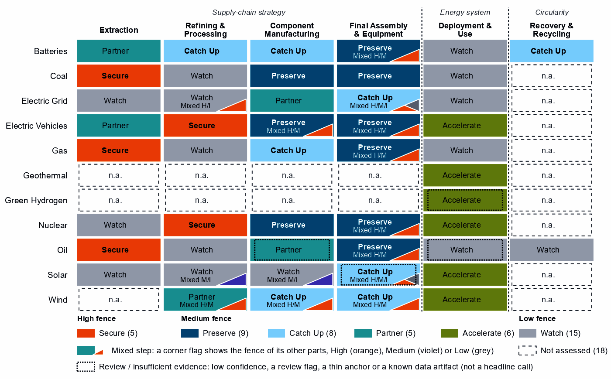
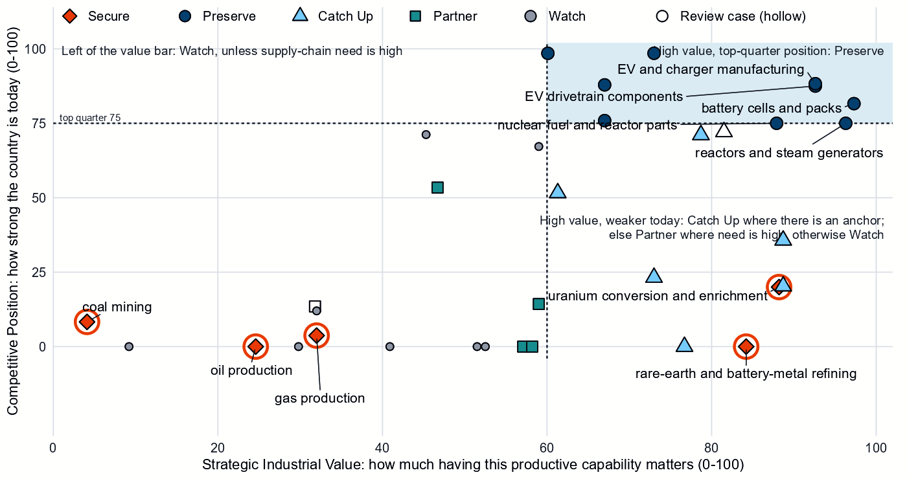
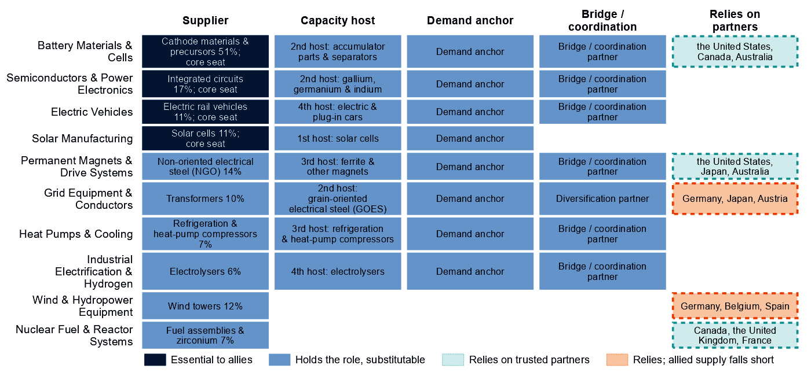
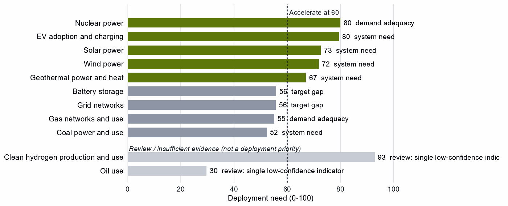

# South Korea and the Allied Industrial Base

*What to secure, build, source from partners, and deploy*

*Generated from Allied Industrial Base Explorer data; evidence, sources and caveats in the appendix. Data as of 30 October 2026.*

## 1. Bottom line — South Korea's strategic role

South Korea's distinctive role in the Allied Industrial Base is as its battery maker and equipment builder. It holds 51% of world exports or production of cathode materials and precursors. It is the largest allied holder of battery components and of gas turbines and LNG plant, and it is the best-placed trusted partner of 56 economies for at least one step. Nationally, that strength reads Preserve in battery cells, EV drivetrains and vehicles, reactors and gas plant. In battery components and materials it reads only Catch Up: South Korea is the largest allied holder of components and a leading cathode supplier, but its national position sits below the top quarter of producers. Its exposure lies at the start of the chain. It is among the most import-dependent economies for oil, gas and coal, relies on China for refined rare earths, and buys 49% of its imported uranium conversion and enrichment from Russia. For minerals, rare-earth and wind materials and grid components it should depend deliberately on trusted producers. At home, the energy system needs nuclear, solar and wind power and electric vehicles faster. Its development cooperation can follow its firms' investment abroad, helping partners add trusted battery and drivetrain capacity. [1, 2, 3]

- **Secure.** Imported oil, gas and coal; the rare-earth chain from separation to magnets, where China holds 94% of world refining supply and trusted suppliers only 4%; uranium conversion and enrichment; and the control software of grids, batteries and inverters. The answer is trusted contracts, stocks and control of command paths, not self-sufficiency. [2]
- **Build / preserve.** Preserve battery cells and packs, EV drivetrains and vehicles, reactors and nuclear fuel parts, and gas turbines and LNG plant. Catch Up in battery components and battery materials, where the national position trails the allied role, and in transformers, switchgear and wind towers.
- **Partner.** Battery and EV minerals, rare-earth and wind materials, and grid components. Source them from trusted producers, such as the United States, Canada and Australia for minerals and Germany, Japan and Austria for grid components, and add trusted capacity through co-investment and offtake where allied supply falls short. [1, 2, 3]
- **Deploy / stay open.** Accelerate nuclear, solar and wind power and EV adoption. Leave open oil refining, gas liquids processing, polysilicon beyond its solar-grade layer, and uranium, copper and bauxite ores, where diversified access matters more than protection.

Figure 1 reads the opposite way from a mining economy. The blue of Preserve sits in the manufacturing columns; the orange of Secure sits in extraction and refining, the fuels, rare earths and enriched uranium South Korea imports. The orange corner flags mark High-fence parts inside steps it otherwise builds: control software in batteries, grid equipment, inverters, turbines, vehicles and plant, and rare-earth magnets in drivetrains and wind parts.

**Figure 1. Where South Korea should secure, build, partner or stay open**

*Each cell is a supply-chain step of a technology, colored by its strategic choice. A corner flag marks a mixed step whose named parts sit behind a different fence. In battery cells and packs, the battery software is Secure while the cells and enclosures are Preserve; in wafers and PV cells, a Watch step, the cell layers are Catch Up. A dotted outline marks a review case, a call resting on low confidence, a review flag, a thin anchor or a known data artifact; this brief does not turn those calls into recommendations. Steps marked n.a. lack the data for a call. [3]*

## 2. Where South Korea should secure, compete and stay open

### High fence — what cannot fail

Secure is a broad call for South Korea: five whole steps and 15 layers inside other steps, which group into ten capabilities. Secure means being able to survive a prolonged cutoff or a hostile command, through qualified trusted supply, stocks, redundancy or control of the command path. The table takes the capabilities where a measured dependence meets an acute problem: system resilience, a coercive chokepoint or a remote command path. [3]

| Capability | Why it matters | Main vulnerability | Recommended response |
|---|---|---|---|
| Imported oil, gas and coal | Fuel power, industry and transport; rebuilding supply takes one to three years. | Import dependence ranks 97 (oil), 97 (gas) and 96 (coal) out of a hundred among importing economies (net imports against GDP). Saudi Arabia supplies 35% of crude imports, and allied oil supply falls short. | **Diversified and allied.** Stocks sized to the rebuild time; long-term and capacity-reservation contracts with trusted producers such as Canada, Norway and the United States for oil and Norway, the United States and Belgium for gas. |
| The rare-earth chain: separation, metals and magnets | Feeds the magnets of the EV motors South Korea makes; it has no measurable refining position. | China holds 94% of world refining supply and provides 64% of imports; substitution is hard and rebuilding takes more than three years. | **Mixed.** Qualified supply from trusted refiners such as the United States, Japan and Australia through offtake, public finance and allied agreements; stockpiles and recycling until it qualifies. |
| Uranium conversion and enrichment | Fuels a reactor fleet that must grow; enrichment is also dual-use. | Russia supplies 49% of imports; substitution is impossible and rebuilding takes more than three years. | **Allied.** For the national-security end uses: long-term contracts, co-investment and shared stockpiles with trusted processors such as Canada, the United Kingdom and France. |
| Control software of grids, inverters and batteries | Firmware and control software can command, update or disable equipment from abroad. | South Korea builds battery and grid hardware but also imports it: China supplies 85% of battery cell and pack imports; the data do not measure who supplies the firmware or remote-access software. | **Domestic, with allied standards.** Trusted-source and certification rules for firmware and remote access, for imports and Korean vendors alike. |

Sources: 1, 2, 3, 4.

Remote access to turbines and connected vehicles, reactor control systems and oil and gas network controls are also Secure, with the same answer as grid software. Grain-oriented electrical steel reads Secure only on the measures of its step, grid metals refining; the AIB instead ranks South Korea a host for new allied capacity in it.

### Medium fence — where industrial capability matters

This is where South Korea makes its real industrial choices: is a capability worth having (Strategic Industrial Value), and how strong is South Korea today (Competitive Position)?

**Preserve.** Every Preserve call rests on a measured position, and the battery and vehicle positions weigh most. Battery cells and packs, EV drivetrain components and EV and charger manufacturing combine top-quarter positions (82, 88 and 88) with high value and high confidence. Reactors and steam generators and nuclear fuel and reactor parts sit exactly on the top-quarter bar, a narrow lead on trade baskets that mix reactor and fuel lines with generic boiler and steam-turbine parts, so the position may be overstated. Gas turbines and LNG plant, and drilling rigs, tankers and oil equipment, hold top positions on what looks like a shared export line, with low need: allied supply roles more than national fences. [2, 3]

**Catch Up.** The strongest cases are in the battery chain. Battery components rest on four anchors at a position of 71, just short of the bar. Battery materials refining reads a Competitive Position of 0, yet South Korea holds 3% of world exports: the zero understates a real industry. Transformers, switchgear and cables rest on a position in transformers, blades, towers and nacelle parts on wind towers, and gas-turbine and drilling components partly on the position of the gas plant step above it. That step looks like a shared export line, so it should not be built on. Inside the Watch step wafers and PV cells, the cell layers read Catch Up, and the AIB gives South Korea a core seat in solar manufacturing. [2, 3]

Other Catch Up calls should not be built on. Wind turbines take their anchor from cables, transformers and switchgear the step's trade data share with the grid, not from turbines. Battery recycling rests on exports of battery waste and scrap, which show where scrap goes, not recycling capacity. [3]

**Partner.** For minerals, rare-earth and wind materials and grid components, need is high but South Korea has little to build on. Dependence should be deliberate and spread across trusted producers: the United States, Canada and Australia for battery and EV minerals, Germany, Belgium and Spain for rare-earth and wind materials, and Germany, Japan and Austria for grid components. In rare-earth and wind materials refining and grid components, allied supply falls short, so a purchase-only strategy will not hold. [1, 2, 3]

**Figure 2. Which producing capabilities are worth holding, and where South Korea is strong today**

*Producing steps with both measures (recovery has no position measure). Dashed lines mark the value bar (60) and the top quarter (75). The Preserve steps sit in the upper right, reactors and nuclear fuel parts on the top-quarter line. Battery components sit just below that line; battery materials refining sits on the bottom axis, though South Korea exports a real volume. Secure steps are ringed and hollow markers are review cases. [3]*

**Shared capabilities.** Some physical capabilities sit in several technology chains, and their calls differ by technology. The table keeps the national reading apart from what allies rely on South Korea for.

| Shared capability | Steps and their choices | National reading | AIB role |
|---|---|---|---|
| Accumulator parts & separators | battery components (Catch Up) and EV drivetrain components (Preserve) | The choices differ across technologies with each step's own measures (battery components: need 73, value 79, position 71; EV drivetrain components: need 97, value 93, position 88) | Supplier: 13% of world exports or production of accumulator parts & separators (the AIB measure of the product, not a step's share); the largest allied holder of the step |
| Ferrite & other magnets | EV drivetrain components (Preserve) and blades, towers and nacelle parts (Catch Up) | The choices differ across technologies with each step's own measures (EV drivetrain components: need 97, value 93, position 88; blades, towers and nacelle parts: need 80, value 89, position 20) | Allies need new capacity here (BUILD); no supplier role |
| Insulators & bushings | grid components (Partner); wafers and PV cells (Watch); and blades, towers and nacelle parts (Catch Up) | The choices differ across technologies with each step's own measures (grid components: need 71, value 47, position 53; wafers and PV cells: need 31, value 59, position 67; blades, towers and nacelle parts: need 80, value 89, position 20) | Allies need new capacity here (BUILD); no supplier role |
| Power electronics components | grid components (Partner); EV drivetrain components (Preserve); wafers and PV cells (Watch); and blades, towers and nacelle parts (Catch Up) | The choices differ across technologies with each step's own measures (grid components: need 71, value 47, position 53; EV drivetrain components: need 97, value 93, position 88; wafers and PV cells: need 31, value 59, position 67; blades, towers and nacelle parts: need 80, value 89, position 20) | Allies need new capacity here (BUILD); no supplier role |

Sources: 1, 3.

### Low fence — what not to prioritize

A credible strategy also says what not to localize. Watch is not a failure: it means affordable, diversified access matters more than domestic production.

- **Oil refining and gas liquids processing.** Oil refining is an established export business, with 6% of world supply; it needs no fence. [2, 3]
- **Polysilicon refining.** The solar-grade polysilicon layer reads Catch Up, but only on its step's export share, and South Korea's position in the step is 0. Treat that call as thin rather than a priority; the rest of the step stays open to diversified trusted producers. [2, 3]
- **Uranium, copper and bauxite ores.** Commodity imports, best bought from a diversified base.

## 3. South Korea's allied bargain

**What South Korea contributes.** In the Allied Industrial Base analysis South Korea combines specialized technology and scale manufacturing roles, and it ranks first among allies on outward cleantech-manufacturing FDI. It holds 51% of world exports or production of cathode materials and precursors, 17% of integrated circuits and 13% of accumulator parts and separators. It is the largest allied holder in battery components, with Japan and Poland the next holders, and in gas turbines and LNG plant, ahead of the United States and Germany. It is the best-placed trusted partner of 28 economies for gas turbines and LNG plant, 21 for battery components and 16 for battery materials refining. It holds a role in all 10 strategic compacts and a core seat in Battery Materials & Cells, Semiconductors & Power Electronics, Solar Manufacturing and Electric Vehicles. [1, 2, 3]

**What South Korea needs.** Minerals, refined rare earths, enriched uranium and fuels from trusted producers. If China's supply stopped, as in the Decoupling scenario, South Korea would lose US$37.3 billion a year of imports across the Allied Industrial Base basket. New capacity at the best-placed allied hosts, led by Germany, would restore only about US$3.7 billion of it a year. Under Managed Interdependence, the default scenario, South Korea sits in the minimum coalition of seven Sectoral Compacts (a different grouping from the strategic compacts above); under Decoupling it sits in twelve and is a demand anchor in all of them. [1, 2]

**The dependencies to make intentional.** These bargains turn that exchange into a specialization partners can count on.

| Capability / compact | South Korea contributes | South Korea needs | Natural partners | What makes the bargain work |
|---|---|---|---|---|
| Battery Materials & Cells | Cathode materials (51%), accumulator parts (13%) and cells | Battery and EV minerals | the United States, Canada and Australia for minerals | Offtake and co-investment with the recommended partners for minerals; joint ventures and support tied to benchmarks for materials |
| Permanent Magnets & Drive Systems | EV drivetrains and non-oriented electrical steel (14% of world exports or production of the steel; no supplier role in magnets) | Refined rare earths and magnets | the United States, Japan and Australia for refining; the compact's makers, Germany, the United States, Japan and Mexico | Qualified supply through offtake and allied agreements; stockpiles until it qualifies |
| Nuclear Fuel & Reactor Systems | Fuel assemblies and zirconium (7% of world exports or production) and reactors | Conversion and enrichment | Canada, the United Kingdom and France | Offtake, co-investment and shared stockpiles with allied producers |
| Equipment allies buy: Electric Vehicles, Solar Manufacturing and gas plant | Electric rail vehicles, solar cells and gas and LNG plant | Open, trusted markets | The compacts' other core seats, which share the producing role rather than buy it, such as Germany, the United States, France and Japan | Offtake and co-investment, the tools of allies' Partner designs; trusted-vendor certification for connected equipment |

Sources: 1, 2, 3.

**Figure 3. South Korea's role in the Allied Industrial Base**

*Each row is a strategic compact in which South Korea holds a role or relies on partners. Dark cells are roles allies cannot easily replace; light cells are roles others could fill; dashed cells mark where South Korea relies on trusted partners, orange where allied supply still falls short of what allies need.*

The bargain has to add trusted supply, not only redirect trade.

## 4. Development strategy — build trusted capacity by helping partners Catch Up

Development cooperation can be the development arm of that bargain. A partnership needs evidence on both sides. On the Korean side, a step needs more trusted capacity: it is Partner, or Secure with allied delivery, its need is high, allied supply falls short, or allies need new capacity there. On the partner's side, a developing economy's same step is a credible Catch Up, inside the allied trust screen.

South Korea's own supply chain drives most of the pairs. Of 49 pairs, 32, with 16 developing partners across six steps, rest on Korean need: rare-earth and wind materials refining; battery materials refining; battery components; EV drivetrain components; battery cells and packs; and blades, towers and nacelle parts. Another 17 rest on the allied gap alone. The table takes the leading partner of the highest-ranked steps, each partner once. Thailand and Indonesia are upper-middle-income economies, so finance, guarantees and offtake should lead. India and Viet Nam, both lower middle income, and Madagascar (low income) need groundwork first: project preparation, industrial infrastructure and skills. [1, 3, 5]

| Capability / allied gap | Developing partner | Why this partner can Catch Up | What the donor should support | Security / AIB benefit | Development benefit |
|---|---|---|---|---|---|
| Rare-earth and wind materials refining: high need, allied supply falls short and new allied capacity needed | India (lower middle income) | A share of world exports; corroborated by feasibility, specialization in the adjacent step and industrial learning | Plant capacity not covered by the data and input costs not covered by the data. Feasibility studies and project preparation, industrial infrastructure, environmental and permitting capability, workforce development; then, at scale, offtake, market access, investment guarantees | A trusted second source and allied capacity where allied supply falls short (allies need new capacity in 2 product groups of the step) | Processing capacity at home, with the skills, standards and value capture of a refinery |
| Battery materials refining: high need and new allied capacity needed | Madagascar (low income) | A share of world exports and operating capacity; corroborated by specialization in the adjacent step | Constraint: related industrial know-how outside the top quarter and input costs outside the cheapest quarter. Workforce development, technology transfer and joint ventures, industrial infrastructure, feasibility studies and project preparation; then, at scale, offtake, market access, investment guarantees | Diversified supply for a high-need step and new allied capacity where the AIB finds a gap (allies need new capacity in 6 product groups of the step) | Processing capacity at home, with the skills, standards and value capture of a refinery |
| Battery components: high need and new allied capacity needed | Viet Nam (lower middle income) | A share of world supply and a share of world exports; corroborated by feasibility and industrial learning | Constraint: operating or committed plant below the capacity bar and a position that rests on trade or output shares, not on plant capacity. Input costs not covered by the data. Project preparation, investment promotion, industrial infrastructure, quality systems and certification; then, at scale, development finance, guarantees, offtake, equity and joint ventures | Diversified supply for a high-need step and new allied capacity where the AIB finds a gap (allies need new capacity in 1 product group of the step) | A certified supplier base and export sales of components |
| EV drivetrain components: high need and new allied capacity needed | Thailand (upper middle income) | A share of world supply and a share of world exports; corroborated by feasibility, input costs, specialization in the adjacent step and industrial learning | Plant capacity not covered by the data. Lead with development finance, guarantees, offtake, equity and joint ventures; public support for supplier development and technical and vocational skills | Diversified supply for a high-need step and new allied capacity where the AIB finds a gap (allies need new capacity in 7 product groups of the step) | A certified supplier base and export sales of components |
| Battery cells and packs: high need and new allied capacity needed | Indonesia (upper middle income) | A share of world supply; corroborated by feasibility, input costs, specialization in the adjacent step and industrial learning | Constraint: no operating or committed plant in the capacity data and a position that rests on trade or output shares, not on plant capacity. Lead with development finance, guarantees, offtake, equity and joint ventures; public support for project preparation and investment promotion | Diversified supply for a high-need step and new allied capacity where the AIB finds a gap (allies need new capacity in 2 product groups of the step) | Factory capacity, skills and export sales of finished equipment |

Sources: 1, 2, 3, 5, 6, 7.

A partnership is more likely to last when it rests on more than aid. The second table shows what ties South Korea to each partner today and what would hold the relationship as the capability scales; aid is the 2020 to 2024 total. Korean firms already invest in several partners, so development finance can follow those ties. In Indonesia, the capacity data record no cell plant while the factory-project data record Korean projects; check that constraint before sizing support. [1, 3, 5]

| Partnership | Relationship today | What makes it durable |
|---|---|---|
| India: rare-earth and wind materials refining | Under $0.1 million at this step, under stage-wide codes (the technology is not identified) and a direct investment position of $9,224 million (economy-wide) | Long-term offtake and investment guarantees as the capability scales; the partner's role as Specialized technology supplier in the Wind & Hydropower Equipment compact; South Korea's own deployment demand for the technology (Accelerate); the partner's own deployment demand for the technology (Accelerate) |
| Madagascar: battery materials refining | Under $0.1 million of energy, industry and mining aid, none at this step; a direct investment position of $400 million (economy-wide); and no export-credit or lender finance recorded at the step | Long-term offtake, joint ventures and investment guarantees as the capability scales; the partner's role as Resource supplier in the Battery Materials & Cells compact |
| Viet Nam: battery components | $0.4 million at this step, under stage-wide codes (the technology is not identified); a direct investment position of $36,204 million (economy-wide); 1 factory project by firms from South Korea in the technology; and no export-credit or lender finance recorded at the step | Long-term offtake, joint ventures and investment guarantees as the capability scales; the partner's role as Scale manufacturer in the Battery Materials & Cells compact; the partner's own deployment demand for the technology (Accelerate) |
| Thailand: EV drivetrain components | $0.4 million at this step, mostly under a code that only approximates the technology; a direct investment position of $4,818 million (economy-wide); and 1 factory project by firms from South Korea in the technology | Long-term offtake, joint ventures and investment guarantees as the capability scales; the partner's role as Resource supplier in the Permanent Magnets & Drive Systems compact; South Korea's own deployment demand for the technology (Accelerate) |
| Indonesia: battery cells and packs | $6.1 million at this step, under stage-wide codes (the technology is not identified); a direct investment position of $12,750 million (economy-wide); 2 factory projects by firms from South Korea in the technology; and no export-credit or lender finance recorded at the step | Long-term offtake, joint ventures and investment guarantees as the capability scales; the partner's role as Processing anchor in the Battery Materials & Cells compact |

Sources: 1, 3, 5, 7, 8, 9, 10.

Battery materials refining is the widest strand: 7 developing economies, led by Madagascar and the Philippines, have credible refining pathways; Mozambique, Colombia and Tanzania are review cases, their positions resting on mine and smelter capacity. For rare-earth and battery-metal refining, the Secure step of the rare-earth chain, no credible development-led supply solution is identified. Malaysia and Thailand host its new capacity in the AIB, a commercial route. In all, 29 pairs are commercial: the partner already Preserves the step or hosts its capacity, so trade, offtake and investment fit better than aid. [1, 3, 5]

Today's aid follows this map only in part; the data cover energy, industry and mining aid only. Aid coded to a partnership's technology reaches only Malaysia, Viet Nam and the Philippines. At some of their steps these partners are development partners; at others they are already on the commercial route, where trade and investment could take its place. India, the Philippines, South Africa, Thailand, Viet Nam, Indonesia and Serbia receive aid at a partnership's step under stage-wide codes that do not identify the technology. Of the partners, 6 receive it at other steps and 3 at no supply-chain step; a partner with several partnership steps can appear in more than one group. The largest recipient, Ecuador, received $165 million over 2020 to 2024 and has no partnership here: that aid serves other aims, which this brief does not judge. [5]

## 5. Energy-system priorities

The energy system needs some technologies faster regardless of where the equipment is made. Nuclear power, EV adoption, solar and wind power clear the Accelerate bar of 60. The national target of 100 GW of renewables by 2030 compares with 37 GW installed in 2025, and at the recent build rate the shortfall is about 45 GW. Between 2020 and 2025, solar capacity grew from 14.8 to 30.4 GW and wind only from 1.6 to 2.4 GW. [3, 11]

**Figure 4. What South Korea needs to deploy faster**

*Deployment need by technology, with the largest of its measures: demand adequacy, the gap to national targets, or system need. Review cases, which rest on a single indicator of low confidence, are shown apart in grey and are not deployment priorities.*

High deployment priority does not imply high manufacturing priority. South Korea makes much of its nuclear and EV equipment, but the wind and solar build-out depends on buying turbines, modules and inverters competitively. Geothermal power and heat also clears the bar, driven by system need with moderate confidence; it needs confirming before it becomes a priority. Battery storage (56) and grid networks (56) sit just below the bar. [3, 11, 12]

## 6. Is current policy pointed in the right direction?

Policy never decides a choice here; it is compared with it afterwards, using South Korea's own recorded industrial-policy measures. The table keeps the most consequential mismatches of each kind.

| Capability | Strategic choice | Current policy | Gap |
|---|---|---|---|
| Uranium conversion and enrichment | Secure | Needs more attention | Vulnerability without enough policy attention |
| Rare-earth and battery-metal refining | Secure | Needs more attention | Vulnerability without enough policy attention |
| Gas production | Secure | Needs more attention | Vulnerability without enough policy attention |
| Grid components | Partner | Protection or localization in the top third | Domestic duplication where trusted specialization is the answer |
| Battery materials refining | Catch Up | Needs more attention | Capability case without enough policy attention |
| Solar power | Accelerate | Deployment policy below the middle | Deployment needed faster than policy supports |
| Wind power | Accelerate | Deployment policy below the middle | Deployment needed faster than policy supports |
| Geothermal power and heat | Accelerate | Deployment policy below the middle | Deployment needed faster than policy supports |
| Wafers and PV cells | Watch | Heavy protection or localization | Localizing what is not a domestic priority |
| Grid networks | Watch | Heavy local-content protection on the equipment of a Watch deployment | Localizing what is not a domestic priority |

Sources: 3, 13, 14.

Government should change course in several places. First, several Secure steps get little recorded attention. Uranium conversion and enrichment, rare-earth and battery-metal refining and gas production rank low among South Korea's own policy priorities (14, 30 and 22 out of a hundred). Battery materials refining, a Catch Up step, sits below the middle (42 out of a hundred). Second, deployment policy lags for solar and wind. Finally, protection runs ahead of the case in grid components, where the strategy is to partner, and in oil refining, gas liquids processing, wafers and PV cells and grid networks. [3, 13, 14]

## 7. Strategic agenda — what should South Korea do next?

### 1. Secure fuels and nuclear fuel through trusted contracts and stocks

Hold fuel stocks sized to the rebuild time, with long-term and capacity-reservation contracts across trusted producers. Supply the national-security end uses of uranium conversion and enrichment from trusted sources only, while the civilian market stays open. Build trusted capacity with partners through long-term contracts, co-investment and shared stockpiles with trusted processors such as Canada, the United Kingdom and France. [1, 2, 3]

### 2. Secure the rare-earth chain with allied refiners

Build diversified, qualified supply with trusted refiners such as the United States, Japan and Australia through offtake, public finance and allied agreements, hold stockpiles until it qualifies, and invest in recycling. No developing partner qualifies at rare-earth and battery-metal refining; India qualifies at rare-earth and wind materials refining, the step that holds the rare-earth separation layer. [1, 2, 3, 5]

### 3. Keep the battery chain at the frontier and close the materials gap

Preserve cells and packs through next-generation research, workforce and supplier development, and finance for expansion tied to benchmarks. In battery components and materials, use time-limited production support, first-of-a-kind finance and demand creation, all tied to benchmarks, and keep the gate open to joint ventures that transfer capability. This is where the national task and the allied role coincide.

### 4. Make the equipment bargain explicit

Offer allies trusted battery materials and components, electric rail vehicles, transformers and gas plant through offtake and co-investment, and secure minerals in return through offtake and co-investment with the United States, Canada and Australia. Protection of grid components should give way to partnership terms. [1, 2, 3]

### 5. Build trusted battery and drivetrain capacity with developing partners

Start with the highest-ranked pairs, India in rare-earth and wind materials refining and Madagascar in battery materials refining, where groundwork comes first. Also start with Viet Nam in battery components, Thailand in EV drivetrain components and Indonesia in battery cells and packs, where Korean firms already invest. Use project preparation, standards and skills where the constraint is a public good, and development finance, guarantees and offtake where it is bankability. Move aid that still reaches commercial-route partners toward partners that need groundwork. [1, 3, 5]

### 6. Accelerate nuclear, solar and wind while keeping sourcing open

Close the deployment-policy gap for solar and wind, and keep nuclear and EV adoption on pace, through infrastructure, permitting and procurement. Buy turbines, modules and commodity hardware competitively from trusted suppliers, and attach trusted-supplier and security conditions to public deployment support and to equipment with built-in control.

## Sources

1. Allied Industrial Base model: roles, compacts, trade restored and new capacity across the allied coalition, computed by the Explorer's authors (run of 30 October 2026); CC BY 4.0.
2. United Nations, UN Comtrade Database, HS6 bilateral trade (all reporters); reconciled by the authors (2022-2024 data); attribution; https://comtradeplus.un.org/.
3. Country strategy choices by technology and supply-chain step (supply-chain need, Strategic Industrial Value, Competitive Position, deployment need, policy alignment), computed by the Explorer's authors (dashboard data of 31 October 2026); CC BY 4.0.
4. Yards & Fences node attributes: standardization, learning, industrial commons and control layers, curated by the authors from public sources (2026-10-30); CC BY 4.0.
5. OECD Creditor Reporting System: official development assistance by donor, recipient and purpose code, gross disbursements at constant prices, energy, industry and mining purpose codes only, mapped to supply-chain steps by the authors (Components and Assembly share purpose codes; no code funds recycling) (2020-2024 data); attribution; https://data-explorer.oecd.org/.
6. Clean Investment Monitor: clean-technology manufacturing investment and capacity (aggregated), world capital expenditure 2021-22 to 2024-25; attribution; https://www.cleaninvestmentmonitor.org/.
7. Development tool families by supply-chain stage and constraint, and the development-partnership tests, set by the authors (config/development_partnerships.yml) (2026-11-03); CC BY 4.0.
8. International Monetary Fund, Direct Investment Positions: outward positions (reported, else derived from the counterpart's reports) (2020-2024 data); attribution; https://data.imf.org/.
9. fDi Markets clean-manufacturing projects (CM-FDI): factory projects by home and destination economy (Components and Assembly not separated); subscription (aggregates only).
10. Oil Change International, Public Finance for Energy: export-credit and development-lender energy finance (not aid) (2013-2025 data); attribution; https://energyfinance.org/.
11. Ember, electricity generation and capacity data (2020-2025) and 2030 Renewable Target Tracker; CC BY 4.0; https://ember-energy.org/.
12. International Energy Agency, World Energy Outlook 2025 (Stated Policies Scenario) and Global Critical Minerals Outlook: demand 2024-2035 (2025); CC BY-NC-SA 4.0 (free dataset); https://www.iea.org/.
13. Global Trade Alert, New Industrial Policy Observatory: industrial-policy interventions, strength scored by the authors, October 2026 extract (as of 5 October 2026); subscription (titles, dates and links only); https://www.globaltradealert.org/.
14. International Energy Agency, Policies and Measures Database (export of 2026-10-26); attribution; https://www.iea.org/policies.

## Appendix — evidence and method

**How this brief is built.** Every number comes from the Country page data of the Allied Industrial Base Explorer (the data release of 30 October 2026) and from the Allied Industrial Base analysis. Each technology is split into supply-chain stages, from extraction to recycling, and each step gets a strategic choice by fixed rules applied in order: [3]

- Secure where an acute vulnerability is measured;
- at deployment, Accelerate where deployment need reaches 60; [3]
- Watch where the step is a large, commoditized yard;
- Preserve where Competitive Position is in the top quarter (75) and either Strategic Industrial Value (bar 60) or supply-chain need (bar 67) is high; [3]
- Catch Up where the value is high, the position is not, and a capability anchor is corroborated by other evidence;
- Partner where supply-chain need is high but there is neither a top-quarter position nor, for a high-value step, a credible pathway;
- Watch otherwise.

Named layers inside a step, such as control software or magnets, take their own choice, and a step whose parts sit behind different fences is mixed. A value that rests on market size alone is capped just under the bar. Observed policy never decides a choice. The high fence (Secure) protects what cannot be allowed to fail; the medium fence covers capabilities worth building, keeping or sourcing deliberately and deployment to accelerate; the low fence (Watch) leaves a step open to competitive purchase.

**Review cases.** Some calls rest on low confidence, an engine review flag, a thin capability anchor, a known data artifact or, at deployment, a single indicator of low confidence. They stay on the map but never enter the Bottom line, the Agenda, the policy table or a headline mark. Of South Korea's steps, four are review cases. [3]

| Step | Choice | Why it is a review case |
|---|---|---|
| Clean hydrogen production and use | Accelerate | A single indicator of low confidence |
| Drilling and pump components | Partner | Low confidence |
| Oil use | Watch | A single indicator of low confidence |
| PV modules and inverters | Catch Up | Low confidence |

Sources: 3.

**Evidence and caveats.** The battery materials Catch Up has high confidence. Its Competitive Position of 0 sits beside an AIB share of 51% in cathode materials: the position measure gives South Korea nothing for plant capacity or investment, while exports and the AIB show a large industry. The wind-turbine Catch Up is anchored on trade codes the step shares with the grid (cables, transformers and switchgear), and the battery-recycling Catch Up on exports of battery waste and scrap; neither measures the capability its name implies. Gas turbines and LNG plant and drilling rigs, tankers and oil equipment show nearly the same share of world exports (11% and 11%), which suggests overlapping trade codes. The oil step's value of 60 only just reaches the bar. Reactors and nuclear fuel parts sit exactly on the top-quarter line. The uranium Secure call is a dual-use call, with the fence on the national-security end uses; coercive suppliers provide 53% of South Korea's imports. Grain-oriented electrical steel takes its Secure call from the measures of grid metals refining. Coal-plant components and equipment are Preserve on real export positions, though coal power is a Watch. In all, 18 steps lack the data for a call, including all of geothermal and green hydrogen manufacturing and most recycling. Recorded policy ranks clean hydrogen use and electrolyser systems among South Korea's highest priorities (98 and 95 out of a hundred). But deployment need rests on a single indicator and the manufacturing steps cannot be assessed, so this brief does not settle that disagreement. Competitive Position ranks South Korea among economies that already supply a step, so a zero means no measurable position. Partner lists name where allied capacity sits, which can include trading hubs, not who owns it. [1, 2, 3, 4, 6, 12, 13, 14]

**Development partnerships.** A pair joins a Korean step with a strategic reason for more allied capacity and a developing economy (not high income) whose same step is a Catch Up. The partner needs an anchor corroborated beyond context signals, sufficient evidence and confidence, and a place inside the AIB trust screen; on a step whose data describe different products, the anchor must measure the product the need is about. A partner that already hosts the step's new capacity in the AIB, or Preserves it, is a commercial case. Aid comes from the OECD Creditor Reporting System by purpose code. Components and Assembly share codes, no code funds recycling, and many codes name a stage rather than a technology, so aid at a step is not aid for that technology. Aid is called technology-coded only where codes naming the technology hold most of it. A constraint on a partner is named only where the data observe its input; otherwise the table says the data do not cover it. In the relationship table an observed zero is stated as nothing recorded, data that do not cover a pair are left out, and the direct investment position is economy-wide, not tied to the step. Export-credit finance is reported apart and never counted as aid, and direct investment uses the IMF positions (the partner's reports where South Korea reports none). Development Potential, an older partner score, is a supporting indicator only. The full list of pairs, with every field, is in the development-partnership export.

| Step | Donor reason | Development partners | Commercial route | Review cases | Aid at the step |
|---|---|---|---|---|---|
| Rare-earth and wind materials refining | Partner, high need, allied supply falls short and new allied capacity needed | India | – | Viet Nam and South Africa | India, Viet Nam and South Africa |
| Battery materials refining | High need and new allied capacity needed | Madagascar, the Philippines, India, South Africa, Thailand, Papua New Guinea and Turkiye | Indonesia, Argentina, the Democratic Republic of Congo and Malaysia | Mozambique, Colombia and Tanzania | the Philippines, India, South Africa, Thailand, Indonesia, the Democratic Republic of Congo, Colombia and Tanzania |
| Battery components | High need and new allied capacity needed | Viet Nam, Indonesia, Mexico, Turkiye, India, Morocco and Malaysia | – | – | Viet Nam, Indonesia and India |
| EV drivetrain components | High need and new allied capacity needed | Thailand, Malaysia, Serbia, Turkiye, Honduras, Morocco and Ukraine | Indonesia, the Philippines, Mexico and India | Viet Nam | Thailand, Serbia, Indonesia, the Philippines, India and Viet Nam |
| Battery cells and packs | High need and new allied capacity needed | Indonesia, Malaysia, Mexico, India and Turkiye | Viet Nam | – | Indonesia, India and Viet Nam |
| Blades, towers and nacelle parts | High need and new allied capacity needed | Thailand, Serbia, Turkiye, Malaysia and Brazil | Mexico, Viet Nam, the Philippines and India | – | Thailand, Serbia, Malaysia, Viet Nam, the Philippines and India |
| EV and charger manufacturing | New allied capacity needed | Mexico, Thailand, Viet Nam, Malaysia, Morocco and Indonesia | Turkiye and India | – | Thailand, Viet Nam, Indonesia and India |
| Wind turbines | New allied capacity needed | Viet Nam, Malaysia, Turkiye, Indonesia, Thailand and Morocco | India and Mexico | Brazil | Viet Nam, Malaysia, Indonesia, Thailand and India |
| Transformers, switchgear and cables | New allied capacity needed | Malaysia, India and the Philippines | Mexico, Thailand, Turkiye and Viet Nam | Morocco | Malaysia, India, the Philippines, Thailand and Viet Nam |
| PV modules and inverters | New allied capacity needed | Morocco and Turkiye | Viet Nam, India, Thailand, Malaysia, Indonesia and Mexico | – | Viet Nam, India, Thailand, Malaysia and Indonesia |
| Rare-earth and battery-metal refining | Secure with allied delivery, few trusted alternatives, high need and new allied capacity needed | – | Malaysia and Thailand | Argentina, Indonesia, the Democratic Republic of Congo, Mozambique, the Philippines, Tanzania, Mexico and Madagascar | Thailand, Indonesia, the Democratic Republic of Congo, the Philippines and Tanzania |
| Uranium conversion and enrichment | Secure with allied delivery and high need | – | – | Namibia | – |
| Battery recycling | High need | – | – | India and Malaysia | – |
| Polysilicon refining | High need | – | – | India | India |

Sources: 1, 3, 5.

**Every step.**

| Step | Stage | Choice | Fence | Need | Value | Position | Evidence | Policy |
|---|---|---|---|---|---|---|---|---|
| Battery mineral mining | Extraction | Partner | Medium | 100 | 57 | 0 | strong | broadly aligned |
| Battery materials refining | Refining | Catch Up | Medium | 99 | 77 | 0 | strong | needs more attention |
| Battery components | Components | Catch Up | Medium | 73 | 79 | 71 | moderate | broadly aligned |
| Battery cells and packs | Assembly | Preserve | Mixed High/Medium | 83 | 97 | 82 | moderate | broadly aligned |
| Battery storage | Deployment | Watch | Low | 56 | – | – | strong | broadly aligned |
| Battery recycling | Recovery | Catch Up | Medium | 94 | 82 | – | – | mixed signals |
| Coal mining | Extraction | Secure | High | 94 | 4 | 8 | strong | mixed signals |
| Coke and coal processing | Refining | Watch | Low | 93 | 9 | 0 | strong | not enough policy evidence |
| Coal-plant components | Components | Preserve | Medium | 58 | 67 | 88 | strong | broadly aligned |
| Coal-plant equipment | Assembly | Preserve | Medium | 60 | 67 | 76 | strong | broadly aligned |
| Coal power and use | Deployment | Watch | Low | 52 | – | – | strong | broadly aligned |
| Coal recovery | Recovery | Not assessed | – | – | 1 | – | – | not enough policy evidence |
| Copper and bauxite mining | Extraction | Watch | Low | 97 | 41 | 0 | strong | broadly aligned |
| Grid metals refining | Refining | Watch | Mixed High/Low | 96 | 53 | 0 | strong | broadly aligned |
| Grid components | Components | Partner | Medium | 71 | 47 | 53 | strong | wrong tool for the problem |
| Transformers, switchgear and cables | Assembly | Catch Up | Mixed High/Medium/Low | 51 | 61 | 52 | strong | broadly aligned |
| Grid networks | Deployment | Watch | Low | 56 | – | – | – | too much intervention |
| Grid-equipment recycling | Recovery | Not assessed | – | – | 14 | – | – | not enough policy evidence |
| EV mineral mining | Extraction | Partner | Medium | 100 | 59 | 14 | strong | broadly aligned |
| Rare-earth and battery-metal refining | Refining | Secure | High | 99 | 84 | 0 | strong | needs more attention |
| EV drivetrain components | Components | Preserve | Mixed High/Medium | 97 | 93 | 88 | moderate | broadly aligned |
| EV and charger manufacturing | Assembly | Preserve | Mixed High/Medium | 37 | 93 | 88 | moderate | broadly aligned |
| EV adoption and charging | Deployment | Accelerate | Medium | 80 | – | – | strong | broadly aligned |
| EV recycling | Recovery | Not assessed | – | – | 37 | – | – | not enough policy evidence |
| Gas production | Extraction | Secure | High | 96 | 32 | 4 | strong | needs more attention |
| Gas liquids processing | Refining | Watch | Low | 93 | 32 | 12 | strong | too much intervention |
| Gas-turbine and drilling components | Components | Catch Up | Medium | 50 | 73 | 23 | strong | broadly aligned |
| Gas turbines and LNG plant | Assembly | Preserve | Mixed High/Medium | 34 | 73 | 99 | strong | broadly aligned |
| Gas networks and use | Deployment | Watch | Low | 55 | – | – | strong | broadly aligned |
| Gas recovery | Recovery | Not assessed | – | – | 25 | – | – | not enough policy evidence |
| Geothermal resource development | Extraction | Not assessed | – | – | 20 | – | – | not enough policy evidence |
| Geothermal refining | Refining | Not assessed | – | – | 20 | – | – | not enough policy evidence |
| Geothermal plant components | Components | Not assessed | – | – | 69 | – | – | not enough policy evidence |
| Geothermal power-plant equipment | Assembly | Not assessed | – | – | 69 | – | – | not enough policy evidence |
| Geothermal power and heat | Deployment | Accelerate | Medium | 67 | – | – | strong | deployment policy lags |
| Geothermal recovery | Recovery | Not assessed | – | – | 20 | – | – | not enough policy evidence |
| Electrolyser mineral mining | Extraction | Not assessed | – | – | 35 | 0 | strong | not enough policy evidence |
| PGM and catalyst refining | Refining | Not assessed | – | – | 63 | 91 | strong | not enough policy evidence |
| Electrolyser stacks | Components | Not assessed | – | – | 99 | – | – | not enough policy evidence |
| Electrolyser systems | Assembly | Not assessed | – | – | 90 | – | – | not enough policy evidence |
| Clean hydrogen production and use | Deployment | Accelerate | Medium | 93 | – | – | – | broadly aligned |
| Stack and catalyst recycling | Recovery | Not assessed | – | – | 49 | – | – | not enough policy evidence |
| Uranium mining | Extraction | Watch | Low | 96 | 52 | 0 | strong | broadly aligned |
| Uranium conversion and enrichment | Refining | Secure | High | 98 | 88 | 20 | strong | needs more attention |
| Nuclear fuel and reactor parts | Components | Preserve | Medium | 54 | 88 | 75 | strong | broadly aligned |
| Reactors and steam generators | Assembly | Preserve | Mixed High/Medium | 62 | 96 | 75 | strong | broadly aligned |
| Nuclear power | Deployment | Accelerate | Medium | 80 | – | – | strong | broadly aligned |
| Spent-fuel reprocessing | Recovery | Not assessed | – | – | 88 | – | – | not enough policy evidence |
| Oil production | Extraction | Secure | High | 99 | 25 | 0 | strong | mixed signals |
| Oil refining | Refining | Watch | Low | 23 | 45 | 71 | strong | too much intervention |
| Drilling and pump components | Components | Partner | Medium | 71 | 32 | 14 | strong | broadly aligned |
| Drilling rigs, tankers and oil equipment | Assembly | Preserve | Mixed High/Medium | 30 | 60 | 99 | strong | broadly aligned |
| Oil use | Deployment | Watch | Low | 30 | – | – | strong | broadly aligned |
| Waste-oil recovery | Recovery | Watch | Low | 43 | 13 | – | – | broadly aligned |
| PV mineral mining | Extraction | Watch | Low | 98 | 30 | 0 | strong | broadly aligned |
| Polysilicon refining | Refining | Watch | Mixed Medium/Low | 71 | 58 | 0 | strong | broadly aligned |
| Wafers and PV cells | Components | Watch | Mixed Medium/Low | 31 | 59 | 67 | moderate | too much intervention |
| PV modules and inverters | Assembly | Catch Up | Mixed High/Medium/Low | 25 | 82 | 72 | moderate | broadly aligned |
| Solar power | Deployment | Accelerate | Medium | 73 | – | – | strong | deployment policy lags |
| PV module recycling | Recovery | Not assessed | – | – | 45 | – | – | not enough policy evidence |
| Wind mineral mining | Extraction | Not assessed | – | – | 44 | 33 | strong | not enough policy evidence |
| Rare-earth and wind materials refining | Refining | Partner | Mixed High/Medium | 75 | 58 | 0 | strong | broadly aligned |
| Blades, towers and nacelle parts | Components | Catch Up | Mixed High/Medium | 80 | 89 | 20 | moderate | broadly aligned |
| Wind turbines | Assembly | Catch Up | Mixed High/Medium | 64 | 89 | 36 | moderate | broadly aligned |
| Wind power | Deployment | Accelerate | Medium | 72 | – | – | strong | deployment policy lags |
| Wind-turbine recycling | Recovery | Not assessed | – | – | 30 | – | – | not enough policy evidence |

Sources: 2, 3, 4, 6, 11, 12, 13, 14.

**Named layers.**

| Layer | Step | Choice | Fence |
|---|---|---|---|
| Anode materials (natural and synthetic graphite) | battery materials refining | Catch Up | Medium |
| Cathode active materials and precursors | battery materials refining | Catch Up | Medium |
| Battery-grade lithium hydroxide and carbonate | battery materials refining | Catch Up | Medium |
| Battery cells (LFP and NMC) | battery cells and packs | Preserve | Medium |
| Communications gateway and cloud fleet management | battery cells and packs | Secure | High |
| Battery-management firmware, energy-management software and remote updates | battery cells and packs | Secure | High |
| Enclosures, racking, thermal management and balance of system | battery cells and packs | Preserve | Medium |
| Grain-oriented electrical steel | grid metals refining | Secure | High |
| Power conversion hardware (inverters and converters) | transformers, switchgear and cables | Catch Up | Medium |
| Smart meters and advanced metering head-end systems | transformers, switchgear and cables | Secure | High |
| Cables and conductors | transformers, switchgear and cables | Watch | Low |
| Utility-scale inverter firmware and remote-access functions | transformers, switchgear and cables | Secure | High |
| Grid-control software (SCADA, EMS, DERMS) | transformers, switchgear and cables | Secure | High |
| Large power transformers | transformers, switchgear and cables | Catch Up | Medium |
| HVDC converter-station control and protection | transformers, switchgear and cables | Catch Up | Medium |
| Electric drive units and motors | EV drivetrain components | Preserve | Medium |
| Sintered NdFeB permanent magnets (traction motors) | EV drivetrain components | Secure | High |
| Connected-vehicle telematics, over-the-air software and connectivity systems | EV and charger manufacturing | Secure | High |
| Charging-network management software (charge-point back ends) | EV adoption and charging | Accelerate | Medium |
| Pipeline SCADA, compressor-station and LNG-terminal control systems | gas turbines and LNG plant | Secure | High |
| Iridium and platinum for PEM electrolyser catalysts | electrolyser mineral mining | Not assessed | – |
| HALEU enrichment | uranium conversion and enrichment | Secure | High |
| LEU enrichment services | uranium conversion and enrichment | Secure | High |
| Fuel assemblies (design-specific fabrication) | nuclear fuel and reactor parts | Preserve | Medium |
| Reactor control and safety instrumentation | reactors and steam generators | Secure | High |
| Oil pipeline and terminal control systems | drilling rigs, tankers and oil equipment | Secure | High |
| Solar-grade polysilicon | polysilicon refining | Catch Up | Medium |
| Solar cells and wafers | wafers and PV cells | Catch Up | Medium |
| Next-generation PV (perovskite and tandem cells) | wafers and PV cells | Catch Up | Medium |
| Distributed PV inverter firmware, communication dongles and vendor cloud | PV modules and inverters | Secure | High |
| Conventional crystalline-silicon modules | PV modules and inverters | Watch | Low |
| Passive racking and mounting | PV modules and inverters | Watch | Low |
| Rare-earth separation and metal-making | rare-earth and wind materials refining | Secure | High |
| Sintered NdFeB permanent magnets | blades, towers and nacelle parts | Secure | High |
| Turbine controllers, OEM remote access and park SCADA | wind turbines | Secure | High |

Sources: 3, 4.

**Partner recommendations.**

| Step | Choice | Trusted partners | Allied supply | Evidence |
|---|---|---|---|---|
| Battery mineral mining | Partner | the United States, Canada and Australia | Allied supply covers the need | moderate |
| Coal mining | Secure | the United States, Canada and Australia | Allied supply covers the need | weak |
| Grid components | Partner | Germany, Japan and Austria | Allied supply falls short | strong |
| EV mineral mining | Partner | the United States, Canada and Australia | Allied supply covers the need | moderate |
| Rare-earth and battery-metal refining | Secure | the United States, Japan and Australia | Allied supply covers the need | moderate |
| Gas production | Secure | Norway, the United States and Belgium | Allied supply covers the need | weak |
| Uranium conversion and enrichment | Secure | Canada, the United Kingdom and France | Allied supply covers the need | strong |
| Oil production | Secure | Canada, Norway and the United States | Allied supply falls short | weak |
| Drilling and pump components | Partner | the United States, Canada and the Netherlands | Allied supply covers the need | weak |
| Rare-earth and wind materials refining | Partner | Germany, Belgium and Spain | Allied supply falls short | strong |

Sources: 1, 2, 3.

**Compact roles.**

| Strategic compact | Lead role | Functions | Lead step | Core countries |
|---|---|---|---|---|
| Permanent Magnets & Drive Systems | Specialized technology supplier | Specialized technology supplier, demand anchor, bridge / coordination partner and diversification partner | Magnets & core steel | Thailand, Viet Nam, Germany, the United States, Japan and Mexico |
| Battery Materials & Cells | Specialized technology supplier | Specialized technology supplier, scale manufacturer, demand anchor, investment anchor, capacity-building host, bridge / coordination partner and diversification partner | Electrode materials & components | the United States, the Democratic Republic of Congo, Japan, Indonesia, South Korea and Germany |
| Semiconductors & Power Electronics | Specialized technology supplier | Processing anchor, specialized technology supplier, scale manufacturer, demand anchor, capacity-building host, bridge / coordination partner and diversification partner | Chips, power devices & sensors | Brazil, Taiwan, Singapore, South Korea, the United States and Viet Nam |
| Solar Manufacturing | Specialized technology supplier | Specialized technology supplier, scale manufacturer, demand anchor and capacity-building host | Cells & cover glass | Germany, Japan, South Korea, Viet Nam, the United States and India |
| Wind & Hydropower Equipment | Specialized technology supplier | Specialized technology supplier | Blades, towers & turbine parts | Spain, Poland, India, Germany, the United States and the United Kingdom |
| Nuclear Fuel & Reactor Systems | Scale manufacturer | Scale manufacturer | Fuel & nuclear materials | Australia, Canada, India, the United States, France and the United Kingdom |
| Grid Equipment & Conductors | Scale manufacturer | Scale manufacturer, demand anchor, capacity-building host and diversification partner | Network equipment | Chile, Peru, the Democratic Republic of Congo, Japan, Germany and the United States |
| Electric Vehicles | Scale manufacturer | Scale manufacturer, demand anchor, investment anchor, bridge / coordination partner and diversification partner | Electric vehicles | Germany, the United States, France, Japan, South Korea and the United Kingdom |
| Heat Pumps & Cooling | Scale manufacturer | Scale manufacturer, demand anchor, bridge / coordination partner and diversification partner | Compressors | the United States, the Netherlands, Thailand, Mexico, Germany and Italy |
| Industrial Electrification & Hydrogen | Scale manufacturer | Scale manufacturer, demand anchor, capacity-building host, bridge / coordination partner and diversification partner | Electrolysers | India, Oman, South Africa, the United States, Saudi Arabia and Morocco |

Sources: 1.

**Coverage and freshness.**

| Item | Value |
|---|---|
| Data release | 30 October 2026 |
| Steps with a choice | 48 |
| Steps not assessed | 18 |
| Named layers with a choice | 34 |
| Steps with strong position evidence | 39 |
| Steps with moderate or weak position evidence | 8 |
| Steps with no position evidence | 19 |

Sources: 3.

*AI-generated from the data and checked against it by an independent verifier.*

*Allied Industrial Base Explorer, Country strategy brief: South Korea*
