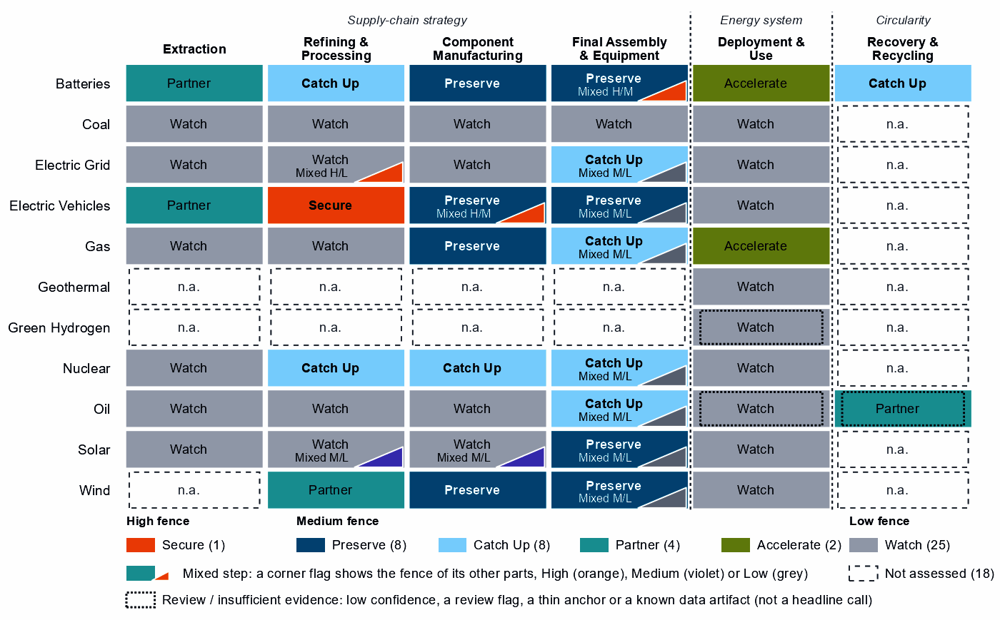
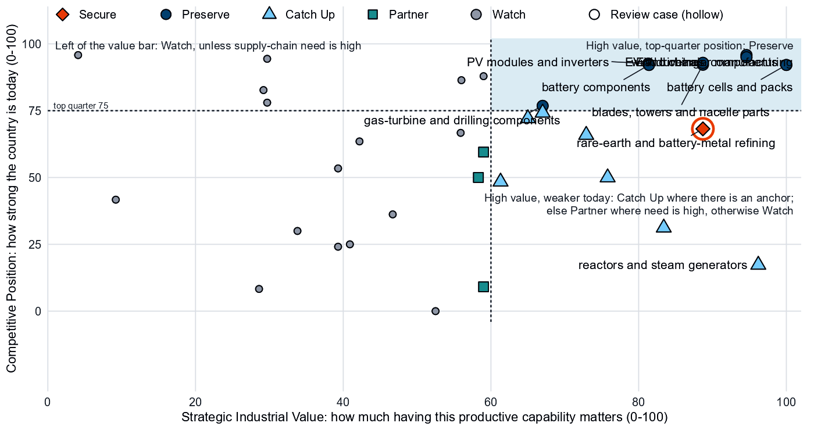
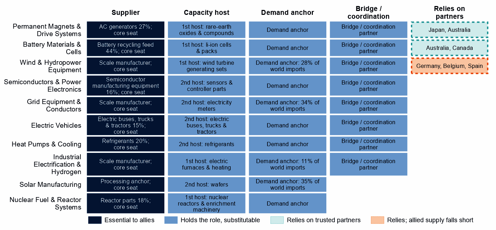
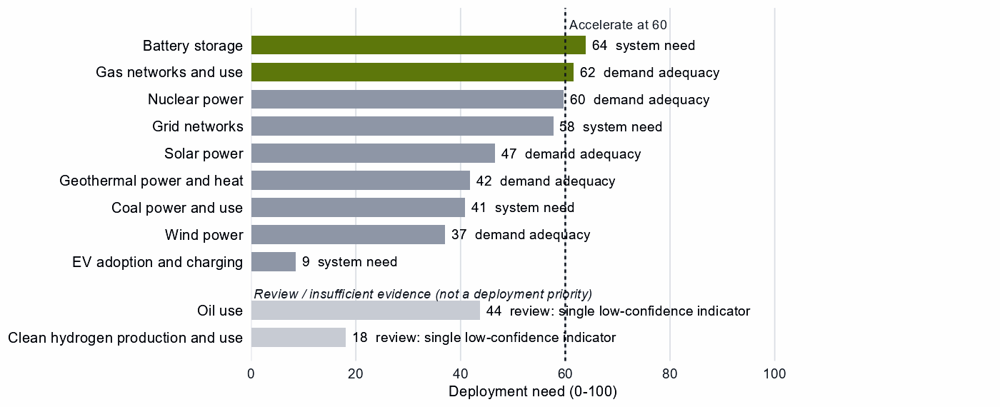

# The United States and the Allied Industrial Base

*What to secure, build, source from partners, and deploy*

*Generated from Allied Industrial Base Explorer data; evidence, sources and caveats in the appendix. Data as of 30 October 2026.*

## 1. Bottom line — the United States' strategic role

In the Allied Industrial Base the United States is the demand and market anchor, with a core seat in all ten strategic compacts. It also supplies fab equipment, automatic controllers and AC generators, and it is the largest allied holder of gas liquids, refined fuels and gas-turbine and drilling components. Nationally, its task is to keep the broad manufacturing base where it holds a top-quarter position, from battery cells and EV drivetrains to wind turbines and PV modules. It should catch up where its position is below the top quarter but anchored: battery materials refining, reactors and nuclear fuel, and large power transformers. The fence that matters is narrow: the rare-earth chain, the electrical steel inside transformers, and the control software of the battery systems it imports mostly from China. It should source battery and EV minerals from trusted producers, and use development cooperation to add trusted capacity in EV drivetrains and battery cells. Much of the map is left open: mining, fuels and basic processing are large, commoditized yards, and only battery storage and gas networks clear the bar for faster deployment. [1, 2]

- **Secure.** The rare-earth chain from refining to traction magnets, where China holds 94% of world refining supply; grain-oriented electrical steel for transformers; and the firmware and communications of imported battery systems. The answer is qualified trusted supply, stocks and control of command paths, not self-sufficiency. [2]
- **Build / preserve.** Preserve the top-quarter positions in battery cells and components, EV drivetrains and vehicles, wind turbines and their parts, PV modules and inverters, and gas-turbine components. Catch Up in battery materials refining, reactors and nuclear fuel, and large power transformers.
- **Partner.** Source battery and EV minerals from Australia and Canada, where allied supply covers the need, and the wider wind-materials refining step from the allied holders Germany, Belgium and Spain. Allied supply of that step falls short of need, so new capacity is also required. With developing partners, development finance and offtake can add capacity in EV drivetrains and battery cells. [1, 2, 3]
- **Deploy / stay open.** Accelerate battery storage and gas networks, with the market open to every trusted supplier. Keep the Watch mining steps, fuels processing and grid components open. Keep supply reliable in gas liquids, which allies rely on most, and in refined fuels, which they rely on less.

In Figure 1, color sits in the manufacturing columns, where the United States holds top-quarter positions, and in the nuclear chain, where it must catch up; mining, processing and deployment are mostly Watch. The orange corner flags mark the High-fence parts: battery software, EV magnets and electrical steel.

**Figure 1. Where the United States should secure, build, partner or stay open**

*Each cell is a supply-chain step of a technology, colored by its strategic choice. A corner flag marks a mixed step whose named parts sit behind a different fence: in battery cells and packs, the battery software is Secure while the cells and enclosures are Preserve. A dotted outline marks a review case, a call resting on low confidence, a review flag, a thin anchor or a known data artifact; this brief does not turn those calls into recommendations. Steps marked n.a. lack the data for a call. [3]*

## 2. Where the United States should secure, compete and stay open

### High fence — what cannot fail

Secure is a narrow call for the United States: one whole step and four layers inside other steps, which group into the three capabilities below. Secure does not mean making everything at home. It means being able to survive a prolonged cutoff or a hostile command, through qualified trusted supply, stocks, redundancy or control of the command path. [3]

| Capability | Why it matters | Main vulnerability | Recommended response |
|---|---|---|---|
| Grain-oriented electrical steel | The core steel of power and distribution transformers, on which every grid expansion depends; it sits inside grid metals refining, a step otherwise left open. | Essential, import-dependent and slow to rebuild, in a step whose supply-chain need is 91; the need is measured for grid metals refining as a whole, not for the steel alone. | **Resilience, not replacement.** Stocks and spares pools sized to the rebuild time, long-lead procurement frameworks and capacity-reservation agreements with trusted producers; screening of foreign control of essential supply assets. |
| The rare-earth chain: separation, metals and magnets | Feeds the traction motors of electric vehicles. The United States holds 18% of world exports in the refining step's trade but only 1% of world supply, so the export share is a trade position to build from, not proven separation capacity. | China holds 94% of world refining supply and trusted suppliers 4%; substitution is hard and rebuilding takes more than three years. | **Mixed.** Build separation and metal-making at home where a foothold exists; add trusted refining and magnet capacity with allies through co-investment and offtake; hold stocks until trusted supply qualifies, and phase in adversary-source restrictions as it does. |
| Control software of battery systems | Battery-management firmware, energy-management software, gateways and cloud fleet management can command, update or disable storage from abroad. | China supplies 69% of US imports of battery cells and packs, and the control is built partly into the hardware. | **Trusted control.** Trusted-source and certification rules for firmware, communications and remote access; limits on remote access and over-the-air updates by untrusted vendors; a deadline to replace untrusted control in the installed base. Where control is built into the hardware, trusted-source rules for that hardware and support for redesigns that separate the control layer. |

Sources: 2, 3, 4.

### Medium fence — where industrial capability matters

**Preserve.** The United States holds a top-quarter position in eight high-value producing steps. They are battery cells and packs; EV drivetrain components; EV and charger manufacturing; wind turbines; blades, towers and nacelle parts; battery components; PV modules and inverters; and gas-turbine and drilling components. For most, need is low and the task is to stay at the frontier. In battery cells and packs (need 90) and EV drivetrain components (73), keeping the position means expanding it, with support tied to benchmarks and the gate open to allied investment. The magnets of blades, towers and nacelle parts read Preserve on that step's measures but Secure in EV drivetrains; this brief treats them as part of the rare-earth chain. [2, 3]

**Catch Up.** Battery materials refining is the best-anchored case for building: high value, a low position and five capability anchors, from operating capacity to committed investment. China holds 94% of world supply, so trusted capacity here is scarce for every ally. Reactors and steam generators, the highest-value Catch Up, and nuclear fuel and reactor parts rest on direct shares of world supply. The AIB's separate measure of reactor parts, 18% of world exports or production, corroborates the reactor-parts side of both; it does not test fuel fabrication. In transformers, switchgear and cables, where value only just clears the bar, the Catch Up sits in large power transformers, power conversion hardware and HVDC control. Gas turbines and LNG plant and drilling rigs, tankers and oil equipment sit just under the top quarter (74 and 72): positions to keep competitive more than gaps to close. [1, 2, 3]

This brief does not build on the Catch Up calls with the weakest anchors. Uranium conversion and enrichment rests on a small share of world exports, about 1%, and on the position in fuel and reactor parts next to it; no conversion or enrichment capacity is measured. Battery recycling rests only on a share of world exports (12%) of what the AIB analysis calls battery recycling feed. [2, 3]

**Partner.** Battery mineral mining and EV mineral mining have high need and no top-quarter position, and allied supply covers the need: source them from Australia and Canada. In rare-earth and wind materials refining, allied supply falls short, and the recommended partners are Germany, Belgium and Spain. Most of that step's trade by value is copper wire rod, not rare earths; its rare-earth separation layer reads Catch Up and belongs with the Secure chain, so partnering applies to the wider basket. [1, 2, 3]

**Shared capabilities.** Some physical capabilities sit in several technology chains, and their calls differ because supply-chain need or evidence differs by technology. The table keeps the national reading apart from what allies rely on the United States for.

| Shared capability | Steps and their choices | National reading | AIB role |
|---|---|---|---|
| AC generators | drilling rigs, tankers and oil equipment (Catch Up) and blades, towers and nacelle parts (Preserve) | The choices differ across technologies with each step's own measures (drilling rigs, tankers and oil equipment: need 14, value 65, position 72; blades, towers and nacelle parts: need 27, value 89, position 92) | Supplier: 27% of world exports or production of ac generators (the AIB measure of the product, not a step's share); the largest allied holder of the step |
| Semiconductor manufacturing equipment | wafers and PV cells (Watch) and PV modules and inverters (Preserve) | The choices differ within the same technology with each step's own measures (wafers and PV cells: need 21, value 59, position 88; PV modules and inverters: need 20, value 81, position 93) | Supplier: 16% of world exports or production of semiconductor manufacturing equipment (the AIB measure of the product, not a step's share) |
| Electricity meters | transformers, switchgear and cables (Catch Up); PV modules and inverters (Preserve); and wind turbines (Preserve) | The choices differ across technologies with each step's own measures (transformers, switchgear and cables: need 28, value 61, position 48; PV modules and inverters: need 20, value 81, position 93; wind turbines: need 33, value 89, position 93) | Allies need new capacity here (BUILD); no supplier role |
| Insulators & bushings | grid components (Watch); wafers and PV cells (Watch); and blades, towers and nacelle parts (Preserve) | The choices differ across technologies with each step's own measures (grid components: need 32, value 47, position 36; wafers and PV cells: need 21, value 59, position 88; blades, towers and nacelle parts: need 27, value 89, position 92) | Allies need new capacity here (BUILD); no supplier role |

Sources: 1, 3.

**Figure 2. Which producing capabilities are worth holding, and where the United States is strong today**

*Producing steps with both measures (recovery has no position measure). Dashed lines mark the value bar (60) and the top quarter (75). The Preserve steps cluster at the top right. Gas turbines and oil equipment sit just below the top-quarter line, and wafers and PV cells just left of the value bar, where its value is capped because it rests on market size alone. Most mining, fuels and basic processing steps are Watch as large, commoditized yards, whatever their position; battery and EV mineral mining are Partner. [3]*

### Low fence — what not to prioritize

Watch is not a failure: it means affordable, diversified access matters more than domestic production. Of the 25 Watch steps, 9 are deployment steps below the Accelerate bar. Most others are large, commoditized yards in mining and basic processing, left open even where need is high. [3]

- **Gas liquids processing and oil refining.** The United States holds 38% and 16% of world supply, the largest allied positions; in gas liquids it is a single point of failure for allies. Keep them open: the obligation is reliable supply to allies, not a domestic fence. [1, 2, 3]
- **Uranium, copper and bauxite, and PV mineral mining.** Need is high (99, 89 and 86), but these are large, commoditized yards. The configured answer is diversified trusted imports and at most a limited, stated capability floor. [2, 3]
- **Drilling and pump components, coal-plant components and grid components.** Supply-chain need is low: buy competitively.

Wafers and PV cells and polysilicon refining are not Low-fence cases: they read Watch as whole steps, but their cell, wafer and polysilicon layers read Preserve and Catch Up. [3]

## 3. The United States' allied bargain

**What the United States contributes.** In the Allied Industrial Base analysis the United States is a Demand & Market Anchor with coordination / bridge and capital & investment roles. It ranks first among allies on these measures: share of allied demand, net imports of end-use goods, strategic compacts it joins, outward direct investment. It is the best-placed trusted partner of 117 economies somewhere in their supply chains, 46 of them for battery cells and packs. It holds 16% of world exports or production of semiconductor manufacturing equipment, 16% of automatic controllers and 27% of AC generators. It is the largest allied holder in gas liquids processing (38%, with Canada and Saudi Arabia next) and in gas-turbine and drilling components (21%). It is also the largest allied holder in drilling rigs, tankers and oil equipment (27%, the AC-generator measure above) and in battery cells and packs (6% of world supply). [1, 2, 3]

**What the United States needs.** If China's supply stopped, as in the Decoupling scenario, the United States would lose US$33.0 billion a year of imports across the Allied Industrial Base basket. New capacity at the best-placed allied hosts, led by Germany, would restore about US$8.7 billion of it a year. [1, 2]

**The dependencies to make intentional.** Four bargains turn the American market and capital into trusted capacity that allies and the United States can count on.

| Capability / compact | The United States contributes | The United States needs | Natural partners | What makes the bargain work |
|---|---|---|---|---|
| Permanent Magnets & Drive Systems | Motor and generator making (27% of AC generators); an export position in rare-earth and battery-metal refining (18% of world exports, against 1% of world supply) | Trusted refined rare earths and magnets | Refiners such as Japan and Australia; the compact's makers, such as Germany, Japan and Mexico | Co-investment and offtake for new trusted capacity, allied agreements, and stockpiles until it qualifies |
| Battery Materials & Cells | The largest allied holding of cell and pack supply, though only 6% of world supply; a large storage market | Battery minerals and refined battery materials; trusted control software | Australia and Canada for minerals; the compact's cell makers, such as South Korea | For minerals, offtake and co-investment with the recommended partners; for refining, licensing and joint ventures that transfer capability; for cells, allied and conditional inbound investment |
| Nuclear Fuel & Reactor Systems | Reactor components (18%), with a core seat as a specialized technology supplier | Conversion and enrichment from trusted processors | The compact's industry seats, Canada, India and France; its raw-material and processing seats, Australia, Canada and India (model seats, not measured conversion, enrichment or uranium supply) | Co-investment and offtake with allied partners, on terms that favor capability transfer |
| Grid Equipment & Conductors | A large grid market, as demand anchor; a transformer base to build on | Large power transformers and grain-oriented electrical steel | The compact's makers, such as Japan and Germany | For transformers, co-investment and offtake with allied makers; for electrical steel, capacity-reservation agreements with trusted producers and stocks sized to the rebuild time |

Sources: 1, 2, 3.

**Figure 3. The United States' role in the Allied Industrial Base**

*Each row is a strategic compact in which the United States holds a role or relies on partners. Dark cells are roles allies cannot easily replace; light cells are roles others could fill; dashed cells mark where the United States relies on trusted partners, orange where allied supply still falls short of what allies need. In the solar, wind, grid and industrial-electrification compacts the core seat is a demand-anchor seat, and the share printed in the supplier cell is the AIB's share of world imports, not of supply.*

Figure 3 shows an economy that holds a seat in every compact and relies on partners in few places: rare-earth refining, battery minerals and the wider wind materials. The national choice and the AIB role differ sharply in fuels: allies rely most on American gas liquids (55% of allied supply); refined fuels are a smaller dependence (20% of allied supply, with India and South Korea next). Both are, nationally, open commodity yards. [1, 2]

## 4. Development strategy — build trusted capacity by helping partners Catch Up

Development cooperation can be the development arm of that bargain. A partnership needs evidence on both sides. On the US side, a step needs more trusted capacity: it is Partner, or Secure with allied delivery, its need is high, allied supply falls short, or allies need new capacity there. On the partner's side, a developing economy's same step is a credible Catch Up, with a capability anchor corroborated by more than context signals, inside the allied trust screen. 49 pairs qualify, with 16 developing partners across 10 steps. [1, 3, 5]

The pairs that serve the US supply chain itself come first. 13 pairs, with 10 partners, sit in three steps where US need is high or allied supply falls short: rare-earth and wind materials refining; EV drivetrain components; and battery cells and packs. Another 36 rest on the allied gap alone, a reason shared by every donor in scope. [1, 3, 5]

The table takes the leading partner of the highest-ranked steps, each partner once. Malaysia and Indonesia are upper-middle-income economies with a Catch Up anchor in own-need steps, so finance, guarantees and offtake should lead. India (lower middle income) needs groundwork first: project preparation, infrastructure, permitting and skills. Its anchor is an export share without a measurable position. Madagascar and Mexico rest on the allied gap alone. [1, 3, 5]

| Capability / allied gap | Developing partner | Why this partner can Catch Up | What the donor should support | Security / AIB benefit | Development benefit |
|---|---|---|---|---|---|
| Rare-earth and wind materials refining: high need, allied supply falls short and new allied capacity needed | India (lower middle income) | A share of world exports; corroborated by feasibility, specialization in the adjacent step and industrial learning | Plant capacity not covered by the data and input costs not covered by the data. Feasibility studies and project preparation, industrial infrastructure, environmental and permitting capability, workforce development; then, at scale, offtake, market access, investment guarantees | A trusted second source and allied capacity where allied supply falls short (allies need new capacity in 2 product groups of the step) | Processing capacity at home, with the skills, standards and value capture of a refinery |
| EV drivetrain components: high need and new allied capacity needed | Malaysia (upper middle income) | A share of world exports; corroborated by feasibility, input costs, specialization in the adjacent step and industrial learning | Plant capacity not covered by the data. Lead with development finance, guarantees, offtake, equity and joint ventures; public support for supplier development and technical and vocational skills | Diversified supply for a high-need step and new allied capacity where the AIB finds a gap (allies need new capacity in 7 product groups of the step) | A certified supplier base and export sales of components |
| Battery cells and packs: high need and new allied capacity needed | Indonesia (upper middle income) | A share of world supply; corroborated by feasibility, input costs, specialization in the adjacent step and industrial learning | Constraint: no operating or committed plant in the capacity data and a position that rests on trade or output shares, not on plant capacity. Lead with development finance, guarantees, offtake, equity and joint ventures; public support for project preparation and investment promotion | Diversified supply for a high-need step and new allied capacity where the AIB finds a gap (allies need new capacity in 2 product groups of the step) | Factory capacity, skills and export sales of finished equipment |
| Battery materials refining: new allied capacity needed | Madagascar (low income) | A share of world exports and operating capacity; corroborated by specialization in the adjacent step | Constraint: related industrial know-how outside the top quarter and input costs outside the cheapest quarter. Workforce development, technology transfer and joint ventures, industrial infrastructure, feasibility studies and project preparation; then, at scale, offtake, market access, investment guarantees | New allied capacity where the AIB finds a gap (allies need new capacity in 6 product groups of the step) | Processing capacity at home, with the skills, standards and value capture of a refinery |
| EV and charger manufacturing: new allied capacity needed | Mexico (upper middle income) | A share of world supply, a share of world exports, operating capacity and a strong position in the next step up the chain; corroborated by feasibility, specialization in the adjacent step and industrial learning | Constraint: input costs outside the cheapest quarter. Lead with development finance, guarantees, offtake, equity and joint ventures; public support for industrial infrastructure and supplier development | New allied capacity where the AIB finds a gap (allies need new capacity in 4 product groups of the step) | Factory capacity, skills and export sales of finished equipment |

Sources: 1, 2, 3, 5, 6, 7.

A partnership is more likely to last when it rests on more than aid. The second table shows what ties the United States to each partner today and what would hold the relationship as the capability scales. Aid is the 2020 to 2024 total; the direct investment position is economy-wide. [5]

| Partnership | Relationship today | What makes it durable |
|---|---|---|
| India: rare-earth and wind materials refining | $0.2 million at this step, under stage-wide codes (the technology is not identified) and a direct investment position of $45,469 million (economy-wide) | Long-term offtake and investment guarantees as the capability scales; the partner's role as Specialized technology supplier in the Wind & Hydropower Equipment compact; the partner's own deployment demand for the technology (Accelerate) |
| Malaysia: EV drivetrain components | $0.2 million of energy, industry and mining aid, none at this step; a direct investment position of $12,143 million (economy-wide); and 1 factory project by firms from the United States in the technology | Long-term offtake, joint ventures and investment guarantees as the capability scales; the partner's role as Demand anchor in the Permanent Magnets & Drive Systems compact |
| Indonesia: battery cells and packs | $27 million of energy, industry and mining aid, none at this step; a direct investment position of $13,606 million (economy-wide); no factory projects by firms from the United States recorded in the technology; and no export-credit or lender finance recorded at the step | Long-term offtake, joint ventures and investment guarantees as the capability scales; the partner's role as Processing anchor in the Battery Materials & Cells compact; the United States' own deployment demand for the technology (Accelerate) |
| Madagascar: battery materials refining | Under $0.1 million of energy, industry and mining aid, none at this step; a direct investment position of $14 million (economy-wide); and no export-credit or lender finance recorded at the step | Long-term offtake, joint ventures and investment guarantees as the capability scales; the partner's role as Resource supplier in the Battery Materials & Cells compact; the United States' own deployment demand for the technology (Accelerate) |
| Mexico: EV and charger manufacturing | $11 million of energy, industry and mining aid, none at this step; a direct investment position of $126,500 million (economy-wide); and 4 factory projects by firms from the United States in the technology | Long-term offtake, joint ventures and investment guarantees as the capability scales; the partner's role as Scale manufacturer in the Electric Vehicles compact |

Sources: 1, 3, 5, 7, 8, 9, 10.

For battery mineral mining; EV mineral mining; and rare-earth and battery-metal refining: No credible development-led supply solution identified. In rare-earth refining, Malaysia and Thailand are the AIB's hosts for new capacity, a commercial route. The other candidates' positions rest on battery-metal capacity data, not on rare earths, except Mexico's, which rests on a thin anchor. Another 29 pairs are commercial: the partner already Preserves the step or hosts its capacity, so trade, offtake and investment fit better than aid. [1, 3, 5]

Today's aid serves other aims and does not follow this map. Only India receives US aid at the step of a partnership, under stage-wide codes that do not identify the technology; the other 15 partners receive it at other steps only. The largest recipient, Ukraine, received $526 million over 2020 to 2024, none of it in EV drivetrain components, where it has a credible pathway. [1, 3, 5]

## 5. Energy-system priorities

Only battery storage and gas networks and use clear the Accelerate bar of 60. Storage rests on all three measures of deployment need with high confidence, and grew from 3.2 to 56.6 GW between 2020 and 2025. Gas networks clear the bar narrowly, on two measures with moderate confidence, led by demand adequacy. [3, 11]

Nuclear power and grid networks sit just below the bar, nuclear on demand adequacy (82) and the grid on system need (79). Solar and wind read lower: demand adequacy is high for both, but system need is low (18). [3, 11, 12]

**Figure 4. What the United States needs to deploy faster**

*Deployment need by technology, with the largest of its three measures: demand adequacy, the gap to national targets, or system need. Nuclear power rounds to the bar but sits just below it, so it reads Watch. Review cases, which rest on a single indicator of low confidence, are shown apart in grey and are not deployment priorities.*

High deployment priority does not imply high manufacturing priority, but in batteries they meet: the United States Preserves cell and pack making while storage is its clearest deployment need. The configured build for Accelerate keeps the market open to every trusted supplier, so cell expansion at home should not close it; the fence belongs on the control software.

## 6. Is current policy pointed in the right direction?

Policy never decides a choice here; it is compared with it afterwards, using the United States' own recorded industrial-policy measures. Protection is a rank within the country, not a level.

| Capability | Strategic choice | Current policy | Gap |
|---|---|---|---|
| Rare-earth and wind materials refining | Partner | Protection or localization in the top third | Domestic duplication where trusted specialization is the answer |
| Wind turbines | Preserve | Needs more attention | Capability case without enough policy attention |
| Battery recycling | Catch Up | Needs more attention | Capability case without enough policy attention |
| Nuclear power | Watch | Heavy local-content protection on the equipment of a Watch deployment | Localizing what is not a domestic priority |
| Wafers and PV cells | Watch | Heavy protection or localization | Localizing what is not a domestic priority |
| Polysilicon refining | Watch | Heavy protection or localization | Localizing what is not a domestic priority |

Sources: 3, 13, 14.

Government should change course in wind turbines and in solar wafers and polysilicon. First, the call on wind turbines is Preserve, but recorded policy priority is low (16 within the country). It needs the R&D, workforce and finance for expansion a Preserve call sets. Second, protection sits in the top third of the country's steps for wafers and PV cells (68) and polysilicon refining (96) as whole steps, while only their cell, wafer and polysilicon layers read Preserve and Catch Up. Protection should narrow to those layers, calibrated and temporary. [3, 13, 14]

The flag on rare-earth and wind materials refining is recorded at the step, so the data cannot tell whether it targets rare-earth separation, which this brief supports, or the wider basket. Nuclear power reads Watch by a fraction, and its local-content measures overlap with the reactor Catch Up. The gap in battery recycling rests on an export anchor that does not measure recycling; the row is a data flag, not a call for new support. [3]

## 7. Strategic agenda — what should the United States do next?

### 1. Secure the rare-earth chain through a mixed domestic and allied build-out

Build separation and metal-making at home where a foothold exists or can be built; the step's export share, 18%, is the only measured foothold, against 1% of world supply. Add trusted refining and magnet capacity with allies through co-investment and offtake, hold stocks until it qualifies, and phase in adversary-source restrictions as it does. The allied route runs through refiners such as Japan and Australia and makers such as Germany, Japan and Mexico, and through new capacity in Malaysia and Thailand on commercial terms. [1, 2, 3, 5]

### 2. Put electrical steel and large transformers on a resilience footing

Hold stocks and spares of grain-oriented electrical steel sized to the rebuild time, set long-lead procurement frameworks, and sign capacity-reservation agreements with trusted producers. Catch up in large power transformers at home where the base is established, and with allied makers such as Japan and Germany through co-investment and offtake. [1]

### 3. Keep battery manufacturing at home and fence its control software

Expand cell and pack production with time-limited support tied to milestones, open to allied and conditional investment. Require certified, trusted firmware and communications for battery systems, and replace untrusted control in the installed base on a deadline. In battery materials refining, tie time-limited incentives to benchmarks and welcome joint ventures that transfer capability.

### 4. Catch up in reactors and nuclear fuel with allied partners

Build reactors, fuel and reactor parts at home where the base is established, and with the compact's processors and makers, Canada, India and France, through co-investment and offtake. Enrichment is outside this call: it rests on a small export share with no capacity measured, so it waits until domestic capacity shows in the data. [1]

### 5. Build trusted equipment capacity with developing partners in EV drivetrains and battery cells

Start with Malaysia in EV drivetrain components and Indonesia in battery cells and packs, where US need is high. Lead with development finance, guarantees and offtake, and use project preparation and skills where the constraint is a public good. The objective is both an additional trusted supplier and a durable manufacturing capability in the partner economy. This supplements the home build rather than replacing it. The United States Preserves both steps with domestic delivery, and the policy design for Preserve sets no partner-country finance, so the case rests on high US need, not on a Preserve mechanism. [1, 3, 5]

### 6. Accelerate storage and gas networks, back wind turbines, and keep commodity yards open

Deploy storage and gas networks faster through infrastructure, permitting and procurement, with trusted-supplier and security conditions on public support. Give the wind-turbine base the build a Preserve call needs. Keep the Watch mining steps, fuels processing and grid components open. Keep supply reliable in gas liquids, which allies rely on most, and in refined fuels, which they rely on less.

## Sources

1. Allied Industrial Base model: roles, compacts, trade restored and new capacity across the allied coalition, computed by the Explorer's authors (run of 30 October 2026); CC BY 4.0.
2. United Nations, UN Comtrade Database, HS6 bilateral trade (all reporters); reconciled by the authors (2022-2024 data); attribution; https://comtradeplus.un.org/.
3. Country strategy choices by technology and supply-chain step (supply-chain need, Strategic Industrial Value, Competitive Position, deployment need, policy alignment), computed by the Explorer's authors (dashboard data of 31 October 2026); CC BY 4.0.
4. Yards & Fences node attributes: standardization, learning, industrial commons and control layers, curated by the authors from public sources (2026-10-30); CC BY 4.0.
5. OECD Creditor Reporting System: official development assistance by donor, recipient and purpose code, gross disbursements at constant prices, energy, industry and mining purpose codes only, mapped to supply-chain steps by the authors (Components and Assembly share purpose codes; no code funds recycling) (2020-2024 data); attribution; https://data-explorer.oecd.org/.
6. Clean Investment Monitor: clean-technology manufacturing investment and capacity (aggregated), world capital expenditure 2021-22 to 2024-25; attribution; https://www.cleaninvestmentmonitor.org/.
7. Development tool families by supply-chain stage and constraint, and the development-partnership tests, set by the authors (config/development_partnerships.yml) (2026-11-03); CC BY 4.0.
8. International Monetary Fund, Direct Investment Positions: outward positions (reported, else derived from the counterpart's reports) (2020-2024 data); attribution; https://data.imf.org/.
9. fDi Markets clean-manufacturing projects (CM-FDI): factory projects by home and destination economy (Components and Assembly not separated); subscription (aggregates only).
10. Oil Change International, Public Finance for Energy: export-credit and development-lender energy finance (not aid) (2013-2025 data); attribution; https://energyfinance.org/.
11. Ember, electricity generation and capacity data (2020-2025) and 2030 Renewable Target Tracker; CC BY 4.0; https://ember-energy.org/.
12. International Energy Agency, World Energy Outlook 2025 (Stated Policies Scenario) and Global Critical Minerals Outlook: demand 2024-2035 (2025); CC BY-NC-SA 4.0 (free dataset); https://www.iea.org/.
13. Global Trade Alert, New Industrial Policy Observatory: industrial-policy interventions, strength scored by the authors, October 2026 extract (as of 5 October 2026); subscription (titles, dates and links only); https://www.globaltradealert.org/.
14. International Energy Agency, Policies and Measures Database (export of 2026-10-26); attribution; https://www.iea.org/policies.

## Appendix — evidence and method

**How this brief is built.** Every number comes from the Country page data of the Allied Industrial Base Explorer (the data release of 30 October 2026) and from the Allied Industrial Base analysis. Each technology is split into six supply-chain stages, and each step gets a strategic choice by fixed rules applied in order: [3]

- Secure where an acute vulnerability is measured;
- at deployment, Accelerate where deployment need reaches 60; [3]
- Watch where the step is a large, commoditized yard;
- Preserve where Competitive Position is in the top quarter (75) and either Strategic Industrial Value (bar 60) or supply-chain need (bar 67) is high; [3]
- Catch Up where the value is high, the position is not, and a capability anchor is corroborated by other evidence;
- Partner where supply-chain need is high but there is neither a top-quarter position nor, for a high-value step, a credible pathway;
- Watch otherwise.

Named layers inside a step, such as control software or magnets, take their own choice, and a step whose parts sit behind different fences is mixed. A value that rests on market size alone is capped just under the bar. Observed policy never decides a choice. The high fence (Secure) protects what cannot be allowed to fail; the medium fence covers capabilities worth building, keeping or sourcing deliberately and deployment to accelerate; the low fence (Watch) leaves a step open to competitive purchase.

**Review cases.** Some calls rest on low confidence, an engine review flag, a thin capability anchor, a known data artifact or, at deployment, a single indicator of low confidence. They stay on the map but never enter the Bottom line, the Agenda, the policy table or a headline mark. The brief treats three steps as review cases. [3]

| Step | Choice | Why it is a review case |
|---|---|---|
| Clean hydrogen production and use | Watch | A single indicator of low confidence |
| Oil use | Watch | A single indicator of low confidence |
| Waste-oil recovery | Partner | Low confidence |

Sources: 3.

**Evidence and caveats.** The rare-earth chokepoint rests on measured supply concentration, and the battery-materials Catch Up has high confidence. The Secure refining step and battery materials refining show the same 94% share of world supply, which suggests overlapping trade codes. Gas turbines and LNG plant and drilling rigs, tankers and oil equipment sit just under the top-quarter line, so a small change in the data would make them Preserve; nuclear power sits just under the Accelerate bar. The uranium conversion and battery recycling Catch Ups rest on export shares that do not measure capacity, and the AIB's 44% share in battery recycling measures recycling feed. The capacity anchors of rare-earth and battery-metal refining come from battery-metal facility data, so the rare-earth foothold is the export share. The nuclear fuel, parts and reactor baskets mix nuclear lines with generic boiler and steam-turbine parts; the AIB's reactor-parts measure is the cleaner signal. The transformer Catch Up rests on shares that also cover switchgear and cables, and on a value just above the bar. The AIB analysis counts the United States as the only allied holder of electrolyser systems, at 19% of world supply, but the national map cannot assess hydrogen manufacturing, so this brief builds on neither reading. In Figure 3, the shares in the supplier cells of the demand-anchor seats measure imports, not supply. 18 steps lack the data for a call, including geothermal supply-chain steps other than power and heat, green hydrogen manufacturing, wind mineral mining and most recycling. Competitive Position ranks the United States among economies that already supply a step, so a zero means no measurable position. Partner lists name where allied capacity sits, which can include trading hubs, not who owns it. The AIB status 'allied supply covers the need' for rare-earth and battery-metal refining describes the allied model, not ample trusted supply: the Secure call rests on a 4% trusted share of world supply. [1, 2, 3]

**Development partnerships.** A pair joins a US step with a strategic reason for more allied capacity and a developing economy (not high income) whose same step is a Catch Up. The partner needs an anchor corroborated beyond context signals, sufficient evidence and confidence, and a place inside the AIB trust screen; on a step whose data describe different products, the anchor must measure the product the need is about. A partner that already hosts the step's new capacity in the AIB, or Preserves it, is a commercial case. Own-need pairs are those where the US step itself needs more trusted capacity; the others rest on the allied gap alone. Aid comes from the OECD Creditor Reporting System by purpose code. Components and Assembly share codes, no code funds recycling, and many codes name a stage rather than a technology, so aid at a step is not aid for that technology. A constraint on a partner is named only where the data observe its input; otherwise the table says the data do not cover it. In the relationship table an observed zero is stated as nothing recorded, data that do not cover a pair are left out, and the direct investment position is economy-wide, not tied to the step. Export-credit finance is reported apart and never counted as aid. Development Potential, an older partner score, is a supporting indicator only. The full list of pairs, with every field, is in the development-partnership export.

| Step | Donor reason | Development partners | Commercial route | Review cases | Aid at the step |
|---|---|---|---|---|---|
| Rare-earth and wind materials refining | Partner, high need, allied supply falls short and new allied capacity needed | India | – | Viet Nam and South Africa | India |
| EV drivetrain components | High need and new allied capacity needed | Malaysia, Turkiye, Thailand, Honduras, Morocco, Serbia and Ukraine | Indonesia, the Philippines, Mexico and India | Viet Nam | India |
| Battery cells and packs | High need and new allied capacity needed | Malaysia, Indonesia, Mexico, India and Turkiye | Viet Nam | – | India |
| Battery materials refining | New allied capacity needed | Madagascar, the Philippines, India, South Africa, Thailand, Turkiye and Papua New Guinea | Indonesia, Argentina, the Democratic Republic of Congo and Malaysia | Mozambique, Colombia and Tanzania | India |
| EV and charger manufacturing | New allied capacity needed | Mexico, Viet Nam, Thailand, Malaysia, Morocco and Indonesia | Turkiye and India | – | India |
| Wind turbines | New allied capacity needed | Turkiye, Viet Nam, Indonesia, Morocco, Thailand and Malaysia | India and Mexico | Brazil | India |
| Battery components | New allied capacity needed | Viet Nam, Indonesia, Mexico, Turkiye, India, Morocco and Malaysia | – | – | India |
| Blades, towers and nacelle parts | New allied capacity needed | Thailand, Serbia, Turkiye, Brazil and Malaysia | Mexico, Viet Nam, the Philippines and India | – | India |
| Transformers, switchgear and cables | New allied capacity needed | India, Malaysia and the Philippines | Turkiye, Mexico, Thailand and Viet Nam | Morocco | India |
| PV modules and inverters | New allied capacity needed | Turkiye and Morocco | India, Viet Nam, Thailand, Malaysia, Mexico and Indonesia | – | India |
| Rare-earth and battery-metal refining | Secure with allied delivery, few trusted alternatives, high need and new allied capacity needed | – | Malaysia and Thailand | Argentina, Indonesia, the Democratic Republic of Congo, Mozambique, the Philippines, Mexico, Madagascar and Tanzania | – |
| Uranium conversion and enrichment | High need | – | – | Namibia | – |
| Battery recycling | High need | – | – | India and Malaysia | – |
| Polysilicon refining | High need | – | – | India | India |

Sources: 1, 3, 5.

**Every step.**

| Step | Stage | Choice | Fence | Need | Value | Position | Evidence | Policy |
|---|---|---|---|---|---|---|---|---|
| Battery mineral mining | Extraction | Partner | Medium | 81 | 59 | 9 | strong | broadly aligned |
| Battery materials refining | Refining | Catch Up | Medium | 45 | 83 | 31 | strong | mixed signals |
| Battery components | Components | Preserve | Medium | 6 | 81 | 92 | moderate | mixed signals |
| Battery cells and packs | Assembly | Preserve | Mixed High/Medium | 90 | 100 | 92 | moderate | broadly aligned |
| Battery storage | Deployment | Accelerate | Medium | 64 | – | – | strong | broadly aligned |
| Battery recycling | Recovery | Catch Up | Medium | 89 | 82 | – | – | needs more attention |
| Coal mining | Extraction | Watch | Low | 61 | 4 | 96 | strong | mixed signals |
| Coke and coal processing | Refining | Watch | Low | 73 | 9 | 42 | strong | broadly aligned |
| Coal-plant components | Components | Watch | Low | 49 | 39 | 53 | strong | broadly aligned |
| Coal-plant equipment | Assembly | Watch | Low | 42 | 39 | 24 | strong | broadly aligned |
| Coal power and use | Deployment | Watch | Low | 41 | – | – | strong | broadly aligned |
| Coal recovery | Recovery | Not assessed | – | – | 1 | – | – | not enough policy evidence |
| Copper and bauxite mining | Extraction | Watch | Low | 89 | 41 | 25 | strong | broadly aligned |
| Grid metals refining | Refining | Watch | Mixed High/Low | 91 | 53 | 0 | strong | broadly aligned |
| Grid components | Components | Watch | Low | 32 | 47 | 36 | strong | mixed signals |
| Transformers, switchgear and cables | Assembly | Catch Up | Mixed Medium/Low | 28 | 61 | 48 | strong | mixed signals |
| Grid networks | Deployment | Watch | Low | 58 | – | – | – | broadly aligned |
| Grid-equipment recycling | Recovery | Not assessed | – | – | 14 | – | – | not enough policy evidence |
| EV mineral mining | Extraction | Partner | Medium | 82 | 59 | 60 | strong | broadly aligned |
| Rare-earth and battery-metal refining | Refining | Secure | High | 90 | 89 | 68 | strong | mixed signals |
| EV drivetrain components | Components | Preserve | Mixed High/Medium | 73 | 95 | 96 | moderate | broadly aligned |
| EV and charger manufacturing | Assembly | Preserve | Mixed Medium/Low | 15 | 95 | 95 | moderate | broadly aligned |
| EV adoption and charging | Deployment | Watch | Low | 9 | – | – | strong | broadly aligned |
| EV recycling | Recovery | Not assessed | – | – | 40 | – | – | not enough policy evidence |
| Gas production | Extraction | Watch | Low | 30 | 30 | 94 | strong | broadly aligned |
| Gas liquids processing | Refining | Watch | Low | 9 | 30 | 78 | strong | broadly aligned |
| Gas-turbine and drilling components | Components | Preserve | Medium | 3 | 67 | 77 | strong | broadly aligned |
| Gas turbines and LNG plant | Assembly | Catch Up | Mixed Medium/Low | 18 | 67 | 74 | strong | mixed signals |
| Gas networks and use | Deployment | Accelerate | Medium | 62 | – | – | strong | broadly aligned |
| Gas recovery | Recovery | Not assessed | – | – | 23 | – | – | not enough policy evidence |
| Geothermal resource development | Extraction | Not assessed | – | – | 20 | – | – | not enough policy evidence |
| Geothermal refining | Refining | Not assessed | – | – | 20 | – | – | not enough policy evidence |
| Geothermal plant components | Components | Not assessed | – | – | 69 | – | – | not enough policy evidence |
| Geothermal power-plant equipment | Assembly | Not assessed | – | – | 69 | – | – | not enough policy evidence |
| Geothermal power and heat | Deployment | Watch | Low | 42 | – | – | strong | broadly aligned |
| Geothermal recovery | Recovery | Not assessed | – | – | 20 | – | – | not enough policy evidence |
| Electrolyser mineral mining | Extraction | Not assessed | – | – | 35 | 50 | strong | not enough policy evidence |
| PGM and catalyst refining | Refining | Not assessed | – | – | 63 | 91 | strong | not enough policy evidence |
| Electrolyser stacks | Components | Not assessed | – | – | 99 | – | – | not enough policy evidence |
| Electrolyser systems | Assembly | Not assessed | – | – | 90 | – | – | not enough policy evidence |
| Clean hydrogen production and use | Deployment | Watch | Low | 18 | – | – | – | broadly aligned |
| Stack and catalyst recycling | Recovery | Not assessed | – | – | 49 | – | – | not enough policy evidence |
| Uranium mining | Extraction | Watch | Low | 99 | 34 | 30 | strong | not enough policy evidence |
| Uranium conversion and enrichment | Refining | Catch Up | Medium | 99 | 76 | 50 | strong | broadly aligned |
| Nuclear fuel and reactor parts | Components | Catch Up | Medium | 48 | 73 | 66 | strong | broadly aligned |
| Reactors and steam generators | Assembly | Catch Up | Mixed Medium/Low | 47 | 96 | 17 | strong | broadly aligned |
| Nuclear power | Deployment | Watch | Low | 60 | – | – | strong | too much intervention |
| Spent-fuel reprocessing | Recovery | Not assessed | – | – | 76 | – | – | not enough policy evidence |
| Oil production | Extraction | Watch | Low | 47 | 29 | 83 | strong | broadly aligned |
| Oil refining | Refining | Watch | Low | 0 | 56 | 86 | strong | broadly aligned |
| Drilling and pump components | Components | Watch | Low | 5 | 42 | 64 | strong | broadly aligned |
| Drilling rigs, tankers and oil equipment | Assembly | Catch Up | Mixed Medium/Low | 14 | 65 | 72 | strong | mixed signals |
| Oil use | Deployment | Watch | Low | 44 | – | – | strong | too much intervention |
| Waste-oil recovery | Recovery | Partner | Medium | 95 | 18 | – | – | broadly aligned |
| PV mineral mining | Extraction | Watch | Low | 86 | 29 | 8 | strong | too much intervention |
| Polysilicon refining | Refining | Watch | Mixed Medium/Low | 71 | 56 | 67 | strong | too much intervention |
| Wafers and PV cells | Components | Watch | Mixed Medium/Low | 21 | 59 | 88 | moderate | too much intervention |
| PV modules and inverters | Assembly | Preserve | Mixed Medium/Low | 20 | 81 | 93 | moderate | mixed signals |
| Solar power | Deployment | Watch | Low | 47 | – | – | strong | too much intervention |
| PV module recycling | Recovery | Not assessed | – | – | 44 | – | – | not enough policy evidence |
| Wind mineral mining | Extraction | Not assessed | – | – | 45 | 88 | strong | not enough policy evidence |
| Rare-earth and wind materials refining | Refining | Partner | Medium | 96 | 58 | 50 | strong | wrong tool for the problem |
| Blades, towers and nacelle parts | Components | Preserve | Medium | 27 | 89 | 92 | moderate | broadly aligned |
| Wind turbines | Assembly | Preserve | Mixed Medium/Low | 33 | 89 | 93 | moderate | needs more attention |
| Wind power | Deployment | Watch | Low | 37 | – | – | strong | broadly aligned |
| Wind-turbine recycling | Recovery | Not assessed | – | – | 32 | – | – | not enough policy evidence |

Sources: 2, 3, 4, 6, 11, 12, 13, 14.

**Named layers.**

| Layer | Step | Choice | Fence |
|---|---|---|---|
| Anode materials (natural and synthetic graphite) | battery materials refining | Catch Up | Medium |
| Cathode active materials and precursors | battery materials refining | Catch Up | Medium |
| Battery-grade lithium hydroxide and carbonate | battery materials refining | Catch Up | Medium |
| Battery cells (LFP and NMC) | battery cells and packs | Preserve | Medium |
| Communications gateway and cloud fleet management | battery cells and packs | Secure | High |
| Battery-management firmware, energy-management software and remote updates | battery cells and packs | Secure | High |
| Enclosures, racking, thermal management and balance of system | battery cells and packs | Preserve | Medium |
| Grain-oriented electrical steel | grid metals refining | Secure | High |
| Power conversion hardware (inverters and converters) | transformers, switchgear and cables | Catch Up | Medium |
| Smart meters and advanced metering head-end systems | transformers, switchgear and cables | Watch | Low |
| Cables and conductors | transformers, switchgear and cables | Watch | Low |
| Utility-scale inverter firmware and remote-access functions | transformers, switchgear and cables | Watch | Low |
| Grid-control software (SCADA, EMS, DERMS) | transformers, switchgear and cables | Watch | Low |
| Large power transformers | transformers, switchgear and cables | Catch Up | Medium |
| HVDC converter-station control and protection | transformers, switchgear and cables | Catch Up | Medium |
| Electric drive units and motors | EV drivetrain components | Preserve | Medium |
| Sintered NdFeB permanent magnets (traction motors) | EV drivetrain components | Secure | High |
| Connected-vehicle telematics, over-the-air software and connectivity systems | EV and charger manufacturing | Watch | Low |
| Charging-network management software (charge-point back ends) | EV adoption and charging | Watch | Low |
| Pipeline SCADA, compressor-station and LNG-terminal control systems | gas turbines and LNG plant | Watch | Low |
| Iridium and platinum for PEM electrolyser catalysts | electrolyser mineral mining | Not assessed | – |
| HALEU enrichment | uranium conversion and enrichment | Catch Up | Medium |
| LEU enrichment services | uranium conversion and enrichment | Catch Up | Medium |
| Fuel assemblies (design-specific fabrication) | nuclear fuel and reactor parts | Catch Up | Medium |
| Reactor control and safety instrumentation | reactors and steam generators | Watch | Low |
| Oil pipeline and terminal control systems | drilling rigs, tankers and oil equipment | Watch | Low |
| Solar-grade polysilicon | polysilicon refining | Catch Up | Medium |
| Solar cells and wafers | wafers and PV cells | Preserve | Medium |
| Next-generation PV (perovskite and tandem cells) | wafers and PV cells | Preserve | Medium |
| Distributed PV inverter firmware, communication dongles and vendor cloud | PV modules and inverters | Watch | Low |
| Conventional crystalline-silicon modules | PV modules and inverters | Preserve | Medium |
| Passive racking and mounting | PV modules and inverters | Watch | Low |
| Rare-earth separation and metal-making | rare-earth and wind materials refining | Catch Up | Medium |
| Sintered NdFeB permanent magnets | blades, towers and nacelle parts | Preserve | Medium |
| Turbine controllers, OEM remote access and park SCADA | wind turbines | Watch | Low |

Sources: 3, 4.

**Partner recommendations.**

| Step | Choice | Trusted partners | Allied supply | Evidence |
|---|---|---|---|---|
| Battery mineral mining | Partner | Australia and Canada | Allied supply covers the need | moderate |
| EV mineral mining | Partner | Australia and Canada | Allied supply covers the need | moderate |
| Rare-earth and battery-metal refining | Secure | Japan and Australia | Allied supply covers the need | moderate |
| Waste-oil recovery | Partner | No credible allied solution yet | – | none |
| Rare-earth and wind materials refining | Partner | Germany, Belgium and Spain | Allied supply falls short | strong |

Sources: 1, 2, 3.

**Compact roles.**

| Strategic compact | Lead role | Functions | Lead step | Core countries |
|---|---|---|---|---|
| Permanent Magnets & Drive Systems | Scale manufacturer | Scale manufacturer, demand anchor, capacity-building host, bridge / coordination partner and diversification partner | Motors & generators | Thailand, Viet Nam, Germany, the United States, Japan and Mexico |
| Battery Materials & Cells | Resource supplier | Resource supplier, scale manufacturer, demand anchor, capacity-building host, bridge / coordination partner and diversification partner | Minerals & recycled feed | the United States, the Democratic Republic of Congo, Japan, Indonesia, South Korea and Germany |
| Semiconductors & Power Electronics | Specialized technology supplier | Specialized technology supplier, scale manufacturer, demand anchor, bridge / coordination partner and diversification partner | Fab equipment | Brazil, Taiwan, Singapore, South Korea, the United States and Viet Nam |
| Solar Manufacturing | Demand anchor | Processing anchor, specialized technology supplier, scale manufacturer and demand anchor | Cells & cover glass | Germany, Japan, South Korea, Viet Nam, the United States and India |
| Wind & Hydropower Equipment | Demand anchor | Scale manufacturer, demand anchor, capacity-building host, bridge / coordination partner and diversification partner | Blades, towers & turbine parts | Spain, Poland, India, Germany, the United States and the United Kingdom |
| Nuclear Fuel & Reactor Systems | Specialized technology supplier | Specialized technology supplier, scale manufacturer and demand anchor | Reactor components | Australia, Canada, India, the United States, France and the United Kingdom |
| Grid Equipment & Conductors | Demand anchor | Scale manufacturer, demand anchor, capacity-building host, bridge / coordination partner and diversification partner | Network equipment | Chile, Peru, the Democratic Republic of Congo, Japan, Germany and the United States |
| Electric Vehicles | Scale manufacturer | Scale manufacturer, demand anchor, investment anchor, capacity-building host, bridge / coordination partner and diversification partner | Electric vehicles | Germany, the United States, France, Japan, South Korea and the United Kingdom |
| Heat Pumps & Cooling | Processing anchor | Processing anchor, scale manufacturer, demand anchor, bridge / coordination partner and diversification partner | Refrigerants | the United States, the Netherlands, Thailand, Mexico, Germany and Italy |
| Industrial Electrification & Hydrogen | Demand anchor | Scale manufacturer, demand anchor, capacity-building host, bridge / coordination partner and diversification partner | Electric furnaces & heating | India, Oman, South Africa, the United States, Saudi Arabia and Morocco |

Sources: 1.

**Coverage and freshness.**

| Item | Value |
|---|---|
| Data release | 30 October 2026 |
| Steps with a choice | 48 |
| Steps not assessed | 18 |
| Named layers with a choice | 34 |
| Steps with strong position evidence | 39 |
| Steps with moderate or weak position evidence | 8 |
| Steps with no position evidence | 19 |

Sources: 3.

*AI-generated from the data and checked against it by an independent verifier.*

*Allied Industrial Base Explorer, Country strategy brief: the United States*
